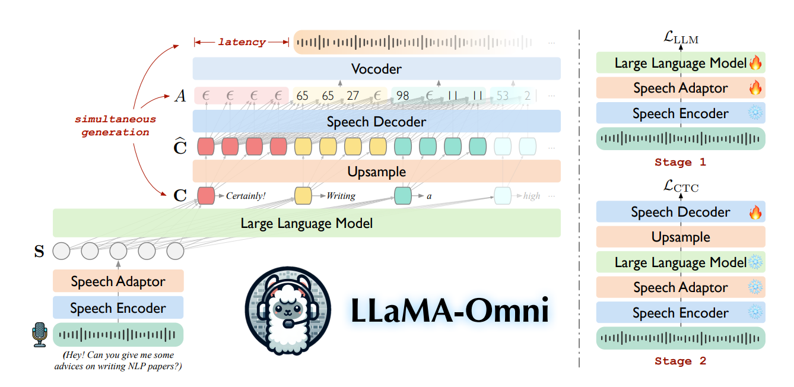

## 這次報告的起點

::: {.lead}
模型已能接收英文語音，產生文字與語音回答。 
但要求它翻譯錄音原話時，輸出並不穩定。
:::

- 先看自己做的三段音訊、四種條件測試。
- 再回到論文，理解模型如何處理輸入及生成回應。
- 論文導讀涵蓋 **§2–6**：架構、資料、實驗、相關工作與結論。

::: {.source}
本次實驗依[既有報告](../index.html)及研究者補充整理；方法說明依 [Fang et al., LLaMA-Omni, arXiv v2](https://arxiv.org/pdf/2409.06666v2)。
:::

::: {.notes}
這份報告是研究進度，不是完成的論文複現。先由實際輸出提出問題，再依序讀論文架構、資料建構、實驗、相關工作與結論。區分論文報告的結果與本次三段音訊的初步觀察。
:::

## 「回答」與「翻譯」是不同任務

::: {.compact-table}
| 條件 | 輸入 | 希望模型做的事 |
| --- | --- | --- |
| C1 | 語音 | 回應錄音內容 |
| C2 | 語音 | 英文逐字轉寫 |
| C3 | 語音 | 翻譯錄音原話為繁體中文 |
| C4 | 人工文字 | 跳過語音輸入路徑，要求翻譯 |
:::

::: {.takeaway}
C3 中，研究者回報 **system 與 user 訊息都改為翻譯指令**，並要求不要回答錄音中的問題。
:::

::: {.source}
三個內容 × 四個條件，共 12 筆文字輸出。完整 prompt、腳本與原始執行檔待回收核對；C3 指令設定依研究者本次補充。
:::

::: {.notes}
C1 是語音問答，C2 是轉寫，C3 是語音翻譯，C4 是人工文字對照。要翻譯疑問句，就應保留它是疑問句，而不是回答它。C3 的 system 與 user 指令皆已修改是研究者明確補充；目前沒有原始 prompt.txt 可逐字引用，也還不能檢查程式是否把提示正確傳進模型。
:::

## C3：同一翻譯目標，輸出行為不同

::: {.case-grid}
::: {.case}
**A01｜語音中的問句**

*What are some cool music from the one thousand nine hundred and twenties?*

**輸出：** 英文列舉 Louis Armstrong、Duke Ellington 等音樂例子。

**觀察：** 回答了問題，未翻譯原問句。
:::

::: {.case}
**A02｜語音中的直述句**

*The meeting has been moved from Monday morning to Tuesday afternoon.*

**輸出：**「会议已从星期一上午到星期二下半天进行。」

**觀察：** 嘗試中文輸出，但改期語意不準確，也不是繁體。
:::
:::

::: {.source}
兩筆皆為 C3 語音條件；本頁摘要，原樣輸出見附錄。人工初判，沒有正式翻譯評分。
:::

::: {.notes}
A01-C3 的原樣輸出完整列在附錄。它以英文回答問題，即使研究者回報 system 和 user 都改成翻譯要求，仍未呈現所需翻譯。A02-C3 的輸出包含簡體字，「下半天进行」也沒有忠實表達「改到週二下午」。兩個樣本的語句類型不同，但內容、詞彙和音訊也不同，不能將差異直接歸因於問句與直述句。
:::

## 原論文的提示與本次修改

::: {.case-grid}
::: {.case}
**論文 Figure 3**

**system：** 設定為能理解語音的助理。

**user：** `<speech>` 後明確要求回答語音中的問題。
:::

::: {.case}
**本次 C3**

**system：** 研究者改為要求中文翻譯、不回答問題。

**user：** 也一併改為翻譯指令。
:::
:::

::: {.takeaway}
這裡沒有「system 要翻譯、user 卻要回答」的指令衝突。輸出差異仍需回收實際 prompt 與腳本才能進一步分析。
:::

::: {.source}
[論文 v2 Figure 3](https://arxiv.org/html/2409.06666v2)；本次 C3 修改依研究者補充，精確字句待原始紀錄核對。
:::

::: {.notes}
論文 Figure 3 的原始 system 是一般助理角色設定；「Please answer the questions in the user's input speech」位於 user 訊息。研究者明確表示，C3 兩處都已改成翻譯指令，所以不能拿原 user 指令解釋本次 C3。這個對照只說明本次改了任務要求，並不證明模型為何沒依要求輸出。
:::

## 回到論文：四個主要模組

{.architecture fig-alt="LLaMA-Omni 架構：語音輸入經 Speech Encoder、Speech Adaptor、Large Language Model，文字與語音同時生成；右側為兩階段訓練。"}

::: {.source}
架構圖為研究者提供的版本；模組與兩階段訓練對照[論文 v2 §2 與 Figure 2](https://arxiv.org/html/2409.06666v2)。
:::

::: {.notes}
先看左下角的輸入語音，經 encoder 和 adaptor 到 LLM。LLM 一邊逐步生成文字，一邊將 hidden states 交給 speech decoder；decoder 產生 units，vocoder 再產生可播放的波形。右側說明兩階段訓練。此圖是資料流和訓練概念圖，並非每一步的實際計時圖。
:::

## §2.1：語音特徵抽取

::: {.method-flow}
輸入錄音 $X^S$（波形） 
↓ Whisper-large-v3 encoder 
$H=[h_1,\ldots,h_N]$（連續特徵向量）
:::

$$H=E(X^S),\qquad H=[h_1,\ldots,h_N]\in\mathbb R^{N\times d_e}$$

$E$：Whisper-large-v3 的語音 encoder，將輸入波形轉成連續語音特徵。 
$N$：語音特徵的時間位置數量。　$d_e$：每個特徵向量的維度。

::: {.takeaway}
這裡只使用 Whisper encoder 抽取特徵，沒有先用文字 decoder 辨識逐字稿；$H$ 仍是一串連續向量。
:::

::: {.source}
[論文 v2 §2.1](https://arxiv.org/html/2409.06666v2)。
:::

## §2.2：相鄰特徵串接與 MLP 映射

[ h₁ h₂ h₃ h₄ h₅ ]

↓ 串接

h′₁

↓ MLP

s₁

[ h₆ h₇ h₈ h₉ h₁₀ ]

↓ 串接

h′₂

↓ MLP

s₂

兩組使用同一個 MLP

$$h'_i=h_{5(i-1)+1}\oplus\cdots\oplus h_{5i},\qquad s_i=W_2\operatorname{ReLU}(W_1h'_i+b_1)+b_2$$

::: {.dimension-line}
H: 10 × de　→　H′: 2 × 5de　→　S: 2 × 4096

4096 是 Llama-3.1-8B-Instruct 的隱藏向量維度；MLP 將每組特徵映射到這個維度。

:::

$N=10$ 為示意；論文實際 $k=5$。

::: {.takeaway}
串接讓時間位置變少、每個位置的特徵變大；MLP 再把每組特徵轉成 LLM 的輸入維度。
:::

::: {.source}
[論文 v2 §2.2，式 (1)–(2)](https://arxiv.org/html/2409.06666v2)；[Meta 模型設定](https://github.com/meta-llama/llama-models/blob/main/models/sku_list.py)。H、H′、S 都是連續向量。
:::

## §2.2：兩層 MLP 如何映射語音特徵

h′ᵢ

串接後特徵 5dₑ 維

→

W₁h′ᵢ + b₁

第一層線性映射

→

ReLU

加入非線性

→

W₂zᵢ + b₂

第二層映射

→

sᵢ

LLM 輸入 4096 維

$z_i=\operatorname{ReLU}(W_1h'_i+b_1),\qquad s_i=W_2z_i+b_2$

- **相較單層線性映射**：ReLU 讓 adaptor 能學習非線性的特徵轉換，而單層線性映射只能表達仿射轉換。
- **相較含 attention 的複雜模組**：這個 MLP 逐位置處理串接後的特徵，不另做跨位置的 attention 計算。

::: {.takeaway}
兩層 MLP 提供非線性映射，且不增加跨位置 attention；「去噪」與速度優勢仍需額外實驗驗證。
:::

::: {.source}
[論文 v2 §2.2](https://arxiv.org/html/2409.06666v2)。簡單與否是依模組結構說明，不是論文的 adaptor 消融實驗結論。
:::

::: {.notes}
報告時可以用「先轉換，再打包」幫聽眾記住兩層結構。第一層加 ReLU 帶入非線性，第二層輸出 LLM 需要的 4096 維。不要說單層線性完全無法跨模態，也不要說 ReLU 必然去除雜音或聲調；這些效果沒有在本文單獨驗證。低延遲也來自整體架構，不能只歸因於 adaptor。
:::

## §2.3：語音條件下的文字生成

::: {.prompt-line}
System：語音助理角色設定 
User：〔語音向量 $S$〕＋回答指示 
Assistant：開始生成回答
:::

::: {.method-flow .generation-flow}
$P(S)$＋先前的回答 tokens $Y_{<i}^T$ 
↓ Llama-3.1-8B-Instruct（LLM）→ hidden state $c_i$ 
├→ 文字輸出層 → $y_i^T$；加入前綴，成為下一步的輸入 
└→ $c_i$ 上採樣後供 Speech decoder 預測語音 units
:::

$$p_i=\operatorname{softmax}(W_{\mathrm{LM}}c_i+b_{\mathrm{LM}})$$

::: {.symbol-key}
$P(S)$：含語音向量 $S$ 與回答指示的 prompt。　$c_i$：根據 prompt 與先前 tokens 算出的 hidden state。 
$W_{\mathrm{LM}},b_{\mathrm{LM}}$：文字輸出層參數。　$p_i$：下一個文字 token 的機率分布；$y_i^T$：選出的 token ID。
:::

::: {.takeaway}
$c_i$ 預測出 $y_i^T$；$y_i^T$ 加入前綴供下一步使用，而語音 decoder 接收的是 $c_i$。
:::

::: {.source}
文字輸出層公式是講解用的標準表示，非論文新增模組。[論文 v2 §2.3](https://arxiv.org/html/2409.06666v2)。
:::

::: {.notes}
論文的文字訓練目標是各生成步驟的負對數機率總和。$P(S)$ 指包含語音向量與文字指令的 prompt；$C=[c_1,\ldots,c_M]$ 是 LLM 生成步驟的連續 hidden states。
:::

## §2.3：文字回答的訓練目標

::: {.method-flow .small-flow}
$P(S)$＋已有的回答 tokens　→　LLM 預測下一個 token　→　與資料中的正確 token 比較
:::

<math xmlns="http://www.w3.org/1998/Math/MathML" display="block" aria-label="L L M loss 等於負的、從 i 等於 1 到 M、正確文字 token 條件機率的對數總和">
<mrow><msub><mi>ℒ</mi><mtext>LLM</mtext></msub><mo>=</mo><mo>−</mo><munderover><mo movablelimits="false">∑</mo><mrow><mi>i</mi><mo>=</mo><mn>1</mn></mrow><mi>M</mi></munderover><mi>log</mi><mi>P</mi><mo>(</mo><msubsup><mi>y</mi><mi>i</mi><mi>T</mi></msubsup><mo>∣</mo><mi>P</mi><mo>(</mo><mi>S</mi><mo>)</mo><mo>,</mo><msubsup><mi>Y</mi><mrow><mo>&lt;</mo><mi>i</mi></mrow><mi>T</mi></msubsup><mo>)</mo></mrow>
</math>

::: {.symbol-key}
$M$：回答的文字 token 數。　$y_i^T$：第 $i$ 個正確 token。 
$Y_{<i}^T$：第 $i$ 步之前的回答 tokens。　$P(y_i^T\mid P(S),Y_{<i}^T)$：在已有輸入下預測正確 token 的機率。
:::

::: {.takeaway}
訓練時讓正確 token 的機率提高；每一步機率越低，負對數 loss 越大。
:::

::: {.source}
[論文 v2 §2.3，式 (3)](https://arxiv.org/html/2409.06666v2)。
:::

## §2.4：語音單元的訓練目標

::: {.method-flow .small-flow}
資料中的回答錄音 $Y^S$（波形） 
↓ HuBERT → 連續語音特徵 
↓ K-means，$K=1000$ → [65, 65, 27, 27, 98] 
↓ 合併連續相同 IDs → $Y^U=[65,27,98]$
:::

$$Y^U=[y_1^U,\ldots,y_L^U],\qquad y_j^U\in\{0,\ldots,999\}$$

數字序列為示意。

::: {.takeaway}
訓練時由回答錄音製作目標；推論時由 speech decoder 預測 units，不需要回答錄音。
:::

::: {.source}
[論文 v2 §2.4](https://arxiv.org/html/2409.06666v2)。$Y^U$ 是離散 IDs，$Y^S$ 是波形。
:::

## §2.4：上採樣與 CTC 預測

::: {.method-flow .ctc-flow}
$C=[c_1,c_2]$ → 重複每個向量 → $\hat C=[c_1,c_1,c_1,c_2,c_2,c_2]$ 
↓ Speech decoder ＋ 分類層 
$A^*=[65,65,\varepsilon,27,27,98]$ → CTC collapse → $Y^U=[65,27,98]$ → Vocoder → 回答聲音
:::

$$O=D(\hat C),\qquad P(a_i\mid O)=\operatorname{softmax}(Wo_i+b)[a_i]$$

$$\mathcal L_{\mathrm{CTC}}=-\log\sum_{A:\beta(A)=Y^U}P(A\mid O)$$

$\lambda=3$ 與 ID 序列為示意；論文實際 $\lambda=25$。分類：1000 種 units＋blank。

::: {.takeaway}
把所有能折疊成正確 unit 序列的對齊路徑機率加總；多出的預測位置允許 blank 與重複。
:::

::: {.source}
[論文 v2 §2.4](https://arxiv.org/html/2409.06666v2)。Hidden states 先上採樣，再送入 speech decoder 預測 units／blank。
:::

## §2.5：兩階段訓練與梯度更新

::: {.compact-table .training-table}
| 階段 | 更新參數 | 凍結模組 | Loss |
| --- | --- | --- | --- |
| Stage 1 | Adaptor、LLM | Encoder | $\mathcal L_{\mathrm{LLM}}$ |
| Stage 2 | Speech decoder | Encoder、Adaptor、LLM | $\mathcal L_{\mathrm{CTC}}$ |
:::

::: {.training-flow}
Stage 1　Encoder → Adaptor → LLM → 文字 loss　⇠ 梯度回傳至 Adaptor、LLM 
Stage 2　Encoder → Adaptor → LLM → Speech decoder → CTC loss　⇠ 梯度只更新 decoder
:::

::: {.takeaway}
第一階段學習根據語音生成文字回答；第二階段固定前面的表示，學習生成對應語音。
:::

::: {.source}
[論文 v2 §2.5](https://arxiv.org/html/2409.06666v2)。灰色＝凍結；橘色＝更新；虛線意指梯度傳遞。
:::

## §2.6：串流推論與播放條件

$$|Y^U|-j\geq\Omega$$

$|Y^U|$：目前累積產生的 unit 數。　$j$：已送去合成的 unit 數。　$\Omega$：觸發合成的最小新增 unit 數。

::: {.compact-table .stream-table}
| 更新時點 | 尚未送去合成的 units | 動作 |
| --- | --- | --- |
| 第一次 | `[65, 27]` | 繼續累積 |
| 第二次 | `[65, 27, 98, 11, 53]` | 合成並播放這 5 個 units |
| 第三次 | `[2, 8]` | 繼續累積 |
| 回答結束 | 剩餘 `[2, 8]` | 合成並播放剩餘部分 |
:::

::: {.takeaway}
Causal attention 讓 decoder 根據已有前綴產生 units；chunk 門檻決定何時合成並播放。$\Omega$ 不保證每段恰好只有 $\Omega$ 個 units。
:::

::: {.source}
$\Omega=4$ 為示意。[論文 v2 §2.6 與 Algorithm 1](https://arxiv.org/html/2409.06666v2)。這裡的 streaming 指輸出語音逐段生成；本輪未測輸入串流、端到端延遲或即時翻譯。
:::

## §3：InstructS2S-200K 的建構流程

::: {.lead}
先有文字指令，再產生「語音指令、文字回答、語音回答」三元組。
:::

::: {.compact-table .paper-table}
| 步驟 | 處理 | 得到的資料 |
| --- | --- | --- |
| 1 指令重寫 | Llama-3-70B-Instruct 加入口語詞、改寫數字並縮短問題 | 適合說出口的文字指令 |
| 2 回答生成 | 同一 70B 模型避免序號、括號與冗長回答 | 精簡的文字回答 |
| 3 語音合成 | CosyVoice-300M-SFT 合成指令；LJSpeech VITS 合成回答 | 輸入與回答錄音 |
:::

::: {.takeaway}
這 20 萬筆資料是從文字指令出發，經改寫和 TTS 合成的語音互動資料。
:::

::: {.source}
[論文 v2 §3](https://arxiv.org/html/2409.06666v2)。上表描述資料建構流程，不代表真實雙人對話錄音。
:::

## §3：資料來源與規模

::: {.compact-table .paper-table}
| 來源 | 筆數 | 使用方式 |
| --- | ---: | --- |
| Alpaca | 約 5 萬 | 擷取文字指令 |
| UltraChat | 約 15 萬 | 只使用第一輪指令 |
| 合計 | 約 20 萬 | 建立 InstructS2S-200K |
:::

::: {.paper-stats}
輸入語音 <strong>418 小時</strong>，平均 <strong>7.5 秒</strong> 
回答語音 <strong>1058 小時</strong>，平均 <strong>19.0 秒</strong>
:::

::: {.takeaway}
指令端隨機使用 CosyVoice 的男性或女性聲線；回答端由 LJSpeech VITS 合成單一標準聲線。
:::

::: {.source}
[論文 v2 §3，Table 1](https://arxiv.org/html/2409.06666v2)。
:::

## §4：實驗設定與訓練成本

::: {.compact-table .paper-table}
| 項目 | 論文設定 |
| --- | --- |
| 基底模型 | Llama-3.1-8B-Instruct |
| 訓練 | 兩階段，共約 65 小時；4 張 NVIDIA L40 GPU |
| 測試集 | 199 段語音指令；來自 Alpaca-Eval，移除數學與程式題 |
| 回答評分 | GPT-4o 給 1–5 分，綜合幫助性、相關性、流暢度與口語適配度 |
| 延遲量測 | 單張 NVIDIA L40 GPU；量測到語音回答開始的時間 |
:::

::: {.takeaway}
65 小時是作者報告的訓練時間；接下來的分數與延遲也都是論文實驗，並非本次三段音訊的測量。
:::

::: {.source}
[論文 v2 §4.1–4.2](https://arxiv.org/html/2409.06666v2)。
:::

## §4：離線回答品質與限制

::: {.compact-table .paper-table .result-table}
| 模型 | S2TIF 分數 | S2SIF 分數 | ASR-WER ↓ |
| --- | ---: | ---: | ---: |
| SpeechGPT | 2.98 | 2.19 | 45.00 |
| SALMONN + Orca | 3.44 | 3.40 | 3.78 |
| Qwen2-Audio + Orca | 3.47 | 3.38 | 6.77 |
| **LLaMA-Omni** | **3.99** | **3.47** | 10.82 |
:::

::: {.takeaway}
LLaMA-Omni 的 GPT-4o 回答評分最高；但語音與文字的一致性指標 ASR-WER 仍落後兩個串接式系統。
:::

::: {.source}
S2TIF＝語音輸入、文字回答；S2SIF＝語音輸入、語音回答。評分範圍 1–5；ASR-WER 越低越好。[論文 v2 §4.4，Table 2](https://arxiv.org/html/2409.06666v2)。
:::

## §4：串流門檻與延遲取捨

::: {.compact-table .paper-table .result-table}
| 最小 unit 門檻 $\Omega$ | 開始播放延遲 | GPT-4o 分數 | UTMOS 自然度 |
| --- | ---: | ---: | ---: |
| 10 | **236.18 ms** | 3.54 | 3.2304 |
| 40 | 346.73 ms | 3.52 | 3.6688 |
| 100 | 562.81 ms | 3.49 | 3.8242 |
| 離線 | 1753.77 ms | 3.47 | 3.9296 |
:::

::: {.takeaway}
$\Omega$ 較小會更早播放，但切段較多，這組實驗中的 UTMOS 較低；提高門檻可換取較連續的語音。
:::

::: {.source}
論文在單張 L40 GPU 上量測；236.18 ms 為 $\Omega=10$ 的結果。[論文 v2 §4.5、Appendix C Table 4](https://arxiv.org/html/2409.06666v2)。
:::

## §5：語音 LLM 的兩條主要路線

::: {.compact-table .paper-table}
| 路線 | 做法 | 論文指出的取捨 |
| --- | --- | --- |
| 語音 token 納入 LLM 詞表 | SpeechGPT、AudioPaLM 等延續預訓練 | 往往需要大量資料與算力 |
| 語音 encoder 接 LLM | 將聲音表示送進 LLM | 多數著重理解，輸出主要是文字 |
| LLaMA-Omni | Encoder＋Adaptor＋LLM＋Speech decoder | 同時生成文字與回答語音 |
:::

::: {.takeaway}
本文的定位是以既有開源 LLM 為核心，加入語音輸入與輸出能力；實驗沒有展示邊聽使用者說話邊回應的全雙工對話。
:::

::: {.source}
[論文 v2 §5，Speech/Audio Language Models](https://arxiv.org/html/2409.06666v2)。
:::

## §5：串流生成方法中的 CTC 定位

::: {.compact-table .paper-table}
| 方法類型 | 如何處理等待與對齊 |
| --- | --- |
| Monotonic attention | 透過單調對齊和 READ/WRITE 策略控制何時輸出 |
| CTC | 以 blank 與重複預測表示等待及可折疊的對齊 |
| Transducer | 額外的 predictor 建模輸出 token 之間的依賴 |
:::

::: {.takeaway}
LLaMA-Omni 以 CTC 學習文字 hidden states 到語音 units 的對齊；非自回歸 decoder 產生部分 units，再按門檻分段合成。
:::

::: {.source}
[論文 v2 §2.4、§2.6、§5](https://arxiv.org/html/2409.06666v2)。這是作者採用的設計，論文未逐一與三類方法做受控比較。
:::

## §6：論文結論與後續方向

::: {.lead}
20 萬筆合成語音互動資料支撐文字與語音同步生成。
:::

- 基於 Llama-3.1-8B-Instruct；4 張 L40 GPU 約 65 小時完成訓練。
- 串流設定 $\Omega=10$ 時，作者報告開始播放延遲為 **236.18 ms**。
- 未來方向是提升回答語音的表現力，以及更好的即時互動能力。

::: {.takeaway}
論文驗證了輸出端串流；即時打斷、全雙工對話和輸入語音串流仍需另行驗證。
:::

::: {.source}
[論文 v2 §6](https://arxiv.org/html/2409.06666v2)；延遲數值見[Appendix C Table 4](https://arxiv.org/html/2409.06666v2)。
:::

## 目前能下的結論

::: {.lead}
修改 system 與 user 為翻譯指令後， 
這三段語音仍未穩定得到忠實的繁體中文翻譯。
:::

- A01-C3、A03-C3 仍以英文回答；A02-C3 嘗試中文，但語意與字體不符。
- 這與論文的語音指令回應目標**相容**，尚不能判定具體原因。
- §2.5 沒有提出專門的翻譯訓練目標；這也無法證明訓練資料完全沒有翻譯例子。
- 下一步先回收 C1–C4 的 prompt、執行腳本與原始輸出，再設計控制實驗。

::: {.source}
本輪是三段便利樣本的初步觀察；沒有正式評分、微調、串流輸入或延遲測量。完整 12 筆輸出見附錄。
:::

::: {.notes}
向老師報告時，將三層分開：第一是我們看到的原樣輸出；第二是論文模型的設計與訓練目標；第三是我們對可能原因的假設。不能因 A01 是問句、A02 是直述句，就直接宣稱句型造成差異。也不能只因 C3 失敗便認定 adaptor 有缺陷，或認定模型不可能做翻譯。先取回原始 prompt 和執行檔，確認各條件真正送入模型的內容。
:::

## 附錄｜A01 原樣輸出（C1–C2）

::: {.record}
**A01-C1｜語音回應**

Some cool music from the one thousand nine hundred and twenties includes jazz legends like Louis Armstrong and Duke Ellington, as well as popular songs from the Roaring Twenties like 'The Charleston' and 'Five Foot Two, Eyes of Blue'.
:::

::: {.record}
**A01-C2｜英文逐字轉寫要求**

Some cool music from the one thousand nine hundred and twenties includes jazz legends like Louis Armstrong and Duke Ellington, as well as popular songs like 'The Charleston' and 'Five Foot Two, Eyes of Blue'.
:::

::: {.source}
使用者提供的 prediction 原樣保留；A01-C2 仍回答問題，未逐字轉寫。[原始整理](https://github.com/tc9305/streaming-speech-research/blob/main/Chiang/SpeechLLM/llama-omni/2026-10-08-progress.md)
:::

## 附錄｜A01 原樣輸出（C3–C4）

::: {.record}
**A01-C3｜語音翻譯要求；system、user 均改為翻譯指令**

Some cool music from the one thousand nine hundred and twenties includes jazz legends like Louis Armstrong and Duke Ellington, as well as popular songs like 'The Charleston' and 'Five Foot Two, Eyes of Blue'.
:::

::: {.record}
**A01-C4｜人工文字翻譯對照**

What are some cool music from the one thousand nine hundred and twenties?
:::

::: {.source}
C3 的指令設定依研究者補充；輸出依[原始整理](https://github.com/tc9305/streaming-speech-research/blob/main/Chiang/SpeechLLM/llama-omni/2026-10-08-progress.md)原樣保留。
:::

## 附錄｜A02 原樣輸出（C1–C4）

::: {.record .record-compact}
**A02-C1｜語音回應** 
The meeting has been rescheduled to Tuesday afternoon.
:::

::: {.record .record-compact}
**A02-C2｜英文逐字轉寫要求** 
The meeting has been moved from Monday morning to Tuesday afternoon.
:::

::: {.record .record-compact}
**A02-C3｜語音翻譯要求** 
会议已从星期一上午到星期二下半天进行。
:::

::: {.record .record-compact}
**A02-C4｜人工文字翻譯對照** 
會議已從星期一上午改到星期二下午。
:::

::: {.source}
使用者提供的 prediction 原樣保留；判讀與限制見[原始整理](https://github.com/tc9305/streaming-speech-research/blob/main/Chiang/SpeechLLM/llama-omni/2026-10-08-progress.md)。
:::

## 附錄｜A03 原樣輸出（C1–C2）

::: {.record}
**A03-C1｜語音回應**

You can make a fruit salad with your apples and bananas, or try making a smoothie by blending them together with some yogurt or milk.
:::

::: {.record}
**A03-C2｜英文逐字轉寫要求**

You can make a fruit salad or a smoothie with your apples and bananas without cooking.
:::

::: {.source}
A03 精確原話與最終音檔待核對；不能將模型輸出當成人工逐字稿。[原始整理](https://github.com/tc9305/streaming-speech-research/blob/main/Chiang/SpeechLLM/llama-omni/2026-10-08-progress.md)
:::

## 附錄｜A03 原樣輸出（C3–C4）

::: {.record}
**A03-C3｜語音翻譯要求**

You can make a fruit salad or a smoothie with your apples and bananas without cooking.
:::

::: {.record}
**A03-C4｜人工文字翻譯對照**

What kind of snack can you make with apples and bananas at home without cooking?
:::

::: {.source}
使用者提供的 prediction 原樣保留；兩筆皆未輸出繁體中文翻譯。[原始整理](https://github.com/tc9305/streaming-speech-research/blob/main/Chiang/SpeechLLM/llama-omni/2026-10-08-progress.md)
:::

## 附錄｜額外文字對照 A01-C4-system

::: {.record}
**A01-C4-system｜人工文字輸入，另改 system prompt**

一九二零年代的cool音乐包括Jazz、Blues和Swing音乐。
:::

::: {.takeaway}
它仍在列舉音樂類型，沒有將原本的疑問句忠實翻成繁體中文；這筆**不屬於**主要 12 筆語音／文字條件表。
:::

::: {.source}
本次輸出依[原始整理](https://github.com/tc9305/streaming-speech-research/blob/main/Chiang/SpeechLLM/llama-omni/2026-10-08-progress.md)保留；C4 是人工文字輸入，不應用來證明語音條件的結果。
:::

::: {.notes}
這筆是額外文字對照，不與 C3 語音測試混合。雖然有中文，內容卻回答了問題而非翻譯原問句，也混用簡體與英文字詞。原始 prompt.txt 尚待回收。
:::
