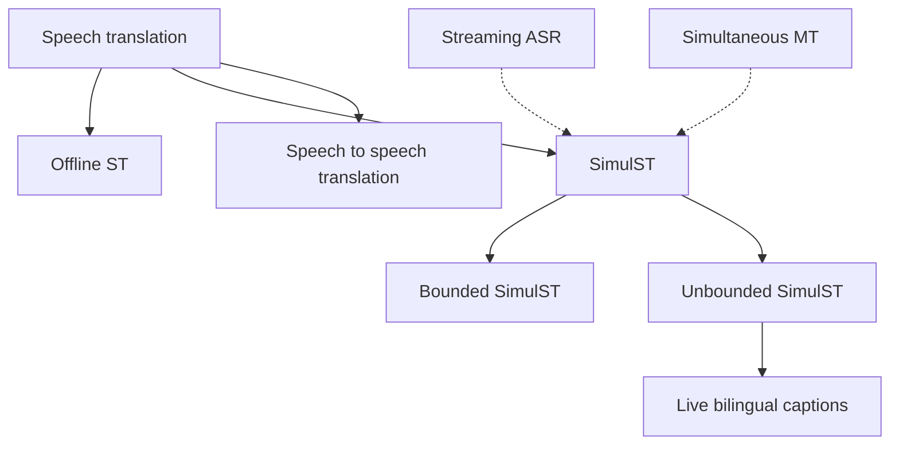
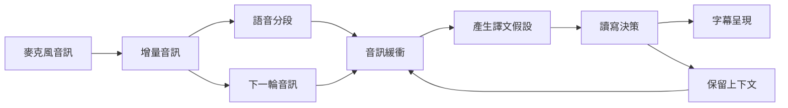
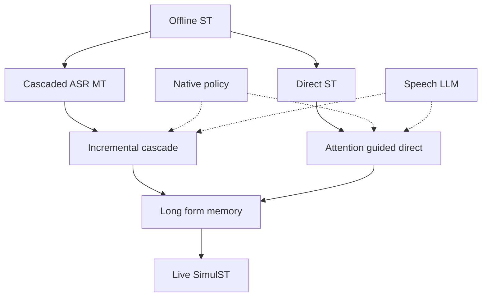
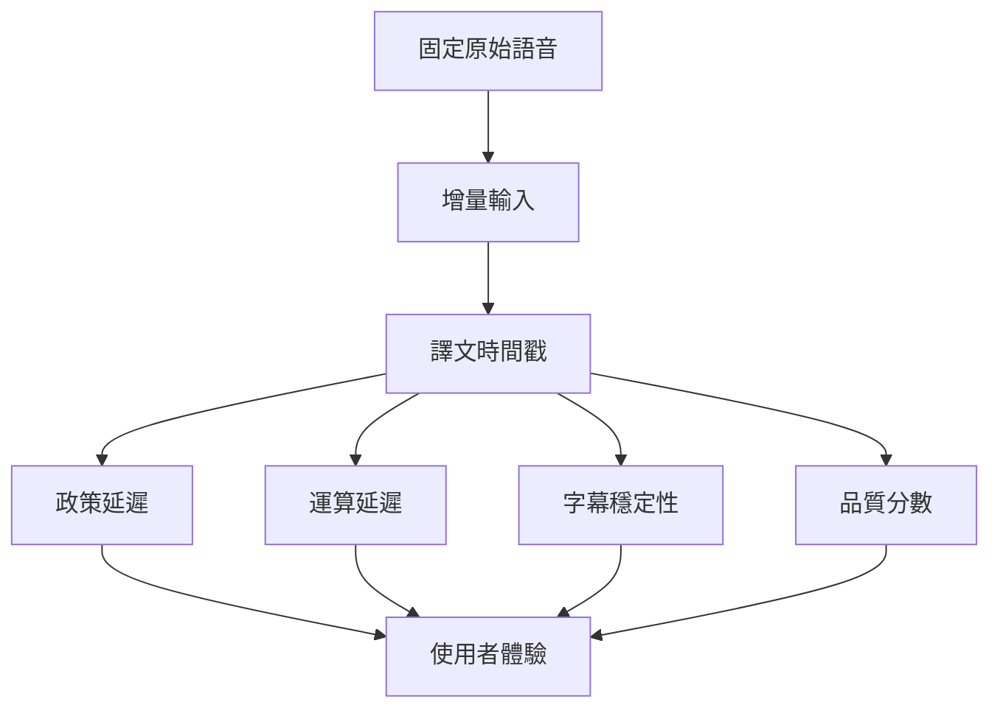

# Simultaneous Speech-to-Text Translation 深度研究報告

> **範圍**：會議即時口譯字幕、EMI 課程即時雙語字幕；以英文原始文獻為主。  
> **研究基準日**：2026-10-10。本文的「近三年」指 2023-10-10 至 2026-10-10；「近四年」指 2022-10-10 至 2026-10-10。  
> **定位**：建立研究全貌，不進行特定選題、工期、人力或硬體可行性篩選。  
> **證據標籤**：【共識】有多篇原始研究、survey 或獨立系統文獻支持；【單篇】來源限於特定論文或該主辦方報告；【推論】由已確認文獻推導，非文獻已驗證結果。相同標籤只覆蓋緊接的該項敘述。  
> **閱讀提醒**：本文「SOTA」是指定測試集、語向、品質指標、延遲區間與條件下的**條件性領先系統**，不是無條件世界第一。文中的 `[Pxx]` 連到末尾「已開啟原文」表，並非僅從搜尋結果臆測。

---

## §1　問題定義與概念邊界

### 1.1　情境如何對應到文獻名稱

| 使用者情境 | 形式化任務 | 對應原因與界線 | 證據 |
|---|---|---|---|
| 一位講者使用中文發言，英文字幕同步出現 | **Simultaneous Speech-to-Text Translation，SimulST** | 輸入源語音訊仍持續到達，系統必須邊聽邊決定何時送出目標語文字，不可等待整段結束 | 【共識】[P01][P02] |
| 英語授課，學生看繁體中文字幕 | **SimulST + Live Translation Subtitling** | 除了翻譯，還有分行、文字凍結、重排、顯示時機、術語正確性與可讀性限制 | 【共識】[P02][P19]；【推論】繁中與 EMI 為場域特化 |
| 不事先切好的整場會議、整堂課 | **Long-form / Unbounded SimulST**，部分論文寫 **Streaming Speech Translation，StreamST** | 需在線偵測語意邊界、管理上下文與記憶，不可假設已有人工標記的句子段落 | 【共識】[P02][P04][P05] |
| 多人互動、同時呈現原文與譯文 | **Multispeaker SimulST + Bilingual Captioning** | 講者辨識、說話重疊、原文與譯文時間對齊是額外子問題；「雙語字幕」本身不是另一種翻譯模型 | 【推論】結合 SimulST 與 live subtitling 需求 |

**採用名稱**：【推論】後續以 **Long-form Simultaneous Speech-to-Text Translation for Live Bilingual Captioning** 描述應用總目標；檢索核心詞固定為 **SimulST**，同時以 *streaming speech translation*, *unbounded speech translation*, *online speech translation*, *live subtitling* 擴大召回。不要把「Streaming ASR」直接當作「SimulST」。

**術語分歧要保留**：【單篇】StreamAtt [P04] 將 SimulST 與 StreamST 作較窄的區分；【單篇】TACL 綜述 [P02] 則將 bounded / unbounded、direct / cascaded、incremental / retranslation 視為 SimulST 的彼此獨立維度。因此，本報告統一採 [P02] 的上位定義；引用其他論文時保留作者原詞，避免錯誤宣稱學界已有統一命名。

### 1.2　為何比離線翻譯難

**例子**：老師說「The treatment did not work because ...」。若立刻譯成「這個治療沒有用」，後面可能接「the sample size was too small」；如果等待更多上下文，句子更準，但字幕已落後。中文與英文語序差異還會讓目標語所需資訊晚到。【共識】[P01][P02]

主要困難是相互牽制，不可拆成一個純粹模型準確率問題：

- **品質與延遲拉鋸**：【共識】等待更多來源內容通常更好翻譯，卻讓觀眾晚看到字；過早承諾易造成語意錯誤。[P01][P02][P21]
- **分段與邊界未知**：【共識】VAD 只知道聲學活動，停頓不必然是完整語意；使用人工切好的語音測試會低估實際難度。[P02][P04]
- **無限流與 buffer 管理**：【共識】重跑整個音訊或永久保留 KV cache 不可無限延伸；裁切歷史又可能造成代名詞、主題與術語失憶。[P02][P04][P07]
- **字幕既要快又要穩定**：【共識】輸出修正太多讓讀者視線反覆移動，完全禁止修正又使早期錯誤無法回復。[P02][P19]
- **資料與評估落差**：【共識】平行語音與譯文資料昂貴，通用語料偏向短句、演講；測試延遲若不計算運算與呈現，就不等於現場延遲。[P01][P02][P15]

### 1.3　概念邊界圖

**節點**：Speech translation、Offline ST、SimulST、Bounded SimulST、Unbounded SimulST、Live bilingual captions、Speech to speech translation、Streaming ASR、Simultaneous MT。**邊**：Speech translation 通往 Offline ST、SimulST、Speech to speech translation；SimulST 通往 bounded、unbounded 及字幕；Streaming ASR 與 Simultaneous MT 分別向 SimulST 提供模組技術。

【共識】ASR 將語音轉為**同語言**文字；MT 將來源**文字**翻成目標文字；S2TT 或 ST 將**語音**翻成異語文字；S2ST 則輸出另一語言**語音**。[P02][P20] **Streaming** 描述連續輸入的處理形態；**Simultaneous** 進一步要求輸出與輸入同步進展；**real-time** 應報告可量測延遲，而不是只寫有 streaming API 就算達標。【共識】[P02][P15]

### 1.4　從麥克風到字幕的真正管線

**節點**：麥克風音訊、增量音訊、語音分段、音訊緩衝、產生譯文假設、讀寫決策、保留上下文、字幕呈現、下一輪音訊。**邊**：依序流向處理步驟；讀寫決策更新緩衝、字幕與下一輪。

【共識】這是 [P02] 所強調的 **system-level** 定義。**Chunk** 是傳遞或模型處理的音訊片塊；**segment** 是系統認定的語音或語意單元；**buffer** 是保存尚需重解碼或供上下文使用的資料；**policy** 是決定 READ 等待、WRITE 輸出以及是否修正的規則。Chunk 與 segment 不應混用。【推論】對 EMI 而言，顯示層需獨立評測，不能將翻譯器的 WRITE 時刻直接當作學生真正看見字幕的時刻。

---

## §2　入門文獻骨架與閱讀月計畫

### 2.1　近三年 survey 與 tutorial

| 骨架文獻 | 年份、性質 | 涵蓋 | 主要限制 | 如何使用 |
|---|---|---|---|---|
| [P01] Liu et al., *Recent Advances in End-to-End Simultaneous Speech Translation* | 2024，IJCAI survey track | 串流模型、對齊、分段、增量生成、品質延遲、資料稀缺 | 偏 **direct / E2E** 與傳統 bounded 研究 | 先掌握方法學辭彙 |
| [P02] Papi et al., *How “Real” is Your Real-Time Simultaneous Speech-to-Text Translation System?* | 2025，TACL taxonomy + systematic review | 全管線、bounded/unbounded、direct/cascade、incremental/retranslation、評測陷阱 | 截止於其蒐集日期，不能當作 2026 SOTA | 整份研究**主骨架** |
| [P03] Sethiya & Maurya, *End-to-End Speech-to-Text Translation: A Survey* | 2023 arXiv，2025 journal | 較大的 speech-to-text 翻譯問題、資料與 E2E 概念 | 不是專門 SimulST；原始 arXiv 發布落於近三年內 | 補語音翻譯的前置知識 |

【共識】近三年**找得到正式 survey**，因此無須用「沒有 survey」代替。以 [P02] 的系統分類為總索引，以 [P01] 的技術機制當細分類，再用 [P21] 更新到競賽近況。沒有找到能單靠一篇就涵蓋台灣繁中 EMI 應用、長串流與真實字幕評估的完整 survey；這是本輪檢索的範圍結論，不是學界不存在的證明。【推論】

### 2.2　一個月閱讀順序

| 週次 | 優先閱讀 | 為什麼 | 讀完能回答的檢核題 |
|---|---|---|---|
| 第 1 週 | [P03] → [P01] | ST 架構先於 SimulST 讀寫機制 | 為何 ASR、MT、ST 不同？Wait-k 與 monotonic policy 想解什麼？ |
| 第 2 週 | [P02] → [P04] | 先建立評估邊界，再讀真實 unbounded 機制 | Bounded benchmark 有什麼樂觀偏誤？為何需 trim audio history？ |
| 第 3 週 | [P05] → [P07] → [P10] | 比較離線模型在線化與 cascade 系統 | AlignAtt、local agreement、retranslation 與穩定輸出能否組合？ |
| 第 4 週 | [P16] → [P15] → [P21] → [P17] | 延遲指標、實際競賽、最新 Speech LLM | 為何高 BLEU 未必現場好用？不同語向與時延條件能否公平排名？ |

**自我測驗**：【推論】如果讀完可以畫出從來源 chunk 到最終字幕的路徑，能區分 buffer latency、policy latency、computation-aware latency、display latency，且可以指出 benchmark 有沒有預切句，就已具備讀 SimulST paper 的必要骨架。

---

## §3　技術路線地圖：固定命名、主要方法與演進

以下路線以**主要研究機制**分群，並非互斥：真實系統可同時屬於不同路線。例如 cascade 系統也能具有可學習的讀寫策略與長音訊 memory。後續研究請沿用 **R1–R5** 標籤。【推論】

### R1 — Cascaded Streaming ASR + MT：串流級聯、穩定前綴及重譯

**流程**：音訊 → Streaming ASR → 增量逐字稿 → MT 或文字 LLM → 文字穩定化與字幕。核心不是只接兩個 API，而是處理**ASR 中途修正傳播到翻譯**的問題。

**常見策略**：Local Agreement 比對相鄰重譯的共同前綴；LCP（Longest Common Prefix）只確定一致的字串部分；retranslation 更新暫定字幕，incremental policy 只追加已承諾文字。若過早提交 LCP，仍有語意斷裂；太保守則延遲。代表 [P07] CUNI IWSLT 2025、[P08] MLLP 2025、[P10] NeMo 2026、[P11] MLLP 2026、[P12] Pinch-AST 2026。【共識】

**優點**：可單獨替換 ASR、MT，便於加入專有名詞與診斷錯誤；預訓練模型資源多。**缺點**：ASR 延遲與錯誤向 MT 傳播、雙模型累積運算、文字轉譯無法直接利用部分聲學訊息；CJK 的 word-level LCP 可能失準，需字元層策略。【共識】[P02][P12]

### R2 — Offline-to-Simultaneous Direct ST：直接翻譯模型的串流化

**流程**：音訊 chunks → 預訓練 speech-to-text 翻譯模型 → 受控解碼、attention-based policy → 逐步輸出。**AlignAtt** 利用對齊訊號，當解碼器關注近期尚未穩定音訊，就延後提交；**StreamAtt** 進一步管理 unbounded audio history。對離線模型而言，重點在**推論時政策與音訊視窗**，不一定要從頭訓練串流模型。代表 [P04] ACL 2024、[P05] ACL 2023、[P07] IWSLT 2025、[P13] 2026 測試時改造。【共識】[核對：P05 原文提出的是 EDAtt，並非 AlignAtt，方法引用需修正]

**優點**：可利用直接 ST 的聲學語意聯合表示，省下中間逐字稿；可重用既有權重。**缺點**：對模型 attention 行為依賴高、複雜分段與長音訊退化難治、中文與長課堂的語向及 domain 適配仍須實證。【共識】[P04][P05]；【推論】domain 限制。

### R3 — Native Streaming Policy and Alignment：原生串流模型與可學讀寫決策

**流程**：chunk 或 frame 逐步進入具 causal / restricted-lookahead 的 encoder；模型藉 wait-k、adaptive read/write、monotonic attention、CTC/CIF 對齊或 transducer 類型的策略來決定輸出時機。這些策略可配合 Transformer、Conformer 等架構，且可處理訓練和推論的 latency budget。代表 [P01] 方法整理、[P14] fully unidirectional adaptive 2025、[P18] speech LLM agent 2024、[P21] 競賽內 UW 2026 的 dynamic attention masking。【共識】

**優點**：可直接控制 future-context 依賴，具方法論創新空間；有機會降低頻繁整段重解碼的開銷。**缺點**：需要對齊或特殊訓練設計、可能需要重訓或適應資料、容易在短句的人工 segmentation benchmark 取得不代表現場的結果。【共識】[P01][P02]

### R4 — Speech LLM with Interleaved Audio and Text：以多模態 LLM 內化讀寫政策

**流程**：speech encoder 或音訊 tokens → multimodal LLM → 根據增量音訊與既有目標文字輸出譯文或 WAIT；利用 LoRA、prompt、有限上下文、KV cache、vLLM 等管理推論。並非只要模型能回答「翻譯這段音訊」就自動能 SimulST。代表 [P18] agent 2024、[P09] NAIST 2025、[P13] test-time policy 2026、[P17] CUHKSZ Qwen3-Omni 2026。【共識】

**優點**：語境、術語提示、跨任務共用能力；可將策略與翻譯模型交織。**缺點**：語音 chunks 與自回歸解碼的運算成本、長對話 context 膨脹、WAIT 與說話邊界需要嚴格控制，不保證計算感知低延遲。【共識】[P13][P17][P21]

### R5 — Long-form Memory, Segmentation and Context Control：無界語音與語意記憶控制

**流程**：長時間音訊中進行 endpoint / semantic segment 偵測，維護 audio / transcript / translation buffers，依時間戳及語意單元 trim，保留最近片段、術語、說話者與歷史摘要。研究重點是防止**記憶無限成長、跨段重複、代名詞失憶、破句翻譯**；它可疊加在 R1–R4。代表 [P04] StreamAtt 2024、[P02] taxonomy 2025、[P07] CUNI 2025、[P11] MLLP 2026、[P21] 競賽 Extra Context track。【共識】

**優點**：貼近會議與 EMI 長課；即使模型相同，系統性能也可能大改。**缺點**：邊界錯誤、buffer 與譯文 alignment drift、重複輸出、場域測試與評估成本高。【共識】[P02][P04][P21]

### 3.1　路線比較矩陣

| 路線 | 核心控制點 | 代表原文，近四年 | 常見優勢 | 典型限制 | 與其他路線的關係 |
|---|---|---|---|---|---|
| **R1** Cascaded Streaming ASR + MT | ASR partial、MT incremental、LCP | [P07][P08][P10][P11][P12] | 模組可替換、錯誤可定位、術語注入 | 錯誤傳播與雙重延遲 | 能與 R3 policy、R5 buffer 結合 |
| **R2** Offline-to-Simultaneous Direct ST | Attention-guided emission、視窗 | [P04][P05][P07][P13] | 重用成熟 ST 權重，免中間 ASR | 解碼策略與模型需協調 | 能與 R5 無界串流結合 |
| **R3** Native Streaming Policy and Alignment | Causal encoder、adaptive READ/WRITE | [P01][P14][P18][P21] | 架構上控制 latency | 需訓練對齊及調整政策 | policy 可嫁接 R1/R2/R4 |
| **R4** Speech LLM with Interleaved Audio and Text | Audio token、WAIT、context window | [P09][P13][P17][P18] | 提示知識、複雜語意 | 算力、cache 與輸出控制 | 可走 direct 或 cascaded |
| **R5** Long-form Memory, Segmentation and Context Control | Segmenter、buffer trim、context | [P02][P04][P07][P11] | 真實長串流的關鍵能力 | 對齊漂移、跨段失憶 | 對 R1–R4 均屬橫向能力 |

### 3.2　技術演進樹及交會點

**節點**：Offline ST、Cascaded ASR MT、Direct ST、Incremental cascade、Attention guided direct、Native policy、Speech LLM、Long form memory、Live SimulST。**邊**：離線基礎分化級聯與直接翻譯；兩支各自發展增量或注意力策略；原生 policy 與 Speech LLM 可與既有策略合流；long-form memory 是所有方法通往 live 系統的共同交會點。虛線表示技術嫁接，不代表歷史上被完全取代。

**「取代」不能畫成已確立事實**：【共識】截至研究基準日，級聯架構並未被 direct 或 Speech LLM 淘汰；最新 IWSLT 有級聯、direct 與 LLM 系統共存並形成不同 latency/quality frontier。[P21]【推論】更合理的歷史敘事是「離線模型的重用」「原生串流政策」「LLM 整合」並行，並向 unbounded memory 與評估框架匯合。

---

## §4　評測現況：資料集、指標、條件化 SOTA

### 4.1　資料集及其實際測量範圍

| 名稱 | 性質與常見語向 | 適合測試 | 對 EMI 或會議的缺口 | 來源 |
|---|---|---|---|---|
| **MuST-C / MuST-C v2** | TED talk 的多語平行語音文本，可進行模擬 streaming；不同版本語向須分辨 | ST 翻譯品質、經典方法比較 | 通常由 utterance 整理；不能單獨證明完整長音訊串流能力 | 【共識】[P01][P23] |
| **CoVoST 2** | 多語語音翻譯語料，常用 ST 預訓練與評估 | Multilingual ST 與低資源 | 不以大學課堂與字幕穩定性為主要設計 | 【共識】[P03][P21] |
| **BSTC** | 中文英語同傳相關語料 | 中文語向的 simultaneous method | 來源、目標方向、人工 segmentation 需逐篇確認 | 【單篇】[P01] |
| **ACL Talks / ACL60/60** | 演講與技術報告，含 SimulST unbounded 評測 | 專業術語、長語流、延遲與品質 | 科研演講不完全等同教室師生互動 | 【共識】[P07][P21] |
| **IWSLT 2026 ACL Test** | 原始不預先切句的會議演講長音訊；多語向 | 最新長音訊 benchmark 與競賽方法比較 | 沒有直接證明繁體中文或台灣口音與教室品質 | 【單篇】[P21] |
| **IWSLT 2026 MCIF dev** | 多模態跨語指令資料，其中 SimulST 部分用於 dev | 判定提交系統 latency regime | 開發集成績不等於實際測試集，也非真人實測 | 【單篇】[P21] |
| **IWSLT 2026 Bloomberg、YODAS** | 商業新聞與網路影片，屬 domain shift 的額外測試 | 聲學、話題與輸入分布轉換 | 同場景與硬體外推需再驗證 | 【單篇】[P21] |
| **真實 EMI 自建資料** | 課堂語音、詞彙、雙語字幕與人類感受 | 直接衡量應用效益 | 本輪未確認有可直接公開取得、可代表台灣繁中 EMI 的標準 SimulST benchmark | 【推論】待內部資料確認 |

### 4.2　指標應分層報告

| 層面 | 指標與縮寫 | 意義及陷阱 |
|---|---|---|
| **翻譯品質** | BLEU、chrF、COMET / XCOMET-XL | BLEU 看 n-gram 重合；chrF 看字元重合；COMET 為學習式品質評估。參考答案的斷詞與字形會影響結果；不能把不同年份、不同語向分數直接相加。【共識】[P16][P21] |
| **政策延遲** | AL、AP、DAL、LAAL、StreamLAAL、LongYAAL | 衡量讀寫相對進度；不同定義、不同 segmentation 導致不可直接橫比。LongYAAL 為長串流較新指標。【共識】[P02][P04][P16][P21] |
| **算力延遲** | Computation-aware latency、RTF、TTFT | 必須包括實際模型計算、排隊與序列化；RTF 是處理時間除以音訊時間；TTFT 是首 token 等待。RTF 低仍可能因 buffering 太久使字幕慢。【共識】[P02][P21]；【推論】整體使用者體驗 |
| **字幕品質** | Revision rate、flicker、CPS、CPL、line breaks | 記錄重排幅度、字符每秒、每行長度與顯示停留時間；不是單純 BLEU 可取代的維度。【共識】[P19][P21] |
| **穩定與尾延遲** | p50、p95、p99、burstiness、memory / VRAM peak | 平均值可能隱藏長尾卡頓；需展示時間分布與記憶曲線。長尾 metrics 文獻已有批判。【共識】[P15][P16] |
| **語音階段診斷** | CER / WER、VAD boundary F1 | 它們診斷 ASR 或 segmentation，**不是** ST 翻譯品質分數。【共識】[P02] |

**固定評測條件**：【推論】每筆結果應留下 model ID 與 revision、是否串流原生、source/target locale、音訊 chunk、segmenter、emission policy、buffer 長度、語料切法、推論 GPU、batch、外部資料與蒸餾/合成資料使用情況、是否允許重譯、字幕 rendering latency。沒有上述欄位的 BLEU / RTF 數字不足以宣稱是 live captioning SOTA。

### 4.3　經過原文核對的代表性競賽前緣（非跨情境絕對 SOTA）

主依據為 IWSLT 官方 *Speech Translation and Metrics in 2026* [P21] PDF **Table 34–37**。表格依照你指定的**固定欄位**；下列延遲若無特別標注，為 **non-computation-aware LongYAAL**。官方品質欄位名寫 `COMET`，但內文定義主要模型為 **XCOMET-XL**；因此用 `XCOMET-XL` 解讀。`logs` 表示只提交輸出與時間戳，沒有統一硬體的 compute-aware 比較。以下皆是主辦方發表的評測，而**不是獨立第三方復現**。【單篇】[P21]

| 資料集 | 指標 | 數字 | 來源論文（URL） | 測試條件（模型規模、是否用外部資料或語言模型、streaming 與否等） | 數字來源類型（論文自報、公開排行榜、第三方復現） | 日期 |
|---|---|---|---|---|---|---|
| ACL Test，En→De | BLEU；XCOMET-XL；LongYAAL | **44.94；0.92；2.6 s** | [IWSLT 2026 主辦方，Table 35](https://aclanthology.org/2026.iwslt-1.39.pdf) | **NeMo low**；unsegmented streaming；Parakeet 類 ASR + Qwen 3.5 MT LLM；外部預訓練權重；具體模型大小與完整資料組合以 [P10] 為準；**logs，無統一 CA 值**。low 是以 dev 分組，不等於 ACL test 必須低於門檻 | **公開排行榜**（主辦單位論文表格） | 2026-07 |
| ACL Test，En→De | BLEU；XCOMET-XL；LongYAAL | **45.01；0.93；4.7 s** | [IWSLT 2026 主辦方，Table 35](https://aclanthology.org/2026.iwslt-1.39.pdf) | **NeMo high**；與上列同家族；外部預訓練；streams、logs；不可與 low 當作相同延遲公平比品質 | 公開排行榜（主辦單位論文表格） | 2026-07 |
| ACL Test，En→De | BLEU；XCOMET-XL；LongYAAL | **44.88；0.92；4.5 s** | [IWSLT 2026 主辦方，Table 35](https://aclanthology.org/2026.iwslt-1.39.pdf) | **MLLP-VRAIN-UPV high**；Parakeet + Qwen 3.5 級聯與 SoftLCP；有外部預訓練；串流；非 CA 值，統一硬體 CA 為 **4.9 s** | 公開排行榜（主辦單位論文表格） | 2026-07 |[核對：輸出策略描述有誤，P11 最終採用 ASR LACP + MT LCP，SoftLCP 為比較過的策略]
| ACL Test，En→Zh | BLEU；XCOMET-XL；LongYAAL | **46.31；0.81；4.2 s** | [IWSLT 2026 主辦方，Table 36](https://aclanthology.org/2026.iwslt-1.39.pdf) | **NeMo low**；unsegmented streaming；Parakeet + Qwen 3.5；外部預訓練；logs。**注意 dev-low 在 ACL test 長於 low 界線**；zh 未證實是 zh-TW | 公開排行榜（主辦單位論文表格） | 2026-07 |[核對：模型版本描述有誤，P10 Table 4 列出的是 Qwen3-4B-Instruct-2507；仍需確認是否對應此筆官方提交]
| ACL Test，En→Zh | BLEU；XCOMET-XL；LongYAAL | **47.64；0.83；28.3 s** | [IWSLT 2026 主辦方，Table 36](https://aclanthology.org/2026.iwslt-1.39.pdf) | **NeMo high**；相同任務、外部預訓練、streaming logs。顯示**品質較高但 test 延遲極大**，不能推薦為低延遲第一名 | 公開排行榜（主辦單位論文表格） | 2026-07 |
| ACL Test，En→Zh | BLEU；XCOMET-XL；LongYAAL | **50.03；0.82；4.8 s** | [IWSLT 2026 主辦方，Table 36](https://aclanthology.org/2026.iwslt-1.39.pdf) | **MLLP-VRAIN-UPV high**；級聯 ASR + Qwen 3.5 LLM、SoftLCP；外部預訓練；streaming；統一硬體 CA **5.2 s**。BLEU 較高但 XCOMET 非最高 | 公開排行榜（主辦單位論文表格） | 2026-07 |[核對：輸出策略描述有誤，P11 最終採用 ASR LACP + MT LCP，SoftLCP 為比較過的策略]
| ACL Test，En→Zh | BLEU；XCOMET-XL；LongYAAL | **41.47；0.73；2.1 s** | [IWSLT 2026 主辦方，Table 36](https://aclanthology.org/2026.iwslt-1.39.pdf) | **CUHKSZ low**；Qwen3-Omni-30B-A3B + LoRA、WAIT policy；合成翻譯監督；unsegmented streaming；模型的數字是總架構名稱，非完整硬體效能保證 | 公開排行榜（主辦單位論文表格） | 2026-07 |
| IWSLT 2026 Test，Cs→En | BLEU；XCOMET-XL；LongYAAL | **49.21；0.89；1.9 s** | [IWSLT 2026 主辦方，Table 34](https://aclanthology.org/2026.iwslt-1.39.pdf) | **NeMo low**；級聯、外部預訓練、unsegmented streaming、logs；不同 source language，不得與 En→Zh 比分數 | 公開排行榜（主辦單位論文表格） | 2026-07 |
| ACL Test，En→It | BLEU；XCOMET-XL；LongYAAL | **37.59；0.85；2.6 s** | [IWSLT 2026 主辦方，Table 37](https://aclanthology.org/2026.iwslt-1.39.pdf) | **NeMo low**；級聯、外部預訓練、streaming、logs；不同語向 | 公開排行榜（主辦單位論文表格） | 2026-07 |
| IWSLT 2025 simultaneous En→Zh（官方 test） | BLEU；COMET；StreamLAAL | **43.26；0.773；2.15 s** | [IWSLT 2025 Findings，Table 25](https://aclanthology.org/2025.iwslt-1.44.pdf) | **CMU low**；長串流；官方當年使用 StreamLAAL；**和 2026 LongYAAL 不能直接比數值**；COMET 版本亦不同；模型完整規模請回原 system paper 核實 | 公開排行榜（主辦單位論文表格） | 2025-07 |

**重要限制**：【單篇】2026 的 `low` / `high` 類別依 **development set** 的 non-CA LongYAAL 分配；測試集 latency 可超標，表中 En→Zh 例子已呈現。Docker 系統於統一 GPU 環境評測，`logs` 則**沒有可比較的計算感知延遲**。主辦者明文提醒 test set 與開發集存在延遲差距。[P21]【推論】因此不要把 NeMo 的最大 BLEU 直接寫作「可用於 EMI 的最強低延遲模型」。

### 4.4　評測本身有哪些未解問題

- **Gold segments bias**：【共識】把人工句界餵給模型使 segmentation 簡化，不能代表整場會議；[P02] 的文獻分類明確指出這個落差。  
- **Quality metric bias**：【共識】BLEU 容易受到重新斷句與中文分詞影響；較新 COMET 對長流同樣要先切分才打分，切分演算法本身帶偏差。[P16][P21]  
- **Latency definition mismatch**：【共識】原音取得、VAD、排隊、policy WAIT、重解碼、網路傳輸與真正顯示，很多論文只測部分；CA 與 non-CA 不可混比。[P02][P15]  
- **Average hides bad moments**：【共識】平均延遲可能漂亮，但偶發跳字、語意倒流與停住更損害體驗，需 tail latency 與 burstiness。[P15][P16]  
- **Language-script confound**：【推論】若評測 `En→Zh` 未明示 zh-Hant-TW 標準，繁體字與台灣譯詞的正確性不可從單一 BLEU 斷言。  
- **Not genuine third-party reproduction**：【推論】本輪開啟文獻沒有找到將上表所有 2026 高分系統於同規格硬體獨立復現的證據；此格不應硬填。  

### 4.5　部署導向評估流程圖

**節點**：固定原始語音、增量輸入、譯文時間戳、品質分數、政策延遲、運算延遲、字幕穩定性、使用者體驗。**邊**：相同語音進入一次實際 streaming；產生譯文與時間戳，對應不同評分分支；使用者體驗須綜合 latency 與顯示而非只看 BLEU。

【推論】同一資料的品質曲線至少畫 BLEU 或 XCOMET 對 LongYAAL／CA latency 的 Pareto frontier；若是字幕系統，另外畫 revision 與 p95 display delay。這比彙總單一平均分數更符合研究目標。

---

## §5　學術、開源與工業動態

### 5.1　論文量與活動趨勢：先界定計數口徑

【單篇】[P02] 有可追溯的系統性檢索與分類；它提供研究史的可複核「總蒐集量」，但不是當下各會議年度精確篇數。**本輪無法以同一檢索式、相同論文類別完整重算 ACL、EMNLP、ICASSP、Interspeech、IWSLT 等所有主會與 workshop 的逐年 SimulST 數量；因此不虛構年增率或各會議篇數。**

| 資料庫／查詢日期範圍 | 逐字查詢式／篩選 | 結果筆數／數值 | 此數字**真正代表** | 出處 |
|---|---|---|---|---|
| Semantic Scholar；論文作者檢索至 2024-07-06 | `simultaneous+speech+translation`；英文公開文獻，作者後續排除 survey、corpora、S2ST 等 | **265 筆原始搜尋命中** | 一個語詞召回量，**不是** SimulST 已發表論文數 | [P02] Appendix A Table 2 |
| Semantic Scholar；論文作者檢索至 2024-07-06 | `streaming+speech+translation`；同上 | **218 筆原始搜尋命中** | 混入其他 streaming/ST 子領域，不等於 SimulST 論文量 | [P02] Appendix A Table 2 |
| Semantic Scholar；論文作者檢索至 2024-07-06 | 上列查詢聯集與其他六條同義查詢，再人工按「具 S2TT 模型實驗、英文、開放原文」去重分類 | **110 篇分類完成** | 截至文獻作者研究時點的歷史樣本；**90 篇 bounded、20 篇 unbounded** | [P02] §4 + Appendix A |
| ACL Anthology；IWSLT 2024，整年度 | 查詢 `FINDINGS OF THE IWSLT 2024 EVALUATION CAMPAIGN`；開啟官方摘要讀 participants | **17 個團隊、27 篇系統論文** | **整個 IWSLT campaign**，不可解讀為 SimulST track 數量 | [P22] |
| ACL Anthology；IWSLT 2025，整年度 | 查詢 `Findings of the IWSLT 2025 Evaluation Campaign`；官方摘要 | **32 團隊** | **所有 shared tasks**，不代表 SimulST 單一領域 | [P20] |
| ACL Anthology；IWSLT 2026，整年度截至基準日 | 查詢 `Speech Translation and Metrics in 2026 Findings of the IWSLT Campaign`；官方摘要 | **超過 30 團隊** | **所有 shared tasks**，不同年度 task 數與 track 配置不一致 | [P21] |

【推論】相較「逐年論文篇數增加」的定量主張，更可靠的結論是：IWSLT 由 utterance-centric SimulST 測試向 **raw unsegmented long-form** 延伸，並且加入 **Extra Context** 和更細緻 latency 指標；這代表**研究問題正在走向實際應用**，不表示所有子路線都快速變好。[P20][P21]

### 5.2　值得持續追蹤的研究團隊與社群

| 團隊／社群 | 此輪核對到的代表工作 | 可追蹤議題 | 證據 |
|---|---|---|---|
| FBK、Papi／Gaido／Turchi 合作群 | TACL 系統分類、AlignAtt、StreamAtt | 長串流、分段、輸出與評測 | [P02][P04][P05] |
| Charles University，Macháček／Polák | CUNI 與 SimulStreaming、latency metrics | 預訓練模型串流化、系統評測、context | [P07][P16] |
| NVIDIA NeMo 團隊 | IWSLT 2026 級聯系統 | Parakeet streaming ASR + MT LLM + integration | [P10][P21] |
| MLLP-VRAIN-UPV | IWSLT 系統、SoftLCP、latency critique | 動態穩定化、CJK retranslation、長尾延遲 | [P08][P11][P15] |
| CUHKSZ / Nakamura 合作群 | Qwen3-Omni + WAIT token | Speech LLM 內部政策、Extra Context | [P17] |
| IWSLT shared task organizers | 官方測試與資料集分布比較 | 產業可比較的 benchmark 介面 | [P20][P21][P22] |

### 5.3　開源實驗工具鏈

| 工具 | 角色 | 官方來源 | 實務注意事項 |
|---|---|---|---|
| SimulEval | 模擬 READ/WRITE 推論與 latency 基礎評估 | [facebookresearch/SimulEval](https://github.com/facebookresearch/SimulEval) | 官方 repository 已封存為唯讀；歷史指標需和新套件定義比對 |
| SimulStream | IWSLT 2026 推薦的 long-form 評測介面／log format | [IWSLT 2026 指南](https://iwslt.org/2026/simultaneous)；[P21] | 模擬時間與正式串流擷取可能不同；Docker/輸出 logs 性質不同 |
| SimulStreaming | 增量 ASR、離線模型在線化、local agreement 範例 | [ufal/SimulStreaming](https://github.com/ufal/SimulStreaming)；[P07] | 通用 ASR 範例並不自動等於 MT 整合完成 |
| OmniSTEval | 長音訊品質與 latency 評估、SoftSegmeter | [pe-trik/OmniSTEval](https://github.com/pe-trik/OmniSTEval)；[P16][P21] | 存在已修正過的指標實作問題；**記錄工具版本** |
| NVIDIA NeMo | Streaming ASR 模型與推論 framework | [P10] 官方模型／系統論文 | ASR 模型自己只輸出同語言逐字稿；若要 S2TT 需 MT 或 direct ST |
| Hugging Face / PyTorch / vLLM | 模型權重、推論與環境 | [P13][P17][P21] | 模型授權、語種、算力及 prompt 版本在成果中必須列明 |

### 5.4　工業化的真實產品邊界

| 產品／公司 | 官方可確認能力 | 不能由官方網頁推論的事 | 付費或場域啟示 |
|---|---|---|---|
| Zoom translated captions | 跨語字幕為官方功能，支援的語言與可用性因設定／方案而異 | 無法從功能存在推得特定台灣課程的 BLEU、p95 delay | 會議/遠距協作場景成熟 |
| Microsoft Teams live translated captions | 提供會議即時字幕與譯文功能，方案及組織管理可能限制 | 功能不表示具學術 benchmark 的同等公平比較 | 與大學 IT 身分及權限整合重要 |
| Wordly | 多語會議活動字幕與 AI translation 的產品化服務 | 廠商宣稱的準確性／延遲不視為第三方實證 | 實體活動、企業培訓與教育需求存在 |

【共識】有產品並不等於研究議題已結束；市場重點可能在術語控管、隱私部署、校務整合與可讀性，不一定是 BLEU 絕對分數。【推論】需以真實學校的授權、網路與教學政策驗證。

---

## §6　成熟度判斷

**結論：【推論】整個 SimulST 應判作「快速成長、部分組件已成熟、整體現場系統未成熟」，而不是「萌芽」或「被 Speech LLM 完全取代」。**

| 面向 | 成熟度 | 證據 | 尚未完成的關鍵條件 |
|---|---|---|---|
| 離線 ASR／MT／ST backbone | **成熟至快速成長** | 大量預訓練模型與級聯系統；[P03][P07][P10] | 直接轉到長流時品質會否失真 |
| Bounded utterance SimulST 的 policy | **較成熟** | Wait-k、AlignAtt、transducer 等長期研究；[P01][P05] | 人工段落假設不代表 live 場域 |
| Unbounded SimulST 的 segmentation + memory | **快速成長** | [P02] 揭示文獻缺口，[P04][P21] 提供方法與新 benchmark | 避免長音訊 context overflow、對齊漂移與重譯 |
| 真正 compute-aware latency 評估 | **快速成長** | [P15][P16] 指標批評及 [P21] 新流程 | 統一機器的 runtime 與 end-to-end display latency |
| Multimodal Speech LLM SimulST | **快速成長偏早期** | [P13][P17][P18] 提出多模態策略 | 高算力、可重現政策、跨域 robustness |
| 台灣繁中 EMI 即時雙語字幕的端到端實證 | **證據不足，暫不定級** | 本輪未驗證公開的標準化繁中 EMI 長流 benchmark | 語音收集、權益、專業術語與教學端人類評測 |

**為何不是「已被更大的範式取代」？**【單篇】最新 IWSLT 官方報告明確包含 cascade、direct 與 multimodal LLM 參賽系統 [P21]，且多條路線在 quality-latency Pareto frontier 共存；【推論】Speech LLM 更像把讀寫策略、prompt 與長文 context 整合至大型模型的**研究分支與潛在吸納路徑**，尚無足夠證據可宣告傳統 streaming ASR + MT 或 AlignAtt 類方法遭淘汰。

---

## §7　反覆出現的未解問題與研究空缺

此節故意**不估開發時程、不依人力與 GPU 篩掉問題**。以下每項至少附公開且本輪已開啟的原始論文。

| 未解問題 | 為何難；失敗模式 | 代表原始文獻 | 場景驗證觀點 | 證據 |
|---|---|---|---|---|
| **Q–L trade-off** | 沒有聽到後半句卻必須寫出目標語；語序重排增加必要等待 | [P01][P02][P21] | 專名／否定句需等到哪個語音單元才能安全輸出 | 【共識】 |
| **Segment boundary mismatch** | VAD 的 silence ≠ 句法完成；太碎翻譯失去依存資訊 | [P02][P04][P21] | 講者無停頓、口頭禪、黑板停頓的反例 | 【共識】 |
| **Unbounded buffer memory** | 全部重算不可持續；截短歷史導致語意遺失、句子重複 | [P02][P04][P11] | 長時課程 memory 峰值、跨段共指正確率 | 【共識】 |
| **Revision vs stability** | 全增量文字穩但早錯無法修；重譯可修但 flicker 擾讀 | [P02][P07][P12][P19] | 每分鐘 revision、被修改字元數、字幕凍結門檻 | 【共識】 |
| **Compute-aware vs simulated latency** | Chunk acquisition、LLM prefill、decoder 以及顯示延遲彼此相加 | [P02][P15][P21] | 同 GPU、線上計時與直播端時間戳對照 | 【共識】 |
| **Metric correctness / domain sensitivity** | BLEU 和 COMET 排名可能不同；LongYAAL 也受對齊與切句方法影響 | [P15][P16][P21] | 報告各 latency 定義與評分器版本 | 【共識】 |
| **Robustness to distribution shift** | 麥克風、教室迴音、口音、背景聲、播影片等遠離訓練分布 | [P03][P21] | 交叉測試 lecture / meeting / interview / video | 【共識】 |
| **Term and name injection** | 專業詞第一次出現無足夠語境；先猜錯便不易修 | [P07][P17][P21] | 利用課程 PPT、詞彙表或論文 PDF | 【共識】 |
| **Training-data coverage** | simultaneous 音訊－譯文對齊資料不足，離線平行資料不包含 read/write 標記 | [P01][P17] | 無標記及合成標記的政策泛化 | 【共識】 |
| **Multispeaker + overlap** | 連續翻譯和 speaker diarization、交疊發言彼此影響 | [P02][P03] | 討論課、Q&A、多人會議 speaker attribution | 【共識】 |
| **Human caption comprehension** | BLEU 高但閱讀者會因抖動、同時雙語塞滿螢幕而不理解 | [P19][P02] | 課堂理解測驗、認知負擔、使用者研究 | 【共識】 |
| **Model policy × buffer interaction** | 分段、選擇輸出及長文 memory 互相改變估計時間，獨立最佳不代表組合最佳 | [P02][P04][P21] | 消融試驗須同時呈現 segmentation、policy 與 latency | 【推論】 |

### 7.1　台灣繁體中文及 EMI 場景的獨立空缺

- **zh-Hant-TW 未明確對應競賽「Chinese」**：【推論】是否輸出繁體字、台灣常用學科術語、標點、外來人名及中英混排，都不能用 En→Zh 字樣自動保證。需另定 script normalization 與譯詞標準。【來源支點】[P21] 語向定義。
- **EMI code-switching**：【推論】英文授課常插入中文名詞、英語縮寫、公式與板書術語；音訊語言辨識的換軌、未翻譯的專有名詞與字幕顯示需有 task policy。【來源支點】[P03][P07] 多語 ST 與術語提示。
- **在地聲學與口音**：【推論】台灣師生英語口音、講師麥克風、投影機雜音與階梯教室殘響，不等同 TED 與 ACL talk。需要現場 benchmark 才能主張改善。【來源支點】[P21] domain shift。
- **在地課綱與術語記憶**：【推論】課綱、講義與當週 PPT 可作 Extra Context，但與考題、師生隱私及著作權相關；對應 [P21] 的 context-augmented track 仍需人機研究。
- **雙語字幕何時切換**：【推論】要先看英文逐字稿還是繁中譯文？同時顯示會不會造成視覺負擔？這屬人因與 UX 問題，不能從單一 machine-translation score 得知。【來源支點】[P19]。
- **中文斷詞與人工標註成本**：【推論】WER、BLEU、chrF、LCP 的分詞及繁簡體 normalization 策略必須固定，否則不同系統被不公平加減分。【來源支點】[P12][P21]。

**重要區分**：【推論】上述是「依據國際研究脈絡推導出的台灣語境值得驗證缺口」，**不是**「已證明台灣完全沒有人研究」。本輪未完成台灣各校與本地非中文文獻的窮盡性檢索；依使用者要求沒有納入中文來源。

---

## §8　商機、研究轉化與風險

| 潛在付費場景 | 付費者與價值 | 學研轉化形態 | 目前可能痛點 | 風險與需要實測項目 |
|---|---|---|---|---|
| EMI 大學授課 | 大學、系所、國際學生服務；無障礙與學習支持 | LMS／Teams／Zoom 外掛、字幕工作站、研究資料治理工具 | 學術術語、繁中地區用字、講師口音、雙語排版 | 授課錄音同意、學生隱私、字幕準確性造成誤學 |
| 大型實體國際研討會 | 主辦單位、展覽與活動公司；多語即時資訊 | Venue 自建字幕引擎、API、現場操作台 | 無穩定網路、術語臨時加入、同步顯示和場控 | 服務不中斷、突發聲源、fallback 方案 |
| 跨國會議與公司培訓 | 企業 IT／採購、內訓單位 | 私有部署、術語表、機密會議專用字幕 | 資料不得出境、專業術語、第三方平台限制 | 安全稽核、license、資料保存政策 |
| 專業領域直播與法遵活動 | 醫療、法律、金融教育機構 | 特定 domain adapter、人工審校、可信度告警 | 誤譯後果高；單純 BLEU 無法衡量危險 | 人工覆核、責任界線、不可宣稱取代專業口譯 |

【共識】市面已有 Zoom、Teams、Wordly 等對應服務；功能存在可確認，但可靠的性能、價格與市場規模需要獨立資料，不應從品牌文宣換算。【推論】學研最自然的轉化不必再造通用會議平台，而可能是**可移植的增量政策、術語／context 控制層、實驗評估工具或繁體字幕 UX 評測**。尚無本輪可核對的售價與 TAM 數字，因此不填估算。

---

## §9　進入選題前必須向實驗室內部確認的問題

| 必須由誰回答 | 必問問題 | 為什麼影響下一輪選題，而不是本輪就決定 |
|---|---|---|
| 指導教授 | **核心學術成果優先是模型方法、串流工程、評測指標還是教學應用？** | 決定同樣的系統改良是否算論文貢獻，及應投 NLP、Speech、HCI 或教育場域 |
| 指導教授與資深學長 | **實驗室以前在 ST／ASR／MT／speech LLM 有哪些程式、baseline、未發表負結果？** | 避免重做既有工作，也能識別可延伸但本輪看不到的技術資產 |
| 資料持有者／IRB 聯絡人 | **可使用的實際會議或 EMI 音訊有哪些？語向、逐字稿、繁中譯文、時間戳與分享授權到什麼程度？** | 是否能研究 long-form、speaker turn、繁中字幕與真人效益；沒有資料不能宣稱 benchmark 存在 |
| 指導教授 | **R1–R5 中哪些路線符合學術定位？是否允許只改 policy／buffer，而不訓練 backbone？** | 定義「新穎性」的合理要求；不表示這一輪先選最省算力路線 |
| 設備管理者 | **實驗室能持續使用什麼 GPU 與顯存、多少併發、是否可跑容器及錄製真實 inference timestamp？** | 後續才可能公平比較 CA latency、LLM caching 與部署限制 |
| 系統與法遵管理者 | **課堂音訊能否離開校園？是否接受閉源 API／第三方雲端？模型授權有何約束？** | 決定研究所需資料與部署架構是否合規、可公開復現 |
| 指導教授與可能使用者 | **真正的成功標準是繁中譯文品質、字幕晚到程度、術語正確性、學生理解度，還是演講者無感使用？** | 不同 objective 會將研究導向不同路線和量測工具 |
| 指導教授與合作窗口 | **是否有講師、學生與活動主辦人願意做使用者測試？如何取得同意與獨立人工評分？** | 若無人類端驗證，字幕 UX 的學術主張難以成立，需於第二輪調整研究範圍 |

---

## Glossary　縮寫與術語對照

| 術語 | 全名或定義 | 在 SimulST 中的作用 |
|---|---|---|
| ST / S2TT | Speech Translation / Speech-to-Text Translation | 語音輸入、異語文字輸出；S2TT 不自動等於 streaming |
| SimulST | Simultaneous Speech-to-Text Translation | 邊接收語音邊輸出翻譯文字 |
| StreamST | Streaming Speech Translation | 某些作者專指無界、連續來源；不同論文用法不同 |
| S2ST | Speech-to-Speech Translation | 輸出異語聲音；不是本報告主輸出 |
| ASR | Automatic Speech Recognition | 語音轉同語言文字 |
| MT / SiMT | Machine Translation / Simultaneous Machine Translation | 文字翻譯／邊讀文字邊翻譯 |
| E2E / direct | End-to-End / direct speech translation | 模型直接將語音變成翻譯，不必暴露文字 ASR 中介 |
| Cascade | Cascaded ASR + MT | 先辨識、後翻譯的管線 |
| Bounded / unbounded | 預切好的一段語音／沒有事先界定終點的連續語流 | 是系統的輸入假設，會影響 benchmark 難度 |
| Chunk / segment | 固定時間處理片塊／模型或演算法認定的語意語音單元 | Chunk 邊界不必等於句界 |
| VAD | Voice Activity Detection | 偵測有聲與靜音；不等於完整句法辨識 |
| Endpointing | 偵測目前說話片段暫時結束 | 控制重置或推進 ASR/MT buffer |
| Buffer / trim | 緩衝資料／裁切已不必要歷史 | 防止無限音訊造成記憶爆增 |
| READ / WRITE | 等待更多輸入／提交輸出 | SimulST 核心策略動作 |
| Wait-k | 固定保留 k 個單位的讀取領先量 | 常見基準 READ/WRITE 政策 |
| Monotonic attention | 單調、不能任意回跳的注意力對齊 | 降低使用未來訊息的需求 |
| CTC / CIF / RNN-T | Connectionist Temporal Classification / Continuous Integrate-and-Fire / Recurrent Neural Network Transducer | 不同聲學對齊與串流輸出機制，不能統稱 ASR 而忽略差異 |
| Conformer / FastConformer | Transformer 與卷積結合的聲學 encoder；FastConformer 為效率導向變體 | 經常用於 streaming ASR 或語音編碼 |
| AlignAtt / StreamAtt | 注意力對齊輸出政策／長串流注意力歷史管理 | 將離線 ST 模型轉成增量處理 |
| LCP / Local Agreement | Longest Common Prefix／多次假設中相同部分的穩定準則 | 避免把暫定的錯譯過早顯示 |
| Retranslation | 每有新內容就重新解碼已有部分，可修訂字幕 | 可修錯，但有 flicker 和延遲負擔 |
| Incremental | 僅追加已確認文字、不修舊字幕 | 穩定但可能早錯無法彌補 |
| LLM / Speech LLM | Large Language Model／可處理語音模態的大型語言模型 | 用於多語翻譯、prompt context 或學習 WAIT 策略 |
| LoRA | Low-Rank Adaptation | 參數高效微調大型模型 |
| KV cache | Key-Value Cache | 自回歸推論保存注意力運算歷史 |
| VRAM | Video Random Access Memory | GPU 記憶體；大型模型與長 cache 可能是瓶頸 |
| BLEU / chrF | Bilingual Evaluation Understudy／character n-gram F-score | 自動翻譯文字相似度 |
| COMET / XCOMET | 學習式機器翻譯品質評估器 | 較 BLEU 更側重語意，但取決於模型與版本 |
| AL / AP / DAL | Average Lagging / Average Proportion / Differentiable Average Lagging | 讀寫延遲指標，定義和資料單位需確認 |
| LAAL / StreamLAAL / LongYAAL | Length-Adaptive Average Lagging 等變體 | 針對輸出長度、長串流等對 latency 評估的修正 |
| CA / NCA | Computation-aware / non-computation-aware | 是否納入實際模型與系統運算時間 |
| RTF | Real-Time Factor | 音訊處理耗時除以音訊長度；低 RTF 不保證字幕顯示早 |
| TTFT | Time to First Token | 從請求開始至第一次文字輸出 |
| CER / WER | Character Error Rate / Word Error Rate | 辨識錯字率／詞錯率；不是翻譯品質 |
| CPS / CPL | Characters Per Second / Characters Per Line | 字幕閱讀速度及行寬限制 |
| EMI | English-Medium Instruction | 以英文作教學媒介的課程 |
| Code-switching | 語碼轉換 | 在同一段話中混合中文、英文或術語 |
| Pareto frontier | 柏拉圖前緣 | 無法不犧牲品質而再減低延遲的方案集合 |

---

# 附錄 A　搜尋紀錄、查詢式與無法查證項

**本輪用到的公開入口**：ACL Anthology（含 TACL、ACL、Findings、IWSLT）、IJCAI Proceedings、arXiv 原文及 HTML、IWSLT 官方 task 說明、GitHub 開源 repositories，以及 Zoom、Microsoft、Wordly 官方產品文件。只將**已實際開啟來源頁面或 PDF**的原始研究列入下方文獻表。

| 資料庫／入口 | 查詢式示例 | 日期範圍 | 篩選與結果／欠缺 |
|---|---|---|---|
| ACL Anthology | `Simultaneous Speech Translation`, `IWSLT 2026 simultaneous`, `StreamAtt`, `latency metrics simultaneous speech translation` | 2023-10-10 至 2026-10-10，經典例外另標示 | 開啟 TACL 2025、IWSLT Findings 各年度、ACL 與 IWSLT 代表模型；**未做完整逐年場次論文數 API 匯出** |
| arXiv | `simultaneous speech translation survey`, `end-to-end simultaneous`, `long form speech translation`, `fully unidirectional simultaneous` | 2022-10-10 至 2026-10-10，survey 近三年 | 開啟 [P01][P03][P14][P16][P18] 等；沒有以搜尋摘要補造 DOI |
| IJCAI | `Recent Advances in End-to-End Simultaneous Speech Translation` | 2024 | 開啟正式 survey track 頁與 arXiv 全文 [P01] |
| Semantic Scholar（**引用 [P02] 已公布的檢索，非本輪重新執行**） | `simultaneous+speech+translation`, `streaming+speech+translation` 等 | **2024-07-06，原作者記錄** | 原作者的歷史筆數已於 §5 呈現；**不得標為 2026 本輪查詢即時筆數** |
| GitHub | `SimulEval`, `SimulStreaming`, `OmniSTEval`, `SimulStream` | 至 2026-10-10 | 查看工具頁與官方連結；不能保證特定 commit 下每個 script 在本機可運行 |
| 工業官方說明 | `Zoom translated captions`, `Teams live translated captions`, `Wordly real time translation` | 至 2026-10-10 可取得的頁面 | 功能說明可開啟；無獨立完整 benchmark，**不以廠商宣傳代替效能測試** |
| 台灣繁中課堂標準測試 | `Taiwan traditional Chinese EMI simultaneous speech translation dataset`、`live bilingual captions Taiwanese university`（英文詞） | 至 2026-10-10 | **未確認**有兼具原始整堂課連續音訊、繁體中文字幕、時間戳和評測規則的可下載公開標準資料；不能聲稱不存在 |

**未取得／無法確認**：一致口徑的近三年「各頂會 SimulST 論文篇數」；所有 2026 競賽系統於統一硬體的第三方獨立復現；各模型完整外部訓練資料清單；繁體 zh-Hant-TW 的官方專門 leaderboard；學校現場學生理解度 benchmark；研究室內部資料、伺服器、教授偏好。上述均不填想像數值。【推論】

## 附錄 B　已開啟原始論文及論文 URL

> 以下只列本輪實際開啟過的論文入口（部分也開啟 PDF 或 arXiv HTML 全文）。若同篇有會議版與 arXiv 版，保留可核對版本。`[Pxx]` 是本文內部編號，不是正式 DOI 或 arXiv ID。

| 代碼 | 作者與原文標題 | 年份、會議／性質 | 本輪實際開啟的論文 URL |
|---|---|---|---|
| **P01** | Liu et al., *Recent Advances in End-to-End Simultaneous Speech Translation* | 2024 IJCAI survey track | https://arxiv.org/abs/2406.00497 ; https://www.ijcai.org/proceedings/2024/900 |
| **P02** | Papi et al., *How “Real” is Your Real-Time Simultaneous Speech-to-Text Translation System?* | 2025 TACL | https://aclanthology.org/2025.tacl-1.14/ |
| **P03** | Sethiya & Maurya, *End-to-End Speech-to-Text Translation: A Survey* | arXiv 2023；journal 2025 | https://arxiv.org/abs/2312.01053 |
| **P04** | Papi et al., *StreamAtt: Direct Streaming Speech-to-Text Translation with Attention-based Audio History Selection* | 2024 ACL | https://aclanthology.org/2024.acl-long.202/ |
| **P05** | Papi et al., *Attention as a Guide for Simultaneous Speech Translation* | 2023 ACL | https://aclanthology.org/2023.acl-long.745/ |
| **P07** | Macháček & Polák, *Simultaneous Translation with Offline Speech and LLM Models in CUNI Submission to IWSLT 2025* | 2025 IWSLT | https://aclanthology.org/2025.iwslt-1.41/ |
| **P08** | Iranzo-Sánchez et al., *MLLP-VRAIN UPV System for the IWSLT 2025 Simultaneous Speech Translation Translation Task* | 2025 IWSLT | https://aclanthology.org/2025.iwslt-1.35/ |
| **P09** | *NAIST Simultaneous Speech Translation System for IWSLT 2025* | 2025 IWSLT | https://aclanthology.org/2025.iwslt-1.39/ |
| **P10** | *NeMo@IWSLT 2026: Cascaded System for Simultaneous Speech Translation* | 2026 IWSLT | https://aclanthology.org/2026.iwslt-1.23/ |
| **P11** | *MLLP-VRAIN UPV System for the IWSLT 2026 Simultaneous Speech Translation Task* | 2026 IWSLT | https://aclanthology.org/2026.iwslt-1.24/ |
| **P12** | *Pinch-AST: Robust Cascaded Speech Translation System for the IWSLT 2026 Simultaneous Speech Translation Task* | 2026 IWSLT | https://aclanthology.org/2026.iwslt-1.30/ |
| **P13** | Xing et al., *Test-Time Adaptation of an Offline Multimodal Foundation Model for Simultaneous Speech Translation* | 2026 IWSLT | https://aclanthology.org/2026.iwslt-1.27/ |
| **P14** | *Efficient and Adaptive Simultaneous Speech Translation with Fully Unidirectional Architecture* | 2025 arXiv | https://arxiv.org/abs/2504.11809 |
| **P15** | Iranzo-Sánchez et al., *Going Beyond Your Expectations in Latency Metrics for Simultaneous Speech Translation* | 2025 Findings of ACL | https://aclanthology.org/2025.findings-acl.937/ |
| **P16** | Polák et al., *Better Late Than Never: Meta-Evaluation of Latency Metrics for Simultaneous Speech-to-Text Translation* | 2025–2026 arXiv revised | https://arxiv.org/abs/2509.17349 |
| **P17** | Yang & Nakamura, *CUHKSZ Simultaneous Speech Translation System for IWSLT 2026* | 2026 IWSLT | https://aclanthology.org/2026.iwslt-1.13/ |
| **P18** | *Towards Achieving Human Parity on End-to-end Simultaneous Speech Translation via LLM Agent* | 2024 arXiv | https://arxiv.org/abs/2407.21646 |
| **P19** | Karakanta et al., *Simultaneous Speech Translation for Live Subtitling: from Delay to Display* | 2021 MT Summit workshop；較早奠基 | https://aclanthology.org/2021.mtsummit-asltrw.4/ |
| **P20** | Abdulmumin et al., *Findings of the IWSLT 2025 Evaluation Campaign* | 2025 IWSLT 官方 Findings | https://aclanthology.org/2025.iwslt-1.44/ |
| **P21** | Adelani et al., *Speech Translation and Metrics in 2026: Findings of the IWSLT Campaign* | 2026 IWSLT 官方 Findings | https://aclanthology.org/2026.iwslt-1.39/ |
| **P22** | *FINDINGS OF THE IWSLT 2024 EVALUATION CAMPAIGN* | 2024 IWSLT 官方 Findings | https://aclanthology.org/2024.iwslt-1.1/ |
| **P23** | Di Gangi et al., *MuST-C: a Multilingual Speech Translation Corpus* | 2019 NAACL；較早資料集奠基 | https://aclanthology.org/N19-1202/ |
| **P24** | *StreamSpeech: Simultaneous Speech-to-Speech Translation with Multi-task Learning* | 2024 ACL；相鄰概念 | https://aclanthology.org/2024.acl-long.485/ |

### 二手／未開原文而不能當作已驗證論文

本報告的代表論文和主要數字**沒有依賴只有搜尋摘要或他文引用、未開啟論文入口的二手研究**。其他背景著作（例如經 [P01] 或 [P02] 的 reference list 才得知、但未各自開啟其論文頁的 wait-k / TAED / DiSeg 創始論文）只在技術概念中被概括提及，**未冒充本輪原文核對**，也未補猜 DOI。這部分如需逐篇完整 source audit，應於下一輪補開論文全文。【推論】

---

# 結尾 B　一頁摘要及口頭報告骨架

## 一頁摘要

**定義與場景**：【共識】SimulST 是在來源語音尚未結束時便增量輸出目標語文字；實際會議與 EMI 需要處理長時間 unbounded input、說話分段、翻譯輸出決策與字幕呈現。[P01][P02][P19]

**研究領域的中心不是 ASR 模型排行榜**：【共識】高準確 ASR 只完成文字辨識；接著的 MT、讀寫 policy、音訊與文字 buffer、字幕修訂共同決定觀眾何時看到正確譯文。[P02][P10][P21]

**技術路線共存**：【共識】R1 streaming ASR + MT、R2 offline direct ST streaming adaptation、R3 native streaming policy、R4 Speech LLM、R5 long-form memory 都有實際研究；新型 LLM 沒有消滅級聯與傳統 direct 方法。[P01][P04][P07][P21]

**基準測試正在變真實**：【共識】最新 IWSLT simultaneous 任務使用原始未切好的長語音與新 latency 衡量；但 BLEU、COMET、LongYAAL 的版本與測試條件不可混用，算力延遲和字幕人類體驗仍需要補足。[P16][P21]

**關鍵開放問題**：【共識】品質與延遲、斷句、無界 buffer、輸出 flicker、跨域、術語、GPU 計算延遲。對台灣 EMI 還必須驗證繁體字幕、台灣譯詞、口音與師生理解度，這是本報告由文獻推導的在地研究缺口，非已驗證的全面文獻空白。【推論】

**下一輪應做什麼**：【推論】先讓指導教授確認研究成果形式與學術邊界，並盤點真實 audio、時間戳、算力、模型授權、user study 可能性，再根據 R1–R5 挑選適當路線；本輪不預判哪條適合現有人力與時程。

## 可直接口頭報告的十分鐘骨架

| 時間 | 主題 | 講者可以直接說的重點 | 對應段落 |
|---|---|---|---|
| 0:00–1:00 | 問題情境 | 「我們不是要做一般錄音翻譯，而是老師正在講話時，學生就看到繁中譯文。」 | §1 |
| 1:00–2:00 | 名詞邊界 | 「ASR 只是同語言辨識；SimulST 需要同時控制翻譯、輸出和字幕顯示。」 | §1 |
| 2:00–3:30 | 核心痛點 | 「太快容易錯，太慢就失去同步；音訊也不會自己替我們切好句。」 | §1、§7 |
| 3:30–5:30 | 路線地圖 | 「R1 是串流 ASR+MT，R2 把 direct ST 串流化，R3 學習 read/write，R4 用 Speech LLM，R5 負責長音訊記憶。」 | §3 |
| 5:30–7:00 | 近年評測 | 「競賽已改成不預切句的長串流；高 BLEU 不一定有低延遲，官方也指出 dev 與 test latency 會不同。」 | §4 |
| 7:00–8:00 | 成熟度 | 「backbone 已成熟，但長串流、延遲與字幕體驗仍是發展中；LLM 尚未取代所有方法。」 | §6 |
| 8:00–9:00 | 台灣 EMI 空缺 | 「En→Zh 不等於繁中；我們還需要學術術語、口音、實際課堂與人因評估。」 | §7 |
| 9:00–10:00 | 待教授確認 | 「先確認教授重視模型還是系統、我們能拿到什麼資料、怎樣才算成功，再進第二輪。」 | §9 |

# 結尾 C　推薦值得進第二輪的技術路線

| 推薦 | 為何是**路線**而不是現在就決定的題目 | 主要證據 | 下一輪關鍵判斷 |
|---|---|---|---|
| **R1 — Cascaded Streaming ASR + MT** | 能將 ASR、MT、stability policy 與字幕層分開研究，是建立系統 benchmark 與排錯的完整研究分支 | 【共識】[P07][P10][P11][P12] | 既有 ASR／MT baseline、資料與教授的 novelty 標準 |
| **R2 — Offline-to-Simultaneous Direct ST** | 關注如何讓強大的離線 ST 真正做到逐步讀寫，能和 cascade 比較「去掉 ASR 中介」的效果 | 【共識】[P04][P05][P07][P13] | 可取得的 direct ST 權重、語向與模型推論權限 |
| **R5 — Long-form Memory, Segmentation and Context Control** | 最貼近未切句、長時間的會議與 EMI；可獨立研究，也可與 R1 或 R2 結合 | 【共識】[P02][P04][P21] | 是否有真實 unbounded 語音、跨句評測與時間戳 |

【推論】**未推薦 R3 與 R4 進前三不等於否定它們**；R3 的 policy 可滲透到 R1–R2，R4 Speech LLM 亦應列入比較與第二輪可能替換路線。這只是「廣泛值得調研」的初步優先順序，不是特定碩士生的資源可行性篩選。

# 結尾 D　入門必讀原始論文

| 閱讀順序 | 文獻（皆已開啟原文入口） | 要得到的能力 |
|---|---|---|
| 最先 | **[P02] Papi et al., TACL 2025** — https://aclanthology.org/2025.tacl-1.14/ | 明確區分 bounded、unbounded、direct、cascade、retranslation 與真實串流整條管線 |
| 然後 | **[P01] Liu et al., IJCAI 2024** — https://arxiv.org/abs/2406.00497 | 理解 end-to-end、分段、單調對齊、policy、訓練與 benchmark 的技術字彙 |
| 接著 | **[P04] Papi et al., ACL 2024 StreamAtt** — https://aclanthology.org/2024.acl-long.202/ | 理解為何 unbounded stream 必須管理音訊歷史 |
| 再來 | **[P07] Macháček & Polák, IWSLT 2025** — https://aclanthology.org/2025.iwslt-1.41/ | 看到 Whisper 與文字 LLM、AlignAtt、cascade 如何形成實務系統 |
| 最後 | **[P21] IWSLT 2026 Findings** — https://aclanthology.org/2026.iwslt-1.39/ | 學會讀最新 unsegmented benchmark、條件性 SOTA、長串流 latency 與公平比較規則 |

> **結語【推論】**：對這個題目最重要的研究習慣，是每讀一篇新論文就問：它用的是不是**未預切句的原始語音**？在哪一刻真正輸出已承諾的文字？有沒有計入實際模型運算？字幕會不會回頭修改？是否測試了真實長音訊與目標語境？這些問題能比單看 BLEU 或模型參數更快地判斷一篇 SimulST paper 的研究位置。
