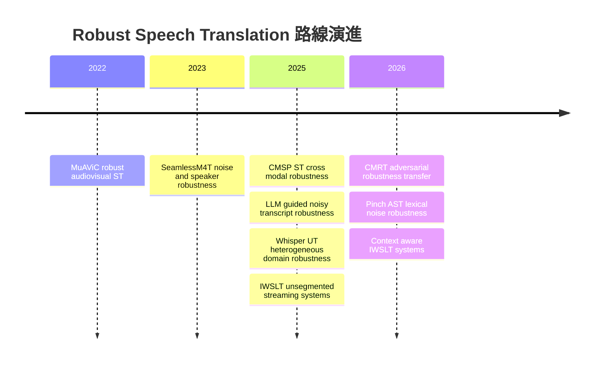
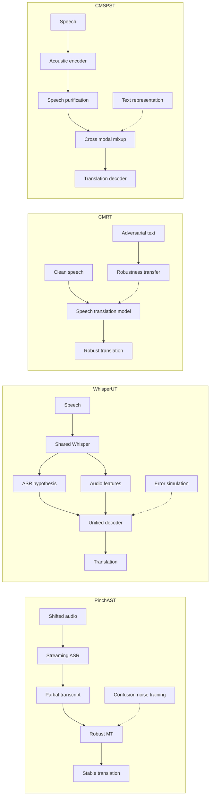
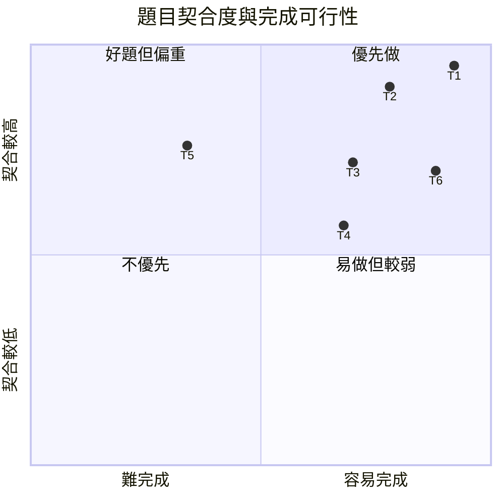

# SimulST 第二輪深度研究：Robustness to Distribution Shift 與 Interspeech 論文選題

**研究基準日：2026-10-17。** 本報告把「近十八個月」固定為 2025-04-17 至 2026-10-17，把「近六個月」固定為 2026-04-17 至 2026-10-17。目標投稿條件完全依你提供的資訊：Interspeech 2027、截止日 2027-02-16、speech 類、四頁、單人、NVIDIA A10 24 GB 共四張；**我沒有自行查詢或推測 Interspeech 2027 截止日**。第一輪報告作為共同前提，不重述其 §1–3。fileciteturn0file0

## 與第一輪的出入與路線全景

**對應你要求的 §0 與 §1。**

第一輪把 *Robustness to Distribution Shift* 列成「麥克風、迴音、口音、背景聲、影片等」的一個開放問題；深挖後，這個分類對選題來說**過度壓縮**。近年的工作實際上在處理不同傳播位置的 shift，而且其方法幾乎不能互換：speech-side acoustic shift、speaker/accent shift、ASR-error lexical shift、semantic/domain shift、streaming-policy shift，以及 multimodal/resource shift。Whisper-UT 明確把 conversational、dialectal、disfluency、code-switching、noise 視為 heterogeneous scenarios；CMRT 針對 morphology/inflectional variation；Pinch-AST 則把 robustness 放在 ASR confusion 所造成的 lexical errors；CMU 的 IWSLT 系統又從「合成 robust speech segments」處理 streaming speech shift。**【共識】因此，第二輪不應再把 distribution shift 當成一個單一變數。** citeturn24view2turn2view0turn15view0

| 第一輪判斷或表述 | 第二輪修正 | 對本次選題的影響 | 證據 |
|---|---|---|---|
| Distribution shift 可作為一個整體 gap | 應拆成 acoustic、speaker、lexical-error、semantic-domain、stream-policy、resource 六層 | 論文最好只挑一層，否則四頁會散掉 | 【共識】Whisper-UT、CMRT、Pinch-AST、CMU citeturn24view2turn2view0turn15view0 |
| Robustness 看起來主要是「加噪聲測試」 | 最新直接相關方法有 adversarial text→speech robustness transfer、ASR-confusion augmentation、cross-modal purification、learned distrust of noisy transcripts | 有足夠方法型 novelty，不必做成純 benchmark paper | 【共識】citeturn2view0turn24view2turn16view1 |
| Cascade 的 error propagation 是缺點，但未細分其 distribution dependence | Pinch-AST 明確以 confusion matrix 合成 lexical noise，且文中假設 lexical noise 的特性可跨 domain 使用；這個假設本身沒有被充分驗證 | **這形成目前最適合四頁論文的窄 gap** | 【單篇】Pinch-AST；【推論】gap 判定 citeturn3view0 |
| CoVoST 2 可籠統當「開放資料」 | Meta 歷史頁仍稱 CoVoST 為 CC0，但 Mozilla Data Collective 目前列出的 CoVoST 2 發行物為 CC-BY-NC-4.0 | 在真正下載資料前應以該 artifact 的現行條款為準；本報告標 **待確認** | 【單篇／來源衝突】citeturn21search9turn22search10 |
| 第一輪曾把 SoftLCP 寫成 MLLP 2026 最終策略 | checked 版第一輪已補註：最終 pipeline 為 ASR LACP 加 MT LCP；SoftLCP 是被比較過的方案 | 第二輪不把 SoftLCP 當成其 accepted final architecture | 【單篇】第一輪 checked report；MLLP 2026 fileciteturn0file0 citeturn12view1 |
| 第一輪曾在 R2 把 P05 說成 AlignAtt | checked 版已註明 P05 原方法是 EDAtt；本輪沿用該修正 | 不影響 robustness 選題，但 prior-work 文字必須精確 | 【單篇】fileciteturn0file0 |

**最重要的新發現是 Pinch-AST 的假設。** Pinch-AST 不是單純「對 MT 加 typo」；它根據 ASR confusion 建 lexical-noise training，並配合 prefix-consistent training。這比第一輪所看到的一般 robustness 描述更接近一個可以被明確反駁的研究假設。**【推論】「ASR lexical noise 是否真的 domain-independent？」比「讓 SimulST 更 robust」更像 Interspeech 四頁論文題目。** citeturn3view0

**Mermaid timeline 的節點**：MuAViC robust audiovisual ST、SeamlessM4T noise robustness、IWSLT long stream、CMSP ST、LLM guided ST、Whisper UT、CMRT、Pinch AST、context aware IWSLT systems。  
**時間關係**：由早期直接測 acoustic robustness，走向 representation robustness、ASR-error robustness、cross-modal transfer，最後進入 long-stream 與 context-aware robustness。這是時間演進，不表示後一方法取代前一方法。MuAViC 建立 noisy audiovisual robustness benchmark；SeamlessM4T 報告 background-noise 與 speaker-variation robustness；CMSP-ST、Whisper-UT、CMRT、Pinch-AST 分別代表不同 robustness mechanism。citeturn21search8turn21search5turn16view1turn24view2turn2view0turn3view0



**【共識】目前並沒有一個已經統一「所有 distribution shifts」的 SimulST 方法。** 有的方法只對 lexical noise 有效、有的只驗證 morphology、有的不是 simultaneous、有的在 clean benchmark 表現很好卻沒有 shift matrix；這反而表示此路線尚未被「一個 foundation model」收斂掉。citeturn2view0turn24view2turn3view0turn13view2

## 近十八個月文獻盤點

**對應你要求的 §2。**

**查詢式。** 本輪實際使用或展開的核心英文查詢包括 `simultaneous speech translation robustness distribution shift`、`speech translation robustness noise domain shift`、`ASR error speech translation robust`、`adversarial speech translation robustness`、`IWSLT 2026 simultaneous speech translation`、`Interspeech 2025 speech translation robustness`、`streaming speech translation domain adaptation`、`speech translation noisy transcript LLM`、`simultaneous speech translation lexical noise`、`simultaneous speech translation test time adaptation`、`dynamic attention simultaneous speech translation`。入口以 ACL Anthology、ISCA Archive、arXiv、論文內 official GitHub 與 IWSLT 原文為主。

**篩選規則。** 時間窗採 2025-04-17 至 2026-10-17；優先保留直接處理 Speech Translation 或 SimulST 的 primary papers。為了不把「distribution shift」狹義化成 noise augmentation，納入少量直接影響 robustness 的 streaming segmentation、context、adaptive policy 論文，但在表內標出「相鄰」。ASR-only paper 不放入核心二十一篇。**所有下表論文的原文頁或 PDF 都在本輪實際開啟；沒有只憑搜尋摘要補 paper ID。**

| 論文與原文 URL | 日期 | 機制 | 資料與測試條件 | 主要數字 | 與前作差異 | 開源 | 判定 |
|---|---|---|---|---|---|---|---|
| **CMRT: Cross-Modal Robustness Transfer**  https://arxiv.org/abs/2602.11933 | 2026-02 | 用 text-side adversarial examples 把 robustness transfer 到 speech ST | 四個 language pairs；針對 morphology 與 inflectional perturbation | adversarial robustness 平均提升 **超過 3 BLEU** | 不需 adversarial speech training | 本輪未找到作者 official repo | 【核心】【單篇】citeturn2view0 |
| **Whisper-UT: A Unified Translation Framework for Speech and Text**  https://arxiv.org/abs/2509.16375 | 2025-09 | ASR、ST、MT、MMT multi-task；ASR error simulation；two-stage learned distrust | CoVoST2；Fisher；BBN | BBN ST **19.8→21.6 BLEU** two-stage；Fisher **62.0→62.1**；CoVoST2 Fr-En **40.8→41.4** | 同一 Whisper 同時使用 speech 與 noisy transcript | https://github.com/BorrisonXiao/Whisper-UT | 【核心】【單篇】citeturn24view2turn24view3 |
| **Pinch-AST**  https://aclanthology.org/2026.iwslt-1.30/ | 2026-07 | ASR confusion lexical noise；prefix-consistent MT；char LCP | MCIF long-form；Qwen3 ASR；Qwen3.5 4B MT | En-De dev chunk **640 ms** 時 BLEU **25.6**；LongYAAL-CU **1639 ms**；較長 chunk BLEU 可至 **29.4** | 把 ASR error distribution 直接放進 MT robustness training | 未找到 paper-specific official repo | 【核心】【單篇】citeturn3view0 |
| **NeMo at IWSLT 2026**  https://aclanthology.org/2026.iwslt-1.23/ | 2026-07 | dual-mode Unified ASR Transducer + multilingual LLM cascade | En-De；En-It；En-Zh；Cs-En；long-form | 原文已開；本輪不從摘要猜主表數字 | 同一 ASR 支援多 latency operating points，強調 transcript stability | NVIDIA NeMo ecosystem；無 paper-specific repo 確認 | 【核心／相鄰 robustness】【單篇】citeturn12view0 |
| **MLLP-VRAIN UPV IWSLT 2026**  https://aclanthology.org/2026.iwslt-1.24/ | 2026-07 | Parakeet + Qwen3.5；LACP/LCP；context RAG 與 ASR boosting | MCIF 與 IWSLT context track | En-De MCIF 對前一年 **+5.82 XCOMET-XL**；context **+1.03** | 把 context shift 與 streaming stability 同時處理 | 本輪未確認 paper-specific repo | 【核心】【單篇】citeturn12view1 |
| **CUHKSZ IWSLT 2026**  https://aclanthology.org/2026.iwslt-1.13/ | 2026-07 | Qwen3-Omni；LoRA；chunk-aligned supervision；WAIT token | IWSLT En-De；En-Zh | official dev low En-Zh 報告約 **40.5 BLEU**、約 **1.95 s** latency | policy 內化到 audio-text LLM，不再外掛 READ WRITE policy | 本輪未找到 paper repo | 【相鄰】【單篇】citeturn12view2 |
| **Test-Time Adaptation of an Offline Multimodal Foundation Model for Simultaneous Speech Translation**  https://aclanthology.org/2026.iwslt-1.27/ | 2026-07 | pause segmentation；wait-k；multi-turn prompting；KV cache | IWSLT language directions | 原文摘要宣稱各方向與 latency regime 均優於其 cascaded baseline；摘要未列安全可轉錄的單一主數字 | 不訓練 native streaming model；deployment-time 轉換 offline FM | 本輪未確認 official repo | 【相鄰】【單篇】citeturn12view3 |
| **AlignAtt4LLM**  https://aclanthology.org/2026.iwslt-1.32/ | 2026-07 | forced alignment + decoder-only LLM AlignAtt | IWSLT European 與 Chinese directions | 已開原文；本輪未擷取可安全引用的單一主表數字 | 把原為 encoder-decoder 的 attention policy 移至 decoder-only LLM | 本輪未確認 repo | 【相鄰】【單篇】citeturn12view4 |
| **Towards Dynamic Attention Masking for Simultaneous Speech Translation**  https://aclanthology.org/2026.iwslt-1.20/ | 2026-07 | SeamlessM4T encoder 每層 scheduler 預測所需 future frames；LoRA | En-De；En-It；En-Zh | proof-of-concept 原文摘要未給單一主表數字 | fixed cutoff 變 content-aware future context | 未見 paper-specific official repo | 【相鄰】【單篇】citeturn13view2 |
| **A Pocket Offline Model for Simultaneous Speech Translation**  https://aclanthology.org/2026.iwslt-1.22/ | 2026-07 | Canary-1B-v2 + AlignAtt | Cs-En；En-De；En-It | model 約 **1B parameters**；原文摘要未列主 BLEU | 用小型 offline direct ST 直接做 simultaneous inference | NeMo model ecosystem；paper repo 未確認 | 【相鄰】【單篇】citeturn13view3 |
| **REINA with Temporal-Awareness Networks**  https://arxiv.org/abs/2604.09916 | 2026-04 | information-gain READ WRITE policy + temporal features | Whisper-based SimulST | NoSE 最多改善 **7.1%** | 修正 original information-only policy 的 read-loop 與過度 READ 問題 | 本輪未找到 official repo | 【相鄰】【單篇；arXiv 顯示 under review】citeturn13view0 |
| **Streaming Sequence Transduction through Dynamic Compression**  https://aclanthology.org/2025.iwslt-1.1/ | 2025-07 | STAR dynamic segmentation 與 anchor compression | ASR + SimulST | ASR 約 **12×** nearly-lossless compression；SimulST 改善 segmentation quality-latency frontier | segmentation 不再用固定 chunk 或獨立 VAD | 本輪未確認 repo | 【相鄰】【單篇】citeturn14view0 |
| **BeaverTalk**  https://aclanthology.org/2025.iwslt-1.30/ | 2025-07 | VAD + Whisper Large V2 + Gemma 3 12B LoRA + previous-sentence context | IWSLT En-De；En-Zh | En-De **24.64 BLEU at 1837.86 ms**、**27.83 at 3343.73 ms**；En-Zh **34.07 at 2216.99 ms** | 簡單一段 memory bank 作 context robustness | paper repo 未確認 | 【相鄰】【單篇】citeturn14view1 |
| **CMU IWSLT 2025 Simultaneous ST System**  https://aclanthology.org/2025.iwslt-1.31/ | 2025-07 | chunkwise causal Wav2Vec2 + adapter + Qwen2.5 7B；robust synthetic speech segments | LibriSpeech；CommonVoice；VoxPopuli synthesis；ACL60/60 dev | En-Zh **44.3 BLEU at 2.7 s CA**；En-De **25.1 at 2.3 s CA** | robustness 放進 streaming training data，而非只在 test 加 noise | paper repo 未確認 | 【核心】【單篇】citeturn15view0 |
| **NAIST IWSLT 2025**  https://aclanthology.org/2025.iwslt-1.39/ | 2025-07 | Whisper encoder + DeCo + Qwen；local agreement；online SHAS | IWSLT En-De；En-Ja；En-Zh | 已開原文；摘要未給一個可代表全部方向的主數字 | 把 robust segmentation 與 LLM ST 接起來處理 unbounded speech | paper repo 未確認 | 【相鄰】【單篇】citeturn15view1 |
| **CUNI IWSLT 2025**  https://aclanthology.org/2025.iwslt-1.41/ | 2025-07 | Whisper offline models + AlignAtt；cascade EuroLLM；terminology prompt | unbounded IWSLT streams | dev 相對 organizer baseline：Cs-En 約 **+2 BLEU**；En-X 約 **+13 至 +22 BLEU** | 展示 offline pretrained model 可透過 policy/context 變成 live system | https://github.com/ufal/SimulStreaming | 【核心／baseline】【單篇】citeturn3view1 |
| **MLLP-VRAIN UPV IWSLT 2025**  https://aclanthology.org/2025.iwslt-1.35/ | 2025-07 | Whisper Large-v3-Turbo + NLLB-3.3B；prefix training；RALCP | ACL60/60 等 IWSLT streams | ACL60/60 約 **31.96 BLEU at 2.94 s StreamLAAL** | prefix-aware MT training 加 stability policy | paper-specific repo 未確認 | 【核心】【單篇】citeturn3view2 |
| **End-to-End ST Guided by Robust Translation Capability of LLM**  https://www.isca-archive.org/interspeech_2025/higuchi25_interspeech.html | 2025-08 | CTC ASR hypothesis → frozen LLM translation → speech-conditioned decoder | CoVoST2；MuST-C-v2 OOD | CoVoST2 De-En **23.9→30.9 BLEU**；MuST-C-v2 OOD En-De **12.4→17.5** | 使用 frozen LLM 的 noisy-text robustness，但 decoder 仍直接看 speech | ESPnet toolkit；無 paper-specific repo | 【核心】【單篇】citeturn18view0turn18view1 |
| **CMSP-ST**  https://www.isca-archive.org/interspeech_2025/ou25_interspeech.html | 2025-08 | speech purification + cross-modal mixup + adversarial soft alignment | MuST-C En-De；CoVoST2 Fr-En；De-En | MuST-C **27.4 BLEU**；CoVoST2 **31.3 Fr-En**、**22.4 De-En** | 明確移除 non-content speech features 再做 modality mixing | https://github.com/Akito-Go/CMSP-ST | 【核心】【單篇】citeturn18view2turn18view3turn26view1 |
| **Towards Efficiently Whisper Fine-tuning with Monotonic Alignments**  https://www.isca-archive.org/interspeech_2025/zhuang25_interspeech.html | 2025-08 | uncertainty-weighted soft monotonic alignment loss | CoVoST2；MDCCST；ASR corpora | Whisper-v2 nl-en **42.02→44.37 BLEU**；但 ja-en **26.17→25.22**、zh-en **20.09→19.15** | 不改 network，只改 alignment objective；效果依語向而異 | MDCCST data repo；paper code 未確認 | 【核心負例】【單篇】citeturn18view5turn25view2 |
| **Speech-to-Text Translation with Phoneme-Augmented CoT**  https://www.isca-archive.org/interspeech_2025/gallego25_interspeech.html | 2025-08 | phoneme intermediate representation + curriculum CoT | multilingual low/zero-resource S2TT | 原文摘要報告 low-resource 改善與 zero-resource enablement，但未給單一主 BLEU；高-resource 有輕微退化 | 將 phonetic invariance 當 cross-lingual transfer bridge | paper repo 未確認 | 【相鄰】【單篇】citeturn16view3 |

**【共識】這二十一篇不是二十一篇都宣稱「distribution shift」。** 真正直接處理 robustness 的核心群較小；其餘是會改變 shift sensitivity 的 segmentation、policy、context 或 streaming architectures。這樣分比把所有 SimulST papers 都稱為 robustness work 更符合原文。citeturn2view0turn24view2turn15view0turn13view2

依你要求，以下是同一盤點的 CSV。`NR` 表示已開原文，但在本輪安全擷取範圍內沒有單一可代表該 paper 的主數字，因此不猜。

```csv
title,year,month,url,mechanism,dataset,main_metric,main_number,diff_from_prior,code_url,source_type
CMRT Cross-Modal Robustness Transfer,2026,02,https://arxiv.org/abs/2602.11933,text adversarial robustness transferred to speech,four language pairs,adversarial BLEU,average gain above 3 BLEU,no adversarial speech required,not_found,primary
Whisper-UT A Unified Translation Framework for Speech and Text,2025,09,https://arxiv.org/abs/2509.16375,multitask speech text plus ASR error simulation,CoVoST2;Fisher;BBN,BLEU,BBN 21.6 BLEU two stage,learned distrust of noisy transcript,https://github.com/BorrisonXiao/Whisper-UT,primary
Pinch-AST,2026,07,https://aclanthology.org/2026.iwslt-1.30/,ASR confusion lexical noise plus prefix training,MCIF long form,BLEU;LongYAAL,En-De 25.6 BLEU;1639 ms at 640 ms chunk,explicit lexical error robustness for streaming cascade,not_found,primary
NeMo at IWSLT 2026,2026,07,https://aclanthology.org/2026.iwslt-1.23/,dual mode ASR plus multilingual LLM,IWSLT En-De;En-It;En-Zh;Cs-En,quality latency,NR,stable transcripts across latency regimes,not_found,primary
MLLP-VRAIN UPV IWSLT 2026,2026,07,https://aclanthology.org/2026.iwslt-1.24/,Parakeet plus Qwen3.5 plus context retrieval,MCIF;IWSLT context,XCOMET-XL,plus 5.82 MCIF En-De;plus 1.03 context,combines stability and context robustness,not_found,primary
CUHKSZ IWSLT 2026,2026,07,https://aclanthology.org/2026.iwslt-1.13/,Qwen3-Omni plus WAIT token,IWSLT En-De;En-Zh,BLEU;latency,En-Zh 40.5 BLEU;1.95 s low dev,policy internalized in speech LLM,not_found,primary
Test-Time Adaptation of an Offline Multimodal Foundation Model for Simultaneous Speech Translation,2026,07,https://aclanthology.org/2026.iwslt-1.27/,pause segmentation plus wait k plus KV cache,IWSLT directions,quality latency,NR,turns offline foundation model into streaming system at test time,not_found,primary
AlignAtt4LLM,2026,07,https://aclanthology.org/2026.iwslt-1.32/,forced alignment plus decoder only AlignAtt,IWSLT European;Chinese,quality latency,NR,extends alignment policy to decoder only LLM,not_found,primary
Towards Dynamic Attention Masking for Simultaneous Speech Translation,2026,07,https://aclanthology.org/2026.iwslt-1.20/,per layer future frame scheduler plus LoRA,En-De;En-It;En-Zh,quality latency,NR,content aware future context replaces fixed cutoff,not_found,primary
A Pocket Offline Model for Simultaneous Speech Translation,2026,07,https://aclanthology.org/2026.iwslt-1.22/,Canary with AlignAtt,Cs-En;En-De;En-It,model size,1B parameters,compact direct offline model adapted to SimulST,not_found,primary
REINA with Temporal-Awareness Networks,2026,04,https://arxiv.org/abs/2604.09916,information gain policy plus temporal features,Whisper SimulST,NoSE,up to 7.1 percent improvement,fixes read loops of information only policy,not_found,primary
Streaming Sequence Transduction through Dynamic Compression,2025,07,https://aclanthology.org/2025.iwslt-1.1/,dynamic segmentation and anchor compression,ASR;SimulST,compression,about 12x ASR compression,dynamic learned boundaries replace fixed segmentation,not_found,primary
BeaverTalk,2025,07,https://aclanthology.org/2025.iwslt-1.30/,VAD Whisper plus Gemma and sentence memory,IWSLT En-De;En-Zh,BLEU;StreamLAAL,En-De 24.64 BLEU;1837.86 ms,simple previous sentence context,not_found,primary
CMU IWSLT 2025 Simultaneous ST System,2025,07,https://aclanthology.org/2025.iwslt-1.31/,causal Wav2Vec2 plus Qwen with robust synthetic segments,ACL60-60,BLEU;CA latency,En-Zh 44.3 BLEU;2.7 s,trains streaming model on robust synthesized speech,not_found,primary
NAIST Simultaneous Speech Translation System for IWSLT 2025,2025,07,https://aclanthology.org/2025.iwslt-1.39/,Whisper DeCo Qwen plus SHAS,IWSLT En-De;En-Ja;En-Zh,quality latency,NR,robust online segmentation for unbounded stream,not_found,primary
CUNI Submission to IWSLT 2025,2025,07,https://aclanthology.org/2025.iwslt-1.41/,Whisper AlignAtt plus EuroLLM cascade,IWSLT streams,BLEU,plus 2 Cs-En;plus 13 to 22 En-X over organizer baseline,offline pretrained models with streaming policy and context,https://github.com/ufal/SimulStreaming,primary
MLLP-VRAIN UPV IWSLT 2025,2025,07,https://aclanthology.org/2025.iwslt-1.35/,Whisper plus NLLB with prefix training and RALCP,ACL60-60,BLEU;StreamLAAL,31.96 BLEU;2.94 s,prefix aware robustness and stability,not_found,primary
End-to-End Speech Translation Guided by Robust Translation Capability of Large Language Model,2025,08,https://www.isca-archive.org/interspeech_2025/higuchi25_interspeech.html,CTC transcript to frozen LLM to speech conditioned decoder,CoVoST2;MuST-C-v2,BLEU,De-En 30.9;MuST-C OOD En-De 17.5,uses LLM noisy text robustness while retaining speech,not_found,primary
CMSP-ST,2025,08,https://www.isca-archive.org/interspeech_2025/ou25_interspeech.html,speech purification plus cross modal mixup plus adversarial alignment,MuST-C;CoVoST2,BLEU,MuST-C 27.4;Fr-En 31.3;De-En 22.4,removes non content speech features before mixup,https://github.com/Akito-Go/CMSP-ST,primary
Towards Efficiently Whisper Fine-tuning with Monotonic Alignments,2025,08,https://www.isca-archive.org/interspeech_2025/zhuang25_interspeech.html,uncertainty weighted monotonic alignment,CoVoST2;MDCCST,BLEU,nl-en 44.37 but ja-en 25.22,objective only adaptation with language dependent gains,not_found,primary
Speech-to-Text Translation with Phoneme-Augmented CoT,2025,08,https://www.isca-archive.org/interspeech_2025/gallego25_interspeech.html,phoneme intermediate CoT and curriculum,multilingual S2TT,BLEU,NR,targets low and zero resource transfer,not_found,primary
```

## 關鍵方法細節與失敗方向

**對應你要求的 §3 與 §4。**

我會把真正最值得影響你選題的四篇縮成四個 robustness mechanisms，而不是四個排行榜冠軍：**Pinch-AST、Whisper-UT、CMRT、CMSP-ST**。Pinch-AST 是最接近你可能投的 SimulST 題目；Whisper-UT 是目前「如何學會不完全相信 ASR transcript」最直接的例子；CMRT 證明 robustness 可跨 modality transfer；CMSP-ST 則代表在 acoustic representation 本身消除 non-content variability。citeturn3view0turn24view2turn2view0turn26view1

**架構圖節點**：每個方法都採 Input shift → Robustness mechanism → Translation model → Output 的相同畫法。Pinch-AST 的 robustness 位於 ASR 與 MT 之間；Whisper-UT 同時保留 audio 與 noisy transcript；CMRT 在 training 階段從 adversarial text transfer；CMSP-ST 在 speech representation 階段 purification。  
**邊**：實線代表 inference data flow；虛線代表只在 training 存在的 robustness signal。citeturn3view0turn24view2turn2view0turn26view1



| 方法 | Architecture 與 training | 推論額外成本 | 真正測到的 shift | 明確弱點或未測區域 | 對你的價值 |
|---|---|---|---|---|---|
| Pinch-AST | Qwen ASR → partial text → Qwen3.5 MT；training 用 confusion-derived lexical noise 與 prefix consistency | 仍是兩模型 cascade；MT model 本身約為 4B 級；paper 在 H100 上做競賽系統 | ASR lexical errors；stream prefix mismatch | confusion distribution 被假設可跨 domain；real acoustic shift 與 confusion shift 未拆開 | **最高**：可以只改 augmentation，不動 backbone，適合四頁 |
| Whisper-UT | 一個 Whisper decoder 可做 ASR、MT、ST、MMT；two-stage 時把自產 ASR hypothesis 再餵回 translation | two-stage 需要額外 decoding；不是原生 SimulST | noisy transcript；conversational/domain shift | 不是 streaming paper；把它直接搬到 partial hypotheses 有工程成本 | 適合當「learned distrust」prior，不適合當第一實作 |
| CMRT | speech model 本身不吃 adversarial speech；從 text adversarial examples 學 robustness | 核心思想主要改 training；paper 主張不必 adversarial speech | morphological/inflectional variation | 不是 acoustic noise、長流或 partial ASR robustness | novelty 很強，但你的題目若直接移植會太接近原作 |
| CMSP-ST | HuBERT speech encoder；orthogonal purification；cross-modal mixup；soft alignment adversarial training | inference 移除 text/MT path，但 speech purification 還在；原文實驗用兩張 RTX 4090 | non-content speech variation 與 modality gap | 非 streaming；沒有 long-form latency | 好的 robustness baseline，但 full reproduction 比 T1 重 |

Pinch-AST 的 full fine-tuning 在一個節點上使用 H100 級 GPU，且 paper 沒有報 wall-clock training duration；Whisper-UT 報告實驗使用 V100 GPU、CMSP-ST 報告兩張 RTX 4090，但同樣沒有足以換算完整 GPU-hours 的 wall-clock 訓練時間。**【共識】所以依你要求，這些 paper 不能被拿來合理估算「幾 A10 小時」；後面我會標「無依據」，不做假精確換算。** citeturn24view2turn26view1

**失敗或被放棄的方向。** 這一段很重要，因為它直接告訴你「不要重踩什麼」。

| 嘗試 | 發生什麼事 | 是否真的被作者說明 | 對研究選題的含義 |
|---|---|---|---|
| 原始 information-only REINA policy | policy 缺 temporal context，容易幾乎把 audio 讀完才開始寫，並出現 read-loop stability 問題；新作加入 SAN/TAN | 【單篇】明確寫在 REINA-TAN/SAN 原文 citeturn13view0 | 單純用 uncertainty 或 information gain 做 adaptive policy 不夠；必須處理 temporal state |
| Whisper monotonic-alignment loss 當成普遍 ST 改良 | Dutch→English 與 Cantonese→Mandarin 提升，但 Japanese→English、Mandarin→English 反而下降 | 【單篇】原文表格與作者分析 citeturn18view5turn25view2 | 「alignment regularization 越強越 robust」是錯的；語序差異本身會造成 failure |
| Zero-shot frozen LLM cascade 被當作 noisy-ASR 萬靈丹 | Higuchi 的 En→De，AED-ASR→zero-shot LLM 只有 17.2 BLEU；即使 reference text 也只有 22.6，而其 speech-conditioned proposed model達 26.0 | 【單篇】citeturn18view1 | LLM 語言能力不能自動消掉 ASR error；必須保留 speech evidence 或做 task adaptation |
| Qwen ASR 用無限制 history 處理某些 long stream | Pinch-AST 報告在 Czech 情況，缺少 punctuation 會讓 buffer 持續長大並導致極差 real-time behavior，因此該路徑改用 Parakeet 類 streaming ASR | 【單篇】Pinch-AST citeturn3view0 | Robustness 包含 state-distribution shift；不只是 WER |
| 把 SoftLCP 當 MLLP 2026 的最終 solution | 該團隊比較多種策略後，最終不是「SoftLCP everywhere」，而是 ASR LACP 與 MT LCP 的組合 | 【單篇】citeturn12view1 | Stability mechanism 也有 deployment dependence，不該在新 paper 裡把單一 heuristic 宣稱 universal |
| 只用 fixed lexical confusion distribution | Pinch-AST 的訓練假設其 lexical-noise behavior 可跨 domain 泛化，但原文沒有提供完整 multi-domain confusion-transfer matrix | 【單篇】paper assumption；【推論】「失敗」尚未被實證，只是未驗證風險 citeturn3view0 | **這正是我推薦拿來做 paper 的 hypothesis** |

CMSP-ST 也提供一個反面的訊息：它的 ablation 中移除 speech purification、cross-modal mixup、augmentation 或 adversarial training 都會下降，但改善不是來自「只加一個 adversarial loss」；speech purification 是其中最大的組件之一。**【單篇】這意味著 generic adversarial training 不宜被當成獨立的萬用 robustness recipe。** citeturn18view3

## 基線、資料授權與可復現性

**對應你要求的 §5，並先處理你目前標成「待確認」的資料條件。**

### 資料可用性與授權風險

| Dataset | 可支援的角色 | 本輪確認到的 license 狀態 | 對你題目的問題 | 本報告建議 |
|---|---|---|---|---|
| **MuST-C** | En→De 等 ST；TED talk；可依 talk 重建較長 stream | **CC BY-NC-ND 4.0**；原 corpus paper 明列此 license citeturn23search0 | `ND` 對「重新發布加噪或混響後 audio」特別敏感；是否允許你生成但不散布 derivative 需再確認 | **可做 baseline；若做 acoustic corruptions，僅發布 recipe 而不發布衍生 audio，且先確認條款** |
| **CoVoST 2** | 多語 ST；accent/speaker diversity；方便 OOD | **待確認**：Meta 舊官方頁寫 CC0，但目前 Mozilla Data Collective 的 CoVoST 2 artifacts 列 CC-BY-NC-4.0 citeturn21search9turn22search10 | 來源條款衝突，不應只沿用舊 paper 的 license 說法 | 下載前保存該版本 license 與 terms snapshot |
| **Common Voice 現行發行物** | 建 ASR confusion domain、accent/noise probe | 現行 Mozilla Data Collective 多數 release 標 **CC0-1.0** citeturn22search0 | 沒有 ST translation reference | 適合生成 ASR confusion，不宜單獨當 ST main benchmark |
| **ACL60/60** | 真實 long-form SimulST dev/eval | **待確認** | 需要確認你能否合法取得、使用與發布衍生結果 | **在 pilot 前一週完成 access/license gate** |
| **MCIF IWSLT dev** | 最新 long-form competition-style stream | **待確認** | 官方 access 條款與 redistribution 要逐版本查 | 若已能合法取得，優先當 second test；不要讓它成為 pilot blocker |
| **Fisher/CallHome** | spontaneous conversational shift | **待確認** | 很可能不是「下載就能用」的無限制 corpus | 不作第一題的必要依賴 |
| **BBN Mandarin-English** | conversational telephone shift | **待確認** | access 風險高於 CoVoST/MuST-C | 不作第一題必要依賴 |

**【推論】你的第一個 administrative milestone 應該不是寫模型，而是確認至少一個有 speech、translation references、可作 on-the-fly perturbation 的 main corpus。** 若這件事拖到主實驗階段才發現 license 不合，你的四張 A10 都救不了時程。

### 開源與復現風險

| Baseline | 可用 implementation | 復現難度 | 主要坑 | 是否建議現在投入 |
|---|---|---|---|---|
| **Whisper-UT** | 官方 repo：https://github.com/BorrisonXiao/Whisper-UT citeturn24view3 | 中 | 不是 SimulST；需要再實作 partial hypothesis policy | 適合 sanity-check robustness，不適合先做主 baseline |
| **CMSP-ST** | 官方 repo：https://github.com/Akito-Go/CMSP-ST citeturn26view1 | 中 | Fairseq2、HuBERT、MT pretraining、multi-stage training；沒有 streaming latency | 適合核對 robustness mechanism |
| **CUNI SimulStreaming** | https://github.com/ufal/SimulStreaming；第一輪與 CUNI system paper 均使用此系列工具 citeturn3view1 | 中 | model/version、buffer、AlignAtt threshold、segmenter 都影響數字 | **非常適合當 streaming harness** |
| **StreamAtt** | FBK fairseq repo 明確有 StreamAtt instructions：https://github.com/hlt-mt/FBK-fairseq citeturn23search13 | 中 | Fairseq dependency 與舊 SimulEval version | 好的 direct-ST control baseline |
| **Pinch-AST** | paper 詳細到足以重建主要 pipeline；本輪未找到 paper-specific official repo | 中高 | Qwen revisions、forced alignment、noise construction、stream policy 都要自己對齊 | **主題最相關，但應只重建最小 robustness core** |
| **CMU 2025** | 原文完整描述 architecture；本輪未找到 official full system repo | 高 | 7B decoder、synthetic robust speech data pipeline、two-stage training | 不適合單人四個月先復現 |
| **CMRT** | 原文方法清楚；本輪未找到 official code | 中高 | adversarial generation 本身會變成第二個研究問題 | 可作第二 baseline，不應當第一 pipeline |

**我建議先復現的 paper：Pinch-AST 的最小核心，而不是整個競賽 system。** **【推論】理由有三個：**第一，它是這輪唯一同時碰到「SimulST + robustness + lexical ASR shift + prefix training」且非常接近你可做 gap 的工作；第二，你不必重訓 ASR，只要固定 ASR、重建 confusion-based MT augmentation；第三，這會直接告訴你 T1 是否還有值得投稿的 margin。其 drawback 是沒有 paper-specific repo，所以 CUNI/SimulStreaming 應作 streaming harness。Pinch-AST 的核心方法與結果可由原文核對。citeturn3view0turn3view1

**復現成功判準**如下。容忍範圍是我為工程 reproducibility 設的 **【推論】**，不是原作者宣稱的統計 confidence interval。

| 對應 Pinch-AST 數字 | 原文測試條件 | Paper 數字 | 你的成功門檻 | 為何這樣設 |
|---|---|---:|---:|---|
| En→De low chunk BLEU | MCIF dev；chunk 640 ms；paper pipeline | 25.6 BLEU | 24.6–26.6 | 容許 tokenizer、model revision、decoder implementation 小差異 |
| 同一條件 COMET | 同上 | 0.7380 | 0.723–0.753 | 若差超過此範圍，先查 metric/version |
| 同一條件 LongYAAL-CU | 同上 | 1639 ms | 1289–1989 ms | hardware 不應影響 non-CA 部分很多，但 streaming wrapper 會有差 |
| high chunk BLEU | MCIF dev；chunk 2500 ms | 29.4 BLEU | 28.4–30.4 | 確認 quality-latency curve 大致重現 |
| high chunk LongYAAL-CU | 同上 | 3035 ms | 2685–3385 ms | 確認 policy timing 沒完全錯位 |

來源為 Pinch-AST 原文，本輪實際開啟其 ACL Anthology paper/PDF。citeturn3view0

你的 A10 條件有一個實際優勢：可以把「不同 shift condition」平行派到四張卡，而不一定做 model parallel。**【推論】對這種小 paper，比用四卡同步訓練一個巨型 model 更有效率的用法，是一張卡一個 seed/domain/config；這也降低單人 debug 的複雜度。** 至於某一個 4B model 能否在單張 A10 24 GB 以特定 precision、optimizer、sequence length 做 LoRA training，不能從 paper 的 weight footprint 自動推導，應在 pilot 實測，不能先視為保證。

## 近六個月業界動態與被做掉風險

**對應你要求的 §6。時間窗固定為 2026-04-17 至 2026-10-17。**

| 公司／玩家 | 日期 | 此六個月實際動態 | 跟你的題目有多接近 | 被做掉風險 |
|---|---|---|---|---|
| **OpenAI** | 2026-05-07 | 發布 GPT-Realtime-Translate；官方稱支援 **70+ input languages、13 output languages**，專用 realtime translation session 持續吃 streaming audio 並回傳 translated audio/transcript deltas citeturn20search3turn20search17 | 非常接近「產品級 live translation」，但不是公開 SimulST robustness benchmark | **高：不要投稿 generic realtime translator** |
| **Google** | 2026-09-04 | Google Translate live translate 官方稱達 **70+ languages**；Google 表示超過三分之一 live sessions 已超過 **5 分鐘**，Android 新增 background long-session support citeturn20search1 | 直接進入 long-form consumer use | **高：long-running translation 本身不再新** |
| **Google DeepMind** | 2026-09-15 | 推出 Gemini 3.8 Live 與 Gemini 3.5 Transcribe；後者官方稱 speech transcription 覆蓋 **85+ languages** citeturn20search15 | upstream ASR/live-audio capability 更強 | **中高：純 backbone upgrade 很容易被壓過** |
| **Apple** | 2026-09-09 | AirPods 5 擴張 Live Translation；Apple 明確把 ANC/computational audio 與 noisy real-world listening 放在產品體驗中 citeturn20search0 | 很接近「noise + translation」產品問題，但沒有公開可復現 robustness benchmark | **中：產品把 UX 做掉，不等於研究假設被做掉** |
| **NVIDIA** | 2026-07 | NeMo IWSLT 2026 直接參與 simultaneous ST，使用 dual-mode ASR transducer 加 multilingual LLM，涵蓋多 latency regimes citeturn12view0 | 和你的 cascade baseline 高度重疊 | **高：不要把 contribution 寫成把 ASR 接 LLM** |
| **Meta** | 2026-09-06 | Text-Audiobox 擴大到 cross-lingual dubbing 與 full-duplex dialogue synthesis；官方 paper 描述 **3B model、480k 小時** monolingual speech pretraining citeturn20search7 | adjacent，不是 SimulST text caption robustness | **中低：方向在 real-time speech interaction，但尚未直接封死你的 gap** |

Meta 較早的 SeamlessM4T 已經把 background noise 與 speaker variation 納入 robustness reporting，Meta 官方報告其在 speech-to-text robustness 上相較當時 baseline 對 background noise 和 speaker variation 均有大幅改善。**【共識】所以「我們首次研究 ST 在 noise 下會掉多少」現在已不夠新。** citeturn21search1turn21search5

**【推論】真正的「做到一半被做掉」風險不在 T1。** OpenAI、Google、Apple 正在商品化 universal live translation；NVIDIA 正在把更好的 ASR/LLM cascade 推上 shared task。若你的 paper 是「用更強 LLM 做即時翻譯」，風險極高；若 paper 是**固定 backbone，問一個可驗證的 robustness hypothesis——cross-domain ASR error distribution 是否 transferable，以及怎樣用極小 augmentation 修正它——大廠產品更新不會直接讓研究問題消失**。citeturn20search3turn20search1turn12view0

反而，大廠產品的發展讓 reviewer 更容易接受一個前提：real-world long-running speech is heterogeneous。**【推論】你應該把 paper positioning 從「build a better translator」改成「make streaming translation robust when the upstream ASR error distribution shifts」。**

## 未解問題與可投題目

**對應你要求的 §7。以下排序刻意按照「四頁 Interspeech + 一人 + 四張 A10 + 截止前可完成」而不是概念宏大程度。**

GPU-hour 換算遵守你的規則。理想公式是：

> `A10 GPU-hours = paper wall-clock hours × paper GPU count × hardware conversion factor`

但 paper 若只報 GPU 型號、沒有 wall-clock duration，左式就不能算。下面所有「無依據」不是漏估，而是**刻意不估**。例如 Pinch-AST 可寫成 `8 H100 × 未報小時 × A10換算因子 = 無依據`；Whisper-UT 為 `8 V100 × 未報小時 × A10換算因子 = 無依據`。這比用 peak FLOPS 假造 wall-clock 更符合你的要求。citeturn24view2

| 排序題目 | Hypothesis | 方法與主實驗 | 比較 baselines | 所需資料 | 完整 run 的 GPU-hours | 主要風險 |
|---|---|---|---|---|---|---|
| **T1 Domain-Mixture Confusion Augmentation for Shift-Robust SimulST** | 不同 acoustic/domain conditions 會產生不同 ASR lexical-confusion distributions；用多 domain confusion mixture training 會比 Pinch-style single confusion source 更能 OOD generalize | 固定 ASR 與 MT backbone；從 clean、noise、reverb 三個 condition 建 confusion banks；MT LoRA 每 batch 從 mixture 抽 noise；long-form streaming inference 不改 policy | clean training；Pinch-style single confusion；proposed mixture | 一個 main ST corpus；優先 MuST-C 或合法取得的 IWSLT long-form；另外可用 Common Voice 建 confusion probe | **無依據**。Pinch 為 H100 系統但未報 training duration | artificial shift 可能被批評；dataset license 先決 |
| **T2 Confidence-Gated Confusion Adaptation** | ASR token uncertainty 可以辨識 error regime，讓 MT 動態選不同 confusion robustness profile | 訓練多個 noise profiles 或一個 condition token；inference 用 ASR entropy/confidence gate | fixed confusion；mixture without gate；proposed gate | 同 T1 | **無依據**；最近 direct prior 未提供可轉換 wall-clock | gate 可能只學 SNR proxy；多一層 engineering |
| **T3 Shift-Aware Adaptive Chunking** | 最佳 chunk size 隨 acoustic difficulty 改變；fixed chunk 在 noisy condition 不是同一 quality-latency Pareto optimum | 用 ASR confidence 或 scheduler 在小中大 chunk 間選擇，不改 translation model | fixed low chunk；fixed high chunk；REINA-style/adaptive policy | long-form ST corpus + controlled corruption | **無依據**；REINA 摘要未給可換算完整 training time | policy 文獻競爭激烈；容易變成 latency paper 而非 robustness paper |
| **T4 Prefix-CMRT for Streaming Translation** | CMRT 的 text-side adversarial robustness 若只作用於 valid streaming prefixes，可提升 partial-hypothesis morphology robustness | 將 CMRT adversarial text generation 限制在 prefix-consistent examples；不改 inference | normal prefix training；CMRT-style full text；prefix CMRT | 一個 ST corpus即可 | **無依據**；CMRT 未提供足夠 wall-clock training time | 與 CMRT 太近；novelty 需要非常清楚 |
| **T5 Streaming Learned Distrust of Partial ASR Hypotheses** | Whisper-UT 的 learned distrust 若針對 unstable partial hypotheses 訓練，可比直接相信 ASR prefix 更 robust | 每 chunk 同時餵 audio representation 與 ASR partial text；simulate revision errors | audio-only ST；plain two-stage；noise-trained two-stage | CoVoST2/MuST-C + streaming wrapper | **無依據**；Whisper-UT 為 V100 實驗但 wall-clock 未報 | 工程量過大；two-stage latency 容易爆 |
| **T6 Distribution-Shift Robustness Frontier Benchmark** | system ranking 會在 clean、noise、reverb、accent-like conditions 下反轉，因此 clean BLEU/latency 不足以代表 robustness | 固定三個 open baselines；定義 relative quality drop 與 latency degradation matrix；不提新 model | CUNI；StreamAtt；一個 robust cascade | 一個 corpus + reproducible corruption recipe | training 可為 **N/A**；完整 inference GPU-hours **無論文依據**，不估 | 四頁可做，但 reviewer 可能認為只是 benchmark；需要明顯 ranking inversion |

### 最接近的 prior work

| 題目 | 最接近 prior | 它做了什麼 | 和這個題目真正差在哪 |
|---|---|---|---|
| T1 | Pinch-AST — https://aclanthology.org/2026.iwslt-1.30/ | 從 ASR confusion 建 lexical noise，做 robust prefix MT | T1 **直接測試其 domain-independence assumption**，比較 single-domain 與 cross-domain mixture citeturn3view0 |
| T1 | Whisper-UT — https://arxiv.org/abs/2509.16375 | 模擬 ASR text errors，學會結合 audio 與不可靠 transcript | Whisper-UT 非 SimulST，也沒有 confusion-bank transfer experiment citeturn24view2 |
| T1 | Higuchi et al. — https://www.isca-archive.org/interspeech_2025/higuchi25_interspeech.html | 用 frozen LLM robustness 抵抗 ASR errors，且保留 speech cross-attention | 沒有研究 error distribution 隨 domain 變化，也沒有 streaming prefix robustness citeturn18view1 |
| T2 | Pinch-AST | fixed training-time lexical noise | T2 在 inference 用 uncertainty 選 robustness regime |
| T2 | Whisper-UT | learned distrust noisy transcript | T2 不做 large multimodal decoder，只用 cheap ASR confidence |
| T2 | REINA-TAN — https://arxiv.org/abs/2604.09916 | 用 information與temporal context做 read/write policy | REINA adaptive 的是 timing；T2 adaptive 的是 error model citeturn13view0 |
| T3 | REINA-TAN | temporal-aware adaptive reading | T3 的 trigger 是 distribution difficulty，而且 action 是 chunk sizing citeturn13view0 |
| T3 | Dynamic Attention Masking — https://aclanthology.org/2026.iwslt-1.20/ | scheduler 預測每層所需 future frames | 沒有把 shift robustness 當 target，也未建立 clean/noisy frontier comparison citeturn13view2 |
| T3 | Pinch-AST | 多固定 chunk sizes 做 quality-latency trade-off | T3 在線選 chunk，不固定 operating point citeturn3view0 |
| T4 | CMRT — https://arxiv.org/abs/2602.11933 | text adversarial robustness transfer 到 speech | T4 強制 adversarial examples 是 valid partial prefixes，目標是 SimulST citeturn2view0 |
| T4 | MLLP 2025 — https://aclanthology.org/2025.iwslt-1.35/ | prefix training 讓 MT 適應 partial source | 沒做 adversarial robustness transfer citeturn3view2 |
| T4 | Pinch-AST | prefix consistency + lexical noise | noise 來自 ASR confusions；T4 noise 是 linguistic adversarial transformation |
| T5 | Whisper-UT | audio + noisy text joint conditioning | 非 streaming；T5 的 text 是會 revision 的 partial transcript citeturn24view2 |
| T5 | Higuchi et al. | speech-conditioned LLM-guided decoder | full utterance；非 unstable streaming prefix citeturn18view1 |
| T5 | CUNI 2025 — https://aclanthology.org/2025.iwslt-1.41/ | offline models 配 AlignAtt、cascade 做 streaming | 沒有 joint audio-text learned distrust citeturn3view1 |
| T6 | CMU IWSLT 2025 — https://aclanthology.org/2025.iwslt-1.31/ | 使用 robust synthesized speech segments 訓練 streaming E2E system | 沒做跨 baseline systematic shift ranking citeturn15view0 |
| T6 | CMSP-ST — https://www.isca-archive.org/interspeech_2025/ou25_interspeech.html | representation purification 增加 ST robustness | offline ST；沒有 latency axis citeturn26view1 |
| T6 | Pinch-AST | lexical robustness + long-stream evaluation | 沒有以「不同 shift 下排名是否反轉」作主要研究問題 |

### Pilot 與明確放棄判準

以下閾值全部是研究設計的 **【推論】**，不是已發表數字；目的就是兩週後能說「做／不做」。

| 題目 | 兩週最小 pilot | 假設成立 | 立即放棄或改題 |
|---|---|---|---|
| **T1** | 單一 language pair；小 train subset；一個 baseline fixed-confusion 與一個 mixture-confusion；只做 clean、noise、reverb 三個 evaluation conditions | proposed 對兩個 OOD conditions 的平均 BLEU **至少 +1.0**，clean BLEU 下降 **不超過 0.3** | OOD 平均提升 **低於 0.5 BLEU**；或所有 domain confusion matrices 的效果近乎相同，表示核心 hypothesis 弱 |
| **T2** | T1 相同資料；只加一個 entropy threshold gate | 比最佳 fixed/mixture baseline 的 OOD BLEU **至少 +0.8**，且額外 policy latency **不超過 0.1 s** | 提升 **低於 0.4 BLEU**；gate performance 對 threshold 極端敏感 |
| **T3** | 一個 clean、一個 noisy condition；兩個 fixed chunk baseline 與 confidence adaptive chunk | 在近似相同 quality 下 LongYAAL 改善 **至少 0.3 s**，或在近似相同 LongYAAL 下 BLEU **至少 +0.8** | adaptive point 落在兩個 fixed baselines 的 dominated region |
| **T4** | 小資料；normal prefix training vs prefix-adversarial training | adversarial test BLEU **至少 +1.5**，clean **不掉超過 0.5** | robustness gain **低於 0.8** 或 clean degradation **超過 1.0** |
| **T5** | 一個小 model；audio-only vs audio+partial-ASR two-stage | noisy-ASR condition **至少 +1.0 BLEU** 且 clean 不降 **超過 0.5** | latency 增幅 **超過一倍** 或 gain **低於 0.5 BLEU** |
| **T6** | 三個 already-runnable systems；clean + two corruptions | 至少出現一對 baseline 的 rank inversion，且至少一個 system 有 **超過 2 BLEU** 相對 degradation 差距 | 三 system ranking 完全不變且 robustness gap 都 **低於 1 BLEU** |

**我的排序不是 T5 > T1，反而是 T1 > T2 > T6 > T3 > T4 > T5。** **【推論】四頁 paper 應優先回答一個可以一句話說完的 hypothesis；T1 正好是「single-domain lexical-noise augmentation does not transfer across ASR-error distributions; a domain-mixture fixes it」。T5 雖概念更大，但工程面足以吞掉整個學期。**

| 題目 | 與現有硬體契合度 | 單人完成度 | 四頁貢獻乾淨度 | 截止前完成主實驗消融 | 綜合排序 |
|---|---:|---:|---:|---:|---:|
| T1 | 5/5 | 5/5 | 5/5 | 5/5 | 1 |
| T2 | 5/5 | 4/5 | 4/5 | 4/5 | 2 |
| T6 | 5/5 | 5/5 | 4/5 | 5/5 | 3 |
| T3 | 4/5 | 4/5 | 4/5 | 4/5 | 4 |
| T4 | 4/5 | 4/5 | 3/5 | 4/5 | 5 |
| T5 | 3/5 | 2/5 | 4/5 | 2/5 | 6 |

**quadrantChart 節點**：T1 至 T6 對應上表。  
**座標關係**：橫軸代表在你單人與四張 A10 條件下的截止前可完成性；縱軸代表和 Robustness to Distribution Shift 主題及四頁 paper 的契合度。座標只用於可視化上表的主觀排序，屬【推論】。



**【推論】T1 的另一個優點，是負結果也有轉題出口。** 若 multi-domain mixture 不改善，可以很自然轉成 T6：用已產生的 confusion matrices 證明「不同 domain 的 ASR error channel 顯著不同，且現有 robust MT training 排名會反轉」。也就是 pilot 的工作不會完全報廢。

## Interspeech 投稿規劃

**對應你要求的 §8。**

我沒有拿 IWSLT system papers 猜 Interspeech 的篇幅偏好，而是實際開啟 Interspeech 2025 同類原文 PDF，選三篇最靠近「Speech Translation + robustness/adaptation」的 accepted paper：Higuchi et al.、CMSP-ST、Zhuang et al.。三篇在 ISCA Archive 都是 Interspeech 2025 原文；其中 Higuchi、CMSP-ST 的 PDF 解析成功，Zhuang 的 PDF 亦做了頁面視覺核對。citeturn17view0turn17view1turn17view2turn25view2

**計數規則**：baseline 數取「主結果表中 proposed method 之外、實際比較的主要 baseline rows/families」，不把每個 literature citation 都重複當一個 baseline；消融數取明確 removal/replacement conditions。

| 論文 URL | 貢獻類型 | baseline 數 | 資料集數 | 消融實驗數 | 主表的欄與列各是什麼 | 多 seed 或顯著性檢定 | 分析圖 |
|---|---|---:|---:|---:|---|---|---|
| **Higuchi et al. End-to-End ST Guided by Robust Translation Capability of LLM**  https://www.isca-archive.org/interspeech_2025/higuchi25_interspeech.html | **新架構／新學習方式**：CTC ASR → frozen LLM guidance → speech-conditioned decoder | 6 個主 comparison rows；另有 cascade controls | 2 個 corpus：CoVoST2、MuST-C-v2 | 4 個：Remove Prompt；Remove Cross-Attention；Remove XLS-R；Replace LLM with AED-MT | Table 1：列為 AED-ST、proposed 與 prior ST models；欄為 speech model、language model、六個 translation directions | **未見 multi-seed 或正式 p-value/significance test** | 有 architecture figure；主要分析仍是 tables，未見 performance-analysis curve citeturn18view0turn18view1 |
| **CMSP-ST**  https://www.isca-archive.org/interspeech_2025/ou25_interspeech.html | **新成分／新損失方式**：speech purification + cross-modal mixup + adversarial soft alignment | CoVoST 主表約 5 個 comparison baselines；MuST-C 另有更多 prior systems | 2 個 ST corpora；3 個 language directions；另用 WMT16 作 MT external data | 4 個 removal：Adv Training；Cross-modal Mixup；Data Augmentation；Speech Purification | Table 2：列為 Transformer-ST、Revisit ST、Siamese-PT、DUB、SRPSE、CMSP-ST；欄為 speech pretraining、Fr-En BLEU、De-En BLEU | **未見 multi-seed 或顯著性檢定** | 有多張 mechanism figures；結果分析核心仍由 ablation 支撐 citeturn18view3turn26view1 |
| **Zhuang et al. Towards Efficiently Whisper Fine-tuning with Monotonic Alignments**  https://www.isca-archive.org/interspeech_2025/zhuang25_interspeech.html | **新損失函數／新學習方式**：uncertainty-weighted soft monotonic alignment | 2 個主要 control conditions：No fine-tune、Normal fine-tune；在 Whisper-v2/v3 重複 | 5 個 corpus families：Aishell-1、Aishell-2、LibriSpeech、CoVoST2、MDCCST | 約 2 個主要 component controls：SMA、Weighted-SMA 相對 normal | Table 2：列為兩個 Whisper versions × 三種 fine-tuning condition；欄為 ASR CER/WER 與四個 ST BLEU tasks | **未見 multi-seed 或顯著性檢定** | 有方法架構；結果主要為 tables；paper 反而明確討論不同 language pair 的失敗 citeturn18view4turn18view5turn25view2 |

這三篇的形式透露出一個很清楚的 pattern。**【共識，限於這三篇樣本】Interspeech 在這條近鄰路線並不要求「巨大 architecture + 十個 dataset」；一個清楚的 speech-side mechanism，加二到四個有意義的 ablations，就能形成完整短篇故事。** CMSP-ST 的核心其實只有 purification + mixup；Zhuang 的核心甚至只是 loss，network 不改；Higuchi 的主張則是「讓 robust LLM guidance 與原 speech evidence 共存」。citeturn16view0turn16view1turn16view2

同時，三篇也都不是只報一個 final BLEU。Higuchi 做 prompt/cross-attention/model replacement ablation；CMSP-ST 拆掉各 robustness components；Zhuang 最值得注意的是**作者沒有藏掉負結果**：其 alignment objective 在 Dutch→English 與 Cantonese→Mandarin 好，但在 Japanese→English 與 Mandarin→English 反而下降，而且 paper 直接以語序與 monotonic correspondence 解釋。**【單篇】這正是 Interspeech style 對你的啟示：失敗條件若能支持 mechanism interpretation，反而可以成為 paper 的價值。** citeturn18view5turn25view2

**因此我對「Interspeech 在這條路線要什麼」的歸納是：**

| 要素 | 從三篇 accepted paper 觀察到的 pattern | T1 應怎麼做 |
|---|---|---|
| 一句話 novelty | 一個 mechanism 足夠；不必 foundation-model 級 architecture | 「domain-mixture confusion augmentation」只做一件事 |
| Speech relevance | mechanism 必須與 speech representation、ASR errors、alignment 等直接連結 | 不要把它包裝成 generic text-noise MT |
| Strong baseline | 至少 normal training + 最接近 previous method | clean MT + Pinch-style single-confusion |
| Ablation | 約二至四項即可，但每項要對 mechanism | single domain；mixture；matched-domain oracle；可選 no-prefix-control |
| Cross-condition analysis | 不一定需要超多 datasets，但要解釋在哪些情況有效／無效 | clean、noise、reverb，最好再一個 genuine OOD condition |
| Multi-seed/significance | 此三篇沒有形成硬性慣例 | 你的題目便宜，反而建議至少 main result 做多 seed；這可增加可信度 |
| Analysis figure | 非硬門檻 | 一張 confusion-shift heatmap 會比再多一個 BLEU table 更值頁面 |

**常見拒稿風險，以下為【推論】而非 Interspeech 官方 rejection statistics：**最危險的是 contribution 被 reviewer 看成「普通 data augmentation」；只用 synthetic noise 沒有證明它代表不同 error distributions；baseline 沒有 Pinch-AST 或等價 single-confusion method；只報 clean/OOD BLEU，沒有證明 latency 不被破壞；以及結果雖正向卻沒有 mechanism analysis。

**T1 要投 Interspeech 還缺什麼：**

| 缺口 | 現在狀態 | 截稿前必補 |
|---|---|---|
| 最接近 baseline | Pinch-AST 已確定 | 必須有 single-confusion implementation |
| Streaming baseline | CUNI/SimulStreaming 可當 harness | 至少固定一個 streaming policy，不要同時研究 policy |
| Main dataset | 待確認 | **這是第一個硬 gate** |
| Shift definitions | 尚未固定 | 最多三類：clean、noise、reverb；不要再塞 accent、code-switch |
| Genuine OOD sanity check | 未確定 | 能拿到就加一個；拿不到仍可投，但 claim 必須限制為 controlled shift |
| Ablation | 規劃完成 | single confusion、mixture、matched oracle；三個足夠 |
| Analysis | 尚未做 | confusion-matrix divergence 或 error-category breakdown 一張圖 |
| Multi-seed | 尚未做 | main table 建議至少重複核心 configs，若成本允許 |
| Compute-aware latency | 尚未做 | proposed augmentation 不改 inference，應明確證明 latency 幾乎不變 |

**【推論】在目前約十七週半的時間窗內，T1 並不是「明顯做不完」；但它有一個非常早的 go/no-go 點。** 若兩週 pilot 到期仍看不到至少接近設定門檻的 OOD gain，不應花一個月微調；直接轉 T6 或換下一場合。

若 Interspeech 2027 來不及，**下一個內容最相容的場合是 IWSLT 的 simultaneous speech translation 社群／相關 workshop**，因為其 recent papers 直接接 long-form、robust cascades、context 與 latency；但其下一輪實際 deadline 本報告**沒有查、也不推測**。若需要完整多-domain benchmark 與更長 analysis，則 Interspeech 下一年度也比硬塞進本次四頁更自然。citeturn3view0turn12view0turn12view1

## 搜尋紀錄、盲區與研究提案

**對應你要求的結尾兩項：搜尋紀錄與盲區，以及推薦題目的 one-pager。**

**搜尋紀錄。**

| 入口 | 實際用途 | 查詢／篩選 | 找到的重點 |
|---|---|---|---|
| ACL Anthology | IWSLT SimulST 原始系統論文 | `IWSLT 2025 simultaneous speech translation`；`IWSLT 2026 simultaneous speech translation`；paper title 精確查找 | Pinch-AST、NeMo、MLLP、CUNI、CMU、NAIST、Dynamic Attention、Pocket Canary、TTA、AlignAtt4LLM |
| ISCA Archive | Interspeech accepted speech-translation papers | `Interspeech 2025 speech translation robustness`；paper-title 精確開啟 PDF | Higuchi、CMSP-ST、Zhuang、phoneme-CoT |
| arXiv | 最新未正式出版 robustness work | `speech translation adversarial robustness`；`simultaneous speech translation temporal awareness` | CMRT、Whisper-UT、REINA |
| GitHub | paper-specific reproducibility | 只接受 paper 明確連出的 repo 或可確認 team repo | Whisper-UT、CMSP-ST、SimulStreaming、FBK StreamAtt |
| Meta AI、Mozilla、MuST-C corpus source | dataset/license | corpus exact-name search | CoVoST license source conflict；Common Voice current CC0；MuST-C CC BY-NC-ND |
| Google、OpenAI、Apple、Meta 官方頁 | 近六個月產品風險 | company domain + realtime speech translation + 2026 | Google Translate、Gemini Live/Transcribe、GPT-Realtime-Translate、AirPods Live Translation、Text-Audiobox |
| NVIDIA academic system paper | industry + academic overlap | NeMo IWSLT 2026 | 強 cascade baseline |

**盲區與不能假裝已知的部分：**

第一，**CoVoST 2 license 有版本／host 間衝突**。Meta 舊頁稱 CC0，但 Mozilla Data Collective 現行 artifacts 顯示 CC-BY-NC-4.0，因此本報告不替你做法律判斷；真正下載時要保存該 artifact 的 license。citeturn21search9turn22search10

第二，**ACL60/60、MCIF 等 IWSLT data 的你方 access 與 redistribution status 尚未確認**。這不是文獻問題，而是你目前條件中「可用資料集：待確認」尚未解。故所有依賴它們的題目都把 access 當 hard gate。

第三，近期多篇 paper 只報 GPU 型號／數量，沒有完整 wall-clock training duration。Whisper-UT 報 V100 環境、CMSP-ST 報兩張 RTX 4090，Pinch-AST 亦說明大型 NVIDIA GPU 環境，但**沒有足夠數據讓我合法依你的規則換算 A10 GPU-hours**。所以 §7 沒有亂填估算值。citeturn24view2turn26view1

第四，arXiv 的 REINA-TAN/SAN 頁面在本輪開啟時標示「under review at Interspeech 2026」；它不能被寫成「Interspeech 2026 accepted paper」。citeturn13view0

第五，本輪對 Interspeech 投稿型態的 dissect 使用三篇 2025 accepted originals。這三篇足以看到 short speech-translation paper 的 contribution/ablation pattern，但**不是 Interspeech 所有 robustness paper 的統計樣本**。因此「會議偏好」部分標成從三篇推導，而不是 acceptance rule。

第六，Higuchi 與 CMSP-ST 的 ISCA PDF 原文文字解析成功，但 PDF screenshot renderer 對其中兩份出現抓取失敗；表格與論文內容因此以實際開啟的 PDF parsed text 核對。Zhuang paper 則成功做了頁面 screenshot visual check。這不影響其「原文已實際開啟」，但我不把未視覺核對的 layout 細節講得比 parsed PDF 更精確。

**研究提案 one-pager：推薦 T1 — Domain-Mixture Confusion Augmentation for Shift-Robust SimulST**

**問題。** Pinch-AST 已證明把 ASR confusion-derived lexical noise 放進 prefix MT training 可以增強 cascaded SimulST robustness，但其方法隱含一個對 deployment 很關鍵的假設：訓練時學到的 lexical-error distribution 可以跨 acoustic/domain conditions 泛化。現實上，background noise、reverb、microphone/channel、speaker variation 會先改變 ASR error distribution，再改變 downstream MT 所見到的 partial text。**【推論】目前最乾淨的問題不是「noise 會不會讓 SimulST 變差」，而是「robust MT 應不應把 ASR error channel 視為單一固定 distribution」。** citeturn3view0turn15view0

**假設。** **【推論】Single-domain confusion augmentation 會在 matched condition 有效，但對 unseen shift transfer 不穩；從多個 ASR error regimes 混合取樣的 confusion augmentation，可在不改 inference architecture 與 latency 的前提下，提高 worst-domain SimulST quality。**

**方法。** 固定 ASR、MT backbone、streaming policy，不研究 architecture。先對同一 audio corpus 建 clean、noise、reverb 三個 ASR outputs，各自建立 lexical confusion distributions；baseline A 不 augmentation，baseline B 採 Pinch-style single-confusion，proposed method 每個 training example 從 domain-mixture confusion bank 抽取 corruption。最重要的 ablation 是 single-domain、mixture、matched-domain oracle。**【推論】四頁 paper 不要再加入 adaptive detector；那是 T2。**

**實驗計畫。**

| 實驗 | 目的 | 最少需要的輸出 |
|---|---|---|
| Clean baseline | 確認 backbone | BLEU；COMET；LongYAAL |
| Fixed-confusion baseline | 重現 prior 核心機制 | 同上 |
| Mixture-confusion proposed | 主結果 | 三個 shift conditions 的同一 metrics |
| Matched-domain oracle | 判斷 improvement ceiling | 同上 |
| Confusion divergence analysis | 證明題目不是 generic augmentation | domain × domain confusion similarity/error category matrix |
| Clean degradation check | 確認 robustness 不是用 clean quality 換來 | clean difference |
| Latency check | 確認 training-only method 不破壞 streaming | quality-latency operating point |
| Optional genuine OOD | 防止「全是人工 corruption」review | 一個可合法取得的 real OOD set |

**主張要刻意小。** 不要寫「robust SimulST under distribution shifts」。應寫成接近：

> **ASR error distributions are domain-sensitive; mixing domain-specific confusion channels during prefix training improves cascaded SimulST robustness under unseen acoustic shifts without changing inference.**

這是一個 Interspeech 四頁剛好的 claim。**【推論】它既有 mechanism，又有 diagnostic evidence，也不需要提出新 backbone。**

**兩週 pilot 是第一個里程碑。**

| Pilot 項目 | 規格 |
|---|---|
| Main language pair | 先只一個 |
| 資料 | 小 subset；只要足以產生穩定 confusion statistics |
| Shift conditions | clean、noise、reverb |
| Baseline | single-confusion augmentation |
| Proposed | domain-mixture confusion augmentation |
| 成功 | OOD 平均至少 **+1.0 BLEU**；clean degradation 不超過 **0.3 BLEU** |
| Borderline | **+0.5 到 +1.0 BLEU**：再看 error-category 是否有一致 improvement |
| 放棄 T1 | **低於 +0.5 BLEU**，或 matched/mismatched confusion 幾乎沒有差異 |
| 轉題方向 | 若有明顯 domain difference 但 mixture 不提升，直接轉 T6 robustness-analysis paper |

**倒推時程。** 從你指定的 2027-02-16 向前算，2026-10-17 至截止約有十七週半。日期只是以你提供的 deadline 做排程，並非我另查會議資訊。

| 里程碑 | 建議日期區間 | 留多少週 | 必須完成什麼 | Miss 時的決策 |
|---|---|---:|---|---|
| **Pilot** | 2026-10-19 ～ 2026-11-01 | 2 | dataset/license gate；single confusion baseline；mixture pilot；第一次 go/no-go | **若 11-01 前沒有可解讀結果，立刻縮 T6 或換題，不再擴 architecture** |
| Baseline reproduction | 2026-11-02 ～ 2026-11-20 | 約 3 | Pinch-style core；固定 streaming harness；鎖版本與 metrics | **若 11-20 還無法穩定重現 baseline，停止追 full Pinch stack，改成 simpler open baseline** |
| 主實驗 | 2026-11-21 ～ 2026-12-20 | 約 4 | clean、noise、reverb × baseline/proposed；核心 seeds；latency | **若 12-20 主結果仍未達 pilot hypothesis，應停止投本次 T1** |
| 消融與 analysis | 2026-12-21 ～ 2027-01-10 | 約 3 | single/mix/oracle；confusion analysis；failure cases | 若此時缺 genuine OOD，可以砍 OOD，不應再加新 model |
| 初稿 | 2027-01-11 ～ 2027-01-25 | 約 2 | 完整四頁 story、主表、analysis figure、related work | **若 01-25 尚沒有可完整閱讀稿，開始準備改投下一個場合** |
| 修稿與重跑 | 2027-01-26 ～ 2027-02-09 | 約 2 | reviewer-style self-check；補必要 controls；final seeds | 只修致命問題，不再新增 contribution |
| Submission buffer | 2027-02-10 ～ 2027-02-16 | 約 1 | formatting、artifact checks、final consistency | 不排主實驗 |

**最重要的改投線不是截止日前一週，而是 2026-12-20。** **【推論】單人研究最常見的錯誤，是把「還能再調一下」拖到一月底；對四頁 paper 而言，若十二月下旬還沒有主表中清楚的 robustness gain，缺的是研究結果，不是寫作時間。** 此時改成 T6 或準備 IWSLT／下一年度 Interspeech 類場合，比在一月底加入第二個大模型合理。

**最終推薦：【推論】現在就把題目收斂成 T1，不要先做 Speech LLM、新 architecture 或完整 multi-domain benchmark。** 第一輪已經證明 SimulST 本身的工程面很寬；第二輪文獻反而顯示，最適合你目前條件的可發表切點，是抓住 Pinch-AST 那個尚未被充分驗證的 **domain-independent lexical-noise assumption**，用一個簡單、可反駁、training-only、inference-cost-free 的方法把它做完整。這比「再做一個更強的 SimulST system」更能在 OpenAI、Google、Apple、NVIDIA 都已快速推進 live translation 的環境下保留學術辨識度。citeturn3view0turn20search3turn20search1turn20search0turn12view0