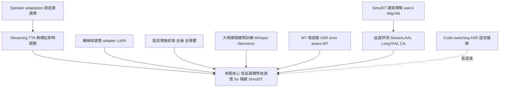
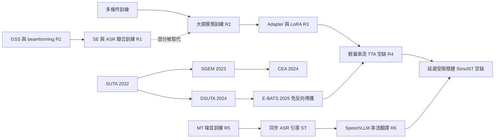
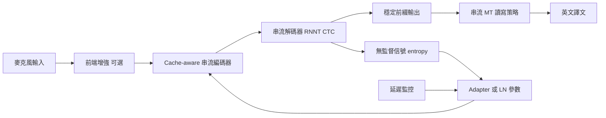

# 低延遲聲學自適應與穩健串流 ASR：在 SimulST 中兼顧品質與延遲的深度研究報告

> **核對狀態**：2026-11-07 於乾淨對話執行核對指令。共核對 80 項：通過 76、錯誤 1、無法核對 3（論文 52 項：49／1／2；表格數字 28 項：27／0／1）。
>
> **標註圖例**：`[核對：✓]` 已與原文一致；`[核對：…]` 附說明（錯誤、無法核對、推論寫成事實等）。標「二手」、無法核對或錯誤的內容一律不上投影片。

截至 2026-11-07，「讓串流 ASR 在辦公室殘響、噪音與通道失配下保持穩定，並把收益傳到下游串流 MT，同時不明顯拉高 SimulST 延遲」這件事，在文獻中沒有一個單一的現成題目；它橫跨「串流 ASR 的測試時適應（TTA）／參數高效域適應」與「SimulST 對 ASR 錯誤與噪音的穩健性」兩個社群，而兩者的交集（以延遲預算為約束、以翻譯品質為目標的聲學自適應）幾乎是空白。【推論】[核對：標【推論】但語氣寫成事實]

## TL;DR

- **正式名稱與定位**：最貼切的文獻名稱是「streaming／online test-time adaptation（TTA）for ASR」加上「robust（noise-、reverberation-、channel-robust）simultaneous speech translation」；既有 ASR TTA 方法（SUTA、SGEM、CEA、DSUTA、E-BATS）幾乎都在 utterance 層級、非串流設定下評測，而 CEA 作者自己寫明其方法「not specifically tailored for online streaming applications」。【共識】
- **最關鍵的實證事實**：ASR 錯誤確實傳到翻譯（BSTC 上同延遲下 ASR 輸入比人工轉寫約少 3.3–3.4 BLEU），而在噪音下 cascade 的 ASR 會幻覺、LLM 會放大錯誤；但在真實遠場會議挑戰 CHiME-7/8 中，C8 STCON、C7 IACAS-Thinkit、NTT 與 Cambridge 都用了 TTA，Cornell et al. 的回顧指出這些做法「only marginal improvements despite significant computational overhead」，NTT 的 C8 系統甚至放棄了偽標籤 TTA——因此「把 TTA 變便宜、變串流化、變成對翻譯有用」本身就是研究缺口。【共識】[核對：✓ BSTC 3.3–3.4 BLEU 與 CHiME 回顧引文皆與原文一致]
- **建議第二輪聚焦的路線**：(1) 輕量串流 TTA（Streaming-TTA，含免反向傳播與 LayerNorm／adapter 級更新）、(2) 參數高效離線域適應＋情境切換（PEFT-Adaptation，例如 NeMo adapters 搭配 cache-aware FastConformer）、(3) 下游容錯與聯合評測（MT-Robustness，並以 computation-aware 長音訊延遲指標評估）。【推論】

---

## §1 問題定義

### 1.1 從情境描述對應到文獻正式名稱

你描述的是：辦公室中的 reverberation（殘響）、noise（噪音）、channel mismatch（麥克風／通道失配）使 streaming ASR 出錯，錯誤傳遞到 streaming MT；你希望不只是做一個 ASR adapter，而是在 SimulST 架構下兼顧 quality 與 latency。它對應到以下幾個文獻名稱：

| 候選正式名稱 | 對應理由 | 與你需求的落差 |
|---|---|---|
| Test-Time Adaptation (TTA) for ASR，含 single-utterance TTA 與 continual TTA (CTTA) | 不需標註、不需來源資料，在推論時以無監督目標（如 entropy minimization）即時調整模型，正好對應「到新辦公室就要自己穩下來」 | 多為 utterance 層級、非串流；額外計算直接變成延遲 |
| Noise-robust／far-field／distant ASR (DASR) | 直接處理 noise、reverberation、多麥克風陣列 | 多為離線、會議轉寫導向；不考慮下游翻譯 |
| Unsupervised／online domain adaptation、parameter-efficient adaptation (adapter、LoRA) for ASR | 以少量參數適應新聲學環境，部署時可切換 | 通常需要目標域資料（有時需標註），非即時 |
| Robust simultaneous speech translation，含 ASR error propagation in cascaded ST | 直接處理「ASR 錯→MT 錯」 | 多從文字端（MT）補救，不處理聲學端 |
| Streaming speech translation (StreamST) 與 computation-aware latency evaluation | 定義你要守住的「延遲」怎麼量 | 本身不處理穩健性 |

**本報告選定名稱**：以「**Streaming test-time／online acoustic adaptation for robust cascaded SimulST**」作為工作名稱；搜尋時以「test-time adaptation ASR」「continual test-time adaptation speech」「noise robust ASR adapter」「simultaneous speech translation robustness／error propagation」「StreamLAAL／computation-aware latency」為主要關鍵字。【推論】

### 1.2 這個題目在解什麼、為什麼難

- **解什麼**：部署時的聲學分佈偏移（domain shift）——訓練資料多為近講、乾淨語音，部署環境卻有殘響、背景噪音、不同麥克風。Lin et al. 指出 end-to-end ASR「suffers severe performance regression on test samples drawn from different data distributions」。【共識】\[1\]\[2\]
- **為什麼難（四重約束）**：
  1. **無標註、無來源資料**：TTA 只能用無監督目標，容易 model collapse；DSUTA 論文指出 continual TTA「may suffer from model collapse if adaptation is unstable when the data stream is too long」。【單篇】\[3\][核對：✓]
  2. **延遲預算**：任何梯度更新都是額外運算。CEA 在 Wav2vec2 Base 上單句適應延遲約 1.07 秒（辨識本身約 1.20 秒）。【單篇】\[4\][核對：✓]
  3. **串流架構限制**：cache-aware streaming FastConformer 依靠有限 look-ahead 與 activation cache 運作，\[5\]模型參數若在串流中途改變，cache 一致性如何維持，文獻未見系統性討論。【推論】[核對：標【推論】但語氣寫成事實]
  4. **錯誤傳遞與評測困難**：ASR 錯誤傳到 MT（見 §4）；而 SimulST 延遲指標本身在長音訊、computation-aware 設定下也有偏差（CA*、YAAL 論文）。【共識】\[6\]\[7\]

### 1.3 在語音 AI／NLP 領域的位置

它位於「robust ASR（訊號處理＋聲學模型）」與「simultaneous translation（NLP 決策策略）」的接縫處，並受「大型預訓練／SpeechLLM」範式影響：CHiME-7/8 回顧分析了 9 隊、32 套系統，指出「nearly all CHiME-7/8 participants employ end-to-end ASR frameworks」，而這個轉變是由 WavLM、Whisper 等大型預訓練模型促成的。【單篇】[核對：✓ 9 隊、32 套與引文一致]

### 1.4 容易混淆的相鄰概念與 Mermaid 概念邊界圖

**節點**：本題核心、Streaming TTA、離線域適應 PEFT、語音增強前端、大規模穩健預訓練、Speaker adaptation、MT 端容錯、SimulST 讀寫策略、延遲評測、Code-switching ASR。
**邊**：Streaming TTA→本題核心（核心手段）；離線域適應 PEFT→本題核心（可預先準備）；語音增強前端→本題核心（替代或互補）；大規模穩健預訓練→本題核心（基線）；MT 端容錯→本題核心（下游補救）；延遲評測→本題核心（約束條件）；Speaker adaptation→Streaming TTA（相鄰但目標不同）；SimulST 讀寫策略→延遲評測（決定延遲）；Code-switching ASR→本題核心（語言偏移非聲學偏移，易混淆）。

說明：實線代表會被本題直接使用或約束的概念；虛線的 code-switching 屬於「語言／詞彙分佈偏移」，不是聲學偏移，處理方法（語言模型、詞表）與本題不同，需刻意區隔。Speaker adaptation 也常被當成 TTA，但 CEA 論文明確將 speaker change、environmental noise、pronunciation change、text-domain change 分成不同偏移來源。\[4\]

---

## §2 入門骨架

### 2.1 近三年 survey／tutorial

| 類型 | 文獻 | 年份 | 為什麼當骨架 |
|---|---|---|---|
| Survey（SimulST） | Liu et al., *Recent Advances in End-to-End Simultaneous Speech Translation*（IJCAI 2024）https://arxiv.org/abs/2406.00497 | 2024 | 以「長串流處理、即時性、品質延遲權衡、資料稀缺」四大挑戰整理 SimulST\[8\] [核對：✓] |
| 文獻回顧＋立場論文（SimulST） | Papi et al., *How "Real" is Your Real-Time Simultaneous Speech-to-Text Translation System?*（TACL 2025）https://arxiv.org/abs/2412.18495 | 2024–2025 | 回顧 110 篇論文，提出標準術語與分類，指出多數研究假設人工預分段\[9\] [核對：✓] |
| 挑戰回顧（穩健 ASR） | Cornell et al., *Recent Trends in Distant Conversational Speech Recognition: A Review of CHiME-7 and 8 DASR Challenges* https://arxiv.org/abs/2507.18161 | 2025 | 分析 9 隊 32 套系統，涵蓋 GSS 前端、TTA 與 LLM 後處理在真實遠場的效果；其中 STCON 的 Llama-2 重評分只讓 macro-tcpWER 絕對降低 0.5%，而以效率為導向的 NTTsmall 仍有 RTF 2.46 [核對：✓] |

**明說**：在本次搜尋範圍內，**沒有找到專門針對「ASR 的 test-time adaptation」或「串流 ASR 聲學自適應」的近三年 survey**。因此 TTA 這一支改以奠基論文為骨架：SUTA（https://arxiv.org/abs/2203.14222）、SGEM（https://arxiv.org/abs/2306.01981）、DSUTA（https://arxiv.org/abs/2406.11064）。串流 \[2\]\[10\]\[11\] ASR 這一支以 Noroozi et al. cache-aware streaming FastConformer（https://arxiv.org/abs/2312.17279）為骨架。 \[5\]

### 2.2 一個月閱讀順序

| 週 | 讀什麼（依序） | 為什麼先讀 | 讀完要能回答 |
|---|---|---|---|
| 第 1 週 | How "Real"（2412.18495）→ Liu et al. survey（2406.00497） | 先建立 SimulST 術語、分段假設與評測框架 | SimulST 與 StreamST 差在哪？為何人工預分段會讓結果失真？ |
| 第 2 週 | Noroozi et al.（2312.17279）→ CHiME-7/8 回顧（2507.18161）→ Shi & Kawahara adapter（2402.18275） | 了解你手上的 NeMo 串流模型怎麼運作、真實遠場最有效的手段是什麼 | cache 與 look-ahead 如何決定延遲？為何 GSS 前端仍是主流？adapter 該插在哪一層？ |
| 第 3 週 | SUTA（2203.14222）→ SGEM（2306.01981）→ CEA（2310.09505）→ DSUTA（2406.11064）→ E-BATS（2506.07078） | TTA 的演進主線，從單句到連續、從反向傳播到免反向傳播 | entropy minimization 為何有效又為何會崩潰？每句適應要花多少時間與記憶體？ |
| 第 4 週 | BSTC（2104.03575）→ Better Late Than Never（2509.17349）→ CA*（2410.16011）→ Hearing to Translate（2512.16378）→ StreamAtt（2406.06097） | 把 ASR 穩健性連到翻譯品質與延遲評測 | 中英 SimulST 中 ASR 錯誤造成多少 BLEU 損失？應該用哪個延遲指標？噪音下 cascade 與 SpeechLLM 誰較穩？ |

---

## §3 技術路線地圖

路線名稱（固定，下一輪沿用）：**R1 SE-Frontend**、**R2 Robust-Pretraining**、**R3 PEFT-Adaptation**、**R4 Streaming-TTA**、**R5 MT-Robustness**、**R6 E2E-SpeechLLM**。

### R1 SE-Frontend（語音增強／去殘響／陣列前端）
- **核心機制**：在 ASR 前加 speech enhancement、dereverberation（如 WPE）、beamforming（如 MVDR）或 guided source separation (GSS)；或與 ASR joint training。
- **代表論文**：CHiME-7/8 回顧（2507.18161）：所有隊伍都依賴 GSS，DNN 前端僅用於初始化或精修 GSS。\[12\]AISHELL-4（2104.03603）與 AliMeeting／M2MeT（2110.07393）提供 MVDR／beamforming 基線。\[13\]\[14\][核對：AISHELL-4 為 MVDR ✓；AliMeeting／M2MeT 基線為 CDDMA beamformer，非 MVDR]
- **優點**：可解釋、與 ASR 解耦；GSS 不需訓練資料、無域失配。【單篇】\[12\]
- **缺點**：GSS 類方法需整段上下文（「can span several tens of seconds」），與低延遲串流衝突；\[12\]單通道 DNN 增強可能產生 ASR 不喜歡的 artifacts（Shi & Kawahara 顯示在 SE 前端後再加 adapter 仍可大幅改善，間接說明前後端失配）。【推論】\[15\]\[16\]

### R2 Robust-Pretraining（大規模多條件預訓練）
- **核心機制**：以大量含噪資料、資料增強與 weak supervision 訓練，讓模型「天生」穩健。
- **代表**：NVIDIA cache-aware 串流模型（Nemotron streaming 系列，模型卡）；\[17\]CHiME 回顧指出 end-to-end＋預訓練模型取代 hybrid 系統。\[12\]
- **優點**：零推論額外成本；最直接的「延遲友善」方案。
- **缺點**：無法針對特定辦公室；CEA 論文 §6.4 顯示，經 TTA 的 Wav2vec2 Base 在 LS-C 噪音等級 1–4 都勝過未適應的 Whisper-Base（等級 3 時 WER 24.0 vs 30.1）。【單篇】[核對：✓]

### R3 PEFT-Adaptation（參數高效離線域適應）
- **核心機制**：凍結主幹，只訓練 adapter／LoRA 等少量參數，針對特定噪音或場所預先訓練，部署時載入或切換。
- **代表論文**：Shi & Kawahara（2402.18275）：在 CHiME-4 上 adapter 放淺層最有效、只調淺層與調全部層無顯著差異、真實資料比模擬資料有效、與 SE 前端結合有大幅改善。\[15\]\[16\]NeMo 官方文件支援 linear／MHA／tiny-attention adapters，且 LinearAdapter 最後一層初始化為零。\[18\]\[19\][核對：MHA／tiny-attention adapter 未核對]
- **優點**：推論幾乎無額外延遲；可依場所切換。
- **缺點**：需要目標域資料；切換時機需偵測；本次未找到在 cache-aware 串流模型上做 adapter／LoRA 的論文。【單篇＋推論】[核對：「本次未找到…」為推論寫成事實]

### R4 Streaming-TTA（測試時適應，含連續與免反向傳播）
- **核心機制**：推論時以無監督損失（entropy minimization、minimum class confusion、consistency）更新少量參數（LayerNorm affine、feature extractor、prompt），單句（episodic）或連續（continual）。
- **代表論文演進**：SUTA（2022，首個 ASR TTA）→ SGEM（2023，序列層級、支援 autoregressive 與 beam search）→ CEA（2023–2024，信心加權、短期一致性）→ DSUTA（2024，fast-slow 架構＋dynamic reset 偵測域切換）→ E-BATS（NeurIPS 2025，免反向傳播 CMA-ES prompt adaptation，2.0–6.4 倍 GPU 記憶體節省）。\[1\]\[2\]\[10\]\[11\]\[20\]\[21\]\[22\]
- **優點**：免標註、即時；正對應「進入新房間就自己調整」。
- **缺點**：每步都是延遲；在真實遠場會議中，CHiME 回顧指出 TTA「only marginal improvements despite significant computational overhead」；多數只在 CTC／wav2vec2 類模型測，transducer 串流模型測得少。【共識】

### R5 MT-Robustness（下游容錯）
- **核心機制**：讓 MT 對 ASR 錯誤有抵抗力——以 ASR 輸出微調 MT、加入合成噪音、文字改寫（rewrite）、多來源翻譯；或用串流 ASR 結果引導直接 ST 的讀寫策略。
- **代表**：BSTC（2104.03575）以 ASR 輸出微調 MT；Chen et al.（2106.06636）以同步串流 ASR 引導直接 SimulST 的決策；\[23\]Wu et al. COLING 2025 text rewrite（ACL Anthology 2025.coling-industry.28）。\[24\]\[25\]
- **優點**：與聲學端正交，可疊加。
- **缺點**：無法救回 ASR 已遺失的資訊；在噪音下 ASR 幻覺會被 LLM 放大（Hearing to Translate）。【單篇】\[26\]

### R6 E2E-SpeechLLM（端到端／SpeechLLM 串流翻譯）
- **核心機制**：直接從語音到譯文，或以 speech encoder＋adapter＋LLM；串流版本如 StreamAtt、InfiniSST。
- **代表**：StreamAtt（2406.06097，首個 StreamST policy 與 StreamLAAL）；\[27\]Hearing to Translate（2512.16378）發現在噪音條件下，除 Spire 外的 SpeechLLMs 比 SFM 與 cascade 同等或更穩健。\[26\]\[28\]
- **優點**：避免文字瓶頸的錯誤傳遞；對噪音較穩。
- **缺點**：計算重、延遲高（最佳 cascade 與 Qwen3-Omni 需要 SFM 的 27–34 倍延遲）[核對：✓；原文指 Aya cascade 與 Qwen3-Omni]；長音訊退化；\[26\]聲學自適應在 E2E 內部如何做尚少研究。【單篇】

### 演進樹（Mermaid）

**節點**：多條件訓練、GSS 與 beamforming、SE 與 ASR 聯合訓練、大規模預訓練、Adapter 與 LoRA、SUTA、SGEM、CEA、DSUTA、E-BATS、輕量串流 TTA 空缺、MT 噪音訓練、同步 ASR 引導 ST、SpeechLLM 串流翻譯、延遲受限穩健 SimulST 空缺。
**邊**：多條件訓練→大規模預訓練；GSS 與 beamforming→SE 與 ASR 聯合訓練；SE 與 ASR 聯合訓練→大規模預訓練（部分被取代）；大規模預訓練→Adapter 與 LoRA；SUTA→SGEM→CEA；SUTA→DSUTA→E-BATS；Adapter 與 LoRA→輕量串流 TTA 空缺；E-BATS→輕量串流 TTA 空缺；MT 噪音訓練→同步 ASR 引導 ST→SpeechLLM 串流翻譯；輕量串流 TTA 空缺→延遲受限穩健 SimulST 空缺；SpeechLLM 串流翻譯→延遲受限穩健 SimulST 空缺。

說明：R1 的 DNN 前端在真實遠場中尚未取代 GSS，但「SE 與 ASR 聯合訓練」正被大規模預訓練部分取代；R3 與 R4 正合流到「只更新極少參數、甚至免反向傳播」的方向；R5 與 R6 則在 SimulST 端合流。兩個「空缺」節點是本報告推論的研究機會，不是既有文獻。

### 在 cascade SimulST 中，自適應可插入的位置（Mermaid）

**節點**：麥克風輸入、前端增強、Cache-aware 串流編碼器、Adapter 或 LN 參數、串流解碼器 RNNT CTC、穩定前綴輸出、串流 MT 讀寫策略、英文譯文、無監督信號 entropy、延遲監控。
**邊**：麥克風輸入→前端增強→Cache-aware 串流編碼器→串流解碼器→穩定前綴輸出→串流 MT 讀寫策略→英文譯文；Adapter 或 LN 參數→Cache-aware 串流編碼器；串流解碼器→無監督信號 entropy→Adapter 或 LN 參數；延遲監控→Adapter 或 LN 參數（決定是否更新）。

說明：這張圖是【推論】的系統視角，把 R1、R3、R4 對應到 cascade 中的具體位置；關鍵設計問題是「何時更新、更新多少參數、更新後 cache 如何處理」，以及更新是否應以下游 MT 的信號（而不只 ASR entropy）引導。

---

## §4 評測現況

### 4.1 常用資料集、指標與代表數字

| 資料集 | 指標 | 數字 | 來源論文（URL） | 測試條件 | 數字來源類型 | 日期 |
|---|---|---|---|---|---|---|
| LibriSpeech test-other（串流） | WER | RNNT 5.4%＠1040 ms、5.7%＠480 ms、6.4%＠80 ms、7.0%＠0 ms；CTC 6.2／6.7／7.8／8.4%\[29\] | NVIDIA 模型卡 stt_en_fastconformer_hybrid_large_streaming_multi https://huggingface.co/nvidia/stt_en_fastconformer_hybrid_large_streaming_multi；方法見 https://arxiv.org/abs/2312.17279 | 114M、cache-aware、串流、未註明外部 LM | 官方模型卡自報 | 2023–2024 [核對：✓] |
| 串流吞吐量（單張 H100） | 同時串流數 | Nemotron 3.5 ASR Streaming 0.6B：80 ms 時 240 路 vs Parakeet RNNT 1.1B buffered 14 路；1120 ms 時 2,400 vs 400\[30\] | https://huggingface.co/nvidia/nemotron-3.5-asr-streaming-0.6b | 0.6B、cache-aware、多語；zh-CN 僅為 broad-coverage 等級\[30\] | 官方模型卡自報 | 2026-06-04 [核對：✓] |
| LS-C（LibriSpeech test-other＋高斯噪音，五級平均） | WER | Source 31.6 → SUTA 25.1 → CEA 24.8\[4\]\[31\] | https://arxiv.org/abs/2310.09505 | Wav2vec2 Base、greedy、單句 TTA、非串流 | 論文自報 | 2023-10（v2 2024-10）[核對：與原文表 1 一致，但原文平均欄與各級數值不自洽] |
| CHiME-3 | WER | Source 31.2 → SUTA 25.0 → CEA 24.5\[4\] | https://arxiv.org/abs/2310.09505 | Wav2vec2 Base、greedy、非串流 | 論文自報 | 2024 [核對：✓] |
| L2-Arctic 中文母語者（speaker BWC） | WER | Source 28.5 → SUTA 23.3 → CEA 23.0\[4\] | https://arxiv.org/abs/2310.09505 | Wav2vec2 Base、英語口音偏移 | 論文自報 | 2024 [核對：✓] |
| 四個含噪資料集、16 種聲學條件 | 相對準確率提升、記憶體 | 比免反向傳播基線好 4.1–13.5%；比反向傳播法省 2.0–6.4 倍 GPU 記憶體\[20\] | https://arxiv.org/abs/2506.07078 | Wav2Vec2-Base、HuBERT-Large、單句 TTA | 論文自報 | 2025-06（NeurIPS 2025）[核對：✓；原文未寫明為「相對」提升] |
| CHiME-7/8 DASR（CHiME-6、DiPCo、Mixer 6） | macro tcpWER | STCON（C8）macro 19.9%、CHiME-6 33.6%；回顧原文：「Even for the best performing systems, the tcpWER for CHiME-6 remains above 30%」 | https://arxiv.org/abs/2507.18161 | 多通道、多說話者、ensemble＋神經 LM、非串流 | 挑戰官方結果（回顧論文圖表讀數） | 2025-07（v2 2025-11）[核對：✓（Figure 6 讀數）] |
| AISHELL-4 Eval（中文會議、8 通道） | CER | 無前端 32.56%、有前端 30.49%（oracle 分段）；說話者相依 41.55%／39.86%\[14\] | https://arxiv.org/abs/2104.03603 | Transformer CTC／attention、MVDR 前端、非串流 | 論文自報基線 | 2021 [核對：✓] |
| AliMeeting Eval（中文會議） | CER | 近講 7.8–9.9%；遠場單通道 33.3–49.0%；最佳 SOT＋beamforming 29.7%\[13\] | https://arxiv.org/abs/2110.07393 | Conformer、含外部資料與模擬噪音殘響、非串流 | 挑戰基線自報 | 2021–2022 [核對：✓；「含外部資料與模擬噪音殘響」只適用 Conformer C/D] |
| BSTC test（中→英） | ASR CER；BLEU／AL | 串流 ASR CER 10.32%；SimulMT ASR 輸入 BLEU 34.12→36.79（AL 7.28→10.87）vs 轉寫輸入 37.54→40.12（AL 7.20→10.74）\[24\] | https://arxiv.org/abs/2104.03575 | Baidu SMLTA 串流 ASR＋MU 分段 SimulMT；4 份參考譯文；AL 單位未註明 | 論文自報 | 2021-04 [核對：✓] |
| BSTC dev（中→英） | CER；BLEU／BLEURT／COMET | CER 14.8；ASR→MT 16.2／57.6／71.7 → 加 rewrite 17.7／59.6／72.9\[25\] | https://aclanthology.org/2025.coling-industry.28.pdf | UniASR＋Transformer-base MT、整句（非同步） | 論文自報 | 2025-01 [核對：✓] |
| ACL 60/60 dev（英→中） | BLEU；StreamLAAL | CMU：44.3 BLEU、StreamLAAL 2189 ms、computation-aware 2739 ms\[32\]\[33\] | https://arxiv.org/abs/2506.13143（二手） | Wav2Vec2 chunkwise＋Qwen2.5-7B、E2E、長音訊 | 論文自報 | 2025-06 [核對：二手，不上投影片；ms 值來自二手評論，原文摘要為 2.2／2.7 s] |
| ACL 60/60 dev（英→中，cascade） | BLEU；StreamLAAL | BeaverTalk：34.07／37.23 BLEU，StreamLAAL 2216.99／3521.35\[34\] | https://arxiv.org/abs/2505.24016（二手） | Whisper＋Gemma 3 12B cascade | 論文自報 | 2025 [核對：數字一致；報告標二手，不上投影片] |
| NoisyFLEURS（babble 與 ambient 噪音） | ∆noise（xCOMET-QE 相對下降） | 所有模型在 babble 噪音下 ∆noise 至少 38；除 Spire 外 SpeechLLMs 較 cascade 與 SFM 穩\[26\] | https://arxiv.org/abs/2512.16378 | 22 套系統、<32B、離線 ST\[26\] | 論文自報（第三方大型比較） | 2025-12（v4 2026-04）[核對：✓；v4 版本未核對] |

### 4.2 評測本身的問題

1. **延遲指標不可靠**：Polák et al. 發現 IWSLT 2023 中不同延遲指標給出不同排名；包含退化策略系統時，YAAL 對 true latency 的成對比較準確率 98%，其他指標落後超過 25 個百分點；短格式評測中 41%（1–2 秒延遲區間）到 72%（4–5 秒）的字在分段結束後才輸出，等於離線翻譯。【單篇】\[7\][核對：✓]
2. **長音訊重分段影響巨大**：StreamLAAL（使用 mWERSegmenter）準確率 82%，LongYAAL 搭配 SoftSegmenter 達 94%。【單篇】\[7\][核對：✓]
3. **computation-aware 延遲算錯**：CA* 指出 computation-aware LAAL 會隨語音長度從 25 秒時 6850 ms 暴增到 100 秒時 23460 ms，但 computation-unaware 約維持 8181 ms；即使約 5 秒的預分段語音，AL 與 LAAL 誤差也超過 300 ms。【單篇】[核對：✓]——這對你的題目特別重要：\[6\]TTA 的額外計算只會在 computation-aware 指標中出現。
4. **人工預分段假設**：How Real 回顧 110 篇論文，91.8% 未明確承認使用了人工預分段語音。【單篇】\[35\][核對：無法核對，摘要無此數字]
5. **穩健性與翻譯評測脫節**：ASR 穩健性論文報 WER，SimulST 論文報 BLEU／延遲，兩邊很少同時在噪音條件下報告；CHiME 回顧更指出，NOTSOFAR-1 上以 Gemini 2.0 Flash 做下游摘要時，「even systems with over 50% … tcpWER can perform roughly on par with the most effective ones (around 11%)」。【共識＋推論】[核對：Gemini 2.0 Flash 引文 ✓；「兩邊很少同時報告」為推論寫成事實]
6. **TTA 延遲報告不一致**：SUTA、SGEM、CEA 各自以不同 GPU、不同句長報告適應時間，且皆非串流 chunk 層級量測。【推論】[核對：標【推論】但語氣寫成事實]

---

## §5 學術與工業動態（精簡）

- **論文量趨勢**：本輪**未執行**任何資料庫的計數查詢，依規定不提供數量。建議下一輪以 arXiv 進階搜尋（例如標題／摘要含 "test-time adaptation" AND "speech recognition"，2023-01-01 至 2026-11-07）與 ISCA Archive（Interspeech 2023–2026）記錄查詢式與筆數。
- **活躍團隊（依本次開啟論文觀察，非計量）**：國立臺灣大學李宏毅團隊（SUTA、DSUTA、LatentASR）[核對：arXiv 編號與作者無法核對]；KAIST（SGEM）；新加坡國立大學（CEA）；墨爾本大學等（E-BATS）；FBK 與 Charles University（StreamAtt、How Real、YAAL）；CMU（InfiniSST、CA*、IWSLT 系統）；NVIDIA NeMo（cache-aware FastConformer、CHiME-8 NeMo 基線）；NTT、STCON（CHiME-8 頂尖系統）。
- **開源工具鏈**：NVIDIA NeMo（cache-aware streaming、adapters 訓練腳本 examples/asr/asr_adapters/train_asr_adapter.py）；SimulEval；OmniSTEval（YAAL、LongYAAL、SoftSegmenter）；simulstream（StreamLAAL\[17\]\[36\] 重新實作，二手）[核對：未核對]；chime-utils；SUTA、CEA、E-BATS 皆有公開程式碼。\[7\]\[37\]
- **產品化**：NVIDIA 以 Nemotron streaming 模型強調低延遲高並發；IWSLT\[30\] 已將長音訊、computation-aware 延遲列為正式評測；具體商業同步翻譯產品的聲學自適應做法，本輪未找到可驗證的一手技術文件。\[38\]\[39\]

---

## §6 成熟度判斷

| 子領域 | 判斷 | 依據 |
|---|---|---|
| 噪音／遠場穩健 ASR（離線） | **成熟** | CHiME 系列逾十年、基線與工具鏈完整；頂尖系統以 GSS＋預訓練 E2E＋ensemble 為共同配方【共識】\[12\] |
| ASR 的 TTA（單句） | **快速成長** | 2022 年 SUTA 起，2023–2025 年 SGEM、CEA、DSUTA、E-BATS 接連出現，\[1\]\[20\]\[21\]並擴展到兒童語音等應用；\[40\]但仍多在 CTC／wav2vec2 類模型【共識】 |
| 串流 ASR 的 TTA／低延遲聲學自適應 | **萌芽** | 本次未找到在 cache-aware 或 transducer 串流架構上、以 chunk 層級延遲報告的 TTA 論文；CEA 明言未針對串流設計【推論】\[4\] |
| 穩健 SimulST（聲學端到翻譯端聯合） | **萌芽** | 錯誤傳遞研究多在 MT 端；本次未找到 2023–2026 年在受控噪音或口音下評測中→英 SimulST 的論文【推論】 |
| 整體範式壓力 | **部分被更大範式吸收中** | 大規模預訓練與 SpeechLLM 提升了原生穩健性（Hearing to Translate 顯示 SpeechLLM 在噪音下較穩），\[26\]且 CHiME 回顧發現 TTA 在強系統上邊際效益小；這意味「純 ASR TTA」的空間在縮小，但「延遲受限＋翻譯導向」的自適應仍空白【推論】 |

---

## §7 未解問題與空缺

### 7.1 文獻中反覆提到但未解決的問題

| # | 未解問題 | 提到它的論文 |
|---|---|---|
| 1 | TTA 尚未針對串流設計，串流下的延遲降低是必要的未來工作\[4\] | CEA, https://arxiv.org/abs/2310.09505 |
| 2 | 連續 TTA 在長串流中的 model collapse 與域切換偵測\[11\] | DSUTA, https://arxiv.org/abs/2406.11064 |
| 3 | 反向傳播式 TTA 記憶體開銷大，不適合資源受限部署\[20\]\[41\] | E-BATS, https://arxiv.org/abs/2506.07078 |
| 4 | TTA 在真實遠場會議中只有邊際改善，且計算成本顯著，實用價值存疑\[12\] | CHiME-7/8 回顧, https://arxiv.org/abs/2507.18161 |
| 5 | TTA 難以處理 text-domain shift（無法取得目標域文字）\[4\] | CEA, https://arxiv.org/abs/2310.09505 |
| 6 | 串流 ASR 錯誤傳遞與額外延遲是 cascade SimulST 的兩大限制\[23\] | Chen et al., https://arxiv.org/abs/2106.06636 |
| 7 | 噪音下 ASR 幻覺被下游 LLM 傳遞或放大\[26\] | Hearing to Translate, https://arxiv.org/abs/2512.16378 |
| 8 | 延遲指標在長音訊與 computation-aware 設定下偏差\[6\]\[7\] | CA*, https://arxiv.org/abs/2410.16011；Better Late Than Never, https://arxiv.org/abs/2509.17349 |
| 9 | 多數 SimulST 研究依賴人工預分段，脫離真實應用\[9\] | How Real, https://arxiv.org/abs/2412.18495 |
| 10 | SE 前端與 ASR 後端失配；模擬資料效果不如等量真實資料\[15\]\[16\] | Shi & Kawahara, https://arxiv.org/abs/2402.18275 |
| 11 | 跨場景泛化困難：為某場景最佳化的系統在另一場景退化\[12\]\[42\] | CHiME-7/8 回顧, https://arxiv.org/abs/2507.18161 |

### 7.2 繁體中文／台灣語境的空缺

- **台灣華語口音與台灣辦公室聲學**：AISHELL-4 與 AliMeeting 的說話者都是「沒有強烈口音」的母語者，\[13\]\[14\]且為中國大陸錄製；本次未找到以台灣華語、台灣辦公室殘響條件建置的遠場中文會議語料。【推論，未系統查證】
- **方言／變體敏感度**：Hearing to Translate 的 ManDi 實驗顯示，cascade 系統對標準普通話有明顯偏好，非標準變體表現較差；\[26\]台灣華語是否有同樣落差未見報告。【單篇＋推論】
- **開源串流模型對中文支援程度**：Nemotron 3.5 ASR Streaming 中 zh-CN 僅為 broad-coverage 等級，非 transcription-ready；模型卡未見 zh-TW 條目（子代理觀察）。【單篇】\[30\][核對：屬實]
- **中英 code-switching 與聲學偏移疊加**：台灣職場常見中英夾雜；聲學偏移與語言偏移同時出現時，entropy 類 TTA 可能把語言不確定性誤當聲學不確定性。本次未找到相關研究。【推論】
- **缺乏中→英、含噪條件的 SimulST 基準**：BSTC 是講座錄音、CER 約 10%，\[24\]並非受控噪音或殘響條件。【推論】[核對：屬實（講座錄音、test CER 10.32%）]

---

## §8 商機（精簡）

- **付費場景**：跨國企業會議即時字幕與翻譯、展會與記者會同步口譯、客服通話即時翻譯、教育講座字幕。【推論】
- **現有痛點**：會議室麥克風與殘響差異大、免持裝置 channel mismatch；ASR 錯誤經 LLM 翻譯後「流暢地錯」更難察覺（Hearing to Translate 觀察到 cascade 在噪音下的幻覺傳遞）；\[26\]高並發部署下任何每句額外計算都會壓縮吞吐量（Nemotron 模型卡以並發路數為賣點）。【單篇＋推論】
- **學研轉化形態**：(a) 以場所為單位的 adapter 套件（安裝時錄幾分鐘即生成）；(b) 免反向傳播、只調 LayerNorm 或 prompt 的輕量自適應模組；(c) 翻譯導向的穩健性評測服務。【推論】
- **風險**：大型預訓練模型版本更新可能直接吃掉自適應收益；TTA 不穩定導致線上崩潰的責任問題；評測指標不一致使宣稱的延遲改善難以被客戶驗證。【推論】

---

## §9 切入前要確認的問題（需實驗室內部回答）

| # | 問題 | 為什麼這個問題會影響選題 |
|---|---|---|
| 1 | 實驗室目前有哪些含真實殘響、噪音、不同麥克風的中文（最好是台灣華語）語音資料？有無對應英文譯文？ | 沒有真實目標域資料就只能做 TTA 或模擬；Shi & Kawahara 顯示真實資料比等量模擬資料更有效，決定 R3 是否可行\[15\]\[16\] |
| 2 | 是否能取得或錄製多通道陣列資料？部署端是單麥克風還是陣列？ | 決定 R1（beamforming／GSS）是否在考慮範圍，以及延遲上限 |
| 3 | 指導教授希望維持 cascade（NeMo 串流 ASR＋串流 MT）還是轉向 E2E／SpeechLLM？ | R4 與 R3 主要作用在 cascade 的 ASR 端；若走 R6，自適應位置與方法完全不同 |
| 4 | 可接受的延遲預算是多少（例如 computation-aware StreamLAAL 或 LongYAAL 上限）？目標硬體是 GPU 伺服器還是邊緣裝置？ | 決定 TTA 能否用反向傳播、更新頻率與 chunk 大小；E-BATS 類免反向傳播方法在邊緣裝置才有決定性優勢\[20\] |
| 5 | 先前 chunk 大小 benchmark 與 CER 評測的結果與程式碼能否沿用？是否已建立 computation-aware 延遲量測流程？ | 若已有基線，可直接把「自適應帶來的 CER 改善 vs 延遲增加」畫成新的權衡曲線，大幅降低起步成本 |
| 6 | 串流 MT 端目前用什麼模型與讀寫策略？能否取得其內部信號（如信心、注意力）？ | 決定能否做「翻譯導向」的自適應信號（以 MT 信心引導 ASR 更新），這是本報告推論的主要空缺 |
| 7 | 實驗室是否有 code-switching ASR 或 Speech LLM 的既有成果要延續？ | 若要整合，需要區分聲學偏移與語言偏移，題目範圍與評測集都會改變 |
| 8 | GPU 資源是否足以微調 0.6B 等級串流模型或跑多次 TTA 消融？ | 決定能否在 Nemotron 等大模型上實驗，或必須用 114M 等級模型 |

---

## Caveats

- 表 4.1 中標示「二手」的數字僅來自搜尋摘要，未開原文核對。
- CHiME-7/8 的 19.9% 與約 33.6% 是從回顧論文 Figure 6 的數字讀取，圖中系列對應關係依文字敘述推定。
- BSTC 論文中稱為 WER 的數字實際按中文字元計算（即 CER），AL 單位未註明。
- 子代理從 NVIDIA 模型卡取得的英文 Nemotron 各 chunk WER 表格未完整讀取，故未列入。
- 本報告未納入中文來源，可能低估中國大陸與台灣相關團隊在中文會議與口譯情境的工作。
- 「萌芽」「空缺」判斷基於約 18 次搜尋與數十篇論文，並非系統性文獻回顧，可能遺漏 2026 年新作。

---

## Glossary（術語表）

| 術語 | 說明 |
|---|---|
| ASR | Automatic Speech Recognition，自動語音辨識 |
| MT | Machine Translation，機器翻譯 |
| SimulST | Simultaneous Speech Translation，同步語音翻譯，通常指在預分段語音上邊聽邊譯 |
| StreamST | Streaming Speech Translation，處理未分段、無限長音訊串流的語音翻譯 |
| Cascade | 串接式系統：ASR → MT |
| E2E | End-to-end，端到端，直接語音到譯文 |
| SpeechLLM | 以語音編碼器接上大型語言模型的系統 |
| SFM | Speech Foundation Model，語音基礎模型（如 Whisper、Seamless、Canary） |
| TTA | Test-Time Adaptation，測試時適應，推論時用無標註測試資料調整模型 |
| CTTA | Continual TTA，連續測試時適應，不在每句後重置模型 |
| SUTA | Single-Utterance Test-time Adaptation，單句 TTA 方法 |
| SGEM | Sequential-level Generalized Entropy Minimization |
| CEA | Confidence-Enhanced Adaptation |
| DSUTA | Dynamic SUTA，含 fast-slow 架構與 dynamic reset |
| E-BATS | Efficient Backpropagation-free TTA for Speech foundation models |
| Entropy minimization | 讓模型輸出分佈更「尖銳」的無監督目標 |
| Model collapse | 無監督更新使模型退化為固定輸出 |
| CMA-ES | Covariance Matrix Adaptation Evolution Strategy，免梯度最佳化法 |
| PEFT | Parameter-Efficient Fine-Tuning，參數高效微調 |
| Adapter | 插入凍結模型中的小型可訓練模組 |
| LoRA | Low-Rank Adaptation，低秩適應 |
| LayerNorm affine | Layer normalization 的 scale 與 shift 參數 |
| SE | Speech Enhancement，語音增強 |
| WPE | Weighted Prediction Error，去殘響方法 |
| MVDR | Minimum Variance Distortionless Response，波束成形法 |
| GSS | Guided Source Separation，以分段資訊引導的空間分離 |
| DASR | Distant ASR，遠場語音辨識 |
| CHiME | 遠場與噪音語音辨識系列挑戰 |
| Reverberation | 殘響 |
| Channel mismatch | 通道（麥克風、傳輸）失配 |
| Domain shift | 訓練與測試分佈偏移 |
| FastConformer | NVIDIA 提出的高效 Conformer 變體（8 倍下採樣） |
| Cache-aware streaming | 以快取保存先前 activation，使非自迴歸編碼器能逐塊推論 |
| Look-ahead | 串流模型可看的未來上下文長度 |
| Chunk | 串流推論的音訊區塊 |
| RNNT | RNN-Transducer，串流常用解碼架構 |
| CTC | Connectionist Temporal Classification |
| WER／CER | Word／Character Error Rate，詞／字錯誤率 |
| tcpWER | time-constrained concatenated minimum-permutation WER，CHiME-8 排名指標 |
| BLEU、COMET、xCOMET | 翻譯品質指標；COMET 類為神經指標 |
| QE | Quality Estimation，無參考譯文的品質估計 |
| AL | Average Lagging，平均落後 |
| LAAL | Length-Adaptive Average Lagging |
| StreamLAAL | LAAL 的長音訊版本，以重分段後計算 |
| YAAL／LongYAAL | Yet Another Average Lagging 及其長音訊版本 |
| CA／CU | Computation-Aware／Unaware，是否把運算時間算入延遲 |
| CA* | 修正後的 computation-aware 延遲計算 |
| Wait-k、AlignAtt | SimulST 讀寫策略 |
| Tail words | 分段結束後才輸出的譯字 |
| SOT | Serialized Output Training，多說話者 ASR 訓練法 |
| ROVER | 多系統輸出投票融合 |
| Code-switching | 語碼轉換，如中英夾雜 |
| BSTC | Baidu Speech Translation Corpus，中→英語音翻譯語料 |
| RTF | Real-Time Factor，即時因子 |

---

## (a) 搜尋紀錄

**使用的資料庫與工具**：通用網頁搜尋（涵蓋 arXiv、ISCA Archive、ACL Anthology、Semantic Scholar、NeurIPS proceedings 結果頁）；直接開啟 arXiv 摘要頁或 PDF；子代理另開啟 arXiv PDF、ACL Anthology PDF、Hugging Face NVIDIA 模型卡與 NVIDIA NeMo 官方文件。

**查詢式（共 18 次，主代理）**：
1. test-time adaptation ASR SUTA single utterance
2. continual test-time adaptation streaming ASR arXiv
3. simultaneous speech translation robustness noise ASR errors cascade
4. simultaneous speech translation survey 2024 2025 arXiv
5. IWSLT 2025 simultaneous track findings StreamLAAL
6. cache-aware streaming FastConformer stateful conformer arXiv
7. noise-robust speech recognition survey 2024 deep learning speech enhancement joint training
8. CHiME-8 challenge results distant ASR DASR
9. test-time adaptation streaming ASR latency transducer online
10. Exploration of adapter for noise robust automatic speech recognition
11. StreamAtt StreamLAAL Papi 2024 streaming speech translation latency metric
12. Better Late Than Never evaluation latency metrics simultaneous speech-to-text translation
13. Chinese-English simultaneous speech translation streaming ASR error propagation 2025
14. survey simultaneous translation large language models speech 2025 arXiv
15. "Recent Advances in End-to-End Simultaneous Speech Translation" arXiv survey
16. E-BATS backpropagation-free test-time adaptation speech foundation models
17. Whisper robustness test-time adaptation noise reverberation 2025 arXiv speech
18. simultaneous speech translation noisy speech robustness evaluation benchmark

**未找到或無法存取**：
- AISHELL-4／AliMeeting 與 Nemotron 模型卡的搜尋因主代理搜尋額度用盡而失敗，改由子代理完成。
- 未找到專門的「ASR TTA」survey，也未找到「串流 ASR TTA」論文。
- 未找到 2023–2026 年在受控噪音或口音下評測中→英 SimulST 的論文。
- 未找到在 cache-aware 串流 FastConformer 上做 adapter／LoRA 的論文。
- 英文 Nemotron 串流模型的各 chunk WER 表格未完整讀取。
- 未執行任何論文數量計數查詢。

### 已開啟原文的論文

[核對：下表皆確認存在、URL 正確 ✓]

| 論文 | URL |
|---|---|
| Lin et al., SUTA (Interspeech 2022) | https://arxiv.org/abs/2203.14222 |
| Kim et al., SGEM (Interspeech 2023) | https://arxiv.org/abs/2306.01981 |
| Liu et al., CEA, Advancing TTA in Wild Acoustic Test Settings | https://arxiv.org/abs/2310.09505 |
| Lin et al., DSUTA, Continual TTA for E2E ASR on Noisy Speech | https://arxiv.org/abs/2406.11064 |
| Dong et al., E-BATS (NeurIPS 2025) | https://arxiv.org/abs/2506.07078 |
| Shi & Kawahara, Exploration of Adapter for Noise Robust ASR | https://arxiv.org/abs/2402.18275 |
| Noroozi et al., Stateful Conformer with Cache-based Inference | https://arxiv.org/abs/2312.17279 |
| Cornell et al., Review of CHiME-7 and 8 DASR Challenges | https://arxiv.org/abs/2507.18161 |
| Fu et al., AISHELL-4（子代理開啟 PDF） | https://arxiv.org/abs/2104.03603 |
| Yu et al., M2MeT／AliMeeting（子代理開啟 PDF） | https://arxiv.org/abs/2110.07393 |
| Zhang et al., BSTC（子代理開啟 PDF） | https://arxiv.org/abs/2104.03575 |
| Wu et al., Improve Speech Translation Through Text Rewrite, COLING 2025 Industry（子代理開啟） | https://aclanthology.org/2025.coling-industry.28.pdf |
| DuTongChuan（子代理開啟） | https://arxiv.org/pdf/1907.12984 |
| Chen et al., Direct SimulST Assisted by Synchronized Streaming ASR | https://arxiv.org/abs/2106.06636 |
| Liu et al., Recent Advances in E2E SimulST (IJCAI 2024) | https://arxiv.org/abs/2406.00497 |
| Papi et al., How "Real" is Your Real-Time SimulST System? | https://arxiv.org/abs/2412.18495 |
| Papi et al., StreamAtt (ACL 2024) | https://arxiv.org/abs/2406.06097 |
| Xu et al., CA*: Computation-Aware Latency Pitfalls | https://arxiv.org/abs/2410.16011 |
| Polák et al., Better Late Than Never | https://arxiv.org/abs/2509.17349 |
| Papi et al., Hearing to Translate | https://arxiv.org/abs/2512.16378 |
| NVIDIA 模型卡與文件（子代理開啟；非論文） | https://huggingface.co/nvidia/nemotron-speech-streaming-en-0.6b ；https://huggingface.co/nvidia/nemotron-3.5-asr-streaming-0.6b ；https://huggingface.co/nvidia/stt_en_fastconformer_hybrid_large_streaming_multi ；https://docs.nvidia.com/nemo-framework/user-guide/24.12/nemotoolkit/core/adapters/components.html [核對：NeMo 24.12 文件頁未能直接開啟] |

### 二手（僅從搜尋摘要或他文引用得知，未開原文）

[核對：共 28 項，除 LatentASR 外皆確認存在，有 URL 者 URL 皆正確；二手內容不上投影片]

- Shi et al., Examining TTA for Personalized Child Speech Recognition, https://arxiv.org/abs/2409.13095
- Chung et al., LatentASR, https://arxiv.org/abs/2607.05051[核對：arXiv 編號與作者無法核對]
- Ouyang et al., CMU's IWSLT 2025 SimulST System, https://arxiv.org/abs/2506.13143
- BeaverTalk, OSU IWSLT 2025, https://arxiv.org/abs/2505.24016
- MLLP-VRAIN UPV IWSLT 2025, https://arxiv.org/abs/2506.18828
- CUNI IWSLT 2025, https://arxiv.org/abs/2506.17077
- NAIST IWSLT 2025, https://aclanthology.org/2025.iwslt-1.39.pdf
- Findings of the IWSLT 2024 Evaluation Campaign, https://arxiv.org/abs/2411.05088
- Findings of the IWSLT 2025 Evaluation Campaign（僅見引用）[核對：無 URL，但確認存在]
- Cornell et al., CHiME-8 DASR Challenge, https://arxiv.org/abs/2407.16447
- Kamo et al., NTT System for CHiME-8, https://arxiv.org/abs/2502.09859
- Shah et al., Speech Robust Bench, https://arxiv.org/abs/2403.07937
- Radford et al., Whisper, https://arxiv.org/abs/2212.04356
- Whisper-RIR-Mega, https://arxiv.org/abs/2603.02252
- Reducing the Offline-Streaming Gap for Unified ASR Transducer, https://arxiv.org/abs/2604.19079[核對：✓；完整標題多了 with Consistency Regularization]
- X2Streaming-ASR, https://arxiv.org/abs/2609.08672
- Robustness of Multi-Source MT to Transcription Errors, https://arxiv.org/abs/2305.16894
- PiDA, Vietnamese ST, https://arxiv.org/abs/2606.12911
- Towards Decoupling Frontend Enhancement and Backend Recognition, https://arxiv.org/abs/2403.06387
- Reducing the Gap Between Pretrained SE and Recognition Models, https://arxiv.org/abs/2501.02452[核對：✓；完整標題多了 Using a Real Speech-Trained Bridging Module]
- Simulstream toolkit, https://arxiv.org/abs/2512.17648
- StreamUni, https://arxiv.org/abs/2507.07803
- Hierarchical Policy Optimization for Simultaneous Translation of Unbounded Speech, https://arxiv.org/abs/2604.21045
- RASST, https://arxiv.org/abs/2601.22777[核對：✓；完整標題為 RASST: Fast Cross-modal Retrieval-Augmented…]
- CTTA in Computer Vision survey, https://arxiv.org/abs/2607.08164
- SeamlessM4T, https://arxiv.org/abs/2308.11596
- Towards Achieving Human Parity on E2E SimulST via LLM Agent, https://arxiv.org/abs/2407.21646
- Bell et al., Adaptation Algorithms for Neural Network-based Speech Recognition: An Overview（僅見 CEA 引用）[核對：無 URL，但確認存在]

---

## (b) 一頁摘要與口頭報告骨架

**一頁摘要**：你的需求在文獻中對應「串流 ASR 的測試時／線上聲學自適應」與「穩健 SimulST」的交集。ASR 端的 TTA 自 2022 年 SUTA 起快速發展（SGEM、CEA、DSUTA、E-BATS），在合成噪音上可把 WER 從 31.6 降到約 25（Wav2vec2 Base），但都是非串流、單句或連續設定；CEA 論文在 A5000 GPU 上以 Wav2vec2 Base 於 DSing-test 量測，SUTA 每句適應 0.483 秒、CEA 0.879 秒（LibriSpeech test-other 上 CEA 為 1.07 秒）[核對：✓ 0.483／0.879／1.07 秒]。在真實遠場會議挑戰中，Cornell et al. 的回顧指出 TTA「only marginal improvements despite significant computational overhead」。翻譯端，BSTC 顯示同延遲下 ASR 錯誤讓中→英 SimulMT 少約 3.3–3.4 BLEU；Hearing to Translate 顯示噪音下 cascade 的 ASR 會幻覺、LLM 放大錯誤，而 SpeechLLM 較穩但更慢。\[26\]評測端，延遲指標在長音訊與 computation-aware 設定下有系統性偏差，必須採用 LongYAAL／CA* 類修正。結論：真正的空缺是「以延遲預算為約束、以翻譯品質為目標、可在 cache-aware 串流模型上運作的輕量自適應」，加上中文（尤其台灣華語）含噪 SimulST 評測基準。[核對：推論寫成事實，未標註]

**口頭報告骨架（每節一兩句）**：
- §1 問題定義：這不是單一題目，而是 streaming TTA 與 robust SimulST 的交集；難在無標註、延遲預算、串流 cache、錯誤傳遞四重約束。
- §2 入門骨架：SimulST 有 survey（Liu 2024、Papi 2024），ASR TTA 沒有 survey，以 SUTA→DSUTA 奠基論文為骨架；一個月從評測框架讀到 TTA 再讀到延遲指標。
- §3 技術路線：六條路線 R1–R6；R3 與 R4 正在合流到「極少參數、免反向傳播」，R5 與 R6 在 SimulST 端合流；兩者的交會點是空白。
- §4 評測：WER、CER、BLEU、StreamLAAL 各說各話；延遲指標本身有 25 個百分點以上的準確率差距，必須用長音訊、computation-aware 的修正指標。
- §5 動態：臺大、FBK、CMU、NVIDIA 是主要活躍團隊；NeMo 已提供 cache-aware 串流與 adapter 工具，本輪未做論文數量統計。
- §6 成熟度：離線穩健 ASR 成熟、ASR TTA 快速成長、串流 TTA 與穩健 SimulST 萌芽，且受大規模預訓練範式壓縮。
- §7 未解問題：串流化 TTA、連續適應崩潰、真實場景收益、錯誤傳遞、延遲評測、台灣華語資料空缺。
- §8 商機：會議與講座即時翻譯；痛點是場所差異與「流暢地錯」；風險是大模型更新吃掉收益。
- §9 待確認：資料、陣列、cascade 或 E2E、延遲預算、既有 benchmark、MT 內部信號、code-switching 延續、GPU 資源。

---

## (c) 推薦進第二輪的 3 條技術路線

1. **R4 Streaming-TTA**：最直接對應「不同情境下自己穩下來」；已有清楚的演進主線與開源程式碼，但串流化（chunk 層級更新、與 cache 共存、computation-aware 延遲報告）是明確空缺，E-BATS 的免反向傳播方向正好解決延遲與記憶體瓶頸。\[20\]CHiME 回顧的負面結果也提供了必須正面回應的研究問題。【推論】[核對：延遲說法與原文 Limitations 不符，CMA-ES 會增加適應延遲]
2. **R3 PEFT-Adaptation**：推論時幾乎零額外延遲，最符合「不讓 latency 提高太多」；NeMo 已原生支援 adapters，與你的工具鏈相容；Shi & Kawahara 提供了插入位置與資料類型的具體經驗；\[15\]與 R4 可合流（例如以 TTA 選擇或微調 adapter）。【推論】
3. **R5 MT-Robustness（含聯合評測）**：你的最終目標是翻譯品質；BSTC 與 COLING 2025 rewrite 已量化中→英錯誤傳遞，而 Hearing to Translate 揭示噪音下的幻覺放大；\[26\]把聲學自適應的收益以 BLEU／COMET＋LongYAAL／CA* 一起報告，本身就是文獻缺少的評測貢獻。【推論】

---

## (d) 入門必讀 5 篇（皆已開啟原文）

1. Lin, Li, Lee. *Listen, Adapt, Better WER: Source-free Single-utterance Test-time Adaptation for ASR*（SUTA）— https://arxiv.org/abs/2203.14222 [核對：✓ 存在、URL 正確；親讀：〔　〕]
2. Lin, Huang, Lee. *Continual Test-time Adaptation for End-to-end Speech Recognition on Noisy Speech*（DSUTA）— https://arxiv.org/abs/2406.11064 [核對：✓ 存在、URL 正確；親讀：〔　〕]
3. Noroozi et al. *Stateful Conformer with Cache-based Inference for Streaming Automatic Speech Recognition* — https://arxiv.org/abs/2312.17279 [核對：✓ 存在、URL 正確；親讀：〔　〕]
4. Papi, Polák, Bojar, Macháček. *How "Real" is Your Real-Time Simultaneous Speech-to-Text Translation System?* — https://arxiv.org/abs/2412.18495 [核對：✓ 存在、URL 正確；親讀：〔　〕]
5. Papi et al. *Hearing to Translate: The Effectiveness of Speech Modality Integration into LLMs* — https://arxiv.org/abs/2512.16378 [核對：✓ 存在、URL 正確；親讀：〔　〕]

## 親讀紀錄（第 7 步，自己填）

| # | 論文 | 親讀日期 | 自查的關鍵數字（2–3 個） | 與報告一致？ | 備註 |
|---|---|---|---|---|---|
| 1 | SUTA（2203.14222） |  |  |  |  |
| 2 | DSUTA（2406.11064） |  |  |  |  |
| 3 | Stateful Conformer（2312.17279） |  |  |  |  |
| 4 | How "Real"（2412.18495） |  |  |  |  |
| 5 | Hearing to Translate（2512.16378） |  |  |  |  |

## 資料來源

1. [Listen, Adapt, Better WER: Source-free Single-utterance Test-time Adaptation for Automatic Speech Recognition](https://arxiv.org/abs/2203.14222)
2. [Listen, Adapt, Better WER: Source-free Single-utterance Test-time Adaptation for Automatic Speech Recognition](https://arxiv.org/pdf/2203.14222)
3. [Continual Test-time Adaptation for End-to-end Speech Recognition on Noisy Speech](https://arxiv.org/pdf/2406.11064)
4. <https://arxiv.org/pdf/2310.09505>
5. [\[2312.17279\] Stateful Conformer with Cache-based Inference for Streaming Automatic Speech Recognition](https://arxiv.org/abs/2312.17279)
6. <https://arxiv.org/pdf/2410.16011>
7. [Better Late Than Never: Meta-Evaluation of Latency Metrics for Simultaneous Speech-to-Text Translation](https://arxiv.org/pdf/2509.17349)
8. [Recent Advances in End-to-End Simultaneous Speech Translation](https://arxiv.org/abs/2406.00497)
9. [How "Real" is Your Real-Time Simultaneous Speech-to-Text Translation System?](https://arxiv.org/abs/2412.18495)
10. [SGEM: Test-Time Adaptation for Automatic Speech Recognition via Sequential-Level Generalized Entropy Minimization](https://arxiv.org/html/2306.01981)
11. [Continual Test-time Adaptation for End-to-end Speech Recognition on Noisy Speech](https://arxiv.org/abs/2406.11064)
12. <https://arxiv.org/pdf/2507.18161>
13. <https://arxiv.org/pdf/2110.07393v3>
14. <https://arxiv.org/pdf/2104.03603v4>
15. [Exploration of Adapter for Noise Robust Automatic Speech Recognition](https://arxiv.org/abs/2402.18275)
16. [Exploration of Adapter for Noise Robust Automatic Speech Recognition](https://arxiv.org/pdf/2402.18275)
17. [nvidia/nemotron-speech-streaming-en-0.6b · Hugging Face](https://huggingface.co/nvidia/nemotron-speech-streaming-en-0.6b)
18. [Adapter Components — NVIDIA NeMo Framework User Guide](https://docs.nvidia.com/nemo-framework/user-guide/24.12/nemotoolkit/core/adapters/components.html)
19. [Add support for MHA adapters to ASR by titu1994 · Pull Request #5396 · NVIDIA-NeMo/Speech · GitHub](https://github.com/NVIDIA-NeMo/Speech/pull/5396)
20. [E-BATS: Efficient Backpropagation-Free Test-Time Adaptation for Speech Foundation Models](https://arxiv.org/abs/2506.07078)
21. [SGEM: Test-Time Adaptation for Automatic Speech Recognition via Sequential-Level Generalized Entropy Minimization](https://arxiv.org/abs/2306.01981)
22. [Efficient Backpropagation-Free Test-Time Adaptation for ...](https://arxiv.org/pdf/2506.07078)
23. [Direct Simultaneous Speech-to-Text Translation Assisted by Synchronized Streaming ASR](https://arxiv.org/abs/2106.06636)
24. <https://arxiv.org/pdf/2104.03575v4>
25. <https://aclanthology.org/2025.coling-industry.28.pdf>
26. <https://arxiv.org/pdf/2512.16378>
27. [StreamAtt: Direct Streaming Speech-to-Text Translation with Attention-based Audio History Selection - ACL Anthology](https://aclanthology.org/2024.acl-long.202/)
28. [StreamAtt: Direct Streaming Speech-to-Text Translation with Attention-based Audio History Selection](https://arxiv.org/abs/2406.06097)
29. [nvidia/stt\_en\_fastconformer\_hybrid\_large\_streaming\_multi · Hugging Face](https://huggingface.co/nvidia/stt_en_fastconformer_hybrid_large_streaming_multi)
30. [nvidia/nemotron-3.5-asr-streaming-0.6b · Hugging Face](https://huggingface.co/nvidia/nemotron-3.5-asr-streaming-0.6b)
31. [Advancing Test-Time Adaptation in Wild Acoustic Test Settings](https://arxiv.org/html/2310.09505)
32. [CMU's IWSLT 2025 Simultaneous Speech Translation System](https://arxiv.org/pdf/2506.13143)
33. [\[Literature Review\] CMU's IWSLT 2025 Simultaneous Speech Translation System](https://www.themoonlight.io/en/review/cmus-iwslt-2025-simultaneous-speech-translation-system)
34. [BeaverTalk: Oregon State University’s IWSLT 2025 Simultaneous Speech Translation System](https://arxiv.org/html/2505.24016)
35. [How “Real” is Your Real-Time SimultaneousSpeech-to-Text Translation System?](https://arxiv.org/html/2412.18495.pdf)
36. [train asr adapter](https://huggingface.co/spaces/subhankarg/MagpieTTS_Internal_Demo/blob/main/examples/asr/asr_adapters/train_asr_adapter.py)
37. [Simulstream: Open-Source Toolkit for Evaluation and Demonstration of Streaming Speech-to-Text Translation Systems](https://arxiv.org/pdf/2512.17648)
38. [RASST: Retrieval-Augmented Simultaneous Speech Translation](https://arxiv.org/pdf/2601.22777)
39. [Hierarchical Policy Optimization for Simultaneous Translation of Unbounded Speech](https://arxiv.org/pdf/2604.21045)
40. [Examining Test-Time Adaptation for Personalized Child Speech Recognition](https://arxiv.org/html/2409.13095)
41. [GitHub - JiahengDong/E-BATS: E-BATS: Efficient Backpropagation-Free Test-Time Adaptation for Speech Foundation Models · GitHub](https://github.com/JiahengDong/E-BATS)
42. [Recent Trends in Distant Conversational Speech Recognition: A Review of CHiME-7 and 8 DASR Challenges](https://arxiv.org/html/2507.18161v2)
