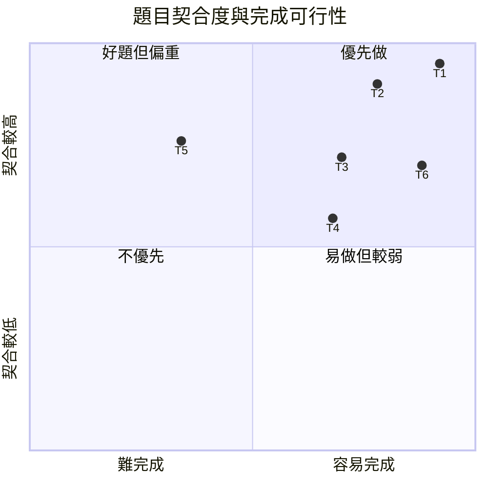

**對應你要求的 §7。以下排序刻意按照「四頁 Interspeech + 一人 + 四張 A10 + 截止前可完成」而不是概念宏大程度。**

GPU-hour 換算遵守你的規則。理想公式是：

> `A10 GPU-hours = paper wall-clock hours × paper GPU count × hardware conversion factor`

但 paper 若只報 GPU 型號、沒有 wall-clock duration，左式就不能算。下面所有「無依據」不是漏估，而是**刻意不估**。例如 Pinch-AST 可寫成 `8 H100 × 未報小時 × A10換算因子 = 無依據`；Whisper-UT 為 `8 V100 × 未報小時 × A10換算因子 = 無依據`。這比用 peak FLOPS 假造 wall-clock 更符合你的要求。citeturn24view2

| 排序題目 | Hypothesis | 方法與主實驗 | 比較 baselines | 所需資料 | 完整 run 的 GPU-hours | 主要風險 |
|---|---|---|---|---|---|---|
| **T1 Domain-Mixture Confusion Augmentation for Shift-Robust SimulST** | 不同 acoustic/domain conditions 會產生不同 ASR lexical-confusion distributions；用多 domain confusion mixture training 會比 Pinch-style single confusion source 更能 OOD generalize | 固定 ASR 與 MT backbone；從 clean、noise、reverb 三個 condition 建 confusion banks；MT LoRA 每 batch 從 mixture 抽 noise；long-form streaming inference 不改 policy | clean training；Pinch-style single confusion；proposed mixture | 一個 main ST corpus；優先 MuST-C 或合法取得的 IWSLT long-form；另外可用 Common Voice 建 confusion probe | **無依據**。Pinch 為 H100 系統但未報 training duration | artificial shift 可能被批評；dataset license 先決 |
| **T2 Confidence-Gated Confusion Adaptation** | ASR token uncertainty 可以辨識 error regime，讓 MT 動態選不同 confusion robustness profile | 訓練多個 noise profiles 或一個 condition token；inference 用 ASR entropy/confidence gate | fixed confusion；mixture without gate；proposed gate | 同 T1 | **無依據**；最近 direct prior 未提供可轉換 wall-clock | gate 可能只學 SNR proxy；多一層 engineering |
| **T3 Shift-Aware Adaptive Chunking** | 最佳 chunk size 隨 acoustic difficulty 改變；fixed chunk 在 noisy condition 不是同一 quality-latency Pareto optimum | 用 ASR confidence 或 scheduler 在小中大 chunk 間選擇，不改 translation model | fixed low chunk；fixed high chunk；REINA-style/adaptive policy | long-form ST corpus + controlled corruption | **無依據**；REINA 摘要未給可換算完整 training time | policy 文獻競爭激烈；容易變成 latency paper 而非 robustness paper |
| **T4 Prefix-CMRT for Streaming Translation** | CMRT 的 text-side adversarial robustness 若只作用於 valid streaming prefixes，可提升 partial-hypothesis morphology robustness | 將 CMRT adversarial text generation 限制在 prefix-consistent examples；不改 inference | normal prefix training；CMRT-style full text；prefix CMRT | 一個 ST corpus即可 | **無依據**；CMRT 未提供足夠 wall-clock training time | 與 CMRT 太近；novelty 需要非常清楚 |
| **T5 Streaming Learned Distrust of Partial ASR Hypotheses** | Whisper-UT 的 learned distrust 若針對 unstable partial hypotheses 訓練，可比直接相信 ASR prefix 更 robust | 每 chunk 同時餵 audio representation 與 ASR partial text；simulate revision errors | audio-only ST；plain two-stage；noise-trained two-stage | CoVoST2/MuST-C + streaming wrapper | **無依據**；Whisper-UT 為 V100 實驗但 wall-clock 未報 | 工程量過大；two-stage latency 容易爆 |
| **T6 Distribution-Shift Robustness Frontier Benchmark** | system ranking 會在 clean、noise、reverb、accent-like conditions 下反轉，因此 clean BLEU/latency 不足以代表 robustness | 固定三個 open baselines；定義 relative quality drop 與 latency degradation matrix；不提新 model | CUNI；StreamAtt；一個 robust cascade | 一個 corpus + reproducible corruption recipe | training 可為 **N/A**；完整 inference GPU-hours **無論文依據**，不估 | 四頁可做，但 reviewer 可能認為只是 benchmark；需要明顯 ranking inversion |

### 最接近的 prior work

| 題目 | 最接近 prior | 它做了什麼 | 和這個題目真正差在哪 |
|---|---|---|---|
| T1 | Pinch-AST — https://aclanthology.org/2026.iwslt-1.30/ | 從 ASR confusion 建 lexical noise，做 robust prefix MT | T1 **直接測試其 domain-independence assumption**，比較 single-domain 與 cross-domain mixture citeturn3view0 |
| T1 | Whisper-UT — https://arxiv.org/abs/2509.16375 | 模擬 ASR text errors，學會結合 audio 與不可靠 transcript | Whisper-UT 非 SimulST，也沒有 confusion-bank transfer experiment citeturn24view2 |
| T1 | Higuchi et al. — https://www.isca-archive.org/interspeech_2025/higuchi25_interspeech.html | 用 frozen LLM robustness 抵抗 ASR errors，且保留 speech cross-attention | 沒有研究 error distribution 隨 domain 變化，也沒有 streaming prefix robustness citeturn18view1 |
| T2 | Pinch-AST | fixed training-time lexical noise | T2 在 inference 用 uncertainty 選 robustness regime |
| T2 | Whisper-UT | learned distrust noisy transcript | T2 不做 large multimodal decoder，只用 cheap ASR confidence |
| T2 | REINA-TAN — https://arxiv.org/abs/2604.09916 | 用 information與temporal context做 read/write policy | REINA adaptive 的是 timing；T2 adaptive 的是 error model citeturn13view0 |
| T3 | REINA-TAN | temporal-aware adaptive reading | T3 的 trigger 是 distribution difficulty，而且 action 是 chunk sizing citeturn13view0 |
| T3 | Dynamic Attention Masking — https://aclanthology.org/2026.iwslt-1.20/ | scheduler 預測每層所需 future frames | 沒有把 shift robustness 當 target，也未建立 clean/noisy frontier comparison citeturn13view2 |
| T3 | Pinch-AST | 多固定 chunk sizes 做 quality-latency trade-off | T3 在線選 chunk，不固定 operating point citeturn3view0 |
| T4 | CMRT — https://arxiv.org/abs/2602.11933 | text adversarial robustness transfer 到 speech | T4 強制 adversarial examples 是 valid partial prefixes，目標是 SimulST citeturn2view0 |
| T4 | MLLP 2025 — https://aclanthology.org/2025.iwslt-1.35/ | prefix training 讓 MT 適應 partial source | 沒做 adversarial robustness transfer citeturn3view2 |
| T4 | Pinch-AST | prefix consistency + lexical noise | noise 來自 ASR confusions；T4 noise 是 linguistic adversarial transformation |
| T5 | Whisper-UT | audio + noisy text joint conditioning | 非 streaming；T5 的 text 是會 revision 的 partial transcript citeturn24view2 |
| T5 | Higuchi et al. | speech-conditioned LLM-guided decoder | full utterance；非 unstable streaming prefix citeturn18view1 |
| T5 | CUNI 2025 — https://aclanthology.org/2025.iwslt-1.41/ | offline models 配 AlignAtt、cascade 做 streaming | 沒有 joint audio-text learned distrust citeturn3view1 |
| T6 | CMU IWSLT 2025 — https://aclanthology.org/2025.iwslt-1.31/ | 使用 robust synthesized speech segments 訓練 streaming E2E system | 沒做跨 baseline systematic shift ranking citeturn15view0 |
| T6 | CMSP-ST — https://www.isca-archive.org/interspeech_2025/ou25_interspeech.html | representation purification 增加 ST robustness | offline ST；沒有 latency axis citeturn26view1 |
| T6 | Pinch-AST | lexical robustness + long-stream evaluation | 沒有以「不同 shift 下排名是否反轉」作主要研究問題 |

### Pilot 與明確放棄判準

以下閾值全部是研究設計的 **【推論】**，不是已發表數字；目的就是兩週後能說「做／不做」。

| 題目 | 兩週最小 pilot | 假設成立 | 立即放棄或改題 |
|---|---|---|---|
| **T1** | 單一 language pair；小 train subset；一個 baseline fixed-confusion 與一個 mixture-confusion；只做 clean、noise、reverb 三個 evaluation conditions | proposed 對兩個 OOD conditions 的平均 BLEU **至少 +1.0**，clean BLEU 下降 **不超過 0.3** | OOD 平均提升 **低於 0.5 BLEU**；或所有 domain confusion matrices 的效果近乎相同，表示核心 hypothesis 弱 |
| **T2** | T1 相同資料；只加一個 entropy threshold gate | 比最佳 fixed/mixture baseline 的 OOD BLEU **至少 +0.8**，且額外 policy latency **不超過 0.1 s** | 提升 **低於 0.4 BLEU**；gate performance 對 threshold 極端敏感 |
| **T3** | 一個 clean、一個 noisy condition；兩個 fixed chunk baseline 與 confidence adaptive chunk | 在近似相同 quality 下 LongYAAL 改善 **至少 0.3 s**，或在近似相同 LongYAAL 下 BLEU **至少 +0.8** | adaptive point 落在兩個 fixed baselines 的 dominated region |
| **T4** | 小資料；normal prefix training vs prefix-adversarial training | adversarial test BLEU **至少 +1.5**，clean **不掉超過 0.5** | robustness gain **低於 0.8** 或 clean degradation **超過 1.0** |
| **T5** | 一個小 model；audio-only vs audio+partial-ASR two-stage | noisy-ASR condition **至少 +1.0 BLEU** 且 clean 不降 **超過 0.5** | latency 增幅 **超過一倍** 或 gain **低於 0.5 BLEU** |
| **T6** | 三個 already-runnable systems；clean + two corruptions | 至少出現一對 baseline 的 rank inversion，且至少一個 system 有 **超過 2 BLEU** 相對 degradation 差距 | 三 system ranking 完全不變且 robustness gap 都 **低於 1 BLEU** |

**我的排序不是 T5 > T1，反而是 T1 > T2 > T6 > T3 > T4 > T5。** **【推論】四頁 paper 應優先回答一個可以一句話說完的 hypothesis；T1 正好是「single-domain lexical-noise augmentation does not transfer across ASR-error distributions; a domain-mixture fixes it」。T5 雖概念更大，但工程面足以吞掉整個學期。** **【研究假設】Single-domain lexical-noise augmentation may generalize poorly across different ASR-error distributions. We hypothesize that domain-mixture confusion augmentation can improve robustness under unseen acoustic shifts.**

| 題目 | 與現有硬體契合度 | 單人完成度 | 四頁貢獻乾淨度 | 截止前完成主實驗消融 | 綜合排序 |
|---|---:|---:|---:|---:|---:|
| T1 | 5/5 | 5/5 | 5/5 | 5/5 | 1 |
| T2 | 5/5 | 4/5 | 4/5 | 4/5 | 2 |
| T6 | 5/5 | 5/5 | 4/5 | 5/5 | 3 |
| T3 | 4/5 | 4/5 | 4/5 | 4/5 | 4 |
| T4 | 4/5 | 4/5 | 3/5 | 4/5 | 5 |
| T5 | 3/5 | 2/5 | 4/5 | 2/5 | 6 |

**quadrantChart 節點**：T1 至 T6 對應上表。  
**座標關係**：橫軸代表在你單人與四張 A10 條件下的截止前可完成性；縱軸代表和 Robustness to Distribution Shift 主題及四頁 paper 的契合度。座標只用於可視化上表的主觀排序，屬【推論】。

**【推論】T1 的另一個優點，是負結果也有轉題出口。** 【推論】若 multi-domain mixture 未能改善 robustness，仍可利用已收集的 confusion matrices 分析不同 domain 的 ASR error distributions 是否存在顯著差異，並進一步檢驗現有系統在不同 shift conditions 下是否出現排名反轉。若得到充分實驗證據，可考慮轉向 T6。也就是 pilot 的工作不會完全報廢。