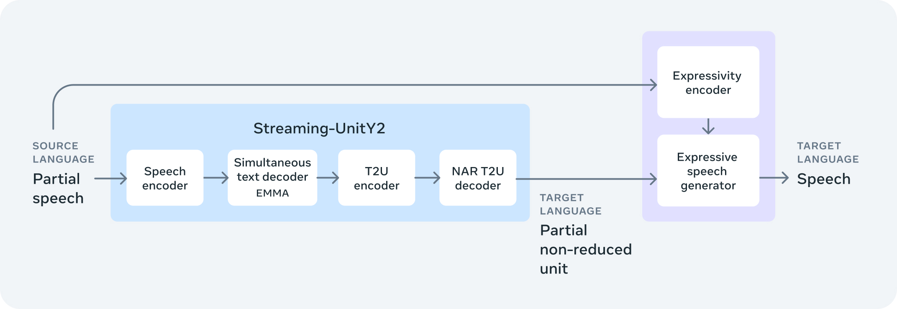
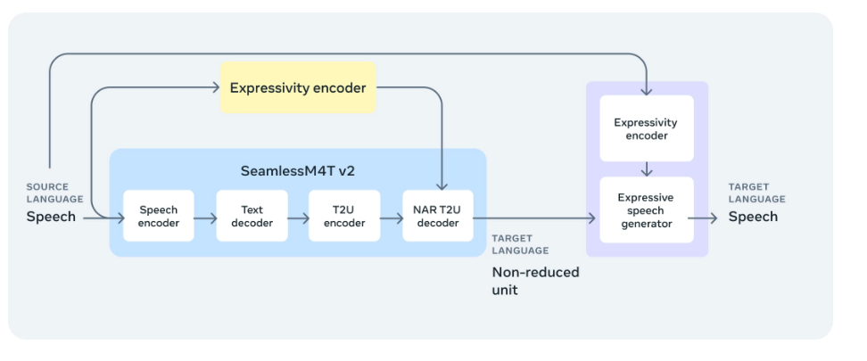
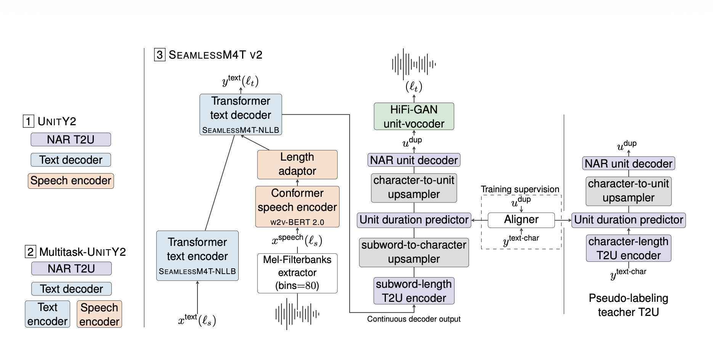
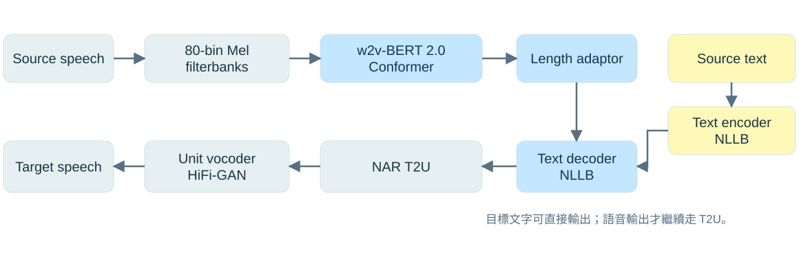
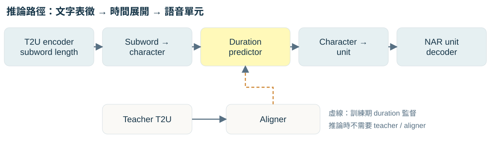
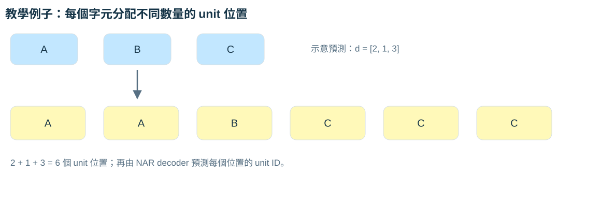

## 這份報告要回答什麼？

::: {.lead}
模型如何把「說什麼」翻成另一種語言， 再把「怎麼說」帶進生成語音？
:::

- **家族定位**：M4T v2、Expressive、Streaming 各自解決什麼問題？
- **架構拆解**：從語音特徵、目標文字，一路走到語音單元與波形。
- **關鍵機制**：T2U 如何靠 duration 預測，把文字長度展開成語音長度？

::: {.source}
內容主線：使用者提供的 RTF、Expressive 與 UnitY2 截圖，以及 Seamless 整合架構圖。
:::

::: {.notes}
這次聚焦模型架構，不呈現先前 chunk 實驗數據。先看 Seamless 如何整合串流翻譯與表現力合成，再看離線 SeamlessExpressive 的雙路徑控制，最後拆解 UnitY2、T2U 與 duration。整合高階圖使用與本次附圖相同內容的 Meta 官方原始圖檔；另兩張圖保留使用者提供的 Expressive 與 UnitY2 論文截圖。
:::

## Seamless AI 家族：三個技術支柱

::: {.small-table}
| 模型 | 核心問題 | 關鍵設計 |
|---|---|---|
| **SeamlessM4T v2** | 多模態、多任務翻譯 | UnitY2／Multitask-UnitY2 基礎骨幹 |
| **SeamlessExpressive** | 跨語言保留韻律與聲音風格 | 表現力條件＋expressive speech generation |
| **SeamlessStreaming** | 不等整句結束就開始翻譯 | EMMA 串流輸出決策 |
| **Seamless** | 結合表現力與串流翻譯 | 整合上述能力 |
:::

::: {.takeaway}
先看 Seamless 的整合全貌，再拆解 Expressive 與 M4T v2／UnitY2。
:::

::: {.source}
來源：使用者 RTF §1；[Meta 官方模型庫](https://github.com/facebookresearch/seamless_communication)。
:::

::: {.notes}
三大技術支柱不是四個串接的推論階段。M4T v2 是基礎，Expressive 與 Streaming 是不同方向的擴展，Seamless 再整合這些能力。Expressive 著重語速、停頓與聲音風格；Streaming 著重何時讀取更多輸入、何時開始輸出。
:::

## M4T v2：同一骨幹支援五種任務

::: {.small-table}
| 任務 | 輸入 → 輸出 | 是否需要 T2U 與語音合成？ |
|---|---|---|
| ASR | 語音 → 同語言文字 | 否 |
| S2TT | 語音 → 目標語言文字 | 否 |
| T2TT | 文字 → 目標語言文字 | 否 |
| S2ST | 語音 → 目標語言語音 | **是** |
| T2ST | 文字 → 目標語言語音 | **是** |
:::

::: {.takeaway}
輸入模態決定 encoder；輸出模態決定是否繼續產生 unit 與波形。
:::

::: {.source}
來源：使用者 RTF §1；[Transformers：SeamlessM4T-v2](https://huggingface.co/docs/transformers/model_doc/seamless_m4t_v2#model-architecture)。
:::

::: {.notes}
S 代表 speech，T 代表 text。例子：中文語音翻成英文字幕是 S2TT；若還要英文語音，才需要走後面的 T2U 與合成路徑。這張表整理任務類型，並不表示每個任務都支援完全相同的語言集合。
:::

## Seamless：串流翻譯與表現力合成

{.diagram .diagram-tall alt="Meta 官方 Seamless 整合架構圖：來源 partial speech 進入 Streaming-UnitY2，經 speech encoder、搭配 EMMA 的 simultaneous text decoder、T2U encoder 與 NAR T2U decoder，輸出 partial non-reduced units；來源語音另經 expressivity encoder，與 units 共同條件化 expressive speech generator，產生目標語言語音。"}

::: {.takeaway}
**Streaming-UnitY2** 決定翻譯內容與輸出時機；**expressive generator** 加入來源聲音風格。
:::

::: {.source}
圖片：[Meta 官方技術介紹 · Seamless](https://ai.meta.com/resources/models-and-libraries/seamless-communication-models/)，與本次附圖內容相同；直接使用官方原圖。
:::

::: {.notes}
這張圖是整合模型 Seamless，不是單獨的 SeamlessExpressive，也不是只做串流翻譯的 SeamlessStreaming。先沿藍色路徑讀：Partial speech 是目前已接收的部分來源語音，speech encoder 編碼後，simultaneous text decoder 透過 EMMA 在可用上下文下決定何時生成目標文字，T2U 再產生部分非去重單元。右側 PRETSSEL 類型的 expressive generator 同時接收 units 與從部分來源語音取得的表現力條件。注意：這張整合圖只有來源語音到右側 expressivity encoder 的上方路徑；下一張 Expressive 架構則額外呈現 T2U 的表現力條件路徑。不要把下一張圖的所有條件連線直接套回整合模型。論文 §6 說明整合版主要保留句子層級的語調、情緒表達與聲音風格，而未提供離線 Expressive 全套的片語層級語速與停頓保留。
:::

## 串流推論：輸入、讀寫決策與輸出

::: {.small-table}
| 階段 | 架構說明 |
|---|---|
| **輸入：Partial speech** | 逐步接收音訊，保留已取得的上下文，不需等整句結束。 |
| **核心：Streaming-UnitY2＋EMMA** | 同步文字解碼器依上下文決定 **READ**（繼續聽）或 **WRITE**（產生翻譯）；T2U 接續生成 units。 |
| **輸出：表現力語音合成** | 以生成的 units 與目前可用來源語音為條件，逐段合成目標語音，保留語調、情緒表達與聲音風格。 |
:::

::: {.takeaway}
官方以「**約 2 秒延遲**」概述 SeamlessStreaming；實際結果隨語言、策略與延遲指標而變化。 部分語音可提供風格條件，但短上下文仍會影響保留品質。
:::

::: {.source}
來源：[Meta：Streaming 與 EMMA](https://ai.meta.com/blog/seamless-communication/)；[論文 §6、§6.2.3](https://arxiv.org/pdf/2312.05187#page=52)。非本機延遲或情緒保留實測。
:::

::: {.notes}
使用者的三段式說明適合做這張圖的講解，但需界定範圍。第一，Partial speech 不等於每塊獨立呼叫離線模型；串流系統保留已接收上下文，並在資訊足夠時輸出。第二，EMMA 是 Efficient Monotonic Multihead Attention，是同步文字解碼中的核心機制，不能把所有後端合成與播放排程都歸給 EMMA。第三，Meta 的約兩秒是研究結果概述，不是每個語言方向、硬體或每個 chunk 都固定兩秒，更不等於 chunk size、首次輸出時間或整段推論耗時。論文區分文字 Average Lagging 與語音 Ending Offset 等指標；若報數值，必須附模型版本、資料集、語言方向、決策閾值與指標。第四，PRETSSEL 可從部分來源語音取得表現力條件，但不能宣稱任意短片段都足以完整還原音色與情緒；論文 §6.2.3 指出部分上下文造成 vocal style similarity 與 AutoPCP 下降。下一頁轉看離線 Expressive，理解其更完整的韻律控制路徑。
:::

## SeamlessExpressive：離線表現力控制

{.diagram .diagram-tall alt="SeamlessExpressive 雙路徑高階圖：藍色翻譯主幹生成 units，黃色表現力分支引導 T2U，紫色生成器另外從來源語音取得表現力條件並合成目標語音。"}

::: {.takeaway}
藍色回答「翻成什麼」；黃色與紫色補上「用什麼節奏與風格說」。
:::

::: {.source}
圖片：使用者提供的原始第一張截圖，完整保留。出處：[Meta SeamlessExpressive 官方介紹](https://ai.meta.com/blog/seamless-communication/)。
:::

::: {.notes}
此頁轉入離線 SeamlessExpressive；與前面的 Seamless 整合圖區分。先沿水平箭頭讀：來源語音進入 speech encoder、text decoder、T2U encoder 與 NAR T2U decoder，再把 non-reduced units 交給右側生成器。接著讀上方兩條分支：來源語音提供表現力條件給單元生成，也提供條件給最終語音生成。圖中兩個 Expressivity encoder 標籤對應兩個使用位置，不能只靠高階圖判定為兩套完全獨立訓練的模型。
:::

## 雙路徑控制：語意與表現力在哪裡會合？

::: {.columns}
::: {.column width="50%"}
### 翻譯主幹｜語意內容

- Speech encoder 編碼來源語音。
- Text decoder 產生**目標語言文字**。
- T2U 把文字表徵轉成語音單元。
:::
::: {.column width="50%"}
### 表現力路徑｜節奏與風格

- 從**來源語音**取得表現力訊號。
- 引導 T2U 的節奏與 duration。
- 作為 expressive generator 的合成條件。
:::
:::

::: {.takeaway}
兩條路徑共同決定輸出；圖中箭頭表示條件傳遞，並非雙向回饋迴圈。
:::

::: {.source}
來源：使用者 RTF §2 與架構截圖；[Meta 官方介紹](https://ai.meta.com/blog/seamless-communication/)。
:::

::: {.notes}
原文件用「雙向注入」描述兩處條件化，這裡改用「兩條條件路徑」避免誤以為生成器會反向回傳訊號。也不要把所有聲音資訊都歸給文字翻譯：文字可保留語意，卻不足以完整表示原說話者的停頓、聲調與聲音風格。這是理解 Expressive 設計動機的重點。
:::

## SeamlessM4T v2：論文原始架構圖

{.paper-original alt="Seamless 論文 Figure 3 原圖截圖：左側比較 UnitY2 與 Multitask-UnitY2；中央為 SeamlessM4T v2 的語音與文字輸入、文字解碼及 NAR T2U；右側為訓練用 aligner 與 pseudo-labeling teacher T2U。"}

::: {.source}
圖片：使用者提供的第二張原圖截圖，完整保留。[Seamless 論文 Figure 3／§3.3](https://arxiv.org/pdf/2312.05187#page=18)。
:::

::: {.notes}
這一頁直接展示論文 Figure 3 的原始架構截圖，不以重繪圖代替。先讀左側：UnitY2 支援 speech encoder，而 Multitask-UnitY2 增加 text encoder 分支。接著讀中央下方的兩種輸入：語音由 Mel-filterbanks、w2v-BERT 2.0 Conformer 與 length adaptor 送到 Transformer text decoder；文字由 Transformer text encoder 送到相同 decoder。目標文字可以直接輸出，連續 decoder 表徵則送往 subword-length T2U encoder，再經兩段上採樣與 unit duration predictor，由 NAR unit decoder 產生 units，最後經 HiFi-GAN unit-vocoder 合成波形。右側 training supervision 與 pseudo-labeling teacher T2U 屬訓練支線，推論時不必執行。下一頁用簡化圖協助逐段講解。
:::

## UnitY2 基礎骨幹：簡化閱讀指引

{.diagram .diagram-tall alt="UnitY2 多模態推論圖：語音經 80-bin Mel-filterbanks、w2v-BERT 2.0、length adaptor，文字經 NLLB encoder，匯入 NLLB text decoder；語音輸出再經 NAR T2U 與 HiFi-GAN unit-vocoder。"}

::: {.takeaway}
先產生目標文字，再決定是否走第二階段的語音單元生成。
:::

::: {.source}
依使用者 RTF §3–4 重繪；[論文 §3.3、Figure 3](https://arxiv.org/pdf/2312.05187#page=18) 對照多任務結構。圖中省略訓練 loss 與部分內部模組。
:::

::: {.notes}
這張圖畫的是基礎模型，左下角保留標準 HiFi-GAN unit-vocoder，下一步才與 Expressive 對照。語音輸入經 length adaptor 接到 text decoder，不是先把音訊變成字串再送進 text encoder。Text encoder 是文字輸入任務的分支。Text decoder 輸出目標語言文字，也提供後續 T2U 所需的連續表徵。
:::

## 前端：從聲學訊號到文字解碼的表徵

::: {.steps}
1. **80-bin Mel-filterbanks**：把音訊轉成隨時間變動的聲學特徵。
2. **w2v-BERT 2.0／Conformer**：建立深層語音表示。
3. **Length adaptor**：調整時間解析度，銜接後續解碼器。
4. **NLLB-based text decoder**：產生目標語言文字序列。
:::

::: {.takeaway}
Length adaptor 處理前端表徵長度；T2U duration predictor 處理生成端的 unit 長度。
:::

::: {.source}
來源：使用者 RTF §3；[Meta 官方模型庫：w2v-BERT 2.0](https://github.com/facebookresearch/seamless_communication)。
:::

::: {.notes}
前端聲學序列通常比文字序列長，因此需要時間解析度調整。不要把 length adaptor 與後面的 duration predictor 混為一談：前者服務語音編碼到文字解碼的銜接；後者預測字元應展開為多少語音單元位置。80 bins 是每一時間步的特徵維度，不是 80 個語音單元。
:::

## T2U：文字怎麼變成語音單元？

{.diagram .diagram-tall alt="T2U 推論路徑：subword-length encoder、subword-to-character upsampler、duration predictor、character-to-unit upsampler、NAR unit decoder；底部虛線表示 teacher 與 aligner 的訓練監督。"}

::: {.takeaway}
兩次長度轉換：**subword → character → unit**；duration 決定第二次展開。
:::

::: {.source}
來源：使用者 RTF §4；[論文 §3.3、Figure 3](https://arxiv.org/pdf/2312.05187#page=18)。此圖簡化支線與訓練標籤細節。
:::

::: {.notes}
T2U 是 Text-to-Unit。文字 token 通常是 subword，而語音需要沿時間排列的 unit 序列，所以兩者不能直接一對一對應。先把 subword 表徵展開為 character 長度，再預測每個字元對應多少 unit 位置。完整圖中 duration predictor 是從 character 表徵讀出 duration，upsampler 同時接收表徵與 duration；這裡按功能順序排列，並非把 duration 數值當作唯一輸入。底部 teacher 與 aligner 僅示意訓練監督，不是部署時必跑的模組。
:::

## Duration：預測每個字元要佔多久

{.diagram alt="教學示意：A、B、C 的 duration 是 2、1、3；展開後得到 A A B C C C 六個 unit 位置，等待 decoder 預測 unit ID。"}

::: {.takeaway}
展開後的總長度 = 各字元 duration 的總和；字元標籤只代表位置來源。
:::

::: {.source}
教學示意，數值為自行設計，未使用模型實測輸出。A／B／C 不是實際 speech unit ID。
:::

::: {.notes}
假設三個抽象字元的 duration 分別是 2、1、3，總共得到六個 unit 位置。圖上重複 A、B、C 是為了說明表徵展開；真正的輸出是由 unit decoder 在這些位置預測離散語音單元。Duration 本身不直接等於情緒，也不是辨識或翻譯延遲。不要把這個例子當成英文單字或漢字的固定時長規則。
:::

## 為什麼使用 NAR unit decoder？

::: {.columns}
::: {.column width="50%"}
### 自迴歸｜AR

- 依先前輸出逐步生成下一個 token。
- 序列越長，需要越多次序列生成步驟。
:::
::: {.column width="50%"}
### 非自迴歸｜NAR

- 先決定展開長度。
- 多個 unit 位置可在同一解碼階段預測。
- 降低逐一生成 unit 的相依性。
:::
:::

::: {.takeaway}
M4T v2 的第二階段 T2U 採用 NAR；文字解碼仍有自己的生成流程。
:::

::: {.source}
來源：使用者 RTF §4；[Transformers：v1／v2 架構差異](https://huggingface.co/docs/transformers/model_doc/seamless_m4t_v2#difference-with-seamlessm4t-v1)。
:::

::: {.notes}
NAR 的優勢在於減少 unit 序列逐步生成的負擔。這不等於整個系統只做一次 forward pass，也不代表完全沒有 attention 或跨位置依存。前端編碼、文字生成、長度預測與波形合成都還存在。這裡只說明生成方式，不推論本機執行速度或實際延遲。
:::

## 訓練期與推論期：Teacher 在哪裡？

::: {.small-table}
| 階段 | 主要角色 | Duration 從哪裡來？ |
|---|---|---|
| **訓練期** | Teacher T2U、Aligner 提供監督訊號 | 以對齊得到的 duration 訓練 predictor |
| **推論期** | 已訓練的 T2U、duration predictor、NAR decoder | 模型預測 duration，據此展開表徵 |
:::

::: {.takeaway}
Teacher／aligner 用於教會模型如何對齊；一般推論不再依賴這條監督支線。
:::

::: {.source}
來源：使用者 RTF §4 的 training supervision 說明；[論文 Figure 3、§3.3.2](https://arxiv.org/pdf/2312.05187#page=18)。
:::

::: {.notes}
這一頁補足原文件中容易被忽略的訓練與推論差異。不要把完整論文圖右側的 teacher 畫成使用者每次翻譯時的必經路徑。Teacher 的 pseudo-labeling 與 aligner 的對齊工作提供訓練訊號，推論由已學好的 predictor 決定長度。這裡沿用文件的高階說明，不展開 teacher 的訓練方法。
:::

## 回到 Expressive：兩處條件化各控制什麼？

::: {.small-table}
| 使用位置 | 功能 | 希望保留的特徵 |
|---|---|---|
| **Prosody UnitY2／T2U** | 用來源表現力條件引導 unit 生成與時長 | 語速、停頓與片語節奏 |
| **Expressive generator／PRETSSEL** | 結合 units 與來源表現力條件生成語音 | 語調、聲音風格與表達方式 |
:::

::: {.takeaway}
只翻譯文字不足以重建完整表達方式；時長與聲學生成也需要來源語音條件。
:::

::: {.source}
來源：使用者 RTF §2、§5 與圖片文字；[Meta 官方介紹](https://ai.meta.com/blog/seamless-communication/)。
:::

::: {.notes}
圖片把表現力條件分別接到 unit 生成與 expressive speech generator，對應文字難以完整表示的韻律與聲音風格。論文更細分為 Prosody UnitY2 與 PRETSSEL。這裡的「保留」是設計目標，不是所有語言、說話者與情緒都能完全重現的保證；也不把聲音風格轉移直接等同於精確的身份複製。
:::

## Units 與波形：最後一段生成的差異

::: {.small-table}
| 比較項目 | SeamlessM4T v2 | SeamlessExpressive |
|---|---|---|
| Unit 生成 | 基礎 NAR T2U | 加入表現力條件的 T2U |
| 高階合成模組 | HiFi-GAN unit-vocoder | Expressive speech generator／PRETSSEL |
| 明確的來源表現力條件 | 未加入 Expressive 的控制路徑 | 來源語音引導節奏與風格 |
:::

::: {.takeaway}
Expressive 更換基礎模型的 **unit-to-speech 流程**；PRETSSEL 內部仍使用 HiFi-GAN 將 Mel 特徵轉成波形。
:::

::: {.source}
來源：使用者 RTF §5；內部合成細節核對自 [論文 §4.2.1](https://arxiv.org/pdf/2312.05187#page=32)。
:::

::: {.notes}
高階圖與官方介紹常說以 expressive generator 取代 unit HiFi-GAN vocoder，這是在比較整段 unit-to-speech 功能。更細的 PRETSSEL 流程會先生成 Mel-filterbank 特徵，最後仍用 HiFi-GAN 產生波形，因此不宜說 Expressive 完全沒有 HiFi-GAN。Non-reduced units 指未去除連續重複的單元；它們仍是離散符號，不是聲音波形。
:::

## 架構總結與 Q&A

::: {.lead}
語意靠翻譯骨幹， 時間靠 duration，表達方式靠來源語音條件。
:::

- **M4T v2／UnitY2**：多模態輸入 → 目標文字 → units → 語音。
- **T2U**：階層式上採樣＋duration predictor＋NAR unit decoder。
- **Expressive**：把表現力條件帶入 unit 與聲學生成。
- **Seamless 整合版**：串流讀寫決策＋部分語音條件下的表現力合成。

::: {.closing}
Q&A：如果譯文正確，但語速與停頓不自然，應先檢查哪一段？
:::

::: {.notes}
可從 T2U 的 duration 與表現力條件開始檢查，同時確認 acoustic generator 是否正確接收來源語音條件。如果語意本身就錯誤，則先回到 speech encoder 與 text decoder 的翻譯路徑。這是根據架構提出的排查方向，並非已做過消融實驗的因果結論。低延遲則要另外檢查 Streaming／EMMA 的策略，不能只因 T2U 是 NAR 就視為串流模型。
:::

## 資料來源與閱讀指引

::: {.small-table}
| 資料 | 本簡報的用途 |
|---|---|
| **SeamlessM4T_for_codex.rtf** | 五段大綱、模型元件與講稿素材；文字備份見 `sources/` |
| **截圖與官方架構圖** | Expressive、UnitY2 原始截圖；Seamless 整合圖採用 Meta 官方原檔 |
| **[Seamless 論文](https://arxiv.org/abs/2312.05187)** | §3.3：UnitY2；§4.2：Expressive；§6：Seamless 整合版 |
| **[Meta 官方模型庫](https://github.com/facebookresearch/seamless_communication)** | 模型家族、任務與開源組件 |
| **[Transformers 官方文件](https://huggingface.co/docs/transformers/model_doc/seamless_m4t_v2)** | v2 生成流程與 NAR T2U 架構 |
:::

::: {.source}
樣式來源：Liu/report/report/_quarto.yml、Liu/report/report/styles.css、Liu/report/report/report.qmd。外部資料核對日期：2026-10-15。
:::

::: {.notes}
本簡報以使用者文件為主線，新增 Seamless 整合架構與串流說明，並修正「雙向注入」「完全取代 HiFi-GAN」「準確預測時長」「聲音複製」等可能過度延伸的表述。架構 SVG 是依提供的圖片與文字資料自行重繪的教學示意，不是論文原圖。約兩秒延遲為官方研究概述，未作為本機實測；未新增模型 benchmark 或情緒保留實驗。原始第一張 Expressive 截圖與第二張 UnitY2 論文截圖已複製至 assets/ 並直接用於簡報，未裁切或重新繪製。其餘 SVG 作為簡化閱讀指引。
:::
