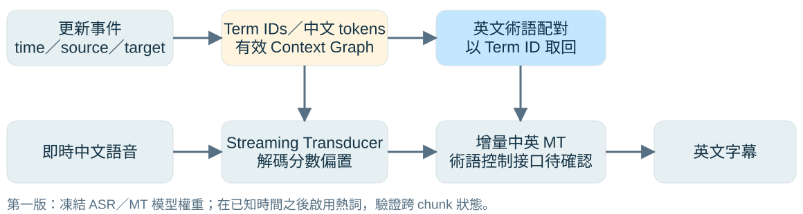
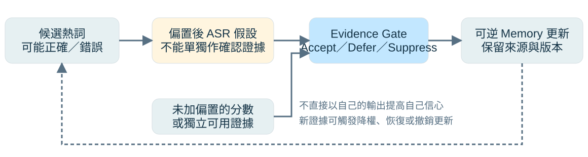
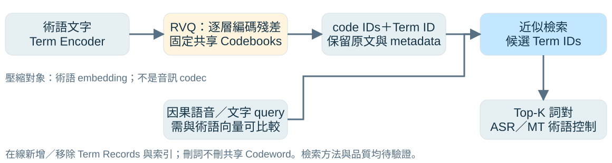

## 這次研究問題已經收斂到哪裡？

::: {.proposal-tag}
研究設計與進度討論 · 尚無完成的模型實驗結果
:::

::: {.lead}
注入時間已知， 但熱詞何時有益、何時有害，仍要驗證。
:::

- **目標**：中文技術演講 → 即時英文字幕。
- **已知輸入**：指定時間的中文術語與英文配對。
- **本階段範圍**：不做投影片偵測；先研究偏置與記憶更新。

::: {.takeaway}
第一個問題是可靠性；只有大型詞庫出現資源瓶頸時，再判斷 RVQ 是否必要。
:::

::: {.source}
內容主線：使用者提供的《SimulST 教授研究討論報告》2026-10-30，第 1、4 部分。
:::

::: {.notes}
教授，我這次把研究範圍縮小：先假設已知什麼時間可取得哪個中文熱詞及指定英文譯名，不再處理投影片偵測。事件只代表這筆術語現在可以使用，不代表演講者一定說到了，也不代表應永久寫入已確認記憶。這份報告是方法設計與下一步規劃，尚無模型實驗結果。封面沿用來源文件的預定報告日期 10 月 30 日；製作與文獻核對日期是 10 月 29 日。
:::

## 既有工作已做到哪裡？

::: {.compact .dense}
| 工作 | 已有能力 | 對本研究的提醒 |
|---|---|---|
| **RASST（2026）** | 部分語音的術語檢索，以及增量生成中的使用決策 | 動態術語＋SimulST 本身不夠作貢獻 |
| **EGTA（2026 預印本）** | 文件術語記憶、局部證據選詞、ASR／解碼側適應 | Evidence Gate 已有近鄰，需比較更新規則 |
| **AutoTerm-SST（2026 預印本）** | Topic Slices＋有限 Active Working Set | 大型詞庫的啟用與退出已有方法 |
| **Flemotomos et al.** | FSQ 量化術語表示，支援高效 ASR 檢索 | 換成 RVQ 不自動構成新穎性 |
| **Xu et al.（2023）** | 自適應開關 Transducer 偏置 | 防污染要超越單純開關 Bias |
:::

::: {.source}
依原報告第 2 部分，核對 [RASST](https://aclanthology.org/2026.emnlp-main.1680/)、[EGTA](https://arxiv.org/abs/2607.17766)、[AutoTerm-SST](https://arxiv.org/abs/2610.26865)、[FSQ 工作](https://arxiv.org/html/2411.00664)、[Adaptive Biasing](https://www.isca-archive.org/interspeech_2023/xu23d_interspeech.html)。
:::

::: {.notes}
這一頁只講各篇與問題直接相關的能力，不比較不同資料集的最高分數。RASST 與 EGTA 都已非常接近術語檢索及使用決策；AutoTerm-SST 強調大詞庫的工作集合；Flemotomos 等人的工作明確使用 FSQ 量化 contextual embeddings；Xu 等人的 adaptive biasing 已能預測 context phrase 是否出現並控制偏置。尚未找到完整相同組合，不代表組合就有足夠原創性。未將「作者沒有提到某功能」當作其絕對不存在的證明。
:::

## 第一版系統：定時熱詞事件＋串流 ASR＋增量 MT

{.diagram alt="指定時間的雙語熱詞事件建立 Term ID、中文 tokens 與英文配對，context graph 影響串流 Transducer 解碼；部分中文辨識經增量 MT 輸出英文字幕。"}

- 先凍結 ASR／MT 權重，固定 tokenizer、chunk、beam 與偏置強度。
- 熱詞只能在事件發生後生效；記錄 Context 版本與輸出時間戳。

::: {.takeaway}
先驗證定時更新、跨 chunk 狀態與雙語配對是否正確，再新增神經 Adapter。
:::

::: {.source}
原報告 §3.1、§5；[sherpa-onnx Hotwords 文件](https://k2-fsa.github.io/sherpa/onnx/hotwords/index.html)。圖為基線設計，尚未實作。
:::

::: {.notes}
這是 cascaded SimulST：Zipformer／Transducer 做來源 ASR，增量中英 MT 做翻譯；不能把串流 ASR 直接叫成完整 SimulST。第一版不要求新的大型模型。sherpa 文件說明 Transducer hotword 與 modified_beam_search 的使用條件，但不能因此推論任意模型、任意語言或同一 stream 中的 graph 熱替換都已支援。需固定實際版本、checkpoint 與接口，測試在 term onset 前、中、後的更新。若 API 無法保留必要狀態，應記錄限制或設計明確的狀態遷移，不靜默重開 stream。增量 MT 也需明定中文假設修訂與英文字幕 commit 的規則。
:::

## 解碼偏置和修改 Joiner，是兩件不同的事

::: {.compact}
| 方案 | 改了什麼？ | 本階段安排 |
|---|---|---|
| **Decoder-side Biasing** | 在解碼搜尋中加入 context 分數 | 第一版先做；保留原模型權重 |
| Prediction-side Adapter | 改變歷史文字表示與 context 的融合 | 有明確缺陷後再評估 |
| Joiner-side Adapter | 在聲學與歷史文字交會處融合 context | 需設計接口、訓練與消融 |
:::

::: {.takeaway}
在 Joiner 輸出後加搜尋分數，**不等於重訓 Joiner**，也不代表已學會使用雙語術語。
:::

::: {.source}
來源：原報告 §3.2；Decoder-side 設定參照 [sherpa-onnx 官方文件](https://k2-fsa.github.io/sherpa/onnx/hotwords/index.html)。
:::

::: {.notes}
可把候選總分概念性地理解為模型分數加上有權重的 context score，實際分數取消、前綴與完成詞加分規則以選定 decoder 為準。用相同搜尋參數建立 no-bias 與 bias 對照，避免把 beam 改變造成的提升算成熱詞收益。Prediction 與 Joiner Adapter 都是未實作候選，現在不承諾哪一個一定比較好。正式英文譯名由 Term ID 配對交給翻譯端，而不是期待中文 ASR 的分數加成自動保證英文術語正確。
:::

## Memory 先分層：停用不等於刪除

::: {.compact}
| 層級／操作 | 儲存或改變什麼？ | 規則 |
|---|---|---|
| **Active** | 當前可影響解碼的 Term IDs 與權重 | 低相關或衝突時降權／停用 |
| **Session** | 本場已驗證的詞與事件歷史 | 保留狀態、來源與可逆更新紀錄 |
| **Long-term** | 跨場可重用、經確認的正式詞對 | 不因一次偏置轉寫直接覆寫 |
| **刪除詞條** | 移除 term record 與檢索索引 | 不刪其他詞也在使用的 codeword |
:::

::: {.takeaway}
穩定 Term ID 串起「中文原詞、英文譯名、確認狀態、時間與來源」；RVQ codes 只是可選索引表示。
:::

::: {.source}
來源：原報告 §3.3。建議欄位：term_id、source、target、provenance、status、last_verified、pinned、code_ids。
:::

::: {.notes}
事件中的新詞可先註冊為候選，不等於已確認演講者真的使用。Active 是工作集合，Session 是本場記憶，Long-term 是經確認可重用的庫。三層不是必須物理上建三個資料庫，而是分清不同存活與更新權限。Pinned 需明定只防止淘汰，還是也強制啟用；建議不要直接繞過證據規則。相同中文詞對應不同英文譯名時，應保留領域、來源與版本，不能只用中文字串當唯一鍵。
:::

## 真正的風險：偏置輸出又被拿來強化自己

{.diagram alt="偏置後 ASR 假設需與未偏置分數或獨立證據交由 Evidence Gate 檢查，再決定可逆記憶更新，避免輸出自我強化。"}

- **污染假設**：錯誤熱詞 → 偏置誤辨識 → 回寫高信心 → 更強偏置。
- **證據要求**：被偏置後的輸出，不能單獨充當其正確性的證明。

::: {.takeaway}
要研究的是「錯誤能否被阻止、撤銷與恢復」，而非只讓熱詞開啟或關閉。
:::

::: {.source}
來源：原報告 §3.3、路線 A。圖示為待測的失敗假設與防護設計，未觀察到實驗結果。
:::

::: {.notes}
虛線表示記憶可能回頭影響下一次偏置的回饋路徑。不能說系統一定會污染；要先在多次重複、錯誤與過期熱詞條件下量出來。未偏置分數可以是同一模型原始 score、抽樣 shadow decoding，或其他可用聲學線索，但要明確區分哪些仍受偏置搜尋剪枝影響。暫存候選不等於確認寫入 Session，寫入權限與當下解碼權重也可分開控制。獨立證據來源不可使用未來音訊或測試 reference。
:::

## 路線 A：Verified Dynamic Hotword Memory

::: {.compact}
| 決策 | 候選行為 | 必須保留的紀錄 |
|---|---|---|
| **Accept** | 證據足夠，允許相應偏置／確認更新 | 依據、作用時間、版本 |
| **Defer** | 保留候選，暫不升為確認記憶 | 缺哪些證據、等待上限 |
| **Suppress** | 衝突或負面證據，降權／停用 | 衝突原因、恢復條件 |
:::

- 雙語詞對以 Term ID 維護；一次錯誤不覆寫正式英文譯名。
- 新證據成立時可恢復，並追蹤恢復時間及殘留錯誤。

::: {.takeaway}
候選貢獻：偏置與記憶回寫之間的可逆防污染規則；仍需與 Adaptive Biasing、TTL 比較。
:::

::: {.source}
來源：原報告路線 A；近鄰：[Adaptive Contextual Biasing](https://www.isca-archive.org/interspeech_2023/xu23d_interspeech.html)、[EGTA](https://arxiv.org/abs/2607.17766)。
:::

::: {.notes}
三種決策是方法構想，門檻與證據融合未定案。解碼使用、Session 確認寫入與 Long-term 提升應是三個可分開的決策，避免用一個 Accept 規則永久控制所有狀態。為證明是寫回防污染而非普通 Gate 的收益，至少需要「只 Gate 不回寫」「相同 Gate 加可逆回寫」的消融；以及不回寫的安全 baseline。若簡單 TTL 或 adaptive on/off 已同樣有效，不能把更複雜機制當成必要創新。
:::

## RVQ 在這裡壓縮什麼？

::: {.lead}
壓縮的是術語的向量表示， 不是把語音轉成音訊 codec tokens。
:::

- **Residual Vector Quantization**：逐層量化上一層留下的殘差。
- 各層選一個 codeword，以多個 codeword 的和近似原向量。
- 詞條保存 code IDs；原始雙語文字及 Term ID 仍要保留。

::: {.takeaway}
向量重建誤差低，不代表檢索或翻譯一定好；最後仍要測術語召回與字幕品質。
:::

::: {.source}
原報告路線 B；殘差量化接口參考 [Faiss ResidualQuantizer](https://faiss.ai/cpp_api/struct/structfaiss_1_1ResidualQuantizer.html)。
:::

::: {.notes}
以直覺解釋：第一層先選最接近的向量，第二層補第一層沒表達到的部分，再繼續補殘差。這是術語庫 embedding 的表示壓縮，並非語音生成或 codec 模型。量化可改變向量距離與相似度排序，因此 MSE、Recall@K 與下游術語正確率需分開評估。Faiss 提供 ResidualQuantizer 等接口，但不能因此假設任意 index 封裝都支援想要的即時增刪功能；實際索引要另選型與測試。
:::

## 路線 B：大型雙語術語庫的 RVQ 檢索

{.diagram alt="術語文字經編碼與 RVQ 固定共享 codebooks 產生 code IDs；可比較的因果 query 檢索候選 Term IDs，再取回雙語原文供 ASR 與 MT。"}

- **離線**：訓練並固定 codebooks；記錄版本與術語 encoder。
- **在線**：只新增／移除詞條與索引，不直接修改共享 codeword。

::: {.takeaway}
只有「先從大型詞庫選詞」才需要檢索；少量已知確切詞可直接建 context graph。
:::

::: {.source}
來源：原報告路線 B；[FSQ 術語檢索先例](https://arxiv.org/html/2411.00664)、[Faiss RQ](https://faiss.ai/cpp_api/struct/structfaiss_1_1ResidualQuantizer.html)。圖為候選架構。
:::

::: {.notes}
Query 可來自已讀語音表徵或已取得的文字上下文，但必須與術語 encoder 所在向量空間可比較；一般文字 encoder 不自動與 Zipformer acoustic embeddings 對齊。若新增 projection 或 contrastive training，需記錄其資料與成本。檢索回 code 不可直接當作正式譯名，必須透過 Term ID 找回雙語原文。這張圖不預設 RVQ 比 FSQ 快，也不把固定 codebook 等同於已解決 domain drift。重新訓練 codebook 需要版本化與重編碼，不是在線隨手改一個共享向量。
:::

## 怎樣比較，才能知道 RVQ 是否值得？

::: {.compact .dense}
| 候選表示 | 在比較中的角色 | 必須量到的代價 |
|---|---|---|
| **FP32／FP16** | 未量化或低精度向量基準 | 實際距離計算精度、索引與記憶體 |
| **PQ** | 分子空間量化的壓縮比較組 | codebook 訓練、碼長與檢索品質 |
| **FSQ** | 已有 contextual ASR 的相關先例 | 投影／訓練配置、碼長與碰撞 |
| **RVQ** | 多層殘差碼的候選方法 | 編碼／更新成本、碼長與召回 |
:::

::: {.takeaway}
兩種公平條件：固定總記憶體預算比品質；固定檢索品質比延遲與占用。
:::

::: {.source}
來源：原報告路線 B、E5；公平比較條件為本簡報補充。所有方法共用資料、query、encoder、Top-K 與硬體。
:::

::: {.notes}
碼長相同不等於總成本相同。總記憶體應包含逐詞 codes、共享 codebooks、索引、原詞串、metadata，以及是否另外保留原始向量。查詢若使用額外 reranking，要讓比較組使用同等設定並計入耗時。FSQ 先例可能包含學習投影，不能只把它當作免訓練四捨五入；RVQ 也需要離線訓練。詞庫規模以實際可取得資料做 sweep，不把數萬或數十萬當作已備妥資料。只有在合理召回下對資源 Pareto frontier 有改善，才值得繼續。
:::

## 最小實驗：先量出問題，再增加機制

::: {.compact .dense}
| 條件 | 設定 | 目的 |
|---|---|---|
| **E0** | 無熱詞 | 共同 ASR／MT 基線 |
| **E1** | 固定清單，固定偏置強度 | 熱詞的基本收益與副作用 |
| **E2** | 指定時間更新，相同偏置強度 | 驗證事件與跨 chunk 狀態 |
| **E3** | E2 加錯誤、近音、過期詞 | 建立可重現的干擾與污染情境 |
| **E4** | 相同 E3，加 Gate／可逆回寫 | 驗證路線 A；分開消融 Gate 與回寫 |
| **E5（條件式）** | 同庫 FP32／FP16／PQ／FSQ／RVQ | 規模瓶頸成立後，評估路線 B |
:::

::: {.source}
來源：原報告第 5 部分。全部為預定實驗；E4 需補 Adaptive Biasing、TTL 與不回寫對照。
:::

::: {.notes}
E0 與 E1 可用來看偏置有無基本收益；E1 的全場清單若包含未來事件資訊，只作非因果診斷上限，不能拿來宣稱可部署動態主結果。可部署的固定清單必須是 session 開始已可取得的資料。E2 與 E3 控制更新事件與干擾。E4 必須在相同干擾詞、retrieval／shortlist、beam 與偏置強度下比較，避免把資料差異算成 Gate 的收益。污染要包含多次更新與後續重訪，而非只測一個句子。E5 固定 Gate 或乾脆不加 Gate，以免可靠性與壓縮兩個變因混在一起。
:::

## 指標與測試情境：術語改善不能靠犧牲一般內容

::: {.compact}
| 面向 | 核心指標 | 代表情境 |
|---|---|---|
| ASR 與誤觸發 | 中文 CER、熱詞 P／R、False Trigger Rate | 詞有／無出現、同音近音干擾 |
| 翻譯 | 英譯術語正確率、一般翻譯品質 | 同一中文詞不同領域譯名 |
| 記憶可靠性 | 錯誤寫入、恢復時間、舊詞誤啟用 | 定時新增／移除、主題切換、重訪 |
| 即時性／規模 | p50／p95 延遲；Recall@K、更新耗時、記憶體 | 連續語音；不同詞庫量與更新負載 |
:::

::: {.takeaway}
開發集調門檻，測試集只評估；語音與熱詞事件都必須遵守因果時間。
:::

::: {.source}
來源：原報告第 5 部分；連續語音評估參考 [Papi et al., TACL 2025](https://aclanthology.org/2025.tacl-1.14/)。記憶診斷指標為補充建議。
:::

::: {.notes}
p50／p95 必須先定義測量單位，例如每個字幕片段從對齊來源音訊位置到英文定稿呈現的延遲，並保留運算與排隊時間。局部 query latency 不等同端到端字幕延遲，也不能用整段耗時除以片段數替代。False Trigger Rate 的分母可定義為沒有該詞的負例機會，需固定規則；熱詞 precision 與召回另報。中文 CER 不能替代英文術語品質。語料切分宜避免同場演講或相同術語的洩漏，至少明列已見／未見術語設定。
:::

## 兩週交付與請教授確認的四個決策

::: {.columns .two-col}
::: {.column width="50%"}
### 建議先交付

1. 定時注入熱詞的 **Streaming ASR Demo**。
2. E0–E3 的設定、日誌與失敗案例。
3. 初步 CER、術語 P／R 與延遲；MT 接口進度。
:::
::: {.column width="50%"}
### 請教授決策

- 主貢獻：**ASR**，還是完整 **SimulST**？
- 是否先凍結 Prediction／Joiner？
- **Verified Memory** 優先，或已有 RVQ 規模需求？
- 資料、硬體與第一階段驗收範圍？
:::
:::

::: {.takeaway}
建議先讓 E0–E3 證明問題存在，再決定 E4 防污染或 E5 量化檢索的投入。
:::

::: {.source}
依原報告第 6 部分調整。兩週為提議的工作範圍，非已完成成果或投稿時程保證。
:::

::: {.notes}
這一頁可收尾：教授，我目前較偏向先完成可重現的動態熱詞基線，再根據錯誤回饋是否真的存在決定 Verified Memory。RVQ 仍有興趣，但如果每次只加幾個確切詞，直接 tokenize 和 context graph 更直接。如果教授希望 RVQ 為主線，需要先共同確認大型詞庫、query 來源、容量與延遲預算。兩週的最低交付以 ASR demo 和 E0–E3 為優先，完整 MT 可依接口進度另定，避免過度承諾。
:::

## 附錄：教授追問時的四個回答

::: {.compact .dense}
| 可能的問題 | 回答重點 |
|---|---|
| **Novelty 在哪裡？** | 尚未成立；先驗證偏置回寫的錯誤累積，再與 Adaptive Biasing、TTL 比較。 |
| **為什麼非改 Joiner 不可？** | 不必先改；先做 decoder-side baseline，缺陷明確後再考慮 Adapter。 |
| **已知詞與時間，為什麼要 RVQ？** | 少量確切詞不一定需要；大型候選池且有資源瓶頸才做比較。 |
| **只是整合現成組件嗎？** | 整合是基線；貢獻需來自可驗證的更新規則或資源／品質改善。 |
:::

::: {.takeaway}
目前是文獻梳理與方法設計；還沒有可報告的模型實驗結果。
:::

::: {.notes}
本頁作備用，不必在主報告逐條讀。若問 RVQ 一定贏 FSQ 嗎，回答沒有預設；比較要固定資料、檢索品質、總記憶體與硬體。若 Gate 沒有顯著效益，先檢查是否真的存在污染及公平對照，再收斂或停止，不靠堆更多模型補研究假設。若問同一 stream 更新 API，回答需實測狀態管理，不能只憑 hotword 文件承諾支援。
:::

## 附錄：資料與參考來源

::: {.compact .dense}
| 資料 | 閱讀用途 |
|---|---|
| **使用者報告 2026-10-30** | 研究範圍、A／B 路線、E0–E5、教授討論；完整備份在 `sources/` |
| **[RASST](https://aclanthology.org/2026.emnlp-main.1680/)／[EGTA](https://arxiv.org/abs/2607.17766)／[AutoTerm-SST](https://arxiv.org/abs/2610.26865)** | SimulST 術語檢索、證據啟用與 Active Working Set |
| **[Flemotomos et al.](https://arxiv.org/html/2411.00664)** | FSQ 壓縮 contextual embeddings 的檢索先例 |
| **[Xu et al., 2023](https://www.isca-archive.org/interspeech_2023/xu23d_interspeech.html)／[Papi et al., 2025](https://aclanthology.org/2025.tacl-1.14/)** | Adaptive Biasing；連續語音與實際即時性評估 |
| **[sherpa-onnx Hotwords](https://k2-fsa.github.io/sherpa/onnx/hotwords/index.html)／[Faiss RQ](https://faiss.ai/cpp_api/struct/structfaiss_1_1ResidualQuantizer.html)** | decoder 使用條件與殘差量化技術接口 |
:::

::: {.source}
製作與原始資料核對日：2026-10-29；預定報告日：2026-10-30。樣式沿用 Zipformer_First／Second；圖皆為提案示意。
:::

::: {.notes}
使用者文件視為研究素材，不將內文講稿、建議與操作字句當作外部工作指令。核對原始出版頁與摘要，另核對 FSQ 全文相關段落及官方技術文件。沒有重做所有論文的完整實驗與程式審查，因此不作全球首創斷言。未引用跨資料集最高分，也未新增實測成績。補充了 Gate／回寫消融、固定清單未來資訊限制、query 空間對齊與總成本比較。製作時使用尚在研究設計階段的表述，避免把論文能力、提案假設及本機成果混在一起。
:::
