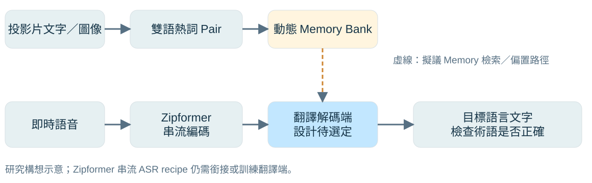
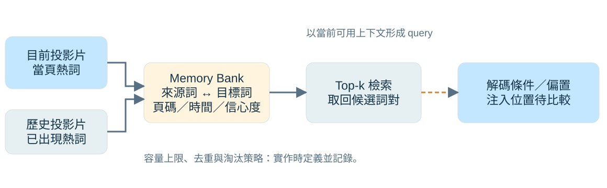

## 研究問題：專有名詞如何跟上演講內容？

::: {.proposal-tag}
研究提案 · 尚未呈現模型實驗結果
:::

::: {.lead}
當投影片已出現專有名詞， 即時翻譯能否利用它，減少術語錯誤？
:::

- **場景**：研討會、國際會議與課堂演講。
- **痛點**：人名、專業術語可能在 ASR 辨識或 ST 翻譯時出錯。
- **研究假設**：隨投影片更新雙語熱詞，可能提升術語正確率。

::: {.source}
內容來源：使用者提供的 slide_content_summary.txt，第 1 節。此頁為研究動機與待驗證假設。
:::

::: {.notes}
完整研究題目為「基於 Zipformer 之動態雙語熱詞與 Memory 注入機制於即時語音翻譯（SimulST）之研究」。本次報告是初期提案，不代表模型已完成或已證明改善。來源摘要指出現有系統動態詞彙適應不足，這裡限縮為欲解決的場景問題，不宣稱所有現有系統都沒有 contextual biasing。例子：投影片出現 Zipformer，但語音辨識或翻譯沒有穩定產生正確術語。
:::

## 系統總覽：投影片提供額外詞彙上下文

{.diagram alt="研究構想流程：投影片文字與圖像擷取雙語詞對，寫入動態 Memory，檢索後偏置翻譯端；即時語音經 Zipformer 串流編碼，再由待選定翻譯解碼端輸出目標文字。"}

::: {.takeaway}
音訊路徑負責理解與翻譯；投影片路徑提供可隨時間更新的術語資訊。
:::

::: {.source}
依來源摘要第 1、3 節繪製的提案示意；虛線模組與翻譯端配置尚待實作及驗證。
:::

::: {.notes}
先沿上方路徑讀：由投影片的文字與圖像取得候選術語，建立來源語與目標語的詞對，寫入 Memory。再沿下方路徑讀：即時語音經串流編碼與翻譯解碼，輸出目標語言文字。Memory 的檢索結果提供額外偏置條件。圖中沒有把 ASR 輸出直接當成翻譯，也沒有把原生 ASR recipe 誤標為已完成的 SimulST。從簡報擷取、翻譯詞對到 Memory 的方法均仍需定義。
:::

## Streaming Backbone：Zipformer＋Transducer

::: {.compact}
| 元件 | 定位 | 本研究如何使用 |
|---|---|---|
| **Zipformer encoder** | 多時間解析度的語音編碼器 | 作為串流聲學底座候選 |
| **Transducer predictor＋joiner** | 結合聲學表徵與輸出歷史 | 先建立串流 ASR 基線，確認增量解碼 |
| **翻譯端** | 將來源語音／文字轉成目標語言 | 串接 MT 或採直接 ST，需先決策 |
:::

::: {.takeaway}
icefall 提供串流 ASR recipes；要成為 SimulST，仍需選定翻譯架構與訓練／解碼方式。
:::

::: {.source}
來源摘要第 2 節；[icefall：Streaming Zipformer Transducer](https://k2-fsa.github.io/icefall/recipes/Streaming-ASR/librispeech/zipformer_transducer.html)、[官方模型與 recipes](https://github.com/k2-fsa/icefall)。
:::

::: {.notes}
原摘要提出 Zipformer2 加 Transducer，這是底座候選，實際採用的 recipe、版本與 checkpoint 需在實作時記錄。Zipformer 的多率結構是效率設計動機，但本研究尚未量測記憶體、RTF 或端到端延遲，不應宣稱本機已顯著降低延遲。Transducer 包含 encoder、prediction network 與 joiner；pruned RNN-T 是可用訓練方法，並非另一個自動具備翻譯能力的模型。若走 ASR 加 MT，需處理部分逐字稿更新與翻譯策略；若直接 ST，需有目標語言監督與相應解碼架構。
:::

## 動態熱詞：從當頁資訊走向歷史 Memory

{.diagram alt="當頁與歷史熱詞寫入 Memory Bank，儲存雙語詞對與來源頁碼等資訊；以目前可用上下文檢索候選，再送至待選定的解碼注入點。"}

::: {.takeaway}
每筆記錄保留雙語詞對與來源資訊；容量管理與檢索規則需可追溯、可重現。
:::

::: {.source}
依來源摘要第 3 節繪製；頁碼、信心度、容量上限與 Top-k 為實作規劃，尚未定案。
:::

::: {.notes}
雙語 Pair 可表示為來源詞、目標詞與 metadata，例如來源詞「齊普變形器」、目標詞 Zipformer；這只是沿用摘要的對應示例，不代表固定或標準譯名。向量化本身不保證搜尋空間不再增長，因此還要定義去重、容量上限與淘汰策略，並保留原詞串以便解碼與評測。當前頁與歷史頁分開記錄，可比較只使用目前投影片與加入歷史記憶的差異。更新熱詞的時間必須來自系統當下已知的換頁事件。
:::

## 注入位置：先選一條可驗證的路徑

::: {.compact}
| 候選路徑 | 偏置對象 | 需要確認的問題 |
|---|---|---|
| **ASR 端** | 來源語言詞彙；Transducer／joiner 附近 | 是否改善辨識？是否傳遞到翻譯端？ |
| **ST 端** | 目標語言術語；翻譯解碼或 attention | 是否能用雙語 Pair 選出正確譯名？ |
| **ASR＋ST** | 來源辨識與目標翻譯共同偏置 | 複雜度與收益是否值得？ |
:::

::: {.takeaway}
先選 ASR 或 ST 單一注入點建立對照，再評估雙端；Cross-attention 是待測方案。
:::

::: {.source}
來源摘要第 3、5 節；此表為架構決策與消融實驗規劃，並非 icefall 已有的直接可用功能宣告。
:::

::: {.notes}
來源摘要提出 joiner 或 ST attention 的 cross-attention 檢索。兩者不能視為無痛互換：joiner 不是原生 Transformer attention 層，新增 cross-attention 需要明確定義 query、key、value、融合位置與訓練方式。若採 ASR 加 MT，ASR 端偏置來源詞，MT 端使用目標詞對；若採直接 ST，則需確認 translation decoder 與 Memory 的介面。建議先決定翻譯架構，再選一個注入點，避免一次修改太多元件而難以歸因。
:::

## 串流 Policy：固定策略，定義清楚讀取單位

- **Wait-k 作為候選基線**：先讀取 k 個來源單位，之後按固定規則交替讀取與輸出。
- **語音需另定義單位**：固定時間片、語音分段或可取得的來源詞，不能直接混用。
- **所有組別共用設定**：相同 chunk、上下文、policy 與解碼參數。
- **比較多個延遲設定**：觀察品質與延遲的取捨，而非只報單一 k。

::: {.takeaway}
可比較性來自明確設定與一致評測；使用 wait-k 本身不保證延遲公平。
:::

::: {.source}
來源摘要第 4 節；[STACL／wait-k 原始論文](https://aclanthology.org/P19-1289/) 以來源詞定義策略，語音版本需指定適配方式。
:::

::: {.notes}
原摘要將此頁稱為 Reviewer-Proof Policy，並把 wait-k 說成先聽 k 個語音 token。這裡改成實驗可比較性的設計：原始 wait-k 是文字端的來源詞策略，語音要定義分段或時間單位。也應說明初始等待後何時再次讀取，不能只寫「等 k 個單位後開啟翻譯」。Transducer 的 blank／token 增量機制與 wait-k 不相同，不能直接用 wait-k 取代整個 Transducer 解碼。最後採哪種 policy，須與選定的 ST 架構一致。
:::

## 對照實驗：分開量出動態與歷史記憶的效果

::: {.compact}
| 組別 | 熱詞來源 | 主要比較目的 |
|---|---|---|
| **A：Baseline** | 無熱詞、無 Memory | 建立共同翻譯底座 |
| **B：當頁熱詞** | 只用當下投影片 | 比較動態場景資訊的收益 |
| **C：當頁＋歷史 Memory** | 當頁與過去投影片 | 比較歷史記憶是否額外有幫助 |
| **D：干擾熱詞（選做）** | 加入不相關或錯誤詞對 | 檢查過度偏置與誤觸發 |
:::

::: {.takeaway}
保留原 A/B 主比較，再用當頁熱詞消融，分開檢驗 Memory 的貢獻。
:::

::: {.source}
來源摘要第 4 節 A/B 設計；B 與 D 為補充實驗建議。全部為預定實驗，尚無結果。
:::

::: {.notes}
原提案 A 為無注入、C 為完整動態熱詞 Memory，保留這個主比較。B 用於辨認改善是來自當頁提示還是歷史記憶；D 則用來觀察當詞庫不正確時會不會強迫輸出錯誤術語。各組需盡量固定模型、資料、切片、policy、beam 與硬體；新增模組若涉及訓練，也需交代參數與訓練預算差異。當下不可讀取尚未播放的投影片或未來逐字稿。若要預載完整簡報，應另立一組並明確說明可取得的資訊。
:::

## 評測：術語、整體品質與延遲一起看

::: {.compact}
| 面向 | 預定指標 | 解讀範圍 |
|---|---|---|
| **術語表現** | 熱詞召回／精確率、譯名正確率 | 是否改善目標詞，也檢查誤觸發 |
| **翻譯品質** | BLEU；人工檢查術語與語意 | 對照人工目標語言 reference |
| **ASR 品質** | WER；中文可加 CER | 僅適用有來源逐字稿的 ASR 分支 |
| **延遲與成本** | AL、含計算延遲、RTF／記憶體 | 記錄 chunk、policy、硬體與時間戳 |
:::

::: {.takeaway}
WER 衡量來源辨識；BLEU 衡量翻譯。需另設術語指標，才能回答熱詞機制是否有效。
:::

::: {.source}
來源摘要第 4 節；術語與資源指標為補充建議。[SimulEval 官方工具](https://github.com/facebookresearch/SimulEval) 可作串流評測參考。
:::

::: {.notes}
AL 的單位與定義需配合 speech-to-text 設定及選定工具版本，並記錄輸出 token 與已讀音訊時間。Computation-aware delay 需使用實際運算完成時間，不能把 chunk size 或整段耗時直接當成字幕延遲。術語評分需預先定義大小寫、縮寫、別名、多種可接受譯名與分詞規則；召回分母是 reference 中應出現的術語，精確率用來檢查不該出現卻被偏置出的術語。MuST-C 只作候選語音翻譯資料；若要評測投影片切換與圖文擷取，還需確認同步簡報是否可得，或另外建立有時間標記的資料。
:::

## 下週目標與需要討論的決策

::: {.columns .two-col}
::: {.column width="52%"}
### 預計交付

1. 跑通離線與串流 **ASR baseline**，保存設定與輸出。
2. 選定 **ASR＋MT 或直接 ST**，定義翻譯基線。
3. 盤點 MuST-C 等資料，製作小型雙語術語清單。
:::
::: {.column width="48%"}
### 請教教授

- 優先在 **ST 端**做術語偏置，還是先改 ASR 端？
- 是否加入特定領域演講／課堂資料？
- 是否能取得同步投影片與換頁時間？
:::
:::

::: {.takeaway}
先確認底座、資料與單一注入點，再開始 Memory 模組與完整 A/B 實驗。
:::

::: {.source}
來源摘要第 5 節；本頁為下一階段工作規劃，未宣稱已完成實作或訓練。
:::

::: {.notes}
下週先完成最小可驗證版本，不將訓練完整 SimulST 與 Memory 的所有工作都承諾在同一週完成。ASR baseline 的交付應包含實際 recipe、checkpoint、環境、音訊格式、chunk／context 以及樣本輸出。資料盤點先確認語言方向、人工翻譯、來源逐字稿、可使用的投影片與同步資訊；特定領域錄音則需確認可使用範圍與標註成本。討論後再收斂模型與熱詞注入的實作範圍。
:::

## 內容來源與技術核對

::: {.compact}
| 來源 | 用途 |
|---|---|
| **slide_content_summary.txt** | 使用者提供的五段研究提案；原文備份於 `sources/` |
| **[icefall 官方 recipes](https://github.com/k2-fsa/icefall)** | Zipformer、Transducer 與串流 ASR 的實作定位 |
| **[Zipformer 論文](https://arxiv.org/abs/2310.11230)** | 多時間解析度 encoder 的設計背景 |
| **[STACL：wait-k](https://aclanthology.org/P19-1289/)** | 固定讀寫策略及來源單位的原始定義 |
| **[SimulEval](https://github.com/facebookresearch/SimulEval)** | 串流翻譯品質與延遲評測工具參考 |
:::

::: {.source}
樣式沿用 chiu/quarto 的既有簡報；技術資料查核日：2026-10-21。架構圖為提案示意，無實驗數據。
:::

::: {.notes}
摘要是內容素材，不是工具或操作指令。簡報保留其研究方向，並釐清 Zipformer ASR 不等同於完整 ST、神經 Memory 注入尚待開發、wait-k 語音單位需明定，以及 WER 與翻譯品質的差別。新增當頁熱詞消融、干擾熱詞與術語評測作為建議，不視為已完成或已確立的方法。這份簡報沒有執行 API、模型訓練或實驗。
:::
