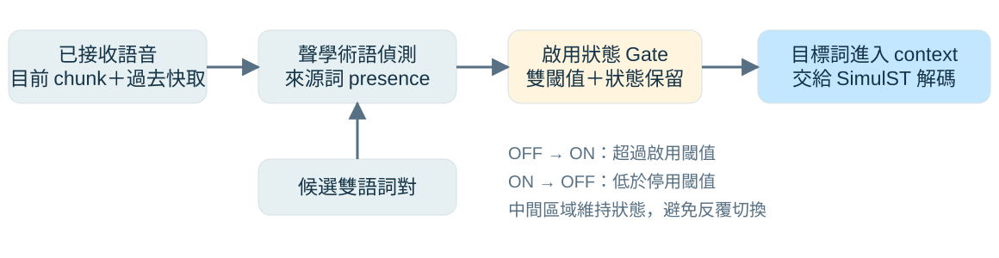
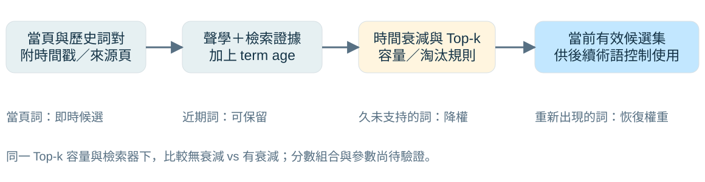
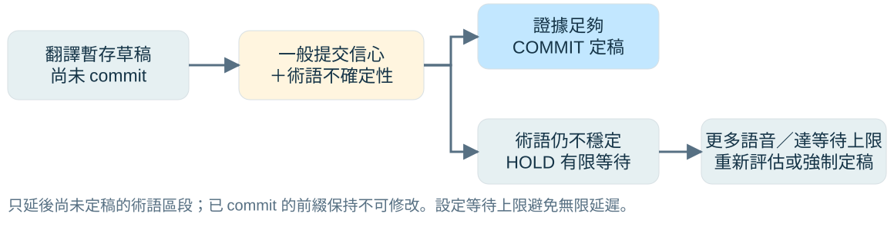

## 這次要和教授確認什麼？

::: {.lead}
從「把熱詞放進模型」， 收斂成「何時啟用、保留與定稿」。
:::

- **排名 1**：聲音是否真的說到這個詞？確認後才啟用雙語術語。
- **排名 2**：歷史熱詞何時該降權？避免舊主題持續干擾。
- **排名 4**：術語還不穩定時，翻譯是否應稍等再定稿？

::: {.takeaway}
本次建議：以排名 1 做主線，排名 2 作備案，排名 4 留作後續擴展。
:::

::: {.source}
依提供的 deep-research-report.md §7 整理。排名與路線建議屬研究判斷；本簡報無新實驗結果。
:::

::: {.notes}
這次報告不重講第一輪 Zipformer、投影片擷取與所有文獻。主要目的是向教授確認可執行的核心問題。報告 §7 的排序是以個人執行性、短論文適配度、新穎性清晰度及訓練成本等因素做的主觀選題判斷，不是實驗排名。Zipformer 可以保留為既有底座候選，但這三題的貢獻在術語控制規則，不需要把 backbone 更換當作研究主張。所有方法與 Pilot 均未執行。
:::

## 三個方向：分別控制哪個決策？

::: {.compact}
| 原報告排名 | 題目與核心問題 | 控制對象 | 主要風險 |
|---|---|---|---|
| **1** | Acoustic-Confirmed Bilingual Term Gating：真的說到了嗎？ | **啟用／停用**目標詞 | 與 A2P 接近，需證明串流狀態的價值 |
| **2** | Time-Decayed Acoustic Hotword Memory：歷史詞還相關嗎？ | 候選詞的**權重與保留** | 可能只是一個排序 heuristic |
| **4** | Term-Aware Commit Policy：現在可以定稿嗎？ | 翻譯草稿的**提交時機** | 延遲評測與細粒度對齊較難 |
:::

::: {.takeaway}
先各自驗證，避免一次整合三個機制，卻無法歸因改善來自哪裡。
:::

::: {.source}
來源：研究報告 §7 的候選題目、風險與 Pilot 表。沿用原排名 1／2／4，未重新編號。
:::

::: {.notes}
Gate 不等於 retrieval，Memory 不等於把歷史全部保存，Commit 也不等於直接生成下一個 token。三者可相互銜接，但研究初期應分別建立對照。實際接口要配合可取得的 SimulST 系統，不能預設現有模型支援任意 runtime glossary 更新或任意草稿延後。
:::

## 排名 1：聲學確認後，才啟用雙語術語

::: {.rank-tag}
Acoustic-Confirmed Bilingual Term Gating for SimulST
:::

{.diagram alt="候選雙語詞對與已接收語音經聲學偵測得到來源詞 presence，雙閾值 Gate 決定目標詞是否進入 SimulST context。"}

- **雙語配對**：確認來源詞，再讓對應的目標譯名影響生成。
- **雙閾值**：啟用閾值高於停用閾值；中間區域保持原狀態。

::: {.takeaway}
研究假設：相同候選詞下，聲學 Gate 能減少錯誤術語插入，同時維持正確詞召回。
:::

::: {.source}
來源：報告 §7、one-pager。偵測器可參考 [Attention2Probability](https://arxiv.org/abs/2508.18701)；圖為擬議方法，尚未實作。
:::

::: {.notes}
只使用目前可取得的 audio prefix，或目前 chunk 加過去 cache，不使用未來音訊。給定來源詞 s 與目標詞 t，聲學偵測值超過 on threshold 就啟用 t，低於 off threshold 就停用，中間保持狀態，稱為 hysteresis。必須先定義 presence 的時間語義：整段 prefix 中曾經出現的累積機率，不能直接拿來判斷某個詞現在是否已過時；停用需要最近因果視窗、事件有效期或其他明確規則。A2P 可作聲學證據方法參考，但不能假設其現有模型已能無損地直接改為 causal streaming。Frozen 與 training-free 只是候選實作，不等於整條串流接口已經驗證。
:::

## 排名 1：關鍵實驗是「同一 shortlist，只改 Gate」

::: {.compact}
| 對照組 | 術語使用方式 | 要回答什麼？ |
|---|---|---|
| No context | 不提供術語 | 外部詞彙是否真的有幫助？ |
| Always-on pool | 全部候選雙語詞持續啟用 | 噪音候選會造成多少誤插？ |
| **Same shortlist／no gate** | 與主方法相同檢索結果，直接使用 | 改善是否只是檢索變好？ |
| **Proposed** | 相同 shortlist，加 causal acoustic gate | Gate 是否有額外貢獻？ |
| Oracle gate | 以人工出現時序決定啟用 | 只作上限，不納入可部署主結果 |
:::

::: {.takeaway}
固定 glossary pool、retriever、翻譯模型與解碼設定；主變因只保留啟用規則。
:::

::: {.source}
來源：報告 §7、投稿最低實驗與 one-pager。評估 Term Precision／Recall／F1、false insertion、翻譯品質及延遲。
:::

::: {.notes}
Always-on pool 與 same-shortlist without gate 要明確分開，避免兩個 baseline 名字不同但實際相同。如果未使用 retrieval，則合併重複組，不捏造獨立 baseline。干擾詞 distractor 是在候選池出現但該段音訊未說到的詞。Oracle 可以使用人工標記作 ceiling，但 proposed 不可使用 reference 詞或未來聲音。必做比較是相同 shortlist 上有無 Gate；再測干擾詞數量與 threshold／hysteresis 消融。
:::

## 排名 2：歷史熱詞要隨時間降權

::: {.rank-tag}
Time-Decayed Acoustic Hotword Memory
:::

{.diagram alt="當頁與歷史詞對依聲學證據、檢索相關性及時間資訊評分，經時間衰減與容量規則形成有效候選集。"}

- 同時考慮 **聲學證據、檢索相關性、距離上次支持的時間**。
- 保留近期有效詞；久未被支持的舊詞降權，再次出現時可恢復。

::: {.takeaway}
研究假設：在相同容量與召回下，時間資訊能減少過期術語的錯誤啟用。
:::

::: {.source}
來源：報告 §7。衰減函數、刷新事件與容量上限為待選定參數；此圖不是已驗證架構。
:::

::: {.notes}
這題與第一輪想做的 Memory 最接近，但把貢獻收斂為 temporal factor。可用加權分數整合 acoustic presence、retrieval relevance 與 age penalty，形式與權重仍需實驗決定。年齡應從最後一次可觀察的支持事件計算，例如投影片換頁或聲學再確認，不能用 reference 中的真實出現時間替 proposed 刷新。過舊不代表永久刪除，可從儲存池重新檢索後再啟用。Top-k 限制工作候選集，不等於整個儲存池已完成容量管理。
:::

## 排名 2：把「時間」和「候選量」分開驗證

::: {.compact}
| 比較條件 | 保留策略 | 分析重點 |
|---|---|---|
| Current-only | 只用當頁詞 | 前幾頁的重要詞是否被遺忘？ |
| All-history | 使用累積歷史詞 | 換主題後，過期詞是否誤觸發？ |
| Retrieved-history | 固定 Top-k，無衰減 | 單靠檢索是否已足夠？ |
| **Time-decayed** | 同一 Top-k，加 age／refresh | 時間因素是否額外有效？ |
:::

::: {.takeaway}
主比較：相同 retriever、Top-k 與詞池下，有／無時間衰減；分析換頁前後與術語再次出現。
:::

::: {.source}
來源：報告 §7。需長 session、換頁時間與雙語詞表；未來投影片不進入當前可用資訊。
:::

::: {.notes}
一場或數個長演講 session 可先建立換頁時間與詞對標記。Current-only 和 all-history 是行為邊界；真正用來歸因 temporal factor 的是 retrieved-history 與 time-decayed 兩組，固定候選容量與基礎檢索分數。至少包含主題切換後舊詞停止出現、稍後再次提到舊詞兩種情境。對比 matched recall 時的 false activation，並另外追蹤最終 target false insertion，兩者不是同一指標。若最佳衰減等同不衰減，代表此資料未支持時間假設。
:::

## 排名 4：術語不確定時，只延後尚未定稿的區段

::: {.rank-tag}
Term-Aware Commit Policy for SimulST
:::

{.diagram alt="未定稿草稿依一般信心與術語不確定性判斷；證據足夠時 commit，術語仍不穩時有限 hold，更多語音或等待上限到達後重評。"}

- 非術語區段沿用原策略，減少額外等待。
- 術語區段在 **聲學／譯名證據不足**時暫緩，並設定等待上限。

::: {.takeaway}
研究假設：少量額外等待，可換取更穩定的術語定稿；已 commit 的前綴不回改。
:::

::: {.source}
來源：報告 §7。概念參考 [Streaming CTC Word Spotting](https://arxiv.org/abs/2605.18222)；從 ASR 移到 target SimulST 是待驗證延伸。
:::

::: {.notes}
Commit 是將暫存草稿變成不可修改輸出的時刻，不等於 decoder 每次生成 token。基礎系統若沒有草稿／定稿接口，需先建立輸出緩衝層；這是本題額外工程成本。可以用一般提交信心結合術語不確定性，只有相關 span 延後，並設定最大 hold。若聲音證據不足但等待上限到達，必須定義保守定稿或沿用 baseline 的 fallback，不無限等候。這裡的 hold 是對已知前綴的提交決策；不能先看未來音訊，再宣稱當時已有足夠證據。
:::

## 排名 4：比較相同等待預算下的定稿品質

::: {.compact}
| 對照策略 | 做法 | 必須記錄 |
|---|---|---|
| Fixed commit | 固定時機提交 | 基準 Term-F1 與延遲 |
| Confidence commit | 以一般翻譯信心提交 | 不使用術語專屬訊號 |
| **Term-aware commit** | 術語不確定時局部 hold | 額外等待、術語定稿錯誤 |
| Matched-delay control | 固定等待到相近平均延遲 | 改善是否只是因為多等？ |
:::

::: {.takeaway}
要證明「等對地方」的價值，而非只證明多等通常更準。
:::

::: {.source}
前三組依報告 §7；Matched-delay control 為本簡報補充建議。比較術語品質與含計算延遲的曲線，不只單一點。
:::

::: {.notes}
固定翻譯底座與術語候選，僅改提交策略；在多個延遲 operating points 對照。原報告提出 term correction／revision rate，實作時需區分草稿修訂與已呈現文字撤回：若 committed prefix 不可修改，不能把其零 revision 當成準確。應主要比較錯誤定稿率、target Term-F1 與等待時間，草稿修訂另作診斷。StreamLAAL 是報告建議的延遲方向，使用前必須核對計算工具、定義、單位與可取得的時間戳；未確認前不報其量測數字。
:::

## 與既有研究的差異：還需要證明哪一段？

::: {.compact}
| 相關研究 | 已有能力 | 本次欲驗證的差異 |
|---|---|---|
| **Attention2Probability** | 從 speech–term attention 估計詞是否出現 | 排名 1：因果分塊狀態，控制雙語目標詞啟停 |
| **BR-ASR** | 先檢索候選，再提供給 ASR | 排名 2：加入時間老化與重新啟用 |
| **Streaming CTC Word Spotting** | 跨 chunk 關鍵詞路徑與增量提交 | 排名 4：以目標翻譯術語的不確定性控制定稿 |
| **InfiniSST** | 處理無界語音，平衡品質與計算延遲 | 提供串流情境參考；不等於已具術語 Commit Gate |
:::

::: {.takeaway}
這些是與已讀工作的研究差異假設；仍需實作與更完整文獻比較，才能主張新穎性。
:::

::: {.source}
核對原始資料：[A2P](https://arxiv.org/abs/2508.18701)、[BR-ASR](https://www.isca-archive.org/interspeech_2025/gong25_interspeech.html)、[CTC-WS](https://arxiv.org/abs/2605.18222)、[InfiniSST](https://aclanthology.org/2025.findings-acl.157/)。
:::

::: {.notes}
不沿用報告中「沒有人做完」「必定可投」等絕對判斷。已核對四篇的原始出版頁與摘要，其能力與表中一致；這次沒有完成所有相關工作的 code-level audit，不能以摘要沒有提到就證明方法不存在。A2P 的現成 presence 機制最接近排名 1，真正要證明的是 causal state 與 bilingual activation 的額外效果。排名 2 必須排除單純縮小 shortlist 的收益，排名 4 必須排除單純增加等待的收益。
:::

## 三題共用的評測與公平性原則

::: {.compact}
| 面向 | 要量什麼？ | 共同控制條件 |
|---|---|---|
| 術語 | Target Precision／Recall／F1、錯誤插入 | 固定候選詞池、別名與正規化規則 |
| 翻譯 | BLEU 或 COMET、一般內容錯誤 | 同一模型、reference 與解碼設定 |
| 串流 | 端到端含計算延遲、query overhead | 同一硬體、chunk、過去快取與時戳 |
| 因果性 | 每個時刻允許看到哪些資訊 | 僅已讀語音、當頁及過去可用 context |
:::

::: {.takeaway}
資料先做小型可控 Pilot；主結果加入 distractors，oracle 只作上限。
:::

::: {.source}
來源：報告 §7、§8 與 one-pager。CoVoST2 zh–en、technical lectures 只是候選，資料、授權與對齊仍待確認。
:::

::: {.notes}
主張術語改善，不能只報 recall，因為全開 glossary 可能同時提高錯誤插入。Term precision／recall 的分母與多種可接受譯名需預先固定。Gate overhead 是局部成本，不能代替端到端 streaming latency。Frozen detector 或 backbone 不代表 evaluation 不花 GPU，也不能從報告沒有硬體基準推算 GPU-hours。報告中的 training-free 只指不新增訓練；若加入 causal adaptation 訓練，需重新記錄成本。中文／英文方向先由資料與既有 checkpoint 決定，不在未確認前承諾。
:::

## 兩週 Pilot：先看有沒有值得追的訊號

::: {.compact}
| 方向 | 最小試驗 | 報告建議的繼續門檻 |
|---|---|---|
| **排名 1** | 500–1000 句；每句 20–50 個干擾詞 | Term-F1 +5 個百分點，或誤插相對減少 30%；BLEU 下降 ≤0.5；Gate ≤20 ms/query |
| **排名 2** | 長 session＋換頁時間；無／有衰減 | 在 recall 差距 ≤2 個百分點下，錯誤啟用相對減少 25%；或 Term-F1 +4 個百分點 |
| **排名 4** | 300–500 句含術語語音；底座固定 | 術語修訂率相對減少 30%、額外 StreamLAAL ≤150 ms、Term-F1 +4 個百分點 |
:::

::: {.takeaway}
以上全部是**報告提出的研究管理門檻**，不是文獻成績或已達成果；需與教授確認。
:::

::: {.source}
來源：deep-research-report.md §7「兩週 Pilot 與放棄判準」。排名 4 的修訂定義與 StreamLAAL 工具需先確認。
:::

::: {.notes}
百分點是絕對差值；相對降低百分比則以 baseline 為分母，不混用。排名 1 若 Term-F1 <+2 points 且誤插下降 <15%，或額外延遲 >50 ms/query，報告建議重新評估或改題。排名 2 若 gain <2 points 或最佳衰減近似 uniform history，時間因素可能沒有價值。排名 4 若增加 >300 ms 等待，仍只有 <3-point F1 gain，則投入風險高。這些都是原報告的管理建議，不能取代信賴區間、顯著性或 matched-delay 對照，也不應被當成先驗保證。若資料量或運算預算不足，先與教授調整試驗規模。
:::

## 建議路線與請教授決策的三件事

::: {.columns .two-col}
::: {.column width="52%"}
### 建議先做

1. **排名 1 為主線**：固定 shortlist，只測 Gate 的額外貢獻。
2. **排名 2 為備案**：共用偵測器與評測，加入時間條件。
3. **排名 4 後續擴展**：先確認草稿／定稿與延遲量測接口。
:::
::: {.column width="48%"}
### 請教授確認

- 是否同意先聚焦**雙語術語啟用**？
- 優先用**公開語料**，或有同步投影片的演講？
- 先驗證 **frozen pipeline**，還是接受為因果偵測增加訓練？
:::
:::

::: {.takeaway}
下一個交付：同一 shortlist 下，無 Gate／有 Gate 的首張術語品質與延遲比較表。
:::

::: {.source}
依報告 §7 與 one-pager 提出執行建議。尚未承諾投稿日期、資料集可用性或 GPU 時間。
:::

::: {.notes}
不是要求現在同時實作三個題目，而是請教授選定主線與資源。排名 1 為主線的前提是 causal term evidence 與 target glossary 接口可行；如果接口失敗，不能僅因排名高就繼續投入。若 detector 與評測可共用，但 Gate 無額外價值，才考慮排名 2 的時間假設。排名 4 需要細粒度對齊、草稿管理與可靠 latency evaluator，較適合已有穩定 SimulST baseline 後展開。先完成可否證的小實驗，再決定是否擴大模型或投稿。
:::

## 資料來源與閱讀範圍

::: {.compact}
| 來源 | 本次用途 |
|---|---|
| **deep-research-report.md §7** | 排名 1／2／4、假設、實驗、風險與 Pilot 門檻；原文存於 `sources/` |
| **[Attention2Probability](https://arxiv.org/abs/2508.18701)** | 聲學詞彙 presence，排名 1 的近鄰工作 |
| **[BR-ASR · Interspeech 2025](https://www.isca-archive.org/interspeech_2025/gong25_interspeech.html)** | 大候選詞池檢索，排名 2 的比較背景 |
| **[Streaming CTC Word Spotting](https://arxiv.org/abs/2605.18222)** | 跨 chunk 偵測與增量提交，排名 4 的概念參考 |
| **[InfiniSST · Findings ACL 2025](https://aclanthology.org/2025.findings-acl.157/)** | 連續語音翻譯與計算延遲情境 |
:::

::: {.source}
原始資料核對：2026-10-22；樣式沿用 Zipformer_First。三張圖皆為研究構想，無實測曲線或數據。
:::

::: {.notes}
提供的 deep research 是研究素材，不把其內部工具指示或不透明 citation tokens 當成可執行要求或正式引用。簡報以第 7 點為主，僅借用 one-pager 的實驗澄清，不逐頁複製全報告。已直接核對四篇原始出版頁與摘要；未將全文所有 2026 文獻與產業新穎性敘述重新驗證，因此不把其廣泛結論作為已確立事實。排名與 Go/No-go 為原報告建議；本簡報新增 matched-delay control，以及累積 presence 與停用語義、草稿修訂與錯誤定稿的區分。沒有執行訓練、推論或 API。
:::
