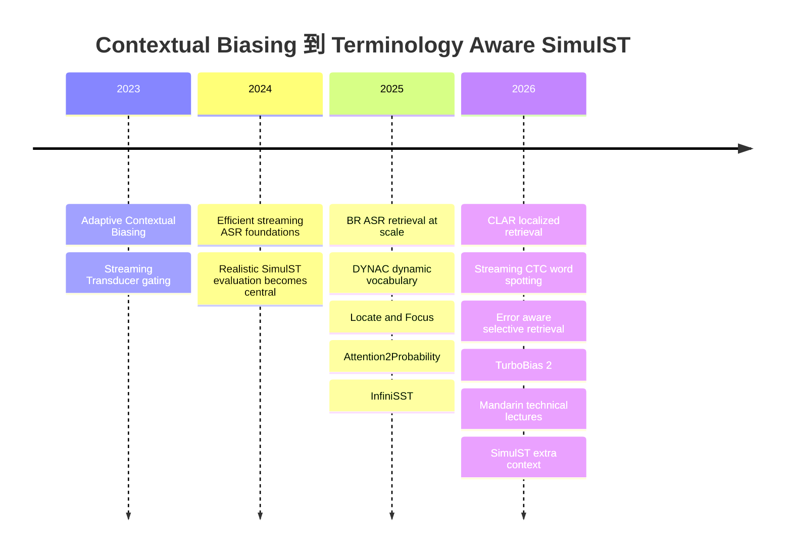
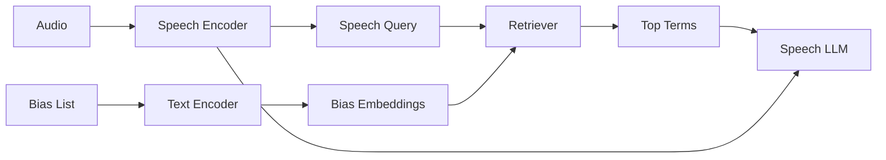
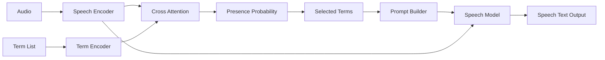
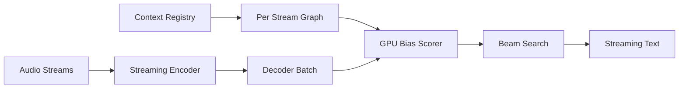
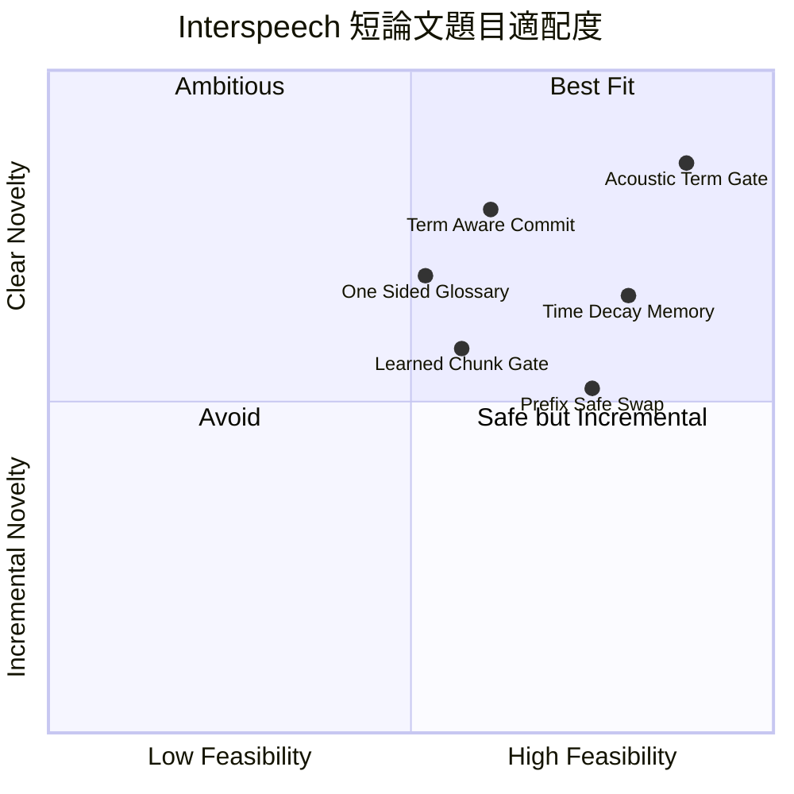

# Dynamic Contextual Biasing 與 Terminology-Aware Simultaneous Speech Translation：第二輪深度研究

**研究基準日：2026-10-22，Asia/Taipei。** 本輪把「近十八個月」定義為 **2025-04-22 至 2026-10-22**，並優先檢查近十二個月。第一輪報告的問題定義與 R1–R5 路線不重述，以下直接沿用第一輪 §1–§3 的術語與分類。fileciteturn0file0

你的條件中有兩個會直接限制本輪可以下到多精確的工程結論：**資料集可用性仍是「待確認」；GPU 雖寫「不限」，但沒有實際型號、卡數、VRAM 與可獨占期間。** 因此，凡論文沒有自報訓練硬體與 wall-clock time，我一律依你的要求寫「無依據」，不自行換算 GPU-hours。**Interspeech 截稿日也沒有填入，因此本報告不查、不猜截稿日**；投稿時程全部用 `T−N 週` 相對表示。

## 與第一輪的出入，以及技術演進全景

**§0 與第一輪報告的出入**

第一輪的核心判斷大致成立，但深挖後有四處需要修正或收斂。

| 第一輪判斷 | 第二輪修正 | 判定 |
|---|---|---|
| 同一 streaming session 中「不中斷且保留狀態的 context 更新」尚未有明確證據 | **TurboBias 2.0** 已比第一輪所見的 sherpa-onnx 更進一步：支援 batched streaming 中每個 stream 的獨立 context model，context model 可以動態新增／移除，而且不需要重新載入 server 或重新實例化 decoder；但論文仍沒有直接證明「在一個 hotword 已匹配到一半時，原地替換 phrase list 且保證 prefix/context state 語義完全不變」。因此第一輪不是錯，而是把「沒有 API 證據」說得太廣。 citeturn20view11turn25view7 | 【單篇】 |
| 第一輪把 R3 Retrieval-Augmented Hotword Memory 判為「快速成長」 | 這個表述已偏保守。近十八個月已有 **200k-entry BR-ASR**、從約 **600k vocabulary 壓到約 98k** 的 retrieval+RL，以及 training-free error-aware selective retrieval。純粹「大列表先 retrieval 再 bias」本身已相當擁擠；真正較空的問題已轉向**時間動態性、錯誤檢索抑制，以及與 target-side terminology control 的耦合**。 citeturn26search5turn25view8turn25view9 | 【推論】 |
| 第一輪把 R3 context retrieval 與 R4 bilingual terminology control 視為相鄰、但橋接證據偏少 | **Attention2Probability** 已明確把 speech–term cross-attention 轉成 terminology presence probability，並把選中的 terminology 用於 ASR 與 translation；作者報告 terminology accuracy 可提升約 6–17%。因此 R3→R4 的橋比第一輪描述得更成熟，但仍不是「simultaneous、chunk-level、runtime-changing bilingual glossary」的完整解法。 citeturn24view1turn25view0 | 【單篇／推論】 |
| 第一輪把「Dynamic Hotword」核心風險放在能否更新 | 更新基礎設施本身正在快速商品化／開源化；更有論文價值的問題已是**何時啟用、何時撤除、哪些 term 真的被語音說到、錯誤 term 如何不污染 target translation、更新時如何影響 commit policy**。這是第二輪最重要的選題轉向。 citeturn25view7turn24view1turn25view10 | 【推論】 |

換句話說，第一輪 §8 的 Gap A「可否 runtime update」到 2026-10 已不再適合作為單獨論文主張；**只做「可以換 hotword list」被 NVIDIA TurboBias 2.0 做掉的風險已很高。** 更安全的論文主張應是「**speech evidence 決定 bilingual terminology 何時進入／退出 simultaneous translation context**」。citeturn25view7 【推論】

**§1 路線全景**

下圖不重畫第一輪 §3 的 R1–R5 分類，而是只標示影響本輪選題的技術轉折。

**節點：** Adaptive Contextual Biasing、Streaming Transducer、dynamic vocabulary、retrieval at scale、term localization、term presence probability、unbounded SimulST、error-aware retrieval、production per-stream biasing。  
**邊：** 依時間表示從「固定 list 加分」逐步走向「選擇 context → 判定 term 是否存在 → streaming translation 使用 context」。



第一個轉折是 **bias 不該永遠開著**：第一輪已讀的 Adaptive Contextual Biasing 顯示，無條件偏置會傷害一般辨識，因此開始學習何時開啟 context。fileciteturn0file0 【單篇】

第二個轉折是 **從「把全部候選丟給 decoder」轉向「先 retrieval」**。BR-ASR 可處理最高 200k bias entries，在 2k bias words 時 LibriSpeech test-clean/test-other 的 B-WER 報告為 2.8%/7.1%；擴到 200k 時只增加 0.3 point WER 與 2.9 point B-WER，並把候選 pruning 99.99%。citeturn26search5 【單篇】

第三個轉折是 **retrieval score 不等於「真的說到了這個 term」**。Attention2Probability 直接把 cross-attention 轉換成 term-presence probability；CLAR 則用局部 acoustic evidence 和 CIF localization，後者在 AISHELL-1-NE 報告 R@1 97.03%、R@5 99.75%，但也顯示 false-positive retrieval 會提高非 bias 區域錯誤。citeturn24view1turn25view10 【共識】

第四個轉折是 **真正 continuous SimulST**。InfiniSST 把無界語音視為 multi-turn streaming dialogue，並利用 KV cache／translation trajectory 降低 computation-aware latency；2026 的 IWSLT systems 更把 Extra Context 直接帶入 SimulST agent。citeturn15view12turn15view14 【共識】

第五個轉折，也是你的「被做掉」風險來源，是 **production-grade per-stream contextual biasing**。TurboBias 2.0 已把 context models 做成可以在服務中動態管理、每個 stream 獨立、可搭配 streaming Transducer 的 open implementation；因此論文最好不要再把「runtime list update」當唯一 novelty。citeturn25view7 【單篇】

## 近十八個月文獻盤點

**§2 查詢式與篩選規則**

本輪主要查詢族包括：

```text
site:isca-archive.org/interspeech_2025 contextual biasing ASR hotword
site:isca-archive.org/interspeech_2026 contextual biasing hotword ASR
site:arxiv.org contextual biasing streaming ASR hotword transducer 2026
site:arxiv.org terminology speech translation retrieval speech 2025 2026
site:aclanthology.org terminology speech translation simultaneous 2025 2026
site:aclanthology.org simultaneous speech translation extra context 2026
"dynamic vocabulary" contextual ASR
"bias retrieval" contextual ASR
"term presence" speech translation terminology
"streaming contextual biasing" transducer
"hotword retrieval" speech LLM
```

篩選範圍固定為 **2025-04-22 至 2026-10-22**；只把本輪實際開啟過原始 arXiv／ACL Anthology／ISCA publication page 的論文放進主清單。搜尋摘要裡看到、但沒打開原文 publication page 的項目不補進清單；GitHub code 則另外實際搜尋 repo。Interspeech 2025 的 contextual-biasing paper 密度特別高，因此主盤點保留它們，即使多數位於十八個月區間較早的一端。citeturn22search0turn26search0turn26search1turn26search5 【推論】

**主文獻清單**

| 論文與開啟 URL | 時間 | 機制 | 資料與測試條件 | 主要數字 | 與前作差異 | 開源 |
|---|---:|---|---|---|---|---|
| [BR-ASR](https://www.isca-archive.org/interspeech_2025/gong25_interspeech.html) citeturn26search5 | 2025-08 | speech-bias contrastive retrieval + curriculum | LibriSpeech；最大 200k entries | 2k list 時 test-clean/test-other B-WER 2.8/7.1%；200k 時僅 +0.3 WER、+2.9 B-WER；20 ms/query | 不讓 SpeechLLM 直接吃巨大 list，先做 acoustic-aware retrieval | 本輪未找到作者官方 repo |
| [DYNAC](https://www.isca-archive.org/interspeech_2025/sudo25_interspeech.html) citeturn26search1 | 2025-08 | dynamic phrase tokens + self-conditioned CTC | LibriSpeech 960 h；另有日語資料 | test-clean 約 0.1 WER point 代價下 RTF 降 81% | 把 AR dynamic vocabulary 改成 NAR contextualization | 本輪未找到作者官方 repo |
| [Dynamic Vocabulary Prediction and Activation](https://www.isca-archive.org/interspeech_2025/lin25g_interspeech.html) citeturn26search0 | 2025-08 | phrase-level prediction + bias loss + confidence activation | LibriSpeech、WenetSpeech | relative WER −28.31%/−23.49%；context phrase WER −72.04%/−75.69% | phrase-level activation，避免只獨立 boost subwords | 本輪未找到作者官方 repo |
| [WCTC-Biasing](https://www.isca-archive.org/interspeech_2025/nakagome25_interspeech.html) citeturn26search7 | 2025-08 | wildcard CTC KWS + inter-layer bias | Japanese ASR；unknown-word test | unknown-word F1 +29% | training-free；在 intermediate acoustic layer 偵測再 bias | 未確認 |
| [GPU n-gram contextual biasing](https://www.isca-archive.org/interspeech_2025/bataev25_interspeech.html) citeturn14view1 | 2025-08 | GPU n-gram LM shallow bias | CTC、RNNT、AED decoders | 額外計算 <7%；greedy 與 beam 的 OOD accuracy gap 消除超過一半 | 讓 greedy decoding 也能高效 contextualize | 現行 NeMo GPU-PB 使用相關 infrastructure；[NeMo](https://github.com/NVIDIA/NeMo) citeturn19search4 |
| [Ranking and Selection of Bias Words](https://www.isca-archive.org/interspeech_2025/hou25_interspeech.html) citeturn26search2 | 2025-08 | bias-word scorer + rank/select | LibriSpeech + IS21 bias list | B-WER relative reduction >40% | 把大型 list 問題轉成 rank/select，而非全量 prompt | 未確認 |
| [Spot and Merge](https://www.isca-archive.org/interspeech_2025/agrawal25b_interspeech.html) citeturn26search4 | 2025-08 | LoRA bias module；cross-attention spot；merge ASR output | LibriSpeech + in-house contact-center | LibriSpeech absolute WER −1.0 point | 不要求完整 jointly retrain ASR；可處理 OOV merge | 未確認 |
| [GLCLAP](https://www.isca-archive.org/interspeech_2025/kong25_interspeech.html) citeturn26search3 | 2025-08 | global-local contrastive audio-text retrieval | contextual ASR | 已開啟摘要只說顯著改善；未暴露可安全抄錄的精確主數字 | 同時使用 utterance global semantic 與 local lexical acoustic cues | 未確認 |
| [Efficient Trie-based Biasing using K-step Prediction](https://www.isca-archive.org/interspeech_2025/kwok25c_interspeech.html) citeturn26search10 | 2025-08 | multi-step lookahead 避免 trie bonus revocation | NSC Part 2；Whisper；10 h synthetic adaptation | WER 30.86% → 12.19% | 避免傳統 trie bias 必須 beam-search 回收 bonus | 未確認 |
| [OWSM-Biasing](https://www.isca-archive.org/interspeech_2025/sudo25b_interspeech.html) citeturn15view4 | 2025-08 | frozen OWSM + dynamic vocabulary contextualizer | LibriSpeech-100 test-clean | B-WER −11.6 point；WER −0.9 point；RTF −7.5% 相對 no-bias setting | 把 dynamic vocabulary 接到 open speech foundation model | 未確認 |
| [Keyword-aware Cost Function](https://www.isca-archive.org/interspeech_2025/kwok25b_interspeech.html) citeturn26search15 | 2025-08 | masked CE + biased-position binary loss | NSC Part 2；Whisper；10 h synthetic data | WER 29.71% → 11.81% | 專門讓 training loss 對 rare keyword position 敏感 | 未確認 |
| [Pinyin-Guided Contextual Biasing](https://www.isca-archive.org/interspeech_2025/zhengjie25_interspeech.html) citeturn15view6 | 2025-08 | audio-to-pinyin cues + phrase filtering + LLM correction | AISHELL-1 | CER relative −25%；bias-phrase CER relative −49.2% | 用 phonetic matching 減少中文同音／形近 contextual confusion | 未確認 |
| [CMT-LLM](https://www.isca-archive.org/interspeech_2025/he25_interspeech.html) citeturn26search12 | 2025-08 | two-stage filtering + SpeechLLM contextual prompt | LibriMix、AMI SDM；bias size 1000 | WER 7.9% / 32.9% | 把 multi-talker ASR 與 contextual biasing 合併 | 未確認 |
| [Attention2Probability](https://arxiv.org/abs/2508.18701) citeturn24view1turn25view0 | 2025-08 | cross-attention → term-presence probability | 中英 terminology speech；ASR 與 ST intervention | max recall 92.57% 中文、86.83% 英文；8.71 ms/query；term accuracy +6–17% | 不把 vector similarity 當成「term 已出現」；直接校準 occurrence probability | [GitHub](https://github.com/bytedance/Attention2Probability) |
| [Locate-and-Focus](https://aclanthology.org/2025.acl-long.556/) citeturn14view19turn21view7 | 2025-07 | locate relevant speech span + focus terminology knowledge | 多個 speech-translation datasets | 已開啟 publication page 顯示 consistency gains；精確主數字需依其各資料表，這裡不跨表挑最高值 | 先定位「這個 term 對應哪段聲音」，再使用 translation knowledge | 本輪 GitHub title search 未找到作者官方 repo |
| [InfiniSST](https://aclanthology.org/2025.findings-acl.157/) citeturn15view12turn21view3 | 2025-07 | unbounded speech as multi-turn dialogue + KV cache | MuST-C En-Es、En-De、En-Zh | 相同品質下 computation-aware latency 約少 0.5–1.0 s | 不依固定 utterance segmentation；處理長 continuous speech | [GitHub](https://github.com/LeiLiLab/InfiniSST) |
| [Hotword Retrieval and Reinforcement Learning](https://arxiv.org/abs/2512.21828) citeturn25view8 | 2025-12 | GLCLAP-style retrieval + RADA + fuzzy + GRPO | 約 600k web vocabulary 經處理約 98k；Media、Medical、General | Media KER 22.63→11.99→8.29；Medical 23.31→15.89→11.24 | retrieval 後再以 RL 優化 SpeechLLM 使用 hotwords 的方式 | 未確認 |
| [CLAR](https://arxiv.org/abs/2603.25460) citeturn25view10 | 2026-03 | CIF localization + local/global contrastive retrieval | AISHELL-1-NE | R@1 97.03%；R@5 99.75%；CER 1.86→0.92；B-WER 12.92→2.78 | 強調 short entity 的 local acoustic evidence | 未確認 |
| [Contextual Biasing via Streaming CTC Word Spotting](https://arxiv.org/abs/2605.18222) citeturn25view6 | 2026-05 | stateful token passing across chunks + incremental commitment | streaming ASR | 已開啟版本確認 WER/KWS F-score 均改善；摘要未提供足夠條件下的單一精確數字，故不猜 | 直接處理 keyword 跨 chunk 及何時 commit | 未確認 |
| [Context-Aware ASR for Mandarin Technical Lectures](https://arxiv.org/abs/2607.05058) citeturn24view0 | 2026-07 | first pass builds glossary；second pass contextual ASR | Mandarin AI technical lectures | Breeze-ASR term recall 52.50→60.13%；hybrid 62.05% recall、82.73% precision | 真正對準中文學術 technical-term 評測，但仍是 two-pass | 未確認 |
| [Hierarchical Policy Optimization for Simultaneous Translation of Unbounded Speech](https://aclanthology.org/2026.acl-long.80/) citeturn15view13turn21view4 | 2026-07 | SFT + hierarchical quality/latency RL | En→Zh、De、Ja | 約 1.5 s latency regime 下 >+7 COMET、+1.25 MetricX | 把 quality-latency policy learning 用於 unbounded SimulST | 未確認 |
| [CUHKSZ IWSLT 2026 Simultaneous ST](https://aclanthology.org/2026.iwslt-1.13/) citeturn15view14turn21view5 | 2026-07 | Qwen3-Omni LoRA + syntax-aware chunks + wait tokens + Extra Context | IWSLT 2026 | En-Zh 40.5 BLEU @1.95 s；42.1 @2.16 s；En-De 27.7 @1.72 s、30.5 @2.29 s | dynamic priors 可直接進 streaming agent prompt | 未確認 |
| [Dynamic Attention Masking for Simultaneous ST](https://aclanthology.org/2026.iwslt-1.20/) citeturn15view15 | 2026-07 | layer-wise future-frame scheduler + LoRA | En-De、En-It、En-Zh；SeamlessM4T | 作者明確定位為 proof-of-concept；已開啟頁沒有一個足以代表全條件的單一主數字 | 直接在 acoustic encoder attention 控制 future context | 未確認 |
| [TurboBias 2.0](https://arxiv.org/abs/2608.21343) citeturn25view7turn20view11 | 2026-08 | GPU context graph + per-stream models + streaming greedy/beam | Contextual Earnings-22 + 約 3 h medical；多個 Parakeet/Nemotron Transducers | Unified + beam + per-stream global：F-score 87.5、WER 12.6；128-stream cached beam RTFx 988 vs baseline 1005；context model 通常 <1 MB | production-grade lifecycle、per-stream batching、cache-aware decoding | [NVIDIA NeMo](https://github.com/NVIDIA/NeMo) |
| [Training-Free Error-Aware Selective Retrieval](https://arxiv.org/abs/2609.30694) citeturn25view9 | 2026-09 | first-pass error span → phonological retrieval → second pass | MedSyn、ATCOSIM、Earnings | MedSyn queries 13.37→0.99；WER 7.30→5.67；B-WER 41.43→28.05 | 不做全句 retrieval；只對模型懷疑的 span 查 glossary | training-free；repo 未確認 |

這批文獻形成一個相當清楚的共識：**「contextual biasing = 把一串詞全部塞進模型」已不是前沿；前沿逐漸變成候選縮減、acoustic localization、confidence gating、runtime context lifecycle，以及 continuous speech 的 context management。** citeturn26search5turn26search2turn24view1turn25view10turn25view7 【共識】

而你真正想做的「**bilingual term pair 隨 streaming context 改變，並直接影響 SimulST target output**」仍沒有在上述工作中被完整閉環解掉：A2P 有 terminology presence 與 ST intervention；Locate-and-Focus 有 speech-term localization；TurboBias 有 production streaming context；IWSLT systems 有 continuous SimulST/Extra Context，但四者目前是不同系統線。citeturn24view1turn21view7turn25view7turn15view14 【推論】

**CSV，欄位依指定格式；欄位內容避免內部逗號，改用分號：**

```csv
title,year,month,url,mechanism,dataset,main_metric,main_number,diff_from_prior,code_url,source_type
BR-ASR Efficient and Scalable Bias Retrieval Framework for Contextual Biasing ASR in Speech LLM,2025,8,https://www.isca-archive.org/interspeech_2025/gong25_interspeech.html,speech bias contrastive retrieval;dynamic curriculum,LibriSpeech,B-WER;latency,2.8 test-clean;7.1 test-other at 2k;20 ms query at 200k,scales retrieval to 200k entries;acoustic aware candidate pruning,not_found,primary
DYNAC Dynamic Vocabulary-based Non-Autoregressive Contextualization for Speech Recognition,2025,8,https://www.isca-archive.org/interspeech_2025/sudo25_interspeech.html,dynamic vocabulary;self-conditioned CTC,LibriSpeech;Japanese corpora,WER;RTF,0.1 WER point cost;81 percent RTF reduction,moves dynamic vocabulary from AR to NAR,not_found,primary
Contextualized Automatic Speech Recognition with Dynamic Vocabulary Prediction and Activation,2025,8,https://www.isca-archive.org/interspeech_2025/lin25g_interspeech.html,phrase prediction;bias loss;confidence activation,LibriSpeech;WenetSpeech,relative WER;phrase WER,28.31 and 23.49 percent relative WER reduction;72.04 and 75.69 percent phrase WER reduction,phrase level contextual integrity instead of independent subword boosts,not_found,primary
WCTC-Biasing,2025,8,https://www.isca-archive.org/interspeech_2025/nakagome25_interspeech.html,wildcard CTC keyword spotting;inter-layer biasing,Japanese ASR,unknown word F1,29 percent improvement,retraining free intermediate acoustic biasing,not_confirmed,primary
GPU n-gram Context Biasing,2025,8,https://www.isca-archive.org/interspeech_2025/bataev25_interspeech.html,GPU n-gram contextual LM,CTC;RNNT;AED,compute overhead;OOD gap,under 7 percent overhead;over half greedy beam accuracy gap removed,enables efficient greedy contextual decoding,https://github.com/NVIDIA/NeMo,primary
Ranking and Selection of Bias Words for Contextual Bias Speech Recognition,2025,8,https://www.isca-archive.org/interspeech_2025/hou25_interspeech.html,bias scorer;ranking;selection,LibriSpeech;IS21 bias list,B-WER,over 40 percent relative reduction,selects important words before contextual Whisper,not_confirmed,primary
Spot and Merge A Hybrid Context Biasing Approach,2025,8,https://www.isca-archive.org/interspeech_2025/agrawal25b_interspeech.html,LoRA;cross-attention spotting;output merge,LibriSpeech;in-house contact center,WER,1.0 point absolute reduction on LibriSpeech,handles OOV without full ASR joint retraining,not_confirmed,primary
GLCLAP,2025,8,https://www.isca-archive.org/interspeech_2025/kong25_interspeech.html,global local contrastive audio text retrieval,contextual ASR,retrieval;ASR accuracy,exact main number not exposed in opened abstract,combines global semantics and local lexical cues,not_confirmed,primary
Efficient Trie-based Biasing using K-step Prediction,2025,8,https://www.isca-archive.org/interspeech_2025/kwok25c_interspeech.html,K-step lookahead trie biasing,NSC Part 2;10 h synthetic data,WER,30.86 to 12.19,avoids expensive trie bonus revocation,not_confirmed,primary
OWSM-Biasing,2025,8,https://www.isca-archive.org/interspeech_2025/sudo25b_interspeech.html,frozen OWSM;dynamic vocabulary,LibriSpeech-100 test-clean,B-WER;WER;RTF,11.6 point B-WER reduction;0.9 point WER reduction;7.5 percent RTF reduction,adds dynamic vocabulary to an open speech foundation model,not_confirmed,primary
Improving Synthetic Data Training for Contextual Biasing Models with a Keyword-Aware Cost Function,2025,8,https://www.isca-archive.org/interspeech_2025/kwok25b_interspeech.html,masked CE;keyword position binary loss,NSC Part 2;10 h synthetic data,WER,29.71 to 11.81,makes training loss explicitly keyword aware,not_confirmed,primary
Pinyin-Guided Contextual Biasing for Chinese ASR,2025,8,https://www.isca-archive.org/interspeech_2025/zhengjie25_interspeech.html,pinyin guidance;phrase filtering;LLM correction,AISHELL-1,CER;bias phrase CER,25 percent relative CER reduction;49.2 percent relative bias phrase CER reduction,uses phonology to reduce Mandarin contextual ambiguity,not_confirmed,primary
CMT-LLM Contextual Multi-Talker ASR Utilizing Large Language Models,2025,8,https://www.isca-archive.org/interspeech_2025/he25_interspeech.html,two stage bias filtering;SpeechLLM prompt,LibriMix;AMI SDM,WER,7.9 LibriMix;32.9 AMI at bias size 1000,unifies multi-talker ASR and contextual biasing,not_confirmed,primary
Attention2Probability,2025,8,https://arxiv.org/abs/2508.18701,cross-attention to terminology presence probability,Chinese and English terminology speech;ASR;ST,recall;latency;term accuracy,92.57 percent Chinese recall;86.83 percent English recall;8.71 ms per query;6 to 17 percent term accuracy gain,estimates occurrence probability rather than vector similarity,https://github.com/bytedance/Attention2Probability,primary
Locate-and-Focus Enhancing Terminology Translation in Speech Language Models,2025,7,https://aclanthology.org/2025.acl-long.556/,speech term localization;knowledge focusing,multiple speech translation datasets,terminology success;translation quality,exact single main number not selected because results span datasets,localizes speech segment before terminology knowledge injection,not_found,primary
InfiniSST,2025,7,https://aclanthology.org/2025.findings-acl.157/,multi-turn unbounded SimulST;KV cache,MuST-C En-Es;En-De;En-Zh,computation aware latency,about 0.5 to 1.0 second lower at comparable quality,removes fixed utterance segmentation assumption,https://github.com/LeiLiLab/InfiniSST,primary
Contextual Biasing for LLM-Based ASR with Hotword Retrieval and Reinforcement Learning,2025,12,https://arxiv.org/abs/2512.21828,retrieval;RADA;fuzzy matching;GRPO,Media;Medical;General;large web vocabulary,KER,Media 22.63 to 8.29;Medical 23.31 to 11.24,combines scalable retrieval with RL based hotword usage,not_confirmed,primary
CLAR,2026,3,https://arxiv.org/abs/2603.25460,CIF localization;global local contrastive retrieval,AISHELL-1-NE,R at 1;R at 5;CER;B-WER,97.03;99.75;0.92;2.78,focuses retrieval on localized short entity acoustics,not_confirmed,primary
Contextual Biasing for Streaming ASR via CTC-based Word Spotting,2026,5,https://arxiv.org/abs/2605.18222,stateful token passing;incremental commitment,streaming ASR,WER;keyword F-score,exact single number not exposed in opened abstract,tracks contextual word evidence across chunks without model retraining,not_confirmed,primary
Context-Aware ASR for Mandarin Technical Lectures,2026,7,https://arxiv.org/abs/2607.05058,two-pass glossary building;contextual ASR,Mandarin technical lectures,term recall;precision,52.50 to 60.13 recall;62.05 recall and 82.73 precision hybrid,targets code-switched terminology in Mandarin technical lectures,not_confirmed,primary
Hierarchical Policy Optimization for Simultaneous Translation of Unbounded Speech,2026,7,https://aclanthology.org/2026.acl-long.80/,hierarchical quality latency RL,English to Chinese;German;Japanese,COMET;MetricX,over 7 COMET gain;1.25 MetricX gain around 1.5 s latency,optimizes simultaneous policy after imperfect SFT,not_confirmed,primary
CUHKSZ Simultaneous Speech Translation System for IWSLT 2026,2026,7,https://aclanthology.org/2026.iwslt-1.13/,Qwen3 Omni LoRA;syntax aware chunks;wait tokens;extra context,IWSLT 2026,BLEU;latency,En-Zh 40.5 at 1.95 s;42.1 at 2.16 s,injects dynamic extra context into a streaming agent,not_confirmed,primary
Dynamic Attention Masking for Simultaneous Speech Translation,2026,7,https://aclanthology.org/2026.iwslt-1.20/,layer wise future frame scheduling;LoRA,English to German;Italian;Chinese,BLEU;latency,proof of concept;no single exact main number selected from opened page,controls acoustic future context inside streaming ST,not_confirmed,primary
TurboBias 2.0,2026,8,https://arxiv.org/abs/2608.21343,GPU context graph;per stream context model;decoder cache,Contextual Earnings-22;medical speech,F-score;WER;RTFx,87.5 F-score;12.6 WER global;988 RTFx cached 128 stream beam,production grade per-stream lifecycle and batched contextual decoding,https://github.com/NVIDIA/NeMo,primary
Training-Free Contextual ASR via SpeechLLM Error-Aware Selective Retrieval,2026,9,https://arxiv.org/abs/2609.30694,error span localization;phonological retrieval;second pass,MedSyn;ATCOSIM;Earnings,queries;WER;B-WER,13.37 to 0.99 queries;7.30 to 5.67 WER;41.43 to 28.05 B-WER,retrieves only for first pass suspected error spans,not_confirmed,primary
```

## 核心方法比較，以及已暴露的失敗方向

**§3 方法細節比較**

我認為真正影響你選題的四篇不是單純「分數最高」的四篇，而是分別卡住四個不同位置：**BR-ASR = large-memory retrieval；Attention2Probability = term presence；TurboBias 2.0 = production streaming injection；InfiniSST = continuous SimulST backbone**。這四篇拼起來，正好顯示目前缺的那條邊：**acoustically confirmed bilingual terminology → simultaneous target generation**。citeturn26search5turn24view1turn25view7turn15view12 【推論】

**BR-ASR 架構**

**節點：** Audio、Speech Encoder、Speech Query、Bias List、Text Encoder、Bias Embeddings、Retriever、Top Terms、Speech LLM。  
**邊：** audio 形成 acoustic query；bias list 預編碼；retriever 以兩者做 candidate pruning；top terms 再交給 downstream SpeechLLM。



BR-ASR 的價值不是提出新的 ASR decoder，而是讓 huge bias list 不必全部進 decoder。作者的 200k-entry 實驗特別重要，因為它證明「大型 context memory 的第一步應該是 retrieval」幾乎已成工程常識。其代價是 retriever 本身要訓練；論文使用 LibriSpeech 960 h 訓練並做 curriculum，但沒有在本輪可核對資訊中提供足夠的 GPU 數 × wall-clock hours，所以不可估其 training GPU-hours。citeturn26search5 【單篇】

**Attention2Probability 架構**

**節點：** Audio、Speech Encoder、Term List、Term Encoder、Cross Attention、Presence Probability、Selected Terms、Prompt Builder、Speech Model、Speech Text Output。  
**邊：** acoustic representation 與 term representation 做 cross-attention；attention 不直接當 retrieval score，而轉成 calibrated presence probability；通過門檻的 terms 才被提供給 ASR／ST。



它對你的題目最關鍵之處在於：**語義上相似的 term，不能直接等同「講者現在真的說了它」。** 作者報告 terminology retrieval latency 8.71 ms/query，Chinese/English max recall 92.57%/86.83%，並在 downstream ASR／translation 中取得約 6–17% terminology accuracy improvement。citeturn24view1turn25view0 【單篇】

但它仍不是完整 SimulST 解法：本輪開啟的論文沒有把問題定義成「每個 streaming chunk 都做 term state transition，並且 target-side glossary entry 只在語音證據足夠後才啟用」。因此它是你最接近、也最需要明確區隔的 prior。citeturn24view1 【推論】

**TurboBias 2.0 架構**

**節點：** Audio Streams、Streaming Encoder、Decoder Batch、Context Registry、Per Stream Graph、GPU Bias Scorer、Beam Search、Streaming Text。  
**邊：** context registry 動態維護每個 stream 的 graph；decoder 在 batch 中使用各自 graph；context score 和 Transducer hypothesis 合併。



TurboBias 2.0 對你的威脅非常直接。它不只是在論文中模擬 contextual beam search，而是處理 **batched streaming、per-stream context models、model lifecycle、GPU memory、decoder cache**。作者在 128-stream 測試中報告 cached per-stream beam RTFx 988，而對照 baseline 為 1005；Contextual Earnings-22 的一個 realistic global-context setting 中，Unified model + beam 為 F-score 87.5、WER 12.6。速度測試使用單張 RTX A5000 24 GB。citeturn25view7turn20view11 【單篇】

因此，**「我改 sherpa／Transducer，讓同一 session 可以換詞」不再是安全的 2026 論文題目。** 除非你的貢獻是「更新的語義」——例如 prefix state 如何處理、acoustic confirmation 如何決定 swap、cross-lingual target term 如何原子更新——否則很容易被審稿人問「TurboBias 2.0 已經做了什麼你沒做？」citeturn25view7 【推論】

**四法比較**

| 面向 | BR-ASR | Attention2Probability | TurboBias 2.0 | InfiniSST |
|---|---|---|---|---|
| 核心問題 | list 太大 | retrieved term 是否真的出現在 speech | streaming serving 怎麼高效 bias | continuous speech 怎麼做 SimulST |
| context 單位 | bias entry | terminology item | context graph phrase | streaming dialogue history |
| acoustic evidence | contrastive speech query | cross-attention presence probability | decoder hypothesis match | speech encoder context |
| 訓練 | retriever 要訓練 | retriever／probability estimator 訓練 | decoder-time；核心 biasing 不需重新訓練 ASR | SimulST model training／adaptation |
| 推論額外成本 | 200k search 約 20 ms/query 的報告條件 | 約 8.71 ms/query 的報告條件 | 128-stream cached beam 幾乎接近 baseline throughput | KV cache 降重算 |
| 最大已展示規模 | 200k list | 中英 terminology lists | 多 stream per-context serving | unbounded continuous input |
| 最可能失敗 | acoustic-semantic nearest terms 仍可能是 distractors | probability threshold domain shift | context graph 本身不知道 target translation | history drift、long-form policy error |
| 對你的直接用途 | Memory shortlist | **最適合做 term gate** | source ASR runtime infrastructure | target SimulST backbone |
| 來源 | citeturn26search5 | citeturn24view1 | citeturn25view7 | citeturn15view12 |

【推論】如果以四頁短論文為尺度，**不要自己同時重做上述四個 component**。最合理的做法是固定三個、只改一個：例如固定 retrieval、固定 streaming backbone、固定 glossary representation，只提出 **acoustic-confirmed target-term gate**。

**§4 失敗與被放棄的方向**

這裡的「放棄」分兩類：作者明確指出舊作法有缺點，和我們根據多篇結果推論不值得再當主題。

| 曾嘗試的方向 | 為何被弱化或取代 | 證據 |
|---|---|---|
| 把整個巨大 hotword list 全部交給 contextual model | list 變大會帶來 distractors、prompt/context 成本與 recognition interference，因此 BR-ASR、Ranking-and-Selection、CMT-LLM 都先 filter/retrieve | 【共識】 citeturn26search5turn26search2turn26search12 |
| 只用 global utterance embedding 做 entity retrieval | 短 entity 的 acoustic cue 容易被整句 pooling 稀釋；CLAR 的 local+CIF 設計正是針對此問題 | 【單篇】 citeturn25view10 |
| 把 cosine similarity 直接當「term 出現機率」 | Attention2Probability 明確區分 similarity 與 occurrence probability，改用 cross-attention-derived probability | 【單篇】 citeturn24view1 |
| Top-k 取越多越好 | Hotword retrieval+RL 中，小 k 可以勝過更大的 k，因為多放 distractors 會傷模型；training-free selective retrieval 也顯示只查 error spans 可大幅減少 retrieval 次數 | 【共識】 citeturn25view8turn25view9 |
| 傳統 trie partial-prefix bonus 再事後 revoke | K-step paper 指出 revocation 依賴 beam search 且計算昂貴，因此改以 lookahead 預測完整 rare word | 【單篇】 citeturn26search10 |
| AR dynamic vocabulary 當作唯一 contextualization 做法 | DYNAC 的直接動機就是 AR 版本推論慢；NAR 版本在 0.1 WER point 代價下把 RTF 降 81% | 【單篇】 citeturn26search1 |
| 一直打開所有 context bias | confidence activation、localized retrieval 的結果都顯示 false-positive bias 會傷一般詞；CLAR 的 false-positive subset 會提高 non-bias CER | 【共識】 citeturn26search0turn25view10 |
| 固定把整段歷史全部留給長對話 speech model | conversational context 工作開始改成 selective context；固定 full history 在長音訊會增加冗餘與成本 | 【推論】這是 MARS／InfiniSST 類方法共同顯示的方向；continuous speech 需要 context management，而非無限累積。 citeturn15view12 |
| 用「多拿到一些 context」就宣稱 Memory 有效 | Retrieval、term presence、target terminology 三者若未隔離，就不知道 gain 到底來自哪一層 | 【推論】由 BR-ASR、A2P、Locate-and-Focus 的不同 intervention points 可看出需要 factorial ablation。 citeturn26search5turn24view1turn21view7 |

對你而言，最值得避免的一個坑是：**做一個 slides → LLM 產 glossary → 全部丟進 ASR prompt → 全部丟進 MT prompt 的 system demo。** 它可能有產品價值，但論文上會被拆成「現成 retrieval + prompt engineering + API integration」，而目前文獻已經要求你回答「selection、presence、false activation、latency 各自貢獻多少」。citeturn26search5turn24view1turn25view10 【推論】

## 基線、資料授權與可復現性

**§5 先復現什麼**

我會把 **TurboBias 2.0** 設成第一個「工程 sanity baseline」，但**不是**最終研究 backbone 必須照抄 NVIDIA。理由很直接：它是目前這一輪中最靠近「streaming Transducer + runtime contextual biasing」、又有現成 NeMo 落地的工作；先復現它可以快速確認你的實驗機器、context list、F-score、WER、streaming evaluation 是否整套正常。citeturn25view7turn19search4 【推論】

真正方法原型則建議以 **Attention2Probability 的 term-presence 思路**做最小化重現，因為你推薦題目的 novelty 會直接建立在「**有 acoustic evidence 才讓 target term 生效**」上，而且作者已公開 code/data/models。citeturn24view1 【推論】

| Baseline | 開源可靠度 | 復現難度 | 建議用途 | 「復現成功」判準 | 主要坑 |
|---|---|---|---|---|---|
| TurboBias 2.0 | 高；NVIDIA NeMo | 低–中 | streaming contextual infrastructure sanity check | 在相同 model/context regime 下，Contextual Earnings-22 F-score 應達 paper 87.5 附近；本報告建議容許 **±1.0 F-score point**，WER 12.6 容許 **±0.3 absolute point**。容差是本報告的工程判準，不是作者標準。 | local oracle context 與 global realistic context 不可混用；beam/cache 設定影響 throughput。 citeturn25view7 |
| Attention2Probability | 高；作者公開 repo | 中 | term detector／gate | 至少先重現一語言的 term retrieval；目標落在作者報告 92.57% 中文或 86.83% 英文 max recall 的 **±2 points**；再檢查 latency order 是否仍是十毫秒內，而不是逐 utterance 大模型二次推論 | term-list construction、negative sampling、domain mismatch。 citeturn24view1 |
| InfiniSST | 高；官方 repo | 中–高 | continuous SimulST baseline | 在相同 quality operating point 下看到作者報告量級約 0.5–1 s computation-aware latency reduction；本報告不訂 BLEU absolute tolerance，因 model/checkpoint/config 差異過大 | MuST-C preprocessing、chunk policy、KV cache、latency metric implementation。 citeturn15view12 |
| BR-ASR | 本輪未找到官方 repo | 高 | large-list retrieval comparison | 若自行實作，2k-list B-WER 應朝 2.8/7.1 test-clean/test-other 靠近；在無官方 code 下不建議把「完全對齊」當前兩週 milestone | curriculum、candidate construction、back-end SpeechLLM 版本很敏感。 citeturn26search5 |
| DYNAC | 本輪未找到官方 repo | 高 | dynamic-vocabulary efficiency comparison | 同設定應接近「RTF −81%、WER +0.1 point」的 trade-off，而非只追 WER | bias encoder 的一次性成本與 decoder RTF 計法不可混在一起。 citeturn26search1 |

上表中的 ± tolerance 都是**本報告為「工程上足以開始做新方法」設定的門檻**，不是原論文宣稱的 statistical equivalence。【推論】

**資料與授權**

因你的「可用資料集」仍填待確認，下表只能區分「公開來源存在」和「你是否真的能取得／可否依目標用途使用」，不能替你宣告實驗室已具權限。

| 資料 | 這條路線用途 | 本輪核對的授權狀態 | 可用性結論 |
|---|---|---|---|
| LibriSpeech | contextual ASR；大量 Interspeech baseline | 公開資料目前標示 CC BY 4.0。citeturn23search10 | 你本地是否已有：**待確認** |
| CoVoST 2 | zh→en speech translation 候選 | 原 facebookresearch CoVoST repo 對 CoVoST annotation/data 標示 CC0，但現在 Mozilla Data Collective 的分發包涉及 CC-BY-NC-4.0 與其存取條件；audio 又依 Common Voice distribution。授權不能只寫一個字串。citeturn23search12turn23search7 | **待確認；使用哪一版 distribution 必須先定** |
| MuST-C | InfiniSST／SimulST baseline | 本輪沒有取得足以安全寫進報告的原始 license 條款 | **待確認** |
| Contextual Earnings-22 | TurboBias reproduction | 論文使用；本輪未完成 dataset license 原文核對 | **待確認** |
| AISHELL-1 / AISHELL-1-NE | 中文 contextual ASR | 本輪未完成原始 license 條款核對 | **待確認** |
| WenetSpeech | 中文 dynamic vocabulary | 本輪未完成原始 license 條款核對 | **待確認** |
| Mandarin Technical Lectures benchmark | 最貼近你的最終情境 | 研究論文已公開，但本輪未能確認所有 audio／annotation 的再分發及研究使用條款 | **待確認** |

【推論】短論文最安全的資料策略不是一開始就建大型新 corpus，而是：**一個有完整 translation reference 的主資料集 + 人工產生的 realistic distractor glossary + 一個小型 technical-term stress subset**。資料貢獻本身不要同時當主 contribution，否則四頁會被擠爆。

**常見復現坑**

| 坑 | 為何會造成假提升 | 應固定的 protocol |
|---|---|---|
| Oracle glossary | 從 reference transcript 抽出「真的會出現的 terms」會把 retrieval 問題直接消失 | 同時報 oracle、realistic retrieved、full distractor list |
| 只報 term recall | 永遠 boost 越多越容易提高 recall | 至少同報 precision／false insertion + global WER 或 translation quality |
| 把 offline phrase encoder latency 排除但不說 | 看起來 RTF 很漂亮 | 明確分成 context update cost、per-chunk decoding cost、end-to-end latency |
| 把 local-context condition 當 production result | local context 可能接近 oracle | 主要表用 global realistic condition；local/oracle 只當 upper bound |
| 不固定 glossary size | 新法可能只是 list 比 baseline 小 | 每組至少固定相同候選 pool 與同樣 distractor count |
| ASR term hit 和 target translation term hit 混為一談 | source 正確不代表 target terminology 正確 | source Term-F1 與 target Term-F1 分開 |
| streaming 使用完整 utterance 做 term detector | 形成未來資訊洩漏 | term detector 只能讀目前 chunk + 明確定義的 left context |

這些風險在 BR-ASR、A2P、CLAR、TurboBias 與 SimulST 工作的設計差異中都能看到。citeturn26search5turn24view1turn25view10turn25view7turn15view12 【共識】

## 近半年業界動態與「做到一半被做掉」風險

**§6 時窗固定為 2026-04-22 至 2026-10-22。** Meta 的 2026-03-17 相關發布已在時窗外，因此不把它硬算成「近六個月」。

| 公司／玩家 | 日期 | 近半年已確認動態 | 跟你題目的重疊 | 被做掉風險 |
|---|---:|---|---|---|
| OpenAI | 2026-05-07 | 官方推出／介紹 `gpt-realtime-translate`，針對 live speech-to-speech interpreting，輸入與譯文可同步 streaming；官方 transcription 介面目前也有 `keywords` hints 可提供產品名、縮寫與 literal terms。citeturn16search3turn16search1 | generic live translation + keyword hints 很接近產品層需求；但本輪官方文件沒有顯示「source-target bilingual glossary pair + acoustic-gated target term」的研究 API | **高**：若題目只是「live translation with hotwords」；**中低**：若題目是可驗證的新 gating algorithm |
| Google | 2026-09-04 | Google Translate 的 live translation 擴展近即時 audio translation，官方稱支援 70+ languages；Cloud Chirp 3 adaptation 文件支援最多 1000 phrases，且明確警告過多 phrase 可能傷 non-adaptation recognition。citeturn17search0turn17search3 | streaming translation + phrase adaptation 產品能力已很強 | **高**：產品 demo；**中**：學術上 context-selection/false-trigger 方法 |
| Apple | 2026-09-09 | AirPods 5 發表時把 Live Translation 擴至 AirPods lineup，由 Apple Intelligence 支援。citeturn18search1 | end-user simultaneous translation UX | **高**：裝置／UX demo；**低**：可重現的 contextual-terminology algorithm |
| NVIDIA | 2026-08 | TurboBias 2.0 提供 per-stream contextual models、dynamic lifecycle、GPU batching；NeMo 目前也有 GPU-PB contextual word boosting。citeturn25view7turn19search4 | **直接命中 R1 runtime contextual biasing** | **非常高**：若只做 decoder hotword update |
| Meta | 近半年本輪未找到直接同題官方發布 | 最近找到的重大 multilingual speech/translation infrastructure 發表在 2026-03-17，位於本報告六個月 cutoff 之前，因此不算入近半年。citeturn17search5turn17search17 | multilingual representation 能加速後續 context-aware ST，但目前未看到近半年直接打到 dynamic glossary | **中**；搜尋陰性不能解讀成 Meta 沒在做 |
| ByteDance research | 2025-08；不在近半年 | Attention2Probability 已直接做 speech-conditioned terminology probability，且 code/data/models 公開。citeturn24view1 | **直接接近你最有價值的核心 component** | **高**：若只做 term retrieval probability；要把 novelty 放到 streaming bilingual activation |

【共識】到 2026-10，**generic simultaneous translation 已不是研究空白，generic contextual ASR 也不是研究空白。** citeturn16search3turn17search0turn18search1turn25view7

【推論】相對安全的窄縫是：

> **不是「我有一份 glossary」；而是「在 continuous speech 中，只有當 source acoustic evidence 足夠時，對應的 target terminology 才暫時進入 decoding context，而且 context 會隨 chunk 的證據出現與消失。」**

這個主張跨過了 A2P 的 terminology presence、TurboBias 的 runtime context、Locate-and-Focus 的 term localization、IWSLT SimulST 的 Extra Context，但不是任何一篇現成工作的同義改寫。citeturn24view1turn25view7turn21view7turn15view14

## 未解問題與可直接開做的題目

**§7 排序原則**

因你沒有填 Interspeech 截稿日，這裡**不能誠實地判斷「截稿日前一定完成」**。排序改用最接近你要求的 proxy：

**一人可執行性 × 四頁短論文適配度 × 新穎性清晰度 × 不需重訓大 SpeechLLM × 被近期大廠直接做掉的風險。**

截稿日一旦補入，只需把低於 `T−8 週` 的題目標成高風險即可，不需要重新做整份文獻研究。【推論】

**GPU-hours 計算規則**

若論文自報 `n` 張 GPU、訓練 `t` 小時，來源 GPU-hours 應為：

\[
H_{\text{source}}=n\times t
\]

若要換算到你的 GPU，至少還要知道相同 workload 下的吞吐比：

\[
H_{\text{user}}
=
H_{\text{source}}
\times
\frac{\text{throughput}_{\text{source}}}
{\text{throughput}_{\text{user}}}
\]

但你的 GPU 型號沒有填入，而且下列最接近 priors 大多**沒有**完整自報 `GPU count × training wall time`。依你的規則，本報告不使用「A100 大概比某卡幾倍」這類猜測。Training-free method 可安全寫 **新增訓練 GPU-hours = 0**；但 evaluation GPU-hours 仍不能憑空估。 【推論】

| 排名 | 題目 | 核心假設 | 方法 | 主實驗 | Baseline | 資料 | 單次完整實驗 GPU-hours | 最大風險 |
|---:|---|---|---|---|---|---|---|---|
| 1 | **Acoustic-Confirmed Bilingual Term Gating for SimulST** | target glossary 只有在 speech evidence 確認 source term 後才啟用，可降低 distractor hallucination 而不犧牲 term recall | frozen term-presence scorer + chunk-level threshold + hysteresis；把 source-target pair 的 target side 動態寫入 SimulST context | distractor list size × gating policy；報 target Term-F1、false insertion、BLEU/COMET、latency | no glossary；always-on glossary；retrieval-only；proposed gate；oracle gate | CoVoST2 zh-en 候選；technical subset；license 均先確認 | **training-free 版本新增訓練 0 GPU-h**；完整 evaluation 無論文硬體基準可換算，故「無依據」 | A2P 太接近；必須把 simultaneous chunk state 與 bilingual target activation 做清楚 |
| 2 | **Time-Decayed Acoustic Hotword Memory** | current slide + recent history 比「全部 history」更好；recency 應與 acoustic score 聯合 | score = acoustic presence + retrieval relevance + time decay；只留 top active terms | 模擬 slide transitions；比較 current-only、all-history、retrieved-history、time-decay | BR-ASR-like retrieval；full history；current slide only | technical lecture audio + time-stamped glossary | prior 無完整 GPU time；**無依據** | 容易被評為 ranking heuristic；需清楚證明 temporal factor 是核心 |
| 3 | **Prefix-Safe Context Swap for Streaming Transducer** | context 在 hotword partial match 中途更新時，prefix state 的 carry/drop policy 會影響 false trigger 與 recovery latency | versioned context graph；keep、drop、re-score 三種 prefix policy | synthetic update events 放在 term onset 前中後；測 term F1、recovery time、WER | TurboBias default lifecycle；restart stream；between-utterance update | Contextual Earnings 類 contextual ASR | TurboBias 本身不需重訓，新增 training 0 GPU-h；evaluation 無依據 | **被 NVIDIA 快速覆蓋風險最高**；偏 systems paper |
| 4 | **Term-Aware Commit Policy for SimulST** | term evidence 尚不穩定時多等極短時間，能以很小 latency 換取大幅 terminology stability | ordinary commit score + terminology uncertainty；只有 term span 使用 adaptive hold | word-level revisions、target term correctness、StreamLAAL trade-off | fixed commit；standard confidence commit；proposed | continuous SimulST corpus | nearest papers未報可換算 train time；無依據 | latency metric 難；資料 alignment 要夠細 |
| 5 | **One-Sided Glossary Completion with Acoustic Verification** | 只有 source 或 target term 時，可先補另一側 pair，但必須 acoustic-verify 才能使用 | LLM glossary completion + term gate | source-only、target-only、paired、oracle pair | no glossary；static completion；paired oracle | zh-en terminology corpus | LLM API／inference 不等於論文 training GPU；無依據 | 主張太多：completion + verification；四頁容易失焦 |
| 6 | **Learned Chunk-Level Terminology Gate** | learned streaming gate 可勝過 fixed threshold | causal chunk encoder + term classifier | train lightweight gate；distractor sweep、early/late detection | threshold A2P-style；always-on | terminology speech | A2P 未提供可換算 wall-clock GPU time；無依據 | 與第一名相比，需要訓練、風險更高，短論文沒有必要先做 |

**各題最接近 prior work 與差異**

| 題目 | 最接近 prior | 它做了什麼 | 跟題目的關鍵差異 |
|---|---|---|---|
| Acoustic-Confirmed Bilingual Term Gating | [Attention2Probability](https://arxiv.org/abs/2508.18701) citeturn24view1 | speech-conditioned term presence；可用於 ASR/ST intervention | 沒有把「chunk-level presence state」定義成 SimulST target glossary 的 activate/deactivate protocol |
|  | [Locate-and-Focus](https://aclanthology.org/2025.acl-long.556/) citeturn21view7 | locate speech span，再 focus terminology knowledge | 重點是 terminology-enhanced speech translation，不是 continuous runtime bilingual context lifecycle |
|  | [CUHKSZ IWSLT 2026](https://aclanthology.org/2026.iwslt-1.13/) citeturn15view14 | SimulST agent 使用 Extra Context dynamic priors | context 並非由 acoustic term-presence gate 控制 |
| Time-Decayed Acoustic Memory | [BR-ASR](https://www.isca-archive.org/interspeech_2025/gong25_interspeech.html) citeturn26search5 | 從超大 list 做 acoustic retrieval | 沒有 slide-time／term-age state |
|  | [Hotword Retrieval + RL](https://arxiv.org/abs/2512.21828) citeturn25view8 | retrieve few hotwords，再 RL 改善 ASR use | memory 不是 temporally evolving lecture state |
|  | [Mandarin Technical Lectures](https://arxiv.org/abs/2607.05058) citeturn24view0 | first pass 形成 glossary，second pass 使用 | two-pass；沒有 online aging/retrieval |
| Prefix-Safe Context Swap | [TurboBias 2.0](https://arxiv.org/abs/2608.21343) citeturn25view7 | per-stream dynamic context lifecycle | 沒有把「partial keyword 正匹配時 list 被換掉」作成主要研究變因 |
|  | [Streaming CTC Word Spotting](https://arxiv.org/abs/2605.18222) citeturn25view6 | token state 跨 chunk；incremental commit | CTC word spotting 而非 Transducer context-graph mutation |
|  | 第一輪 sherpa-onnx 路線 fileciteturn0file0 | stream 建立時可帶 context | 尚未提供同 stream prefix-safe mutation |
| Term-Aware Commit Policy | [Streaming CTC Word Spotting](https://arxiv.org/abs/2605.18222) citeturn25view6 | keyword evidence 穩定後 incremental commit | 沒有 target SimulST terminology commit |
|  | [InfiniSST](https://aclanthology.org/2025.findings-acl.157/) citeturn15view12 | continuous SimulST latency optimization | commit policy 不特別針對 terminology uncertainty |
|  | [HPO Simultaneous Translation](https://aclanthology.org/2026.acl-long.80/) citeturn15view13 | quality-latency policy learning | reward 是 general translation，不是 terminology stability |
| One-Sided Glossary Completion | [Locate-and-Focus](https://aclanthology.org/2025.acl-long.556/) citeturn21view7 | terminology knowledge + speech localization | 預設已有可使用的 terminology knowledge，而非缺一側 pair |
|  | [Attention2Probability](https://arxiv.org/abs/2508.18701) citeturn24view1 | speech 判斷 term presence | 不處理 source-only／target-only 自動補 pair |
| Learned Chunk-Level Gate | [Attention2Probability](https://arxiv.org/abs/2508.18701) citeturn24view1 | term-presence probability | 非專門 causal streaming chunk state machine |
|  | [CLAR](https://arxiv.org/abs/2603.25460) citeturn25view10 | localized acoustic retrieval | 沒有直接控制 bilingual target terminology |
|  | [Dynamic Vocabulary Activation](https://www.isca-archive.org/interspeech_2025/lin25g_interspeech.html) citeturn26search0 | confidence activation suppresses wrong source bias | activation 對象仍是 ASR dynamic phrase，不是 ST target term |

**兩週 Pilot 與放棄判準**

所有門檻都是研究管理用的【推論】，不是 prior paper 宣稱的 significance threshold。

| 題目 | 兩週最小 Pilot | 假設成立 | 放棄或改題 |
|---|---|---|---|
| Acoustic-Confirmed Bilingual Term Gating | 約 500–1000 utterances；每句加入 20–50 個 distractor terms；只比 always-on glossary vs acoustic gate；base models frozen | target Term-F1 **至少 +5 absolute points**，或 false-term insertion **至少 −30% relative**；BLEU degradation ≤0.5；額外 term-gate latency ≤20 ms/query | Term-F1 gain <2 points **且** false insertion 降幅 <15%；或額外延遲 >50 ms/query |
| Time-Decayed Acoustic Memory | 一場或數個長 session；人工建立 slide change/time stamps；比較 all-history vs decay | 在相同 term recall ±2 points 下 false activation **至少 −25%**；或 Term-F1 +4 points | gain <2 Term-F1 points；最佳 decay 幾乎等於 uniform history，表示 temporal hypothesis 不成立 |
| Prefix-Safe Context Swap | 對 contextual ASR utterances人工插入 update event；event 放在 term onset 前、term 中、term 後 | mid-term update condition 中 term F1 +5 points 或 update recovery time −30%，global WER 增量 ≤0.3 point | 相對 TurboBias default 無 >2-point F1 差或只在不 realistic 的 exact timing 才有效 |
| Term-Aware Commit Policy | 只處理 300–500 個含 glossary term 的 utterances；base translation fixed | term correction/revision rate −30%，額外 StreamLAAL ≤150 ms，Term-F1 +4 points | 需 >300 ms 額外等待才出現 <3-point Term-F1 gain |
| One-Sided Glossary Completion | 200–500 terms；source-only 與 target-only 各一半；只比 static LLM completion vs acoustic-verified completion | wrong-term insertion −30%，correct target term recall loss ≤3 points | completion 本身錯誤率太高導致 gate 無法補救；或 gate 和 static completion 差 <10% relative |
| Learned Chunk-Level Gate | 先做小型 causal gate；只用一份 terminology corpus | fixed threshold 已無法達到 learned gate：Term-F1 至少 +4 points，latency overhead ≤20 ms | learned gate 比 fixed threshold <2 points；直接退回排名第一的 training-free 方法 |

**排序圖**

**節點：** 六個候選題目。  
**邊：** 橫軸代表一人短論文的執行可行性；縱軸代表相對現有工作的 novelty 清晰度。位置是本報告根據上述 evidence 的相對研究決策，不是統計分數。



【推論】**第一名明顯是 Acoustic-Confirmed Bilingual Term Gating。** 它適合四頁的原因不是它最宏大，而是恰好相反：可以把 contribution 壓成一句話——

> *A bilingual terminology pair should affect simultaneous translation only after causal acoustic evidence confirms the source term.*

一篇短論文只需證明這個 gate 在「很多 distractors、streaming chunks、相同 glossary pool」下，比 always-on glossary 和 retrieval-only baseline 更好，就有完整故事；不必順便發明新的 ASR、MT、retriever、SpeechLLM 或資料集。【推論】

## Interspeech 投稿規劃

**§8 近兩年同路線的 Interspeech 論文解剖**

由於本輪實際開到、且與你的 contextual-biasing 主線高度一致的 Interspeech 原文集中在 **Interspeech 2025**，下面選三篇最能反映審稿尺度的工作，而不是硬湊較不相關的 2026 paper。三篇原始 ISCA publication pages／PDF 均已實際開啟。citeturn26search5turn26search1turn26search0

計數規則：baseline 數以**主比較表中的主要外部方法／非 proposed comparison variants**計；同一方法不同 decoding option 若形成獨立 comparison row 則計入。因此這些數字是「paper-structure audit」，不是作者自稱的 baseline count。【推論】

| 論文 URL | 貢獻類型 | baseline 數 | 資料集數 | 消融實驗數 | 主表的欄與列 | 多 seed 或顯著性 | 分析圖 |
|---|---|---:|---:|---:|---|---|---|
| [BR-ASR](https://www.isca-archive.org/interspeech_2025/gong25_interspeech.html) citeturn26search5 | 新成分；新學習方式；retrieval 分析 | 約 7 個主要 comparison variants | 1 個公開主 benchmark；LibriSpeech test-clean/test-other 為兩 split | 約 3 類 factor family；展開約 6 個 configuration | **列**：DB-NNLM、USTR-CT、不同 QwenAudio/SLAM contextual variants、BR-ASR variants；**欄**：bias-list size、WER、B-WER 等 | 本輪原文檢查未見 multi-seed／significance 作為主結果要求 | 有；bias list scalability／retrieval efficiency |
| [DYNAC](https://www.isca-archive.org/interspeech_2025/sudo25_interspeech.html) citeturn26search1 | 新架構；dynamic vocabulary；效率 | 約 5 個主要 method variants | 2 個任務族；LibriSpeech 與日語 | 沒有大型 formal ablation table；主要以約 3 類分析軸比較 context size／token behavior／efficiency | **列**：AR contextual、dynamic-vocabulary、CTC/self-conditioned variants；**欄**：WER、U-WER、B-WER、RTF | 未見 multi-seed/significance 為必要呈現 | 有；效率與 bias-size behavior |
| [Dynamic Vocabulary Prediction and Activation](https://www.isca-archive.org/interspeech_2025/lin25g_interspeech.html) citeturn26search0 | 新架構；新損失；新 decoding activation | 約 2 個 principal contextual baselines，另有 model variants | 2；LibriSpeech、WenetSpeech | 約 4 個 removal／activation configurations | **列**：baseline、dynamic phrase variants、activation variants；**欄**：不同 bias-list condition 下的 WER／biased phrase error | 未見 multi-seed/significance 作為主表必備 | 有；confidence activation 行為及 component diagnostics |

這三篇共同傳達的不是「Interspeech 要多大模型」，而是幾個更重要的 pattern。

**【共識】一個很窄、很好說清楚的 component innovation 完全足以進 Interspeech。** BR-ASR 的故事是 retrieval scaling；DYNAC 是 AR→NAR dynamic vocabulary；Lin et al. 是 phrase-level prediction + confidence activation。都沒有試圖同時解完整 ASR+MT+memory+slides 系統。citeturn26search5turn26search1turn26search0

**【共識】contextual paper 幾乎不能只報 global WER。** 三篇都透過 B-WER／biased phrase metric 或不同 bias-list condition 把「真正被 context 影響的部分」拆出來。citeturn26search5turn26search0

**【共識】效率是合法的 primary axis。** DYNAC 的 81% RTF reduction、BR-ASR 的 200k-list latency/scalability 都表明：如果方法的 accuracy gain 不巨大，只要 trade-off 很乾淨，也可以構成論文。citeturn26search1turn26search5

**【推論】multi-seed/significance 並不是這三篇五頁式 Interspeech contextual-ASR paper 的共同硬門檻，但公平 baseline、component ablation 和 domain-specific error metric 是。** 因此一人做四頁短論文，不應把時間先花在五個 seed，而應先把 realistic distractor protocol、Term-F1、false insertion、latency 和 gate ablation 做乾淨。

**常見拒稿理由，依這條路線的審稿風險推定**

| 風險 | 為何容易被拒 | 排名第一題目的處理 |
|---|---|---|
| 「只是整合兩個現成 component」 | A2P + streaming MT 拼起來沒有新 decision rule | 把 **causal bilingual activation state** 定義成方法；不是「用了 A2P」 |
| Oracle glossary | 審稿人會認為 term selection 問題被 reference answer 偷解 | 主結果必須有 realistic distractors；oracle 只當 ceiling |
| 只看 Term Recall | always-on boost 很可能作弊式提高 recall | 主表同報 Precision、F1、false insertion |
| 不報 global quality | term 變好可能把一般翻譯搞壞 | BLEU/COMET 至少一個 |
| 不報 streaming latency | 題目叫 SimulST 卻只 offline evaluation | 報 computation-aware latency 或至少 per-query gate overhead |
| 沒有 chunk causality | 使用完整 utterance 算 term probability 等同看未來 | detector 僅能讀當下 chunk + past cache |
| glossary size 不公平 | proposed 只用 top terms、baseline 卻吃全部 terms | 加 `same shortlist without gate` baseline |
| 方法只在無 distractor 情境有效 | 現實 context list 一定有錯／過期 term | distractor sweep 是必要分析 |

以上是根據近年論文設計反推，而非 Interspeech 公布的官方 reject statistics。citeturn26search5turn26search2turn25view10 【推論】

**排名第一題目若要投 Interspeech，還缺什麼**

最低限度我會要求一張主表、兩個小消融／分析，而不是做大型 benchmark zoo。

| 必補內容 | 目前狀態 | Interspeech 前最低版本 |
|---|---|---|
| no-context baseline | 尚未跑 | 必須 |
| always-on bilingual glossary | 尚未跑 | 必須 |
| retrieval-only same shortlist | 尚未跑 | 必須；這是證明 gain 來自 gate 而非 shortlist 的關鍵 |
| oracle acoustic gate | 尚未跑 | 建議；給 ceiling |
| proposed causal gate | 尚未跑 | 主方法 |
| 主要資料集 | 待定 | 1 個即可；四頁短論文不要貪多 |
| distractor sweep | 尚未跑 | 至少低／中／高三個 list-density condition |
| threshold ablation | 尚未跑 | 至少三個 operating points 或一條 PR curve |
| hysteresis ablation | 尚未跑 | with／without 即可 |
| latency | 尚未跑 | 至少 term-gate overhead + end-to-end streaming latency |
| qualitative analysis | 尚未跑 | 約 3–5 個錯誤類型即可，不需大篇幅 |

【推論】也就是說，這題**不缺更多 backbone**；缺的是一個非常嚴格的 attribution experiment：

\[
\text{Same retrieved terms}
\quad+\quad
\text{Always on vs Acoustic gated}
\]

只要這個實驗贏得乾淨，四頁就有故事。反之，即使你接了十種 LLM，也不會補足核心因果證據。

因你沒有提供 Interspeech 截稿日，不能判斷「現在一定趕得上／趕不上」。若到下述 one-pager 的 pivot milestone 已確定來不及，題目路線本身最適合轉向 **IWSLT**，因它直接有 Simultaneous Speech Translation／Extra Context 的研究社群；若最後成果偏 ASR contextualization 而非 translation，則 **ASRU** 類 speech-recognition 場合更自然；若方法最後偏 terminology control／LLM prompting，則 ACL／EMNLP 類 NLP 場合更合理。這裡不提供或推測任何截稿日期。citeturn15view14 【推論】

## 搜尋紀錄、盲區與研究提案 one-pager

**(a) 搜尋紀錄與盲區**

本輪使用的資料來源包括 **ISCA Archive、ACL Anthology、arXiv、官方 GitHub、NVIDIA NeMo 文件與 repo、OpenAI 官方文件／Cookbook、Google 官方產品與 Cloud 文件、Apple Newsroom、Meta 官方研究頁**。對 GitHub 另搜尋 BR-ASR、DYNAC、OWSM-Biasing、Locate-and-Focus、InfiniSST 等 title／repository name；其中明確找到並核對的是 InfiniSST、Attention2Probability 以及 NVIDIA NeMo。citeturn15view12turn24view1turn19search4

| 搜尋範圍 | 查詢重點 | 找到什麼 | 盲區 |
|---|---|---|---|
| ISCA Interspeech 2025–2026 | contextual biasing；hotword；dynamic vocabulary；rare word；SpeechLLM | 2025 有高度密集的 CB paper cluster；2026 index 仍有 contextual/hotword work | 部分 2026 paper 只在 index 中被發現但未逐篇開原文，因此**沒有塞入本輪主清單**。citeturn26search9 |
| arXiv 2025–2026 | streaming CB；retrieval；term presence；CTC word spotting | TurboBias 2.0、A2P、CLAR、training-free retrieval、Mandarin lectures 等 | arXiv 版本可能後續進會議；本報告以 2026-10-22 當下已開版本為準 |
| ACL Anthology | terminology ST；SimulST；unbounded speech；IWSLT Extra Context | Locate-and-Focus、InfiniSST、HPO、IWSLT systems | 沒有把所有 general SimulST paper 納入，因它們和 dynamic terminology 的方法距離太遠 |
| GitHub | paper title、method name | A2P、InfiniSST、NeMo 有明確 repo | 「未找到」只代表本輪 repository search 未找到作者官方 repo，不等於作者絕對沒有私有／後來釋出的 code |
| Industry official sources | live translation；keyword adaptation；phrase boost | OpenAI、Google、Apple、NVIDIA 都已具很強的 product/infrastructure overlap | commercial system 內部演算法不公開，不能用 API feature 反推其研究方法 |
| Dataset licensing | LibriSpeech、CoVoST2 等 | LibriSpeech 相對清楚；CoVoST2 因 distribution/component 有 license 差異 | MuST-C、AISHELL、WenetSpeech、Mandarin lectures 等本輪沒有逐份完成 legal-grade license audit，故全部標待確認 |

一個特別值得保留的盲區是 **Interspeech 2026 contextual-biasing cluster**。本輪已開 Interspeech 2026 index，能看到例如 COALA、UGPCB 等 contextual/hotword titles，但因沒有繼續逐篇取得原始 paper page/PDF，本報告遵守你的規則，**沒有用搜尋摘要替它們補 mechanism、數字或 paper ID**。citeturn26search9 【單篇】

另一個盲區是「GPU-hours」。本輪最接近你的 papers 常報 epochs、dataset hours、inference hardware 或 latency，但沒有完整的 **GPU count × wall-clock training time**；例如 BR-ASR 報訓練 epoch/data setting，但沒有足夠硬體時間證據；TurboBias 2.0 的 RTX A5000 24 GB 是 inference benchmark，不是 model-training GPU-hour。依你的要求，不能用這些資訊偽造「大約需要 100 GPU-hours」之類數字。citeturn26search5turn25view7 【共識】

**(b) 研究提案 one-pager**

**暫定題目**

> **Acoustic-Confirmed Dynamic Bilingual Terminology Gating for Simultaneous Speech Translation**

**問題。** 現有 contextual ASR 已能從大型 hotword lists retrieval；terminology-aware speech models 已能判斷 speech 與 term 的關聯；SimulST 也能接受外部 context。但把 bilingual glossary 全程打開會把尚未說到、已過時或只是相似的 terms 帶進 target generation。BR-ASR、A2P、TurboBias 2.0、Locate-and-Focus 與 IWSLT 2026 各解一段，尚未形成「**causal acoustic term evidence 控制 bilingual target terminology lifecycle**」的完整方法。citeturn26search5turn24view1turn25view7turn21view7turn15view14 【推論】

**核心假設。**

> 在相同 retrieved bilingual glossary 下，**acoustic-confirmed causal gate** 相較於 always-on glossary，可以顯著降低 target-side false terminology insertion，同時維持或改善正確術語 recall，而且增加的 streaming latency 很小。【推論】

**方法。** 不重訓大型 SimulST model。給定 bilingual pair：

\[
(s_i,t_i)
\]

只對目前 streaming speech prefix \(x_{\leq \tau}\) 計算 source term \(s_i\) 的 presence probability：

\[
p_i^\tau=P(s_i\text{ is acoustically active}\mid x_{\leq\tau})
\]

再用兩個 threshold 做簡單 hysteresis：

\[
p_i^\tau>\theta_{\text{on}}
\Rightarrow
t_i\text{ enters translation context}
\]

\[
p_i^\tau<\theta_{\text{off}}
\Rightarrow
t_i\text{ leaves translation context}
\]

其中 \(\theta_{\text{off}}<\theta_{\text{on}}\)，避免 term 在連續 chunks 間頻繁閃爍。這個 state machine 是方法核心；A2P-like detector 可以 frozen，translation backbone 也 frozen。【推論】

**四頁論文應只回答四件事。**

| 問題 | 實驗 |
|---|---|
| Gate 是否真的比 always-on glossary 好？ | same glossary；same retrieval；only gating differs |
| List 變髒時還有效嗎？ | distractor-count sweep |
| 是否只是 recall 換 precision？ | target Term Precision／Recall／F1 + false insertion |
| 是否還算 simultaneous？ | BLEU/COMET + streaming latency + gate overhead |

**主表設計**

| 系統 | Retrieval | Acoustic gate | Target glossary | Term Precision | Term Recall | Term F1 | False insertion | BLEU/COMET | Latency |
|---|---|---|---|---|---|---|---|---|---|
| No context | 否 | 否 | 否 |  |  |  |  |  |  |
| Always on | 同 proposed | 否 | 是 |  |  |  |  |  |  |
| Retrieval only | 同 proposed | 否 | top terms |  |  |  |  |  |  |
| Proposed | 同 proposed | 是 | active terms |  |  |  |  |  |  |
| Oracle | oracle | oracle | active terms |  |  |  |  |  |  |

【推論】這張表只要填得漂亮，就足以構成四頁論文的主故事；第二資料集、巨大模型 scaling 或複雜 RL 都是「有時間再加」，不是接受所必需的概念核心。

**Pilot 的第一個里程碑**

| Pilot 項目 | 最小設定 |
|---|---|
| 資料 | 約 500–1000 utterances |
| glossary | 每句真 term + 20–50 distractors |
| baseline | always-on bilingual terminology |
| proposed | frozen acoustic presence + threshold gate |
| 主要 metric | target Term-F1、false insertion |
| safety metric | BLEU 或 COMET |
| latency | gate query overhead |
| Go | Term-F1 +5 absolute；或 false insertion −30% relative；BLEU loss ≤0.5；overhead ≤20 ms/query |
| Borderline | Term-F1 +2–5 points；需先做 threshold／glossary normalization |
| No-go | Term-F1 <+2 points 且 false insertion reduction <15%；或 overhead >50 ms/query |
| No-go 後改題 | 立即轉 **Time-Decayed Acoustic Hotword Memory**，保留 term detector 與 evaluation infrastructure |

所有 Go/No-go 數字都是為兩週研究決策設定的【推論】。

**倒推 Interspeech 的相對時程**

由於你沒有提供截稿日，`T` 只代表你之後填入的 Interspeech deadline，不對實際日期做任何推測。

| 相對 deadline | 工作 | 必須完成的輸出 | 若沒完成怎麼辦 |
|---:|---|---|---|
| T−12 至 T−11 週 | **Pilot，第一里程碑** | always-on vs gate；第一版 Term-F1／false insertion | **若 No-go，立即改第二名題目；不再投入完整 SimulST 整合** |
| T−10 至 T−9 週 | baseline reproduction | TurboBias/A2P-style infrastructure 至少一條確認；streaming metric script 固定 | 若到 T−9 還無可信 baseline，砍掉複雜 backbone，只保留 frozen pipeline |
| T−8 至 T−6 週 | 主實驗 | no context；always-on；retrieval-only；proposed；oracle 的完整主表 | **若 T−6 主表仍不成立，應停止以本輪 Interspeech 為目標，轉下一個合適場合** |
| T−5 週 | 消融 | threshold；hysteresis；distractor levels | 若主 gain 已強，可只保留一個 threshold curve + hysteresis ablation |
| T−4 週 | 分析 | error taxonomy；latency；典型 positive/negative cases | 若連 latency 都尚未跑完，不再新增 dataset |
| T−3 週 | 初稿 | 完整四頁第一稿；主圖表固定 | **這是第二個改投警戒點：未有完整稿就不要再改模型架構** |
| T−2 週 | 內部 revision | reviewer-style novelty check；A2P/TurboBias/Locate-and-Focus differentiation | 只修實驗 attribution 與寫作，不擴題 |
| T−1 週 | 最終 | reproducibility check；數字對表；附錄／supplement 準備 | 留作 buffer，不排新實驗 |

【推論】最關鍵的 deadline 不是投稿日前一週，而是 **T−6 週**：如果那時候「same retrieved terms；always-on vs acoustic-gated」仍沒有穩定主結果，就表示核心 hypothesis 沒被證明；繼續堆模型只會增加 sunk cost。若因時程而改投，**IWSLT** 是這個版本最自然的下一個研究場合，因為 simultaneous translation 與 Extra Context 本來就是其正式研究脈絡。citeturn15view14

**最終推薦。** 【推論】第二輪研究後，我不建議把論文題目定為「Dynamic Hotword for Simultaneous Speech Translation」——這在 2026-10 已經太大、也太容易被解讀成 systems integration。最適合你一人、四頁 Interspeech 型短論文的命題是：

> **Dynamic hotword 不是研究主張；「acoustically confirmed bilingual terminology activation」才是。**

它有一個可以被 falsify 的假設、一個可以 frozen-backbone 實作的乾淨機制、一個兩週內能 kill 的 pilot、一組能把 retrieval gain 與 gating gain 分開的 baseline，而且和最接近的 A2P、Locate-and-Focus、TurboBias 2.0、IWSLT Extra Context 都能用一句非常清楚的差異回答審稿人。citeturn24view1turn21view7turn25view7turn15view14