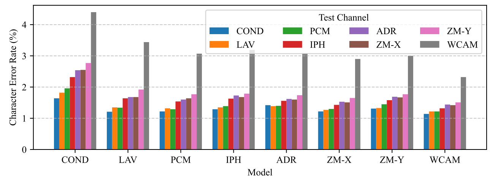
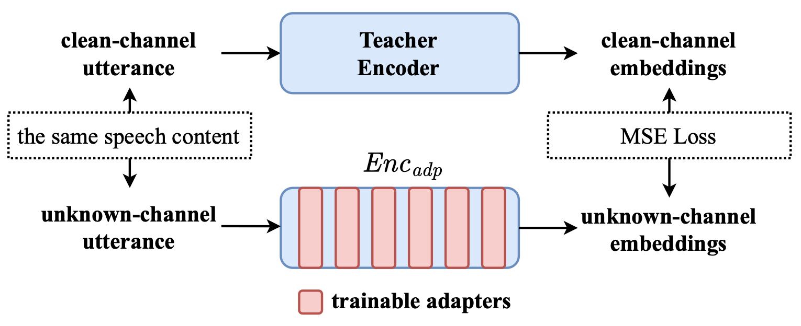
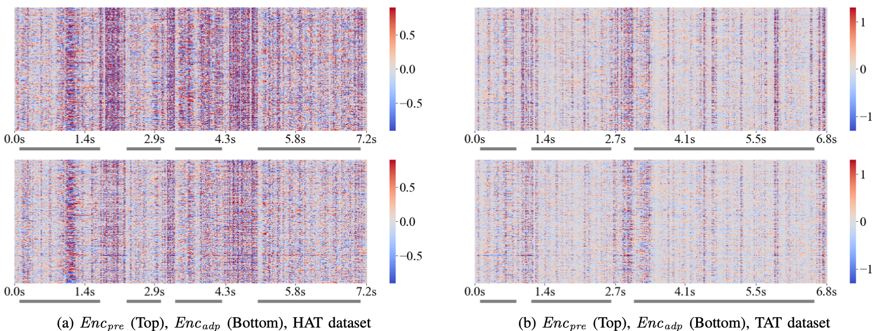

## Revealing the Role of Audio Channels in ASR Performance Degradation {.smnsm-cover background-color="#fafaf8"}

::: {.smnsm-cover-body}
::: {.smnsm-kicker}
PAPER READING · SPEECH RECOGNITION
:::

::: {.channel-title}
Revealing the Role of
**Audio Channels** in
ASR Performance Degradation
:::

::: {.smnsm-subtitle}
錄音通道如何影響語音辨識？
論文導讀與討論 · arXiv 2508.08967v2
:::

::: {.channel-byline}
Huang · Chen · Lee · Chen · Wang ｜ 2026-11-12
:::
:::

## 這篇論文的一句話 {.channel-opening}

::: {.incremental}
- **主張：** ASR 換麥克風就變差，不只是訓練與測試不一致（domain mismatch），**錄音通道本身的品質**就有穩定的難易排序
- **方法：** 在 Whisper encoder 插入 adapter，讓**任一通道**的特徵向**乾淨通道（Condenser）**的特徵對齊（MSE）
- **賣點：** Encoder 可直接替換（plug-and-play），不必動 decoder；對沒見過的通道（Webcam）與語言（台語）也有效
:::

::: {.src}
Whisper-small ｜ HAT 客語（8 通道）、TAT 台語（6 通道）
:::

::: {.notes}
【0.5 分鐘】背下這一句開場：「這篇的主張是，ASR 換麥克風變差，不只是訓練測試不一致，通道本身的品質就有穩定的難易排序。作者用 adapter 讓各通道的 encoder 特徵向 condenser 對齊，可以直接替換進現有的 decoder。」講完直接進下一頁。
:::

## 難度跟著通道走？ {.smnsm-section}

::: {.smnsm-kicker}
01 / QUESTION & EVIDENCE
:::

::: {.smnsm-subtitle}
從同步錄音與跨通道矩陣，檢驗 domain mismatch 的解釋。
:::

## 問題：換麥克風 ASR 就變差，是 domain mismatch 嗎？

:::: {.columns}
::: {.column width="48%"}
::: {.smnsm-card .smnsm-card--flat}
<h3>傳統看法</h3>

- 訓練與測試的通道分佈不同（domain mismatch）
- 解法：data augmentation，訓練時模擬目標通道
- 代表：[12]（同團隊 ICASSP 2025，channel-aware domain-adaptive GAN）
:::
:::
::: {.column width="52%"}
::: {.smnsm-card .smnsm-card--accent}
<h3>本文看法</h3>

- 通道帶來的**內在訊號差異**才是主因
- 證據：不論用哪個通道微調，**通道難度排序一致**
- 為什麼不用語音增強（SE）：文獻指出 SE 的 artifacts 會傷害 ASR，改在模型**內部表示空間**做正規化
:::
:::
::::

::: {.ask}
**可檢驗的預測：** 若是 domain mismatch，每個模型應該在「自己微調的通道」上表現最好 → 下一頁檢驗
:::

::: {.notes}
【1.5 分鐘】只講一件事：如果是 domain mismatch，每個模型應該在自己練習過的通道考最好。下一頁用資料來檢驗這個預測。不要在這頁解釋 adapter 或 MSE，他讀過論文。
:::

## 資料：8 支麥克風「同時」錄同一句話

::: {.channel-devices}
| 縮寫 | 全名 | 說明 |
|---|---|---|
| **COND** | Condenser | 專業電容式麥克風；論文當作乾淨的 [reference]{.channel-pill .ref} channel |
| **LAV** | Lavalier | 小型夾式（領夾）麥克風 |
| **PCM** | PC-Mic | 一般電腦麥克風 |
| **IPH** | iPhone | 用 iPhone 錄音 |
| **ADR** | Android | 用 Android 手機錄音 |
| **ZM-X** | ZOOM-X | Zoom X-Y 立體聲麥克風的其中一個 channel |
| **ZM-Y** | ZOOM-Y | 同一支 X-Y 立體聲麥克風的另一個 channel |
| **WCAM** | Webcam | 網路攝影機內建麥克風；論文留作 [unseen]{.channel-pill .unseen} test channel |
:::

::: {.small}
- **HAT（客語）**：約 1,461 小時，每通道約 182.6 小時
- **TAT（台語）**：結構類似，但沒有 Webcam 與 PC-Mic，共 6 通道
- **關鍵：語者與內容完全相同，唯一的變數是通道** → 分析才能成立
:::

::: {.notes}
【1 分鐘】強調同步錄音是整個分析的前提。HAT 規模一句話帶過。TAT 的裝置是否與 HAT 不同，論文用的是 likely，不是確定。
:::

## Fig. 1：先看原圖，通道排序如何跨模型重現？ {.channel-figure-focus}

::: {.smnsm-kicker}
EVIDENCE / CHANNEL PERFORMANCE
:::

{width=1150}

:::: {.channel-reading-grid}
::: {.fragment .fade-in}
**讀橫軸**

每一簇代表一個微調模型；簇內不同顏色代表測試通道。
:::
::: {.fragment .fade-in}
**比較同一簇**

觀察哪個測試通道的 CER 較高，再比較這個現象是否跨模型重現。
:::
::: {.fragment .fade-in}
**下一頁看矩陣**

把原圖改排成表格，檢查對角線與各通道的數值。
:::
::::

::: {.src}
來源：使用者提供論文 PDF，第 2 頁 Fig. 1。圖例、座標軸與原始長條皆保留。
:::

## 通道難度排序穩定：Fig. 1 重新整理成 8×8 矩陣 {.channel-matrix}

::: {.small}
列＝微調用的通道（模型），欄＝測試通道，數值＝CER (%)，**粗框＝對角線（自己測自己）**
:::

| 微調＼測試 | COND | LAV | PCM | IPH | ADR | ZM-X | ZM-Y | WCAM | 列平均 |
|---|---|---|---|---|---|---|---|---|---|
| **COND** | [1.64]{.c2 .diag} | [1.82]{.c2} | [1.96]{.c2} | [2.32]{.c3} | [2.54]{.c3} | [2.55]{.c3} | [2.77]{.c3} | [4.40]{.c4} | 2.50 |
| **LAV** | [1.21]{.c1} | [1.35]{.c1 .diag} | [1.34]{.c1} | [1.64]{.c2} | [1.68]{.c2} | [1.68]{.c2} | [1.92]{.c2} | [3.44]{.c4} | 1.78 |
| **PCM** | [1.22]{.c1} | [1.32]{.c1} | [1.29]{.c1 .diag} | [1.54]{.c2} | [1.60]{.c2} | [1.64]{.c2} | [1.77]{.c2} | [3.07]{.c4} | 1.68 |
| **IPH** | [1.29]{.c1} | [1.35]{.c1} | [1.39]{.c1} | [1.63]{.c2 .diag} | [1.73]{.c2} | [1.68]{.c2} | [1.79]{.c2} | [3.19]{.c4} | 1.76 |
| **ADR** | [1.42]{.c1} | [1.39]{.c1} | [1.40]{.c1} | [1.56]{.c2} | [1.62]{.c2 .diag} | [1.60]{.c2} | [1.74]{.c2} | [3.08]{.c4} | 1.73 |
| **ZM-X** | [1.22]{.c1} | [1.27]{.c1} | [1.30]{.c1} | [1.43]{.c1} | [1.53]{.c2} | [1.51]{.c2 .diag} | [1.65]{.c2} | [2.90]{.c3} | 1.60 |
| **ZM-Y** | [1.31]{.c1} | [1.33]{.c1} | [1.45]{.c1} | [1.58]{.c2} | [1.69]{.c2} | [1.67]{.c2} | [1.77]{.c2 .diag} | [3.00]{.c4} | 1.73 |
| **WCAM** | [1.14]{.c1} | [1.22]{.c1} | [1.22]{.c1} | [1.32]{.c1} | [1.44]{.c1} | [1.42]{.c1} | [1.51]{.c2} | [2.32]{.c3 .diag} | 1.45 |

::: {.src}
來源：論文 Table I 的 Van_pre 各列（與 Fig. 1 為同一份資料），格式由報告者重整。色階：綠 <1.5 ｜ 黃 1.5–2.0 ｜ 橙 2.0–3.0 ｜ 紅 ≥3.0
:::

::: {.incremental .small}
- **橫著看：** 每一列的難易排序幾乎一致：COND/LAV/PCM 最易 → IPH → ADR/ZM-X/ZM-Y → **WCAM 最難**（約 2 倍以上）
- **看對角線：** 最小值只在 COND 列落在對角線；WCAM 模型在自己的通道反而是整列最差 → 只靠 domain mismatch 解釋不了
- **細節：** ZM-Y 在**每一列**都比 ZM-X 難（同一台錄音機的兩個收音頭）
:::

::: {.notes}
【3 分鐘，簡報核心】
先說怎麼讀：一列是用某通道微調出的模型，一欄是測試通道。
1. 橫著看，排序跨模型一致，難度跟著測試通道走，不跟著訓練通道走。
2. 看對角線，如果是 domain mismatch，每列最小值應該在對角線，但只有 COND 符合。
3. 順帶請教：「ZM-Y 在每一列都比 ZM-X 難，這是擺放方向或增益造成的嗎？」（教授若參與過錄音，這是他最能回答的問題。）
注意：這張表是我從 Table I 重整的，不是論文原表，要講清楚。
:::

## 矩陣沒說的：我的三個補充觀察 {.channel-obs}

:::: {.channel-obs-grid}
::: {.smnsm-card}
[① 直著看 · 固定測試通道，比較模型]{.obs-k}

### 最差的通道，練出最 robust 的 decoder

::: {.obs-stats}
[[1.45]{.num .good} WCAM 模型平均 每個測試通道都最好]{.stat}
[[2.50]{.num .bad} COND 模型平均 8 個模型中最差]{.stat}
:::

- COND 模型連 **COND 測試集**也墊底（1.64，其他 1.14–1.42）
- 我的推測：效果類似 data augmentation
:::

::: {.smnsm-card}
[② 反方向證據]{.obs-k}

### Domain mismatch 並非完全不重要

::: {.obs-stats}
[[≈20%]{.num} WCAM 欄 matched 領先 2.32 vs 次佳 2.90]{.stat}
[[4–9%]{.num .muted} 其他欄 matched 領先 （我自行重算）]{.stat}
:::

- **通道品質**決定難度排序
- **Domain matching** 是次要因素，但對極端通道仍有影響
:::

::: {.smnsm-card .smnsm-card--accent}
[③ 替代解釋 · 待確認]{.obs-k}

### 排序也可能來自 Whisper encoder

- Fig. 1 的數字與 Table I 的 **Van_pre** 完全相同
- Van_pre 用的是 Enc_pre 的輸出 → 我的理解：8 個模型是 **encoder 凍結、只微調 decoder**
- 若如此，排序可能反映「原版 encoder 對各通道的表示品質」，不一定是物理上的內在難度
:::
::::

::: {.ask}
**想請教老師：** Fig. 1 的 8 個模型，encoder 是否凍結？若全模型微調，排序是否仍然存在？
:::

::: {.notes}
【2 分鐘，你的加分頁，用請教語氣】
- 「用最爛的通道訓練 decoder，反而最 robust。我的推測是類似 data augmentation 的效果，想請教老師有沒有類似經驗？」
- 「所以比較精確的說法可能是：通道品質決定難度排序，domain matching 是次要但對極端通道仍有影響。」
- 「我的理解是 Fig. 1 的模型 encoder 是凍結、只微調 decoder，因為數字和 Table I 的 Van_pre 完全相同。想跟老師確認我的理解對不對。」
:::

## 向乾淨的特徵對齊 {.smnsm-section}

::: {.smnsm-kicker}
02 / REPRESENTATION ALIGNMENT
:::

::: {.smnsm-subtitle}
Adapter-enhanced encoder → plug-and-play → DEFA
:::

## Fig. 2：同一句話，兩條 encoder 路徑 {.channel-figure-focus .channel-training-focus}

::: {.smnsm-kicker}
METHOD / PARALLEL AUDIO → FEATURE ALIGNMENT
:::

{width=1000}

:::: {.channel-reading-grid}
::: {.fragment .fade-in}
**Teacher：乾淨參考**

COND 輸入凍結的 Enc_pre，提供對齊目標。
:::
::: {.fragment .fade-in}
**Student：只訓練 adapter**

同內容的多通道錄音輸入 Enc_adp；紅色模組是可訓練部分。
:::
::: {.fragment .fade-in}
**最後一層 MSE**

對齊輸出表示；此階段不需要文字轉寫。
:::
::::

::: {.src}
來源：使用者提供論文 PDF，第 2 頁 Fig. 2。圖中 unknown-channel 是訓練輸入，真正未見通道為 WCAM。
:::

## 方法：讓各通道的 encoder 特徵向 Condenser 對齊 {.channel-method}

::: {.small}
| 設計 | 理由 |
|---|---|
| 只訓練 adapter | 保留預訓練能力、可替換 |
| MSE 只放最後一層 | Decoder 只讀最後一層；中間層 adapter 漸進修正 |
| 輸入含 COND 本身 | 乾淨輸入時應近似恆等 |
| 同內容的平行語料 | 差異只來自通道 |
| 7 通道混合、無通道標籤 | 推論不需辨識通道，有利泛化 |
| WCAM 不參與 | 作為 unseen 檢驗 |
:::

::: {.small}
- **老師：** Enc_pre（凍結），輸入只有 COND ｜ **學生：** Enc_adp（只訓練 adapter），輸入 7 個通道
- 設定：3 epochs、batch 24、lr 1e-4、AdamW、線性排程（10% warm-up）；每個 Transformer block 兩個 adapter（依 [29]）
- **訓練 Enc_adp 不需要文字轉寫**，只需要平行錄音；限制是需要多通道同步錄音
:::

::: {.notes}
【2.5 分鐘】
- 注意 Fig. 2 的 "unknown-channel" 指訓練時用的其他通道，不是推論時未知的通道；真正沒見過的只有 WCAM。
- Enc_adp 全篇只訓練一次，後面所有實驗共用。
- 論文沒寫：adapter 瓶頸維度與參數量、batch 是單通道還是混合、MSE 是否排除 padding frame、平行錄音的時間對齊。這些放到最後一頁請教。
:::

## 三種推論設定，以及 Enc_adp 只訓練一次

:::: {.channel-lanes}
::: {.smnsm-flow .fragment .fade-in}
[Van_pre]{.channel-flow-label} [錄音]{.smnsm-node} [→]{.smnsm-flow-arrow} [Enc_pre（原版）]{.smnsm-node} [→]{.smnsm-flow-arrow} [Decoder A（原樣）]{.smnsm-node} [→ 文字]{.channel-flow-end}
:::
::: {.smnsm-flow .fragment .fade-in}
[Van_adp]{.channel-flow-label} [錄音]{.smnsm-node} [→]{.smnsm-flow-arrow} [Enc_adp（加 adapter）]{.smnsm-node .channel-node-accent} [→]{.smnsm-flow-arrow} [Decoder A（原樣）]{.smnsm-node} [→ 文字]{.channel-flow-end}
:::
::: {.smnsm-flow .fragment .fade-in}
[DEFA]{.channel-flow-label} [錄音]{.smnsm-node} [→]{.smnsm-flow-arrow} [Enc_adp（凍結）]{.smnsm-node} [→]{.smnsm-flow-arrow} [Decoder A（再微調）]{.smnsm-node .channel-node-accent} [→ 文字]{.channel-flow-end}
:::
::::

::: {.meta}
Van_adp：只換 encoder ｜ DEFA：再讓 decoder 適應
:::

| 階段 | 訓練什麼 | 凍結什麼 | 產出 |
|---|---|---|---|
| Fig. 1 實驗 | decoder（我的理解，待確認） | encoder | 8 個模型 |
| **訓練 Enc_adp** | **adapter（一組）** | 原 encoder 全部 | **1 個 Enc_adp** |
| Van_adp（Table I、III） | 不訓練 | 全部 | — |
| DEFA（Table II、IV） | decoder | Enc_adp | 3 個 + 1 個 decoder |

::: {.small}
- Table I 的各列是**不同的 decoder**（在哪個通道微調），不是不同的 adapter
- 每個 decoder 都是在 **Enc_pre 的輸出**上訓練的 → Enc_adp 的特徵與其分佈不完全一致 = **encoder-decoder mismatch**
:::

::: {.notes}
【1.5 分鐘】講一句：「Enc_adp 只訓練一次，後面所有實驗共用；Table I 的各列是不同的 decoder。」這樣可以避免混淆，也讓教授知道你抓到結構。
:::

## 替換 encoder 之後 {.smnsm-section}

::: {.smnsm-kicker}
03 / RESULTS & GENERALIZATION
:::

::: {.smnsm-subtitle}
平均改善、局部退步，以及跨通道與跨語言的泛化。
:::

## Table I：直接換 encoder（decoder 不動）就有效 {.channel-results}

::: {.small}
| Decoder 微調於 | Van_pre AVG | Van_adp AVG | AVG 改善 | WCAM 欄改善（unseen） |
|---|---|---|---|---|
| COND | 2.50 | 2.19 | 12.4% | 8.6% |
| ADR | 1.73 | 1.55 | 10.4% | 10.4% |
| ZM-X | 1.60 | 1.50 | 6.3% | 15.5% |
| ZM-Y | 1.73 | 1.64 | 5.2% | 7.7% |
| IPH | 1.76 | 1.57 | 10.8% | 12.5% |
| LAV | 1.78 | 1.60 | 10.1% | 14.2% |
| PCM | 1.68 | 1.51 | 10.1% | 10.1% |
| WCAM | 1.45 | 1.31 | 9.7% | 14.7% |
| **~WCAM（7 通道，strong baseline）** | 1.36 | 1.24 | 8.8% | 12.5% |
:::

::: {.incremental .small}
- 9 個 decoder 的 AVG **全部下降**（單通道 5.2%–12.4%）；WCAM 欄 8 個單通道 decoder 中 6 個 ≥10%
- 多通道 decoder 仍有 8.8% 改善 → **encoder 端正規化與 decoder 端多通道訓練互補**
- 變差的格子：COND→COND **−1.8%**、LAV→COND −0.8%、ZM-X→ADR **−12.4%**（1.53→1.72）、ZM-Y→LAV **−11.3%**（1.33→1.48）→ 論文歸因於 mismatch
:::

::: {.src}
來源：論文 Table I（節錄 AVG 與 WCAM 欄），rel. = (CER_pre − CER_adp) / CER_pre
:::

::: {.notes}
【2.5 分鐘】
1. 直接換 encoder、decoder 完全沒動，平均就有進步。
2. 好通道訓練的 decoder 進步小，爛通道的進步大。
3. 多通道 decoder 也有進步，所以兩者互補。
4. 論文稱變差為 minor、rare，但 −12.4% 與 −11.3% 並不 minor。負數格留給下一頁 DEFA 收尾。
兩層 unseen：WCAM decoder 是用 WCAM 訓練的，只有 Enc_adp 沒見過；~WCAM decoder 則是兩邊都沒見過。
:::

## Table II：DEFA 把 encoder-decoder mismatch 修掉

**DEFA = Decoder-Encoder Feature Adaptation**：接上**凍結的 Enc_adp**，用原本那份資料與文字轉寫，**只微調 decoder**

| Decoder | Van_pre AVG | Van_adp AVG | **DEFA AVG** | DEFA 相對改善 |
|---|---|---|---|---|
| HAT_LAV | 1.78 | 1.60 | **1.29** | 27.5% |
| HAT_ZM-X | 1.60 | 1.50 | **1.23** | 23.1% |
| HAT_~WCAM | 1.36 | 1.24 | **1.04** | 23.5% |
| *ZM-X decoder 測 ADR* | 1.53 | 1.72（−12.4%） | **1.17（+23.5%）** | 變差 → 翻轉 |

::: {.small}
- 進步可拆成兩段：**特徵變乾淨**（Van_pre→Van_adp）＋ **decoder 習慣新特徵**（Van_adp→DEFA）
- DEFA | HAT_~WCAM 在 unseen 的 WCAM 欄進步最大：2.48 → 1.70（**31.5%**）
:::

::: {.ask}
**想請教老師：** DEFA 比 vanilla 多訓練 decoder 3 個 epoch。論文以「vanilla 已收斂」辯護，但沒有「Enc_pre ＋ decoder 同樣再訓練」的對照組；DEFA 連 COND 測試也進步 13–20%，其中有多少是單純的多訓練？
:::

::: {.src}
來源：論文 Table II。Decoder 以 1e-4 微調是否合適（參數量遠大於 adapter），論文也沒有討論。
:::

::: {.notes}
【2.5 分鐘】
「進步可以拆成兩段，第一段來自特徵變乾淨，第二段來自 decoder 習慣了新特徵。上一頁變差的格子，在 DEFA 之後翻轉成 23.5% 的進步，這支持論文把變差歸因於 mismatch 的解釋。」
然後主動提對照組問題，這是你最重要的請教點。
補充：論文選 ZM-X 代表「mismatch 較嚴重」，但 Table I 平均改善最低的是 ZM-Y（5.2%），ZM-X 是 6.3%；可能因為 ZM-X 有最嚴重的單一 −12.4%。
我對 DEFA 的理解是從 vanilla decoder 繼續訓練，不是從原版 Whisper 重來，建議向教授確認。
:::

## 泛化：台語（TAT）的跨語言與跨裝置結果

::: {.smnsm-kicker}
GENERALIZATION / TABLE III & IV
:::

::: {.channel-generalization}
- **同一個** Enc_adp（只用客語訓練），接台語 decoder
- Van_adp：所有 decoder 平均都有進步，但僅約 1% 左右
- DEFA（TAT_ZM-X）：**9.92 → 9.80 → 9.42**（5.0%），6 個通道全部進步
- 幅度遠小於客語；CER 基線 9–11% vs 客語 1–2%，**兩者不宜直接比較**
:::

::: {.smnsm-takeaway}
結果之外，下一頁用 Fig. 3 檢視 encoder 表示層的差異。
:::

## Fig. 3：表示層差異縮小，但證據支持到哪裡？ {.channel-figure-focus .channel-heatmap-focus}

::: {.smnsm-kicker}
REPRESENTATION / HAT（左）· TAT（右）
:::

{width=1150}

:::: {.channel-reading-grid .channel-reading-grid-two}
::: {.fragment .fade-in}
**觀察**

下排比上排淡，**連非語音段也縮小**。灰線標示語音活動區間。
:::
::: {.fragment .fade-in}
**限制**

單一語句的質性展示、無整體量化指標；左右色階不同（±0.5 vs ±1）。
:::
::::

::: {.src}
來源：使用者提供論文 PDF，第 6 頁 Fig. 3。保留各自色階、時間軸與語音活動標記；不直接比較左右顏色深淺。
:::

::: {.notes}
【1 分鐘】不要在這裡拆解 HAT 與 TAT 的 CER 差異，除非教授問（備用頁有）。
Fig. 3 只是單句的質性展示，沒有整個測試集的 MSE 或 cosine similarity。
:::

## 證據支持到哪裡？ {.smnsm-section}

::: {.smnsm-kicker}
04 / RESEARCH DISCUSSION
:::

::: {.smnsm-subtitle}
區分論文觀察、報告者推論與仍需驗證的問題。
:::

## 我的疑問與想請教的地方 {.channel-discussion}

:::: {.columns}
::: {.column width="50%"}
### 驗算時發現（請教語氣）
- Table III 最後一列（TAT_~ZM-Y）AVG rel. 印 **0.2**；我算 (9.51−9.32)/9.51 ≈ **2.0**
- Table III 的 ZM-X 組、LAV 欄印 **−0.9**，CER 是 8.85→8.77，應為 **+0.9**（Table IV 同格為 0.9）
- 選 Condenser 的理由寫「所有模型」表現最好，但 ADR 模型是例外（LAV 1.39、PCM 1.40 都比 COND 1.42 好）
- 其餘表格的 rel. 我逐格驗算皆吻合
:::
::: {.column width="50%"}
### 想請教老師
1. Fig. 1 的 8 個模型是否 **encoder 凍結**？
2. DEFA 有沒有 **Enc_pre 多訓練 3 個 epoch** 的對照？
3. HAT 的 **train/test 怎麼切**？有無語者或內容重疊？CER 用漢字還是拼音？
4. Adapter 的**瓶頸維度**？batch 是單通道還是混合通道？
5. **ZM-X、ZM-Y** 為什麼有穩定差距（擺放方向、增益）？
6. 沒有與 SE、[12] 的直接比較，是刻意的嗎？
:::
::::

::: {.small}
其他限制：單次實驗、無多個隨機種子與顯著性檢定（例如 1.03 vs 1.04 難以下結論）；需要多通道平行語料；只驗證 Whisper-small。
:::

::: {.notes}
【2.5 分鐘，留最多時間，不要全講完，挑他有興趣的聊】
提錯誤的語氣：「我自己驗算時發現這裡好像是 2.0，想確認是不是我理解錯了？」不要說「這裡寫錯了」。
被打斷就順著他走。被糾正時說「謝謝，我記下來」，不要辯解。
不確定就直說：「這個論文沒寫，我不確定，但我的推測是…」
:::

## 附錄（備用，被問到才開） {.smnsm-section .unnumbered}

::: {.smnsm-kicker}
APPENDIX · DISCUSSION TOOLKIT
:::

逐格驗算、方法細節與備用回答。

## A1. Table III 兩處疑似印刷錯誤（逐格驗算）

| 位置 | 論文印的 | CER | 我算的 |
|---|---|---|---|
| Van_adp \| TAT_~ZM-Y，AVG rel. | 0.2 | 9.51 → 9.32 | (9.51−9.32)/9.51 ≈ **2.0%** |
| Van_adp \| TAT_ZM-X，LAV 欄 rel. | −0.9 | 8.85 → 8.77 | (8.85−8.77)/8.85 ≈ **+0.9%** |

::: {.small}
- 後者會牽動 IV-C 的敘述「DEFA 讓先前變差的 Lavalier 也改善」：ZM-X decoder 在 LAV 上原本並沒有變差
- Table III 真正變差的只有 ZM-Y decoder 測 LAV（8.97 → 9.00，−0.3%）；LAV decoder 測 LAV 持平（0.0%）
:::

## A2. Adapter 公式（Houlsby et al., 2019）

$$h' = h + W_{up}\,\sigma\!\left(W_{down}\,h + b_{down}\right) + b_{up}$$

::: {.small}
| 符號 | 意思 | 維度 |
|---|---|---|
| $h$ | 輸入向量（一個 frame；Whisper-small d = 768） | $d$ |
| $W_{down}$ | 降維矩陣 | $m \times d$ |
| $\sigma$ | 非線性（ReLU/GELU） | — |
| $W_{up}$ | 升維矩陣 | $d \times m$ |
| $m$ | 瓶頸維度（$m \ll d$） | — |

- 參數量 $2md + d + m$。**示意：** $d=768, m=64$ → 每個 adapter 約 99k；24 個約 238 萬，約佔 Whisper-small（約 2.44 億）的 1%（$m$ 為假設值，論文未寫）
- 殘差 $h + f(h)$：初始化接近 0 時近似恆等；adapter 只學「修正量」
- 本文：每個 Transformer block 兩個 adapter（依 [29]），插入位置待查 code
:::

## A3. 超參數與訓練設定

| 設定 | 值 | 意思 |
|---|---|---|
| Epoch | 3 | 整份資料看 3 遍；依 dev set 挑 checkpoint |
| Batch size | 24 | 每 24 筆平均 loss 後更新一次（推測受 GPU 記憶體限制） |
| 學習率 | 1e-4 | adapter 為新加入的小零件，可用比全模型微調更大的學習率 |
| 優化器 | AdamW | 自適應步長 + 解耦的 weight decay（數值未寫） |
| 排程 | Linear + 10% warm-up | 先升後降 |

::: {.small}
論文**沒有**說明選擇依據，也沒有超參數 ablation。待查 code：weight decay、batch 組成、gradient accumulation、混合精度、dev 指標（MSE 或 CER）。
:::

## A4. CER 與相對改善率

- **CER** = (替換 + 刪除 + 插入) / 參考文字字數；參考文字為**語料庫的人工轉寫**，8 個通道共用同一份（COND 只是 adapter 訓練時 embedding 的對齊目標，不是 CER 的參考答案）
- **rel.** = (CER_pre − CER_new) / CER_pre × 100%，負數代表變差
- **AVG 欄**的 rel. 由「平均 CER」算出，**不是**各欄 rel. 的平均；AVG 為 8 個通道（TAT 為 6 個）的簡單平均，**包含 WCAM**
- WCAM 欄 CER 約 2.3–4.4，其他欄多在 1.2–1.9，所以 AVG 的改善率有相當一部分由 WCAM 欄貢獻

## A5. HAT 與 TAT 的 CER 為何不能直接比

::: {.small}
HAT 約 1–2%，TAT 約 9–11%。兩份語料只要下列任何一項不同，數字就不可比（以下皆為推測，論文未說明）：

1. **測試集設計：** 是否語者或內容重疊、是否朗讀稿（客語在低資源下做到 1–2% 通常暗示測試條件偏容易）
2. **轉寫系統：** 台語漢字寫法不統一；用漢字或拼音算 CER 影響很大
3. **資料量：** HAT 每通道約 182.6 小時；TAT 每通道時數論文未寫
4. **文字正規化：** 標點、空白、全形半形
5. 語言本身（連續變調、借詞等）：最沒把握，只當可能性

**驗證：** 查切分與時數 → 確認 CER 的書寫系統 → 看原版 Whisper 的 CER 對照 → 用同樣小時數子集各微調一次
:::

## A6. 可能被問的問題（一句話回答）

::: {.small}
| 問題 | 回答重點 |
|---|---|
| 憑什麼說不是 domain mismatch？ | 對角線不是最佳、排序跨模型一致；但 WCAM 欄 matched 有約 20% 優勢，是次要影響 |
| 為什麼 loss 只在最後一層？ | Decoder 只讀最後一層；中間層 adapter 漸進修正 |
| 為什麼輸入包含 COND？ | 讓乾淨輸入時近似恆等，避免改壞 |
| DEFA 是不是只是多訓練？ | 論文沒有對照組，這是我想請教的 |
| 為什麼 WCAM 當 unseen？ | 表現最差、聲學差異最大；但只是 encoder 沒見過，WCAM decoder 是見過的 |
| Adapter 與 LoRA 差在哪？ | Adapter 串接新模組、有非線性；LoRA 把低秩更新加到權重、可合併回去，推論無額外成本 |
| Adapter 只做 frame 內運算，能處理迴響嗎？ | 它插在 attention 之後，輸入已含上下文資訊，間接有上下文（我的推論） |
| 為什麼 TAT 改善小？ | 語言與裝置不同、基線 CER 高、錯誤中通道造成的比例可能較低（推測） |
:::

## A7. 論文 Fig. 1 原圖

{width=1150}

::: {.smnsm-takeaway}
對照主簡報的 8×8 矩陣：原圖依模型分組，顏色代表測試通道。
:::

::: {.src}
來源：Huang et al., arXiv:2508.08967v2, Fig. 1（PDF 第 2 頁）。
:::
