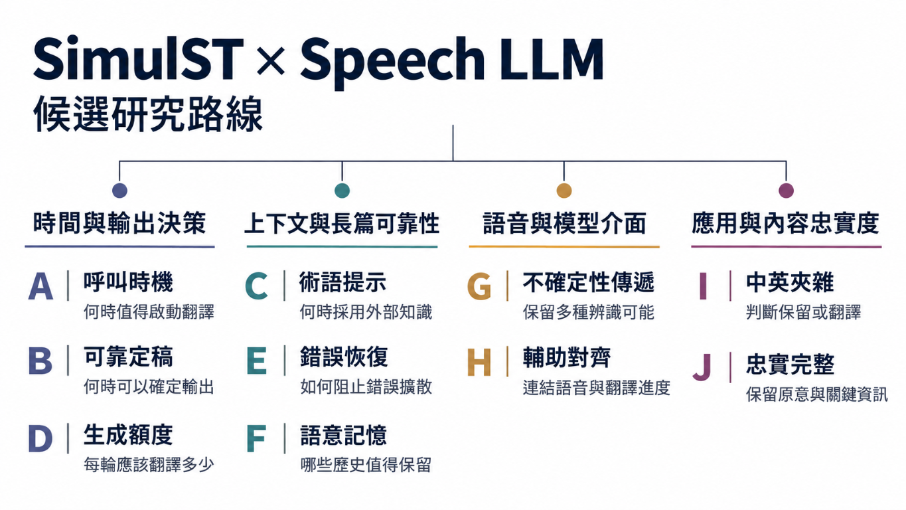

## 研究選題討論 {.cover #cover}

::: {.eyebrow}
2026 年 10 月 22 日 · 研究生與指導老師討論
:::

<h1>SimulST／Speech LLM 研究選題討論</h1>

::: {.subtitle}
Zipformer／Streaming Transducer 的角色與研究空間
:::

從已選定的復現論文出發，討論 **A–J 十個候選方向**。

::: {.meta}
18 頁主簡報 · 約 20 分鐘報告後接討論 
本次呈現文獻整理與研究假設，尚無本研究模型實驗結果。
:::

::: {.source}
研究起點：[Xing et al., IWSLT 2026](https://aclanthology.org/2026.iwslt-1.27/)。文獻核對日：2026-10-21。
:::

01 / 18

::: notes
建議時間 30 秒。這次不是已決定題目的開題報告。我已決定復現 Yi Xing、Manli Yu、Pengfei Liu、Helen Meng 的 Test-Time Adaptation of an Offline Multimodal Foundation Model for Simultaneous Speech Translation，仍在準備復現，沒有可報告的自有結果。老師提出 Zipformer／Streaming Transducer 搭配 Speech LLM 值得探索，因此今天把元件組合拆成可實驗的研究問題。

我個人較關心模型呼叫時機與實際延遲，但這只是興趣，不是題目排序。18 頁之後是備用頁，可在討論時按需要開啟。全部提案與自建案例都不代表模型已能做到。

完整來源：https://aclanthology.org/2026.iwslt-1.27.pdf 。三份選題資料的版本與用途見同資料夾 sources.md。
:::

## 研究定位與目前進度 {#position}

::: {.lead}
以既有翻譯能力為起點，研究串流決策的代價與可靠性。
:::

| 已確定 | 尚待決定／驗證 |
|---|---|
| 復現 Xing et al. 的 Test-Time Adaptation | 主研究問題、場景與語言對 |
| 探索 Transducer 與 Speech LLM 的分工 | Transducer 是否提供不可替代的訊號 |
| 可使用實驗室 Linux GPU 主機 | GPU 規格、實際執行條件與量測結果 |

::: {.takeaway}
希望老師協助選出一個主問題，並同意公平比較與續做條件。
:::

::: {.source}
依研究選題討論稿與兩份 R2 整理。R2 是文獻分析，不是本研究已完成的實驗。
:::

02 / 18

::: notes
建議時間 50 秒。工作範圍是 speech-to-text 的串流翻譯。此處用 SimulST 指來源尚未結束即開始翻譯，用 StreamST 強調連續、未預先分句的長音訊處理；文獻用語並不完全一致，因此每個實驗都要明列是否有已知句界。

三份資料提供候選問題與文獻索引，不能把其中先前假設的四張 A10、兩張 GPU、ACL 截稿日、四頁或長文目標、題目分數或改善百分比當成本次背景。沒有預先指定投稿會議，也不估訓練時數、顯存或部署可行性。

今天請老師決定的是優先研究哪個失敗機制、願意投入哪些資料標註、是否允許小型訓練、字幕要不要顯示草稿。骨幹已選定，不再討論模型推薦或安裝順序。後續若有資源阻礙，應據實記錄，不偷偷換模型後宣稱同條件復現。
:::

## 三個場景，三種使用者代價 {#scenarios}

| 場景 | 使用者遇到的問題（示意） | 候選方向 |
|---|---|---|
| EMI 課堂 | 中英切換時術語被翻錯，否定或數字漏掉 | C、I、J；A、B |
| 專業演講 | 術語尚未講完就出現，字幕長時間不更新 | A、B、C、D |
| 長時間會議 | 前後人名不一致，錯誤延續，講者自我修正 | E、F、G、H、J |

::: {.flow}

來源持續到達<small>時間與語意進展不同步</small>

→

翻譯分輪產生<small>每次可用資訊有限</small>

→

使用者閱讀字幕<small>等待、誤解與更正成本</small>

:::

::: {.source}
場景為研究動機，未做使用者研究。術語與自我修正相關證據：[RASST](https://arxiv.org/abs/2601.22777v2)、[Züfle et al.](https://arxiv.org/abs/2608.02138v1)。
:::

03 / 18

::: notes
建議時間 55 秒。這三個場景不是三套都要實作的系統，也不是已證實的產品需求頻率。EMI 可以是英語講課中保留英文專業詞、穿插中文解說。專業演講可以有講義或論文作外部上下文。會議同時牽涉長距離記憶和說話者修正，但多人重疊與分離不預設納入第一個研究題目。

資料選擇應跟主張一致：學術演講資料不能直接證明臺灣 EMI 自然中英夾雜有效。MCIF 或 ACL60/60 可作學術演講候選，需確認取得條件、語向、授權與切分。自建 EMI 子集若需要錄音，要先確保同意與可使用範圍，並建立保留／翻譯規範。

圖僅示意系統因果順序，沒有實測時間或品質數據。RASST 原文：https://arxiv.org/html/2601.22777v2 。Disfluencies 原文：https://arxiv.org/html/2608.02138v1 。
:::

## 復現起點：分段、讀寫與多輪狀態 {#baseline}

::: {.proposal}
原論文架構重繪 · 非本研究新方法
:::

::: {.flow}

串流音訊

→

Silero VAD<small>停頓＋最短／最長切塊</small>

→

Qwen3-Omni<small>多輪語音輸入</small>

→

增量譯文

:::

| 決策 | 原論文設計 |
|---|---|
| 何時開始、每次讀多少 | wait-(k, s, n)：先讀 k 塊，之後 s = 1 |
| 每輪生成多少 | 最多 n 個文字單位；音訊結尾解除限制 |
| 如何延續翻譯 | 近期譯文 prefill、跨輪 KV cache、重複處理 |

::: {.takeaway}
切塊、呼叫與輸出額度互相耦合；後續實驗必須拆開。
:::

::: {.source}
[Xing et al. 2026](https://aclanthology.org/2026.iwslt-1.27.pdf)，§2、Fig. 1–2。n：中文為字，英／德／義為詞，排除標點與空白。
:::

04 / 18

::: notes
建議時間 90 秒。原文是測試時調整串流流程，沒有為 SimulST 另作專門微調。使用 Qwen3-Omni-30B-A3B-Instruct。VAD 的機率配合最小與最大塊長，不是單純遇靜音才切。到達最大長度時的候選邊界可能位於已觀察區間較早位置，量測觸發時間不能回填成那個較早音訊時間。

第一輪累積 k 個塊，之後每輪讀一個塊。n 是文字單位上限，不等於 tokenizer token 數。停止可能來自額度或 EOS；到音訊結束才放開生成額度。prefill 只帶近期譯文，不等於整個 KV 歷史已做滑動淘汰。重複處理是原方法的一部分，因此 E 不能把「加入重複偵測」直接寫成新貢獻。

官方模型頁可見公開模型：https://huggingface.co/Qwen/Qwen3-Omni-30B-A3B-Instruct 。公開模型不等於本機可執行，也不等於論文完整系統可直接下載。論文連結的 owaski/iwslt-2026-baselines 是競賽對照基線，不能當成 Xing 系統官方實作。本研究仍需核實完整實作與版本。

來源：Xing et al., §2.1、§2.2.1–2.2.4，https://aclanthology.org/2026.iwslt-1.27.pdf 。
:::

## 原論文的處理範圍與研究入口 {#limits}

| 證據層級 | 內容 |
|---|---|
| **已處理** | 離線模型串流化、跨輪延續與重複輸出處理 |
| **作者明示限制** | 錯誤累積、無限串流快取、有限領域調參、推論成本 |
| **我們待驗證** | 哪些失敗真的出現？新訊號是否有額外決策價值？ |

::: {.lead}
論文的品質–延遲取捨，不能替代我們的實際延遲量測。
:::

- 主要表格使用 **CU LongYAAL**，不是 GPU 執行時間。
- En→Zh 的取捨也有品質下降的情況，不能概括為全面勝出。

::: {.source}
[Xing et al. 2026](https://aclanthology.org/2026.iwslt-1.27.pdf)，§3.1、§3.3、Table 5、Limitations。均為文獻結果。
:::

05 / 18

::: notes
建議時間 65 秒。作者在 Limitations 明示四點：多輪錯誤可能延續、快取仍需支援無限串流、調參只涉及較小且領域有限的兩組資料、大模型計算造成較高 computation-aware latency。這些是研究入口，不等於我們已重現相同失敗。

原文用開發資料做五折交叉驗證。Table 5 的 En→Zh high 設定在更低 CU 延遲下有較低 COMET，因此介紹應說取捨，不能說所有品質與延遲同時改善。本簡報不把作者表格重畫成我們的實驗曲線。

待驗證的診斷包括：是否真的有可省呼叫、是否真的有不可接受的錯誤定稿、長篇錯誤是否由移除歷史造成。先量測，再決定哪個主張能成立。原文網址 https://aclanthology.org/2026.iwslt-1.27.pdf ，限制見第 245 頁。
:::

## 候選方向地圖：四種事件與十個問題 {.image-map #map}

06 / 18

::: notes
建議時間 80 秒。一次呼叫可以生成零個或多個字；生成文字不必立刻顯示；顯示也不代表已承諾不再修改。只有定稿才形成不可撤回前綴。若 UI 只顯示定稿，內部改寫再多也不是可見閃爍；若 UI 顯示草稿，閃爍是可見文字的刪改量。錯誤定稿是語意內容在定稿當下不獲來源支持，不能以是否改過字串代替。

本頁圖片由使用者提供。圖片把 A／B／D、C／E／F、G／H、I／J 分成四組，是選題導覽，不表示它們已成為確定的論文主題或實驗結果。原本可編輯的四種事件圖保留在備用 B6。不宣稱原始 Test-Time Adaptation 已提供獨立草稿 UI 或風險控制器。若 B 要新增草稿重譯能力，必須給所有 B 的對照同樣能力並把額外呼叫計入成本。A 改呼叫之前的策略，B 改生成之後的承諾，D 改每次生成量，三者不可一開始同時更動。

G 是輸入表示選擇，H 是訓練約束，I/J 可以成為獨立主題，也可以是任何方向的壓力測試。十個方向是保留的選題空間，不表示做十套方法。
:::

## A：何時值得呼叫大型翻譯模型？ {#a}

::: {.proposal}
研究提案 · 尚待驗證
:::

::: {.lane}

內容路徑

新增音訊 → 同一 Speech LLM → 翻譯

:::
::: {.lane}

控制路徑

音訊 → Transducer 訊號 → 呼叫門控＋最大等待

:::

**假設：** 同品質與完整性下，Transducer 訊號能比時間／VAD 更有效地安排呼叫。

| 最小比較 | 判斷依據 |
|---|---|
| 固定週期、VAD、匹配呼叫預算 | 實際延遲、成本、漏譯、末尾積壓 |
| 移除各訊號／只保留最大等待 | 額外訊號是否真的有用 |

::: {.takeaway}
呼叫減少，仍可能更慢；blank／emission 不是語意完整證明。
:::

::: {.source}
鄰近方法：[Xing et al.](https://aclanthology.org/2026.iwslt-1.27/)、[NeMo 2026](https://aclanthology.org/2026.iwslt-1.23/)。控制通道的額外價值待驗證。
:::

07 / 18

::: notes
建議時間 100 秒。情境：長演講中固定短週期可能重複啟動模型，延長週期則可能錯過可立即翻譯的片段。根因是時間、停頓與可翻譯資訊增加不是相同概念。假設的可推翻版本是：在同骨幹、相近品質、輸出完整性和呼叫預算下，訊號控制能改善實際延遲／成本取捨；若做不到，A 的核心主張不成立。

改動位於 LLM 之前，翻譯仍接收音訊。先用規則與最大等待、結尾 flush，不先假設需要學習策略。Transducer 的持續推論、資料傳輸、排隊、額外 cache 操作全部算成本。ASR 文字沒送給翻譯，不表示沒有錯誤傳遞：錯誤 emission 或不可靠 blank 仍會誤觸發、切錯或多等。

呼叫數匹配只能控制部分混淆。還需固定相同骨幹、precision、prompt、cache、commit 策略；記錄總允許輸出額度與實際輸出，否則呼叫變少也把生成預算減少了。檢查品質匹配的前緣、p95 無更新間隔、EOS 後清空時間、漏譯和 GPU busy time／RTF。matched-call 比較與 matched-quality 比較應分開報。

最大風險：訊號無超過 VAD 的價值、Transducer 本身成本抵銷收益、優勢來自延後輸出。若匹配預算後優勢消失，或靠漏譯才改善指標，停止此主張。來源：https://aclanthology.org/2026.iwslt-1.23.pdf §2；https://aclanthology.org/2026.iwslt-1.27.pdf §2。
:::

## B：部分語音下，何時可以可靠定稿？ {#b}

::: {.proposal}
研究提案 · 示意翻譯軌跡，非模型輸出
:::

| 已收到的語音 | 內部候選 | 定稿問題 |
|---|---|---|
| “We did not …” | 「我們沒有……」 | 否定範圍尚待後文 |
| “… find evidence …” | 「我們沒有發現證據……」 | 哪一段語意已獲支持？ |
| “… of improvement.” | 「我們未發現改善的證據。」 | 同義改寫不等於先前犯錯 |

**假設：** 對當下訊號做風險校準，能改善「錯誤定稿率–定稿延遲」的取捨。

**比較：** 原生策略、LocalAgreement、原始信心門檻與校準後策略。

::: {.takeaway}
LCP 穩定「且」聲學穩定會更嚴格，不能直接聲稱減少等待。
:::

::: {.source}
[Hoang & Axelrod, 2026](https://arxiv.org/abs/2610.02612v1)，§3、§6：已有 prefix supervision、confidence 與 commit calibration。
:::

08 / 18

::: notes
建議時間 85 秒。情境：學生依字幕理解論點，但新語音可能改變語序、否定範圍或專名。根因是部分語音存在資訊不足，模型信心可能不代表語意可承諾。改動在候選生成後、不可撤回前綴擴張前。風險標籤必須由來源支持、人工語意判讀或可驗證的語意單位建構；完整音訊可用於離線標籤，不能作線上特徵。

最小比較要共享呼叫時間與候選生成流程。如果原生策略沒有重譯草稿，要把共同草稿生成器提供給所有策略，另報相對原系統的總成本。wait-k 僅在相同決策介面可表達時比較。主指標：錯誤定稿率、定稿延遲、risk–coverage、ECE／Brier，加品質與可見閃爍。錯誤分母使用標註語意單位，避免同義字串差異一律算錯。

近作已研究學習承諾與校準，差異候選是連續長篇、跨領域語意風險與實際延遲；尚未證明這些差異有研究價值。近作限制包括固定區塊、已知句界與未量 wall-clock latency，可作比較邊界，不能改寫成作者方法必然失敗。

最大風險：可靠標籤難取得、與近作高度重疊。若校準沒有超過簡單信心門檻，或低錯誤只是全面延後，假設不成立。完整來源：https://arxiv.org/html/2610.02612v1 。
:::

## C：何時允許術語或外部上下文介入？ {#c}

::: {.proposal}
研究提案 · 尚待驗證
:::

::: {.flow}

術語候選<small>講義／論文／詞表</small>

→

證據檢查<small>部分語音是否支持？</small>

→

提示或偏置<small>不是直接批准定稿</small>

:::

**假設：** 在相同候選下，額外聲學證據可降低誤插，同時保留真正術語的召回。

| 最小比較 | 主要指標 |
|---|---|
| 無提示、全提示、檢索分數門檻 | 術語 precision／recall、誤插率 |
| RASST／EGTA 的適用機制＋有無新訊號 | 過早使用、術語顯示／定稿延遲 |

::: {.takeaway}
核心風險：罕見術語也可能是 Transducer 最不可靠的部分。
:::

::: {.source}
[RASST v2](https://arxiv.org/abs/2601.22777v2) 已處理是否／何時用詞；[EGTA](https://arxiv.org/abs/2607.17766v1) 已用串流證據選詞。
:::

09 / 18

::: notes
建議時間 85 秒。情境：演講資料有很多術語，但說話者此刻只說了一個發音前段，提示可能把模型推向錯的專名。根因是詞表先驗與當下聲學證據不匹配。改動可以位於檢索後的候選門控或 decoder bias 前，但第一個實驗只能選一個，不能同時換檢索器、詞表和翻譯骨幹。

RASST 是部分語音跨模態檢索並訓練模型適時採用術語；EGTA 使用文件術語記憶與當下串流證據選候選，已有確切詞形、縮寫等匹配。因此「有證據才提示」本身不新。待驗差異要縮小成：對同音干擾、詞尚未說完、錯誤檢索時，新增 Transducer 聲學／posterior 訊號是否超過既有局部文字或檢索證據。

最小資料要有術語出現時間、正例、未出現干擾詞、相近發音與不同領域。保持相同候選集合與候選數，分開候選命中、模型採用、目標定稿時間。來源術語有證據不表示目標語序已可定稿。比較適用的 RASST/EGTA 完整系統是外部參照，內部新訊號消融才回答歸因。

若收益來自全面抑制提示、召回大幅下降或未超過簡單分數門檻，假設不成立。原文：https://arxiv.org/html/2601.22777v2 §4；https://arxiv.org/html/2607.17766v1 §3.3、Appendix A.3。
:::

## D：每輪應該生成多少翻譯？ {#d}

::: {.proposal}
研究提案 · 以下為額度示意，不是實測吞吐量
:::

::: {.mathline}
總允許輸出量 = 各次呼叫的額度 n₁ + n₂ + … + nₘ
:::

| 改動 | 可能後果 |
|---|---|
| 呼叫變少，但每輪 n 固定 | 總額度縮小，未翻內容可能累積 |
| n 無限制增大 | 可能超前翻譯、重複或單輪等待變長 |
| 按來源進展與積壓估計調整 n | 能否跟上內容而不犧牲忠實度？ |

**假設：** 固定呼叫排程，動態額度比最佳固定 n 更能減少末尾積壓。

**比較：** 固定 n、時長比例、積壓策略。若漏譯或超前輸出增加，假設不成立。

::: {.source}
動機：[Xing et al. 2026](https://aclanthology.org/2026.iwslt-1.27.pdf)，§2.2.2、§3.3.2 已指出 n 與塊長耦合。新策略尚待驗證。
:::

10 / 18

::: notes
建議時間 65 秒。情境：快速講課或中英詞長變化時，字幕看起來持續輸出，實際未翻內容卻越積越多，最後一次爆量。根因是固定每輪產量不匹配語速、來源資訊密度與目標語言展開比例。改動只在生成停止額度，不改呼叫排程、術語或定稿器。

這裡的總額度指非結尾輪次的上限和，不等於實際生成字數。EOS 可以提早停止，最終 flush 必須獨立記錄。先用時間比例作強簡單對照，再測可因果取得的 source-progress proxy、已輸出量和未翻依存估計。不能把參考譯文長度、未來語音或真實 backlog 偷用在線上。

最小比較需匹配全程額度預算，並另報自由額度條件，避免只是多給生成量。主指標：EOS 後清空時間、漏譯語意單位率、超前／無證據生成率、p95 定稿延遲與總生成量，輔以品質。待翻內容的真值需離線人工／對齊診斷，不用簡單「字數少」當漏譯。

最大風險是 backlog 估計不可靠，或更多生成只是把等待轉成幻覺。若相同總額度後收益消失，或只有結尾品質好但線上更慢，就不支持假設。
:::

## E：多輪翻譯異常後，如何局部恢復？ {#e}

::: {.proposal}
研究提案 · 狀態轉移示意
:::

::: {.flow}

正常翻譯

→

偵測異常<small>偏離翻譯、持續漏譯等</small>

→

局部重建<small>回放近期音訊與狀態</small>

→

恢復並記錄<small>保留已定稿內容</small>

:::

**假設：** 限定範圍的恢復，可比不處理／全重置更快阻止錯誤延續。

| 最小比較 | 主要指標與失敗判準 |
|---|---|
| 原生重複處理、全重置、局部重建 | 偵測 precision／recall、恢復時間 |
| 同一異常起點與回放範圍 | 若誤報造成更多正常內容損失，假設不成立 |

::: {.takeaway}
講者自我修正與模型翻譯錯誤，必須分開標註。
:::

::: {.source}
[Xing et al.](https://aclanthology.org/2026.iwslt-1.27.pdf)，§2.2.3 與 Limitations；[Züfle et al.](https://arxiv.org/abs/2608.02138v1) 研究自我修正的語意。
:::

11 / 18

::: notes
建議時間 65 秒。情境：會議中一輪開始回覆說明文字或漏掉內容，錯誤被後續上下文繼承。根因是多輪歷史與 KV 狀態把不當內容帶到下一輪。原論文已做 token／文字重複處理，因此本方向應研究較廣的異常與恢復界限，而非重做重複偵測。

最小方法：以可見來源／輸出進展、格式偏離和重複等訊號偵測，保留可信狀態錨點，從近期音訊重建未定稿後綴；若錯誤已定稿，不能暗中刪改，應另外顯示更正事件並計入錯誤定稿。固定回放範圍和重新生成額度。比較無額外恢復、全清除、局部重建，計算誤報、遺漏／重複、後續錯誤傳播長度、恢復時間和額外成本。

自然異常與合成注入分開報，不能只用可被規則容易偵測的人造錯誤。最大風險是狀態重建破壞尚未譯出的內容或錯誤偵測不準。若只在注入錯誤有效，需縮限主張。

示意：講者說 fifteen，之後說 sorry, fifty。前一刻忠實譯成十五不是模型誤譯；之後應呈現講者更正。相反地，在只說 fifteen 時譯成五十，才是模型錯誤。詳細軌跡見備用 B2。來源同頁底。
:::

## F：有限記憶下，哪些歷史值得保留？ {#f}

::: {.proposal}
研究提案 · 尚待驗證
:::

::: {.flow}

歷史資訊<small>術語、實體、翻譯決策</small>

→

固定預算選擇<small>近期內容＋重要記錄</small>

→

後續翻譯<small>能否正確使用？</small>

:::

| 必須分開的機制 | 最小診斷 |
|---|---|
| 資訊已被移除 | 恢復該資訊，錯誤是否減少？ |
| 資訊仍可見但未使用 | 明確檢索／提示，是否改變結果？ |

**假設：** 相同記憶預算下，保留高價值資訊比只留近期內容更能維持一致性。

**否證：** 若補回歷史無助，或改善只因增加總記憶，不能支持選擇機制。

::: {.source}
[InfiniSST](https://arxiv.org/abs/2503.02969) 已使用有界 KV；[StreamUni](https://arxiv.org/abs/2507.07803v2) 已研究串流生成與歷史處理。
:::

12 / 18

::: notes
建議時間 65 秒。情境：會議早先定義縮寫、人物譯名或約定，經過很長間隔再次出現時變得不一致。根因可能是記憶被丟掉，也可能只是模型沒有利用仍可見的資訊，不能由長度與錯誤相關性直接推斷淘汰造成錯誤。

方法位置在跨輪狀態管理。第一個可控版本用文字記錄選擇，不必直接宣稱任意 KV token 可安全拼接。若改 KV，需要另外驗證位置編碼、audio/text 對應、cache 重建正確性。已錯誤的譯名若長期保留會放大錯誤，因此記憶需要來源與可信度。

最小比較：同預算 recent-only、固定術語記錄、顯著性選擇；另設保留完整相關資訊的離線診斷條件。記憶預算必須包含保留 cache、文字摘要和檢索索引，不只看 prompt 字數。主指標是實體與術語一致率、長距離指涉正確率、品質、實際狀態大小和延遲。以距離、時長、是否移除分層。

最大風險：資料缺少重現依賴、摘要引入錯誤、框架不支援可控淘汰。若輸入補回後仍錯，就轉向資訊使用診斷，不把它算成記憶選擇成果。InfiniSST §3.5：https://arxiv.org/html/2503.02969 。
:::

## G／H：保留不確定性，或改善對齊？ {#gh}

::: {.proposal}
兩個獨立提案 · 尚待驗證
:::

::: {.cols}
::: {.col}
<h3>G · 多候選／posterior conditioning</h3>

專名有歧義時，1-best 會丟掉其他可能。

**假設：** 多候選能改善歧義片段的翻譯。

比較 1-best、N-best、soft posterior；看實體正確率、品質與額外延遲。
:::
::: {.col}
<h3>H · Transducer 輔助對齊</h3>

部分語音下，來源進度與目標生成可能失配。

**假設：** 輔助來源對齊可改善增量翻譯。

比較無輔助、CTC、RNN-T 約束；看 ST 品質與錯誤定稿。
:::
:::

::: {.takeaway}
G 若等預算後無收益，或 H 只改善 WER，都不足以支持翻譯主張。
:::

::: {.source}
[LegoSLM](https://aclanthology.org/2025.findings-emnlp.985/)：CTC posterior 接 LLM；[CAAT](https://aclanthology.org/2021.emnlp-main.4/)：翻譯重排序；[Transducer-Llama](https://arxiv.org/abs/2412.16464)：ASR 整合。
:::

13 / 18

::: notes
建議時間 90 秒。G 的情境是口音、專名或同音歧義。根因是離散 1-best 提早壓掉不確定性。方法位於辨識與翻譯的表示介面，和 A 的 control-only audio 路徑不同，不能當作 A 的小改版。最低版本先比較 1-best 與等文字預算的 N-best；soft posterior 則可能要投影訓練與詞彙映射。RNN-T posterior 依賴聲學時間與 label history，不可當作 CTC 的獨立逐幀分布直接套用。固定下游骨幹、資料、訓練量與候選總長；主指標為歧義子集實體／術語正確率、整體品質與延遲。最大風險是候選噪音、詞表對齊和額外訓練混淆。若 N-best 已達同樣效益，不能宣稱 posterior 介面必要。

H 的情境是 partial audio 容易超前生成或缺乏可靠來源進展。根因假設為表示未充分保留時間對齊。方法在 speech encoder 的輔助訓練 head／loss，翻譯仍由 Speech LLM 生成。要比較同訓練資料與可訓練參數條件下的無輔助、CTC、RNN-T，並對輔助權重消融。主指標應是 ST 語意品質、不可支持的定稿、CU／CA 延遲，WER 僅輔助診斷。最大風險是強迫 ASR 單調性傷害目標重排序，或提升只是來自多了監督。若只改善 WER、不改善 ST，假設不成立。

LegoSLM 的先例是 CTC posterior，不是本案 RNN-T 的直接證明。CAAT 是翻譯 transducer，Transducer-Llama 是 ASR；三者都不能被說成已完成本案輔助訓練。來源見頁底正式原文。
:::

## I／J：中英夾雜與翻譯忠實度 {#ij}

::: {.proposal}
兩個獨立提案 · 下列句子為示意案例
:::

::: {.cols}
::: {.col}
<h3>I · 保留，還是翻譯？</h3>

「這個 loss 用 cross-entropy。」

**假設：** 語言與術語證據可改善保留／翻譯決策。

比較一律翻譯、固定保留提示、動態策略；看規範符合率與術語正確率。
:::
::: {.col}
<h3>J · 流暢，是否仍忠實？</h3>

“The error did **not** fall by **15%**.”

**假設：** 來源覆蓋檢查可減少漏譯、數字與否定錯誤。

比較原解碼、一般信心、語意檢查；看分類錯誤率與延遲。
:::
:::

::: {.takeaway}
I 需要可信的雙語標註規範；J 需要超越單一自動品質分數的證據。
:::

::: {.source}
I：本研究場景假設。[Züfle et al.](https://arxiv.org/abs/2608.02138v1) 提醒清理口語可能遺失語意；[HPO](https://arxiv.org/abs/2604.21045) 是品質／延遲後訓練的鄰近方法。
:::

14 / 18

::: notes
建議時間 85 秒。I 情境是 EMI 的自然中英切換，包括術語沿用原文、中文補充與縮寫。根因是「來源語言是什麼」不直接決定「應保留還是翻譯」，還涉及課程規範和受眾。改動位於 prompt／copy policy 的決策，不能將 language ID 當作全部答案。比較一律翻譯、固定詞表保留、動態 evidence policy，所有方法共用目標輸出規範。主要量測決策 accuracy／macro F1、術語保留和翻譯正確率，另報忠實度與延遲。最大風險是自然資料不足或標註者本身不一致。若規範無法建立，或只在合成混語有效，就不能聲稱適用真實 EMI。

J 情境是流暢字幕漏掉關鍵否定、數字、條件或子句。根因假設是目標流暢性與來源覆蓋不一致，亦可能由輸出額度不足造成，所以要先固定 D。最小方法可在定稿前做來源語意單位的因果檢查，決策為等待、接受或局部重生成，另計檢查器成本。比較原解碼、一般 confidence gate 與語意檢查器，人工盲評數字、否定、漏譯類別，同時報額外等待、誤攔與總品質。

最大風險是檢查器與生成器共享偏誤；使用 LLM 自評不能直接當真值。若只提升 COMET 或檢查器自評，而人工分類錯誤沒有改善，假設不成立。可將 HPO 類方法留作後續訓練對照，不預設需要 RL。講者修正與模型錯誤分開，詳備用頁。
:::

## 近作重疊：還需要證明哪些差異？ {#overlap}

::: {.dense}
| 最接近工作 | 已處理的部分 | 本研究仍需證明 |
|---|---|---|
| Xing／NeMo → A、D、E | 串流政策、輸出控制／Transducer cascade | 新訊號有因果收益，含總成本與完整性 |
| Commit 近作 [2] → B | 前綴訓練、信心與定稿校準 | 長篇／領域轉移的風險與延遲 |
| RASST／EGTA → C、F | 術語檢索、使用時機、證據選詞 | 同候選下，額外聲學證據的邊際價值 |
| InfiniSST 等 → F、G、H | 有界快取／posterior／對齊 | 記憶因果診斷／RNN-T／ST 收益 |
| Disfluencies／CA* | 口語語意損失／計算延遲評估 | E、J 與全方向的正確分類及量測 |
:::

::: {.takeaway}
已有相關方法不代表題目不能做；「未搜尋到」也不代表新穎。
:::

::: {.source}
完整原文與版本見第 18 頁、備用 B5 與 sources.md。本表「仍需證明」是研究判斷，非文獻結論。
:::

15 / 18

::: notes
建議時間 85 秒。這頁是選題差異清單，不是競爭排名。A 必須比固定排程與 VAD 更有用，僅把 Transducer 接上 Speech LLM 不夠。B 不能說第一次研究 confidence commitment，因指定的近作已直接研究。C 不能只把 evidence gate 重新命名，因 EGTA 已用局部串流證據，RASST 已學習採用術語時機。

F 必須超過固定視窗，且辨認資訊移除的因果影響；G 的 RNN-T posterior 若沒有相對 N-best 或 CTC 的特定理由，介面更複雜不等於研究貢獻；H 需量到翻譯而非只有 ASR 變好。E 和 J 要保留講者自我修正的語意，不能把說話者改口當模型品質退步。

CA* 是評估論文，不是呼叫門控 baseline。它指出音訊接收和計算可以重疊，因此不能把所有已經重疊的時間再次相加。重現原文數字和研究我們的實際延遲是兩個不同驗證任務。

來源：[1] Xing https://aclanthology.org/2026.iwslt-1.27/；[2] Commit https://arxiv.org/abs/2610.02612v1；[3] RASST https://arxiv.org/abs/2601.22777v2；[4] EGTA https://arxiv.org/abs/2607.17766v1；[5] Disfluencies https://arxiv.org/abs/2608.02138v1；[6] CA* https://aclanthology.org/2025.findings-naacl.393/；其餘見備用 B5。
:::

## 公平實驗：事件時間、預算與可歸因性 {#evaluation}

::: {.flow}

音訊到達

→

排隊／呼叫

→

生成完成

→

暫定顯示

→

不可撤回定稿

:::

::: {.dense}
| 控制／量測 | 最低要求 |
|---|---|
| 只改一個主模組 | 同骨幹、資料切分、precision、prompt、cache、UI |
| 品質與完整性 | BLEU＋語意指標；人工抽查漏譯、數字、否定 |
| 延遲與穩定性 | CU＋正確 CA 時間線；p50／p95、閃爍、錯誤定稿 |
| 成本與產量 | 呼叫數、總計算、總額度、實際輸出、末尾積壓 |
:::

::: {.takeaway}
未來資訊只供離線診斷；調參／校準資料與測試演講分開。
:::

::: {.source}
[CA*, Xu et al. 2025](https://aclanthology.org/2025.findings-naacl.393.pdf)：避免把音訊接收與重疊計算時間重複累加。流程為量測設計示意。
:::

16 / 18

::: notes
建議時間 100 秒。每個事件保存 monotonic wall clock、來源已可用／已消費音訊範圍、call ID、生成／顯示／commit 文字 span，以及輸出上限、EOS／flush、cache 狀態和異常事件。首次可見延遲與不可撤回定稿延遲分開；可見更新間隔不等於文字對來源的延遲。只顯示定稿時兩者可以重合，但要明列。

CA* 提醒排程需考慮音訊與計算重疊。單 worker 簡化例可用開始時間 max(所需音訊可用時間, 前一工作完成時間)，再加本次實際服務時間；多 worker 則需依實際依賴圖，不可硬套序列公式。GPU 非同步執行要正確計時，暖機、負載與重複量測固定。各方向新增模組都算入成本。

LongYAAL／StreamLAAL 要選定與輸出設定相容的版本、resegmentation 和中文正規化。回報原文 CU 指標以驗證復現，另保留 CA 與可見事件 trace，不能把跨 GPU 時間硬對。BLEU 與 COMET/XCOMET 版本、分數尺度與繁簡處理固定。完整音訊翻譯可以作離線參照，但不是真值，也不是線上輸入。

以演講／說話者切分，保留 domain shift 子集，避免同一長篇前後片段洩漏。按演講做 paired bootstrap 或適當配對分析，若訓練校準器再報多 seed。先依 baseline 波動和使用情境決定有意義差異，不承襲 R2 的百分比門檻。來源：https://aclanthology.org/2025.findings-naacl.393.pdf 。
:::

## 選題比較與請老師拍板的問題 {#decision}

::: {.dense}
| 候選 | 主要價值 | 第一個必須取得的證據 |
|---|---|---|
| A／D | 呼叫時機／每輪產量 | 相同品質與完整性下的延遲、成本或積壓收益 |
| B／E | 定稿可靠性／異常恢復 | 可信錯誤標籤與低誤報的決策價值 |
| C／F | 術語證據／長篇記憶 | 有時間標註的術語／長距離依賴案例 |
| G／H | 不確定表示／輔助訓練 | 超過簡單介面或等條件訓練的 ST 收益 |
| I／J | EMI 決策／翻譯忠實度 | 可一致標註的規範與語意錯誤分析 |
:::

**請老師決定：** 主問題與場景、輸出契約、可投入的資料／訓練範圍。

**共同續做原則：** 超過簡單對照，且收益不靠多等、少翻或額外預算。

::: {.source}
本頁為選題判斷，未排名。個人較關心 A 的呼叫時機與實際延遲，仍保留全部方向供討論。
:::

17 / 18

::: notes
建議時間 85 秒，之後進入老師討論。先問希望研究哪一個使用者代價，再選工具。A 的優點是可在凍結骨幹下分離控制；B 的難點是標籤與近作差異；C/F 受資料與可信證據制約；D 要防止額度混淆；E 需要自然異常而非只有注入案例；G/H 要承擔介面或訓練複雜度；I/J 需要可靠人工規範。這是證據門檻比較，不是可完成率或成功機率。

可在會議記錄填：主方向＿＿；備選＿＿；主語向＿＿；主場景＿＿；是否顯示暫定字幕＿＿；允許的訓練範圍＿＿；需取得資料＿＿；續做標準＿＿。Zipformer 是必要架構條件，或是可被消融移除的候選訊號來源，也請老師決定。

後續順序建議：完成已選復現與量測軌跡；建立主問題的小型診斷集；只改一個模組；以消融、失敗案例與公平預算判斷繼續、修改或停止。這是工作順序，不承諾固定週數或算力可行性。若本案訊號無額外價值，可以接受負面結果，不以無止境調參維持題目。
:::

## 精選參考文獻 {#references}

::: {.references}
**[1] Xing, Yu, Liu & Meng (2026).** [Test-Time Adaptation of an Offline Multimodal Foundation Model for Simultaneous Speech Translation.](https://aclanthology.org/2026.iwslt-1.27/) IWSLT，238–246。

**[2] Hoang & Axelrod (2026).** [Learning When to Commit from Partial Speech for End-to-End Simultaneous Speech Translation.](https://arxiv.org/abs/2610.02612v1) arXiv:2610.02612v1。

**[3] Luo, Ouyang, Xu & Li (2026).** [RASST: Retrieval-Augmented Simultaneous Speech Translation.](https://arxiv.org/abs/2601.22777v2) arXiv:2601.22777v2。

**[4] Yang & Nakamura (2026).** [When to Use Extra Context: Evidence-Grounded Terminology Adaptation for Simultaneous Speech Translation.](https://arxiv.org/abs/2607.17766v1) arXiv:2607.17766v1。

**[5] Züfle et al. (2026).** [The Role of Disfluencies in Speech Translation.](https://arxiv.org/abs/2608.02138v1) arXiv:2608.02138v1。

**[6] Xu, Xu, Ouyang & Li (2025).** [CA*: Addressing Evaluation Pitfalls in Computation-Aware Latency for Simultaneous Speech Translation.](https://aclanthology.org/2025.findings-naacl.393/) Findings of NAACL，7077–7082。
:::

::: {.source}
主簡報到此。後接備用 B1–B6；其他相關文獻與三份輸入資料見 sources.md。
:::

18 / 18

::: notes
建議時間 20 秒。主簡報共 18 頁。文獻名稱可點擊開啟正式出版頁或鎖定 arXiv 版本。預印本身份不等於已接受，也不把摘要中的改善數字當成本研究成果。

後續討論可跳到 B1 的 A×D 歸因、B2 的 self-repair 軌跡、B3 的錯誤定義、B4 的最小實驗清單、B5 的延伸文獻與 B6 的可編輯事件圖。當老師問到 novelty，可以回第 15 頁，從最接近的方法和仍需證明的差異回答。
:::

## B1 · A 與 D 如何避免互相混淆？ {#backup-ad}

::: {.proposal}
備用 · 實驗設計，尚無結果
:::

| 呼叫策略 × 額度策略 | 固定每輪 n | 按已到達音訊分配總額度 |
|---|---|---|
| 固定週期／hybrid VAD | 原生對照 | 控制額度的對照 |
| Transducer 門控 | 可能同時減少總產量 | 檢驗呼叫時機的額外價值 |

1. **A 實驗**固定額度規則與定稿器，掃描呼叫策略。
2. **D 實驗**固定呼叫排程，比較最佳固定與動態額度。
3. 有主效果後，再做完整交叉實驗檢查交互作用。

::: {.takeaway}
可用額度、實際生成量與真正翻譯覆蓋，是三種不同量。
:::

::: {.source}
本研究設計；動機來自 [Xing et al., §3.3.2](https://aclanthology.org/2026.iwslt-1.27.pdf)。
:::

B1 / B6

::: notes
呼叫少了，每次 n 不變，總額度通常就縮小。按音訊時長分配額度的規則只能用已到達的來源時間，並須定義是否允許未用額度累積、上限以及結尾 flush。所有方法共用這套會計規則，記錄 n 的總和與實際輸出，才可以比較 A 的時機價值。

不能要求相同實際輸出字數而強迫模型生成相同長度，那會改變任務。相同允許預算、品質匹配與呼叫匹配是互補的分析，不必強求一個點同時完全相等。語意覆蓋由離線對齊與人工抽查，不把中文／英文長度比例當真實漏譯。完整 flush 後品質與線上尾端延遲都要報，不能把末尾處理時間排除以得到好看的平均延遲。
:::

## B2 · 講者更正與模型錯誤的時間軌跡 {#backup-repair}

::: {.proposal}
備用 · 示意案例，非模型輸出或實驗紀錄
:::

::: {.trace}
| 時點 | 此刻可聽到的來源 | 忠實呈現的可能方式 | 判讀 |
|---|---|---|---|
| t₁ | “fifteen …” | 「十五……」 | 此刻有來源支持 |
| t₂ | “… sorry …” | 「十五……抱歉……」 | 修正尚未完成 |
| t₃ | “… fifty.” | 「更正：五十。」 | 講者的修正事件 |
| 反例 t₁ | 僅 “fifteen …” | 「五十」 | 此刻沒有來源支持 |
:::

::: {.takeaway}
定稿後的新更正可以追加；不能回頭把當時忠實的「十五」算成誤譯。
:::

::: {.source}
語意動機：[The Role of Disfluencies in Speech Translation](https://arxiv.org/abs/2608.02138v1)。時間軌跡為本研究自建。
:::

B2 / B6

::: notes
需要分開三種標籤：當時來源支持的陳述、後來講者改口、模型在當時資訊下翻錯。對離線 cleaned reference 直接計算字串差異，可能把忠實保留的自我修正當成錯誤。應保存 disfluency 與修正區段標註，並預先決定 UI 是逐語保留還是明確標示更正。

本例中「更正：五十」是可能的輸出契約示意，不宣稱原模型支援。若不可撤回介面需要更正，只能追加明確更正訊息，原定稿事件仍留在 log。B 的風險校準不應要求模型預知尚未發生的說話者改口，E 的異常偵測也不應把所有改口當成失常。
:::

## B3 · 三種穩定性指標分開計算 {#backup-metrics}

| 現象 | 量測事件 | 不應混用的替代量 |
|---|---|---|
| 內部草稿改寫 | 兩次內部候選的變動範圍 | 不能直接叫做使用者閃爍 |
| 可見字幕閃爍 | 使用者看到的刪除／替換字數 | 純追加新字不是相同代價 |
| 錯誤定稿 | 已承諾語意不獲當時來源支持 | LCP 不變不代表語意正確 |

::: {.lane}

延遲時間

來源證據可用 → 首次顯示 → 不可撤回定稿

:::
::: {.lane}

長篇尾端

最後音訊到達 → 最後翻譯定稿；另報未翻完內容

:::

::: {.source}
本研究操作型定義；對照 [Learning When to Commit, §6](https://arxiv.org/html/2610.02612v1) 的 lexical stability 限制。
:::

B3 / B6

::: notes
建議定義：內部 edit rate 對候選後綴計算；可見 erasure rate 的分母固定為新顯示字數，並另報總刪改字數、更新次數與無更新間隔。正式數學定義需隨 UI 契約鎖定，避免不同字詞單位直接比較。time-to-stable 是事後看最後一次修訂的時間，不一定等於系統主動 commit 的時間。

錯誤定稿率可按人工標註的語意單位計算：錯誤已定稿單位／全部已定稿單位。也要報全部必要語意單位的覆蓋，避免只定稿少量容易部分就得到低錯誤率。講者後來修正另外標註；同義改寫、標點與繁簡正規化不直接作錯誤。人工標註採雙人抽樣與仲裁，記錄一致性。

對每個單位的來源證據時間需可重現標註，否則只稱事件間隔或 policy delay，不冒充來源對齊延遲。CU 與 wall-clock CA 是時間軸選擇，和字幕閃爍是不同維度。
:::

## B4 · 各方向的最小實驗與停止訊號 {#backup-tests}

::: {.dense}
| 方向 | 最小資料／對照 | 不支持假設的結果 |
|---|---|---|
| A／D | 長篇 trace；VAD／固定額度 | 只靠少輸出或多等才變好 |
| B | 多前綴語意標籤；原始信心 | 校準無額外決策價值 |
| C | 正例＋干擾術語；相同候選 | 降誤插只是全面少用術語 |
| E／F | 自然異常／長距依賴；重置／近期 | 誤報傷害正常翻譯／補回資訊無助 |
| G／H | 歧義語音／對齊監督；N-best／CTC | 等預算無益／僅 WER 改善 |
| I／J | EMI 規範／語意標籤；靜態策略 | 人工判準不一致／真實錯誤未減 |
:::

::: {.source}
本研究待驗證設計。主頁 7–14 的講者備註分別列出 A–J 根因、方法、指標與風險。
:::

B4 / B6

::: notes
本頁是會議收斂用的清單，不設定固定改善百分比。A/D 先確認全程生成預算與尾端處理；B 先確認語意標籤；C 先確認術語時間與干擾候選；E/F 先確認可觀察到自然錯誤與長距依賴；G/H 先確認介面和公平訓練對照；I/J 先確認人工規範。

共同判準：品質與完整性不能被未聲明地犧牲；新模組成本必須納入；調參只在開發集；以配對資料和不確定區間判斷穩定性；保留失敗案例。若沒有額外價值，就縮限或停止主張，不把無顯著差異自動解讀成方法等效。
:::

## B5 · 延伸文獻與來源版本 {#backup-sources}

::: {.references}
**A／B：** Grigoryan et al. (2026). [NeMo@IWSLT 2026: Cascaded System for Simultaneous Speech Translation.](https://aclanthology.org/2026.iwslt-1.23/)

**F：** Ouyang et al. (2025). [InfiniSST: Simultaneous Translation of Unbounded Speech with Large Language Model.](https://arxiv.org/abs/2503.02969)；Guo et al. (2025). [StreamUni.](https://arxiv.org/abs/2507.07803v2)

**G：** Ma et al. (2025). [LegoSLM: Connecting LLM with Speech Encoder using CTC Posteriors.](https://aclanthology.org/2025.findings-emnlp.985/)

**H：** Liu et al. (2021). [Cross Attention Augmented Transducer Networks for Simultaneous Translation.](https://aclanthology.org/2021.emnlp-main.4/)；Deng et al. [Transducer-Llama.](https://arxiv.org/abs/2412.16464)

**J：** Ouyang et al. (2026). [Hierarchical Policy Optimization for Simultaneous Translation of Unbounded Speech.](https://arxiv.org/abs/2604.21045v1)

**輸入分析資料：** 研究選題討論稿、R2 2026-10-17、R2 2026-10-20。 
本地快照與 Git blob SHA 記於 sources.md；只作選題材料，不當實驗證據。
:::

::: {.source}
原文核對日 2026-10-21。未核實的完整程式、checkpoint 或實驗重現狀態，維持「待確認」。
:::

B5 / B6

::: notes
R2 中 CAAT 的 2021.emnlp-main.555 連結實際對應 Generating Datasets with Pretrained Language Models；正確 CAAT 連結是 2021.emnlp-main.4，本簡報已使用正確來源，未修改原始研究報告。

模型公開狀態只對已讀官方頁作有限聲明：Qwen 官方 Hugging Face 頁存在，這不代表已驗證下載、授權對所有用途適用或實驗室部署可行。未逐一重現本頁其他模型，也不把論文說有 code 視為已驗證完整復現套件。方法比較建立在原論文內容，任何新穎性結論仍需後續引用追蹤與實驗支持。
:::

## B6 · 串流決策事件與十個問題 {#backup-map}

::: {.proposal}
備用 · 可編輯事件圖；全部方向尚待驗證
:::

::: {.flow}

① 模型呼叫<small>A：是否值得執行</small>

→

② 翻譯生成<small>C／D／G／H</small>

→

③ 暫定顯示<small>可修訂，可不顯示</small>

→

④ 不可撤回定稿<small>B：是否能承諾</small>

:::

| 介入位置 | 候選問題 |
|---|---|
| 內容與產量 | C 術語證據、D 輸出額度、G 多候選／posterior、H 輔助對齊 |
| 跨輪狀態 | E 異常恢復、F 有限記憶 |
| 語意決策與評估 | I 保留／翻譯、J 忠實度 |

::: {.takeaway}
內部草稿改寫 ≠ 使用者看到的閃爍 ≠ 不可撤回的錯誤定稿。
:::

::: {.source}
本研究問題分解與示意架構。來源基礎：選題討論稿、兩份 R2；不是原論文既有的完整模組。
:::

B6 / B6

::: notes
本備用頁保留原主簡報的可編輯文字式事件圖。它與第六頁使用者提供的圖片回答不同問題：圖片呈現 A–J 的主題分組，事件圖區分一次呼叫、生成譯文、暫定字幕顯示與不可撤回定稿。選定研究主題後仍應先固定這四個事件的量測與 UI 契約，再比較方法。
:::
