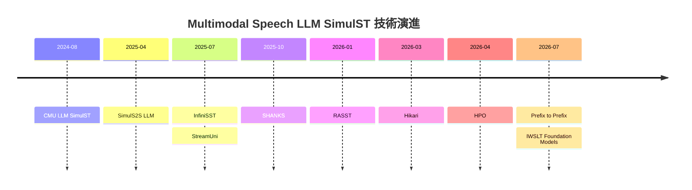
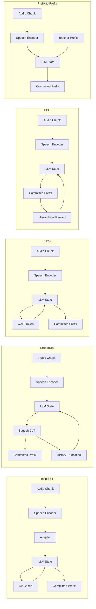
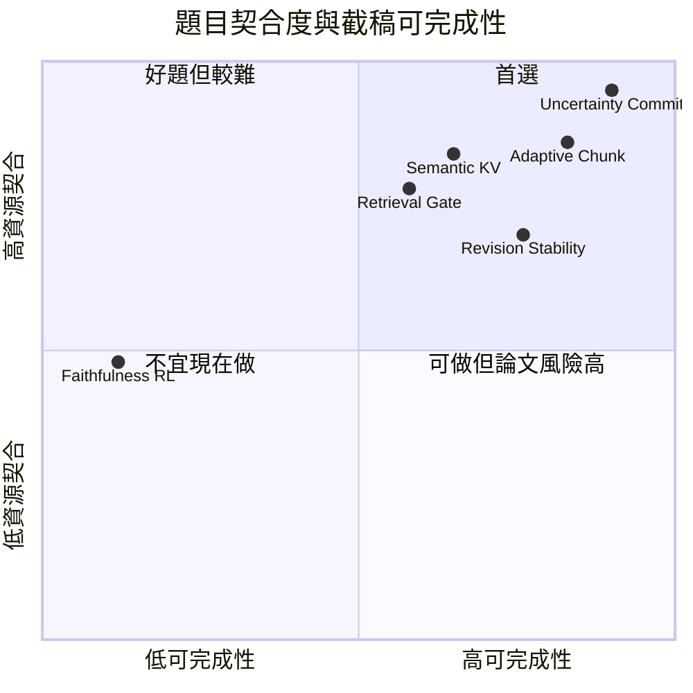
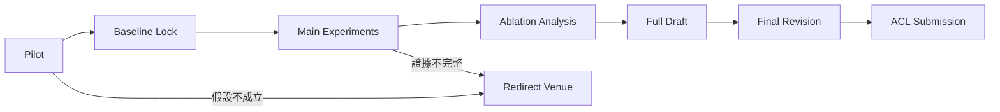

# Multimodal Speech LLM SimulST 第二輪深度研究：面向 ACL 2027 的可投題目與執行路線

> 研究基準日：**2026-10-17，Asia/Taipei**。本報告把「近十八個月」定義為 **2025-04-17 至 2026-10-17**，「近六個月」定義為 **2026-04-17 至 2026-10-17**。ACL 2027 截稿日 **2027-01-04** 完全採用你提供的日期，不另行查證或推測。第一輪報告則以 2026-10-11 為基準。〔附件 ID：turn0file0〕

> 用語上，本報告使用 **Multimodal Speech LLM SimulST** 指「speech encoder 或原生 audio frontend 將增量語音送入 LLM／multimodal foundation model，且模型、訓練資料或推論機制直接處理 simultaneous/streaming translation」的路線。它對應第一輪 §3 的 **D 有界記憶語音 LLM**，但實際上也與 **C 離線模型串流化、E 上下文與術語增強、F 時序對齊聯合生成**高度重疊。〔附件 ID：turn0file0〕

## 與第一輪的出入與路線演進

**對應原需求：§0、§1。**

【推論】第二輪最重要的修正不是「第一輪整體錯了」，而是：第一輪為了畫技術地圖，把 Speech LLM route 分得太像一條單一路線；深挖後，現在更合理的看法是把它拆成數個**正交設計軸**。近期方法可以同時是「Speech LLM + bounded cache + synthetic timing supervision + retrieval + RL」，所以只用「有界記憶語音 LLM」一個格子描述，會掩蓋真正能形成論文貢獻的選擇。

| 第一輪的表述或隱含判斷 | 第二輪修正 | 為什麼要修正 | 證據 |
|---|---|---|---|
| D 有界記憶 Speech LLM 可視為一條相對獨立技術路線 | 【推論】應拆為至少四軸：speech-to-LLM connector、增量音訊編碼與 cache、何時 WRITE/WAIT 的 supervision、post-training/retrieval | InfiniSST 主要解 long-form cache；StreamUni 同時處理 generation 與 truncation；Hikari 把 WAIT 放進 token space；HPO 再對類似 LLM SST 做 RL | [InfiniSST](https://arxiv.org/html/2503.02969)、[StreamUni](https://arxiv.org/html/2507.07803)、[Hikari](https://arxiv.org/html/2603.11578)、[HPO](https://arxiv.org/html/2604.21045) 〔引註 ID：turn9view1、turn16view0、turn22view0〕 |
| Speech LLM SimulST 容易被理解為 direct E2E 模型 | 【共識】**不成立。**近期 IWSLT 系統同時存在 direct multimodal model、test-time-adapted multimodal foundation model、LLM cascade、attention-guided decoder-only LLM | IWSLT 2026 的 NeMo、MLLP、AlignAtt4LLM、test-time adaptation 路線並存 | [IWSLT 2026 track](https://iwslt.org/2026/simultaneous)、[NeMo](https://aclanthology.org/2026.iwslt-1.23/)、[AlignAtt4LLM](https://aclanthology.org/2026.iwslt-1.32/) 〔引註 ID：turn12search5、turn12search7、turn12academia48〕 |
| 第一輪推薦 D 時，開源性看起來足以支撐碩士生快速開始 | 【推論】需要更保守。**checkpoint 能下載 ≠ paper training 可以在你的硬體重跑。** | InfiniSST 官方 recipe 的兩階段訓練使用多張 L40S；HPO 一次 RL run 使用多張 H100；Hikari 的完整 pretraining 規模更大且沒有可換算的訓練時數 | [InfiniSST repo](https://github.com/LeiLiLab/InfiniSST)、[HPO paper](https://arxiv.org/html/2604.21045)、[HPO repo](https://github.com/owaski/HPO)、[Hikari](https://arxiv.org/html/2603.11578) 〔引註 ID：turn13search2、turn22view0、turn13search1、turn9view2〕 |
| 可把 Speech LLM 的「翻譯能力」和「串流能力」一起當成待訓練問題 | 【共識】近期證據反而支持**把能力與時機拆開**：強 offline/multimodal foundation model 已有翻譯能力，研究重心逐漸移到 prefix supervision、commitment、cache 與 test-time adaptation | CSSEL-P2P 明確問「是否需要 architectural changes」；IWSLT 2026 有 off-the-shelf foundation model test-time adaptation；AlignAtt4LLM 對 decoder-only LLM 外掛 alignment policy | [Prefix-to-Prefix](https://arxiv.org/html/2607.13158)、[test-time adaptation](https://aclanthology.org/2026.iwslt-1.27/)、[AlignAtt4LLM](https://aclanthology.org/2026.iwslt-1.32/) 〔引註 ID：turn8view2、turn12academia48〕 |
| 第一輪把 Hikari 某一個數字當代表性結果 | 【推論】第二輪改為**每個數字必須綁定 split、指標與版本**；不能把不同表格或 shared-task 條件的結果合成單一「Hikari 分數」 | 目前已開啟的 Hikari 原文表格在指定 En→De 條件報告不同品質與 latency 指標；IWSLT official table 又可能使用不同 test set/long-form metric | [Hikari](https://arxiv.org/html/2603.11578)、[IWSLT 2026 findings](https://aclanthology.org/2026.iwslt-1.39/) 〔引註 ID：turn9view3、turn8view5〕 |

因此，第一輪 §1–§3 的問題定義與六路線地圖仍可沿用；本輪不重寫，而是把 **D＋F 的交界**重新展開為下面這條技術 lineage。〔附件 ID：turn0file0〕

**圖的節點：** CMU LLM SimulST、SimulS2S LLM、InfiniSST、StreamUni、SHANKS、RASST、Hikari、HPO、Prefix to Prefix、IWSLT Foundation Models。  
**圖的邊：** 時間線由早至晚；不表示直接程式繼承，只表示本報告追蹤的思想演進。



【推論】這條 timeline 的真正轉折不是「模型越做越大」，而是：

**先把 LLM 接到 speech → 再讓它能無限串流 → 再讓它自己學 WAIT／truncation → 再研究 retrieval、RL 與 test-time policy → 最後開始質疑是否根本不需要重訓整個 architecture。**

這個轉折對你的 ACL 選題非常重要：你的資源是 **四張 A10、單人、剩不到三個月**，最不合理的競爭方式是從頭做另一個大型 Speech LLM；最合理的是把**已有 multimodal Speech LLM 當能力底座，研究目前仍不穩定的 commitment、uncertainty、compute-aware streaming 或 memory policy**。【推論】

## 近月文獻盤點

**對應原需求：§2。**

本輪實際使用的核心查詢方向為 `simultaneous speech translation large language model streaming`、`streaming speech translation speech LLM`、`unbounded speech simultaneous translation LLM`、`IWSLT 2025 speech LLM streaming translation`、`IWSLT 2026 simultaneous speech translation LLM`、`prefix-to-prefix simultaneous speech translation LLM`、`streaming spoken language model think while listening`，以及論文名稱的 GitHub 定向查詢。來源限英文 primary sources：ACL Anthology、arXiv 原文與作者／組織官方 GitHub。IWSLT 2025 正式 proceedings 確認了 STAR、SSR、SparQLe、Conversational SimulMT 等相鄰工作。〔引註 ID：turn24search2、turn24search0、turn24search1、turn24search3〕

**篩選規則**採三層：第一層是直接做 streaming/simultaneous speech translation 且 LLM/multimodal model 位於 translation path；第二層是直接解 Speech LLM 的 streaming connector、cache、prefix supervision、retrieval 或 incremental generation；第三層則只收會直接影響本題 method/evaluation 的工作，例如 Simulstream。純 offline speech translation、純文字 MT、一般 ASR 除非提供上述機制，不納入核心集合。【推論】

18 個月窗口如下。

| 項目 | 值 | 來源 |
|---|---:|---|
| 研究基準日 | 2026-10-17 | 本題指定 |
| 十八個月起點 | 2025-04-17 | 由本題基準日回推 |
| 文獻主窗口 | 2025-04-17 至 2026-10-17 | 本報告規則 |
| 表中論文數 | 22 篇 | 本輪實際開啟的 primary-source 集合 |

以下「NR」是 **Not Reported in the opened primary source at a safely comparable level**；不是零，也不是我沒興趣補，而是避免從摘要、不同 split 或他文引用亂拼數字。

| 論文 | 與本路線關係 | 機制 | 資料與測試條件 | 已核對主要數字 | 與前作差異 | 官方程式 | 日期與原文 |
|---|---|---|---|---|---|---|---|
| SimulS2S-LLM | 直接但輸出為 S2S | streaming encoder＋CIF boundary-aware speech prompt＋固定 LLM＋speech generator；test-time wait-k | CVSS-C；Es→En、Fr→En、De→En | proposed ASR-BLEU 為 26.33、26.93、21.5；streaming StreamSpeech 為 22.94、25.30、17.0 | 把大型 text LLM 放入 SimulS2ST；用 boundary-aware prompts 解 offline-trained LLM 在 partial speech 的落差 | 未在已開啟原文確認專用 repo | 2025；[原文](https://arxiv.org/html/2504.15509) 〔引註 ID：turn19view0、turn20view0〕 |
| InfiniSST | **核心** | streaming encoder＋adapter＋Llama；speech/text 交錯；full KV reuse；attention sink＋sliding cache | long-form En→De 等；不同 cache/context 設定 | cache 10 speech＋1000 LLM 時 COMET 69.2、StreamLAAL 1.1；2000/4000 時 69.4、1.2 | 從 repeated retranslation 轉為持續對話式 state 與 bounded memory | [LeiLiLab/InfiniSST](https://github.com/LeiLiLab/InfiniSST) | Findings ACL 2025；[原文](https://arxiv.org/html/2503.02969) 〔引註 ID：turn9view1、turn13search2〕 |
| Streaming Sequence Transduction through Dynamic Compression | 強相鄰 | STAR 動態切分 input stream 成 anchor representation | ASR 與 SimulST | ASR 約 12× compression，論文摘要稱近乎無損；SimulST 主張較佳 segmentation 與 latency-quality trade-off | 把「固定 chunk」改成 learnt dynamic compression | 未確認專用 repo | IWSLT 2025-07；[原文](https://aclanthology.org/2025.iwslt-1.1/) 〔引註 ID：turn24search2〕 |
| SSR: Alignment-Aware Modality Connector for Speech Language Models | Speech LLM enabling | alignment-based segmentation/compression connector；distillation＋fine-tuning | StoryCloze、Speech-MMLU 等 speech understanding | 相對既有 connector 約 +10 StoryCloze accuracy、+20 Speech-MMLU | 把長 speech feature 壓到接近 text granularity，兼顧 text capability preservation | 未確認 | IWSLT 2025-07；[原文](https://aclanthology.org/2025.iwslt-1.5/) 〔引註 ID：turn24search0〕 |
| SparQLe: Speech Queries to Text Translation Through LLMs | Speech LLM ST enabling | self-supervised speech representation＋modality adapter＋instruction LLM | English speech 到 text translation；opened abstract 未給單一可比 headline number | NR | 強調少改動方式把 SSL speech 接 instruction-tuned LLM | 未確認 | IWSLT 2025-07；[原文](https://aclanthology.org/2025.iwslt-1.6/) 〔引註 ID：turn24search1〕 |
| Conversational SimulMT | 文字端直接前驅 | source/target chunks 交錯成 multi-turn history，重用 LLM KV cache | 三個 SimulMT benchmarks；Llama2-7B-chat | opened primary abstract 未給單一 headline number | 與 InfiniSST 很接近的思想前驅：把 repeated prompt 改成 conversational cache reuse | 未確認 | IWSLT 2025-07；[原文](https://aclanthology.org/2025.iwslt-1.8/) 〔引註 ID：turn24search3〕 |
| Soundwave | multimodal LLM enabling | speech-text alignment adapters；representation-gap 與 sequence-length adapter | 多項 speech-language tasks | shrinker compression 約 2.5%；TTFT 約 72 ms，相較兩種 adapter 約 95 ms、85 ms | 研究如何用更少 speech data 做高效 speech-text alignment | [FreedomIntelligence/Soundwave](https://github.com/FreedomIntelligence/Soundwave) | ACL 2025；[原文](https://arxiv.org/html/2502.12900) 〔引註 ID：turn22view2〕 |
| CMU’s IWSLT 2025 Simultaneous Speech Translation System | **核心** | chunkwise-causal speech encoder＋adapter＋Qwen2.5 7B；synthetic streaming ST | ACL60/60 dev；En→Zh、En→De | En→Zh BLEU 44.3；StreamLAAL 2.189 s；CA 約 2.739 s。En→De BLEU 25.1；StreamLAAL 1.689 s；CA 2.306 s | 把 InfiniSST 類方法擴到 IWSLT long-form shared task | InfiniSST code family；exact system repo 未獨立確認 | IWSLT 2025；[原文](https://aclanthology.org/2025.iwslt-1.31/) 〔引註 ID：turn7view1〕 |
| StreamUni | **核心** | Speech CoT 同時驅動 generation 與 truncation；支援 Phi-4 Multimodal 與 Qwen2.5-Omni | MuST-C、CoVoST2；En→Zh 等 | Phi-4 vanilla policy 的一組 SimulST operating points 為 LAAL 1112.48 ms / BLEU 22.51 與 1448.43 ms / 24.27；mixed CoT training WER 20.74、BLEU 35.22 | 不只加 streaming policy，而把「何時生成、何時截掉舊歷史」統一到 Speech LLM training | [ICTNLP/StreamUni](https://github.com/ictnlp/StreamUni) | arXiv 2025-07；[原文](https://arxiv.org/html/2507.07803) 〔引註 ID：turn16view0、turn13search5〕 |
| CUNI IWSLT 2025 system | 強相鄰 | direct Whisper＋AlignAtt 與 cascade contextual prompting 並行 | IWSLT long-form；En→De/Zh/Ja、Cs→En | opened system report 報告 contextual route 對部分 dev directions 約 +13 至 +22 BLEU；Cs→En 約 +2 BLEU | 顯示 LLM/context 與 attention policy 可以是可組合模組，而非單一 E2E 架構 | 未確認 exact repo | IWSLT 2025；[原文](https://aclanthology.org/2025.iwslt-1.41/) 〔引註 ID：turn7view4〕 |
| Simulstream | **評測核心** | long-form streaming agent framework；支援 incremental 與 revision/retranslation | 系統評測而非單一 corpus 模型 | 不以單一 BLEU 為主；工具記錄 latency、computation 與 flickering 等 | 補上 SimulEval 對 long-form/revision support 的缺口 | [hlt-mt/simulstream](https://github.com/hlt-mt/simulstream) | arXiv 2025-12；[原文](https://arxiv.org/abs/2512.17648) 〔引註 ID：turn7view8、turn13search0〕 |
| SHANKS | streaming Speech LLM 強相鄰 | 固定 audio chunks；模型在 listening 中做 latent reasoning 並可 interrupt/tool-call | interruption test、tool-call scenario | interruption test 中 E2E Shanks 的 wrong-case interrupt 約 84.8%、valid 約 63.9%、latency 約 5.08 s；cascade 約 86.1%、78.3%、6.90 s | 把「listen until complete」改成「think while listening」；不是 translation paper | 未在已開啟來源確認 repo | ACL 2026；[原文](https://aclanthology.org/2026.acl-long.404/) 〔引註 ID：turn21view3、turn22view1〕 |
| RASST | **核心增強** | sliding partial speech 上做 cross-modal terminology retrieval，再以 synthetic training 教 LLM 使用 hints | ACL60/60 dev；三個 translation directions | terminology accuracy 最高提升約 16%；BLEU 最高約 +3 | retrieval 不再只在文字完成後做，而是針對 partial speech 即時找 terminology | 本輪未找到作者明示 official repo | 2026-01；[原文](https://arxiv.org/abs/2601.22777) 〔引註 ID：turn7view9、turn9view6〕 |
| Hikari | **核心** | causal speech-to-text alignment；把 WAIT 放入 decoder vocabulary；Decoder Time Dilation；latency-recovery SFT | opened En→De setting | 0.76B 模型的一組結果：BLEU 39.1、chrF 71.6、COMET 0.80、CU StreamLAAL 1.6 s、CA 1.8 s | 試圖拿掉外部 handcrafted policy，讓 token generation 本身決定 WAIT | 權重與 inference code 在原文版本中為 planned release；本輪不當作已完整可復現 | 2026-03；[原文](https://arxiv.org/html/2603.11578) 〔引註 ID：turn9view3、turn9view2〕 |
| Hierarchical Policy Optimization for Simultaneous Translation of Unbounded Speech | **核心** | 對 Speech LLM 做 hierarchical RL；品質 reward＋latency control＋segmentation | YODAS 訓練；ACL60/60、RealSI；En→Zh/De/Ja | 相對 SFT 約 +7 COMET、+1.25 MetricX，約 1.5 s regime；一組 HPO-Sent 為 StreamLAAL 1383 ms、COMET .8234、BLEU 43.37 | 從 synthetic SFT timing 進一步做 RL，並顯式研究 reward hacking/omission | [owaski/HPO](https://github.com/owaski/HPO) | ACL 2026；[原文](https://arxiv.org/html/2604.21045) 〔引註 ID：turn22view0、turn21view0、turn13search1〕 |
| Do LLMs Need Architectural Changes for Simultaneous Speech Translation? A Prefix-to-Prefix Data Driven Approach | **核心** | 固定 cumulative chunks＋teacher-produced bounded-wait prefix-to-prefix labels；rewind committed prefix | in-house conversational speech；多語方向 | 相對 streaming baseline 在近似 latency 下 COMETKiwi 約 +1.54，同時 AL 約 +0.15 s | 主張關鍵可能是 supervision trajectory，不一定是新 architecture | 本輪未找到 official repo | 2026-07；[原文](https://arxiv.org/html/2607.13158) 〔引註 ID：turn8view2、turn4view9〕 |
| Test-Time Adaptation of Multimodal Foundation Models for Simultaneous Speech Translation | **核心** | pause segmentation＋off-the-shelf multimodal FM；wait-k variant；multi-turn response prefilling＋KV cache | IWSLT 2026 simultaneous directions/regimes | opened canonical page 主張各 direction/regime 均較 cascade baseline 有更佳 quality-latency trade-off；未安全抽出單一 headline number | **不重訓基礎模型**，把串流性移到 test-time adaptation | 未確認 exact repo | IWSLT 2026；[原文](https://aclanthology.org/2026.iwslt-1.27/) 〔引註 ID：turn7view11〕 |
| Dynamic Attention Masking IWSLT 2026 system | **核心架構相鄰** | SeamlessM4T＋per-layer scheduler 動態開 future frames；LoRA；sliding retranslation＋StreamAtt | En→De/It/Zh | opened primary page 未安全抽出單一 headline number | 不固定 look-ahead；每層學可見 future context | 未確認 | IWSLT 2026；[原文](https://aclanthology.org/2026.iwslt-1.20/) 〔引註 ID：turn7view13〕 |
| AlignAtt4LLM | **核心** | forced alignment 找 source spans；decoder-only MT LLM attention heads 驅動 AlignAtt；QK fast replay | IWSLT 2026；En→De/It/Zh | opened primary source 顯示 En→De/It 在約兩秒至四秒 CU-LongYAAL 區域優於 supplied baselines；En→Zh 結果較混合 | 把原本 encoder-decoder attention policy 移植到 decoder-only LLM | 本輪未確認 official repo | 2026-06；[原文](https://aclanthology.org/2026.iwslt-1.32/) 〔引註 ID：turn12academia48〕 |
| NeMo@IWSLT 2026: Cascaded System for Simultaneous Speech Translation | **強基線** | dual-mode Unified ASR Transducer＋multilingual LLM translation | IWSLT 2026 long-form | ACL Test En→De high group：XCOMET-XL 0.93、BLEU 45.01、CU-LongYAAL 4.7 s；En→Zh 為 0.83、47.64、28.3 s | 顯示強 ASR＋LLM cascade 仍能壓過不少直接系統，不能假設 direct Speech LLM 自動勝出 | [NVIDIA/NeMo](https://github.com/NVIDIA/NeMo) 為框架；不等同 exact submission | IWSLT 2026；[原文](https://aclanthology.org/2026.iwslt-1.23/) 〔引註 ID：turn12search7、turn8view5〕 |
| MLLP-VRAIN UPV System for IWSLT 2026 Simultaneous Speech Translation Task | **強基線與 context route** | Parakeet＋Qwen cascade；LCP/black-box streaming；context retrieval | IWSLT 2026 | ACL Test En→Zh high：XCOMET-XL 0.82、BLEU 50.03、CU-LongYAAL 4.8 s、CA 5.2 s；context condition BLEU 50.24、XCOMET-XL 0.84 | 說明 context/RAG 與穩定 commitment 在 cascade 中也非常強 | 未確認 exact repo | IWSLT 2026；[原文](https://aclanthology.org/2026.iwslt-1.24/) 〔引註 ID：turn8view7、turn8view5〕 |
| NAVER LABS IWSLT 2026 Instruction-Following reimplementation | multimodal LLM 相鄰 | SeamlessM4T-v2 speech encoder＋Qwen3-4B；synthetic instruction data | MCIF；ST 與 spoken QA | opened source 報告 En→Zh ST COMET 約 0.781；另做 SQA | 顯示 compact speech-encoder＋4B LLM 能共同承擔 translation/instruction following | 未確認 | IWSLT 2026；[原文](https://aclanthology.org/events/iwslt-2026/) 〔引註 ID：turn12academia49、turn23view1〕 |
| HENT-SRT: Hierarchical Efficient Neural Transducer with Self-Distillation for Joint Speech Recognition and Translation | 串流非 LLM 對照 | hierarchical neural transducer＋self-distillation；joint ASR/ST | 三個 conversational datasets | opened proceedings abstract 未提供可安全摘錄的單一主數字 | 是重要「非 LLM streaming inductive bias」baseline family，避免把改進都歸因於 LLM | 未確認 | IWSLT 2025；[proceedings](https://aclanthology.org/events/iwslt-2025/) 〔引註 ID：turn23view0〕 |

【共識】這份盤點最明顯的研究趨勢不是單純「Speech LLM 正取代傳統 SimulST」，而是三件事同時發生：**能力底座愈來愈強、串流控制逐漸和基礎模型解耦、long-form state 與計算成本變成一級問題**。InfiniSST、StreamUni、Hikari、Prefix-to-Prefix、IWSLT 2026 test-time adaptation 分別從不同角度支持這個判斷。〔引註 ID：turn9view1、turn16view0、turn9view3、turn8view2〕

【共識】另一個不能忽略的事實是：**cascade 沒有死。**IWSLT 2026 的 NeMo 與 MLLP 系統仍然非常有競爭力，所以你的論文若主張「multimodal direct model 較好」，必須真的和強 cascade 比，而不是只和舊 wait-k E2E baseline 比。〔引註 ID：turn12search7、turn8view7、turn8view5〕

固定欄位 CSV 如下。沒有安全確認的官方 code URL 留空；不把第三方 reimplementation 猜成官方 repo。

```csv
title,year,month,url,mechanism,dataset,main_metric,main_number,diff_from_prior,code_url,source_type
SimulS2S-LLM,2025,4,https://arxiv.org/html/2504.15509,streaming encoder;CIF speech prompts;fixed LLM;wait-k,CVSS-C;Es-En;Fr-En;De-En,ASR-BLEU,26.33;26.93;21.5,boundary-aware speech prompts for simultaneous LLM decoding,,primary
InfiniSST,2025,7,https://arxiv.org/html/2503.02969,streaming encoder;adapter;interleaved speech text;KV reuse;sliding cache,long-form SimulST,COMET;StreamLAAL,69.2;1.1s at one cache setting,unbounded speech with bounded LLM memory,https://github.com/LeiLiLab/InfiniSST,primary
Streaming Sequence Transduction through Dynamic Compression,2025,7,https://aclanthology.org/2025.iwslt-1.1/,dynamic stream segmentation;anchor compression,ASR;SimulST,compression,about 12x on ASR,dynamic learned compression replaces fixed segmentation,,primary
SSR Alignment-Aware Modality Connector for Speech Language Models,2025,7,https://aclanthology.org/2025.iwslt-1.5/,alignment segmentation;speech compression;distillation;fine-tuning,StoryCloze;Speech-MMLU,accuracy gain,about +10;+20,compresses speech to text-like granularity while preserving text ability,,primary
SparQLe Speech Queries to Text Translation Through LLMs,2025,7,https://aclanthology.org/2025.iwslt-1.6/,self-supervised speech encoder;modality adapter;instruction LLM,speech-to-text translation,NR,NR,lightweight bridge between speech representation and instruction LLM,,primary
Conversational SimulMT Efficient Simultaneous Translation with Large Language Models,2025,7,https://aclanthology.org/2025.iwslt-1.8/,interleaved source target dialogue;KV reuse,three SimulMT benchmarks,NR,NR,reuses conversational KV state instead of repeated full decoding,,primary
Soundwave,2025,7,https://arxiv.org/html/2502.12900,speech-text alignment adapters;sequence compression,speech-language tasks,compression;TTFT,2.5%;72ms,data-efficient speech-text alignment,https://github.com/FreedomIntelligence/Soundwave,primary
CMU IWSLT 2025 Simultaneous Speech Translation System,2025,7,https://aclanthology.org/2025.iwslt-1.31/,chunkwise causal speech encoder;adapter;Qwen LLM;synthetic ST,ACL60/60;En-Zh;En-De,BLEU;StreamLAAL,44.3;2.189s for En-Zh,long-form Speech LLM shared-task system,,primary
StreamUni,2025,7,https://arxiv.org/html/2507.07803,Speech CoT;generation policy;semantic truncation;multimodal LLM,MuST-C;CoVoST2,BLEU;LAAL,22.51;1112.48ms at one Phi4 operating point,unifies generation and history truncation,https://github.com/ictnlp/StreamUni,primary
CUNI IWSLT 2025 system,2025,7,https://aclanthology.org/2025.iwslt-1.41/,direct AlignAtt;cascade LLM prompting;terminology context,IWSLT long-form,BLEU gain,up to about +13 to +22 on selected directions,combines direct policy and contextual cascade,,primary
Simulstream,2025,12,https://arxiv.org/abs/2512.17648,long-form streaming framework;revision support;latency and flicker metrics,long-form streaming evaluation,tooling,NR,supports revision and long-form evaluation beyond older SimulEval assumptions,https://github.com/hlt-mt/simulstream,primary
SHANKS,2026,4,https://aclanthology.org/2026.acl-long.404/,chunked streaming Speech LLM;latent reasoning;interrupt;tool calls,interruption;tool-call tasks,interrupt validity;latency,63.9%;5.08s for one E2E setting,think while listening rather than listen then answer,,primary
RASST Fast Cross-modal Retrieval-Augmented Simultaneous Speech Translation,2026,1,https://arxiv.org/abs/2601.22777,partial-speech retriever;terminology hints;synthetic training,ACL60/60 dev;three directions,term accuracy;BLEU gain,up to +16%;+3,retrieves terminology before full speech is available,,primary
Streaming Translation and Transcription Through Speech-to-Text Causal Alignment,2026,3,https://arxiv.org/html/2603.11578,WAIT token;causal alignment;Decoder Time Dilation;latency recovery SFT,En-De streaming,BLEU;StreamLAAL,39.1;1.6s at opened setting,learns emission directly inside token generation,,primary
Hierarchical Policy Optimization for Simultaneous Translation of Unbounded Speech,2026,4,https://arxiv.org/html/2604.21045,hierarchical RL;quality reward;latency reward;segmentation,YODAS;ACL60/60;RealSI,COMET gain;MetricX gain,about +7;+1.25 around 1.5s regime,post-trains imperfect synthetic SFT trajectories,https://github.com/owaski/HPO,primary
Do LLMs Need Architectural Changes for Simultaneous Speech Translation A Prefix-to-Prefix Data Driven Approach,2026,7,https://arxiv.org/html/2607.13158,teacher prefix labels;cumulative chunks;rewind committed prefix,in-house conversational multilingual speech,COMETKiwi gain;AL delta,+1.54;+0.15s,improves streaming mainly through supervision rather than architecture,,primary
Test-Time Adaptation of Multimodal Foundation Models for Simultaneous Speech Translation,2026,7,https://aclanthology.org/2026.iwslt-1.27/,pause segmentation;multimodal foundation model;prefilling;KV cache,IWSLT 2026,quality latency tradeoff,NR,turns off-the-shelf multimodal model into SimulST without full retraining,,primary
Dynamic Attention Masking IWSLT 2026 system,2026,7,https://aclanthology.org/2026.iwslt-1.20/,per-layer dynamic future masks;LoRA;retranslation;StreamAtt,En-De;En-It;En-Zh,NR,NR,learned future context replaces one global lookahead,,primary
AlignAtt4LLM,2026,7,https://aclanthology.org/2026.iwslt-1.32/,forced alignment;LLM attention head selection;QK replay,IWSLT 2026;En-De;En-It;En-Zh,CU-LongYAAL;translation quality,NR,ports attention-guided commitment to decoder-only LLM,,primary
NeMo at IWSLT 2026 Cascaded System for Simultaneous Speech Translation,2026,7,https://aclanthology.org/2026.iwslt-1.23/,streaming ASR transducer;multilingual LLM,IWSLT 2026 ACL Test,XCOMET-XL;BLEU;CU-LongYAAL,0.93;45.01;4.7s for En-De high,strong cascade remains competitive,https://github.com/NVIDIA/NeMo,primary
MLLP-VRAIN UPV System for IWSLT 2026 Simultaneous Speech Translation Task,2026,7,https://aclanthology.org/2026.iwslt-1.24/,Parakeet;Qwen;stable-prefix policy;context retrieval,IWSLT 2026 ACL Test,XCOMET-XL;BLEU;CU-LongYAAL,0.82;50.03;4.8s for En-Zh high,strong black-box cascade plus optional context,,primary
NAVER LABS IWSLT 2026 Instruction Following reimplementation,2026,7,https://aclanthology.org/events/iwslt-2026/,Seamless speech encoder;Qwen3-4B;synthetic instruction tuning,MCIF;En-Zh ST;SQA,COMET,0.781 for reported En-Zh ST,compact multimodal speech LLM jointly handles translation and instruction tasks,,primary
```

## 方法、失敗方向與復現性

**對應原需求：§3–§5。**

我建議把五篇最重要的方法讀成五種不同回答：

1. **InfiniSST：如何不斷聽而不一直重算？**
2. **StreamUni：如何讓模型自己管理生成與歷史？**
3. **Hikari：是否可以把 WAIT 本身變成 language-model token？**
4. **HPO：SFT 的 timing 不完美時，能不能用 RL 修？**
5. **Prefix-to-Prefix：真的需要新 architecture 嗎，還是資料 trajectory 才是瓶頸？**

這五篇形成的爭論，正好比「誰 BLEU 高」更接近能做成 ACL long paper 的概念問題。〔引註 ID：turn9view1、turn16view0、turn9view3、turn22view0、turn8view2〕

**圖的節點：** Audio Chunk、Speech Encoder、Adapter、LLM State、KV Cache、Speech CoT、History Truncation、WAIT Token、Hierarchical Reward、Teacher Prefix、Committed Prefix。  
**圖的邊：** 每個方法皆由增量音訊向文字輸出流動；額外邊表示 cache、policy、reward 或 teacher supervision 的位置。



| 面向 | InfiniSST | StreamUni | Hikari | HPO | Prefix-to-Prefix |
|---|---|---|---|---|---|
| 核心主張 | 【單篇】無限長 speech 可用 bounded cache、多輪 speech-text state 做 LLM SST | 【單篇】generation 與 truncation 可由同一 unified Speech LLM 學 | 【單篇】WAIT 可成為 token-level causal alignment，而非外部 controller | 【單篇】synthetic SFT timing 不夠好，可用 hierarchical RL 同時優化品質與延遲 | 【單篇】大量 streaming gain 可能來自正確 prefix supervision，而非 architectural novelty |
| Speech 處理 | chunkwise/streaming encoder，只編新音訊 | multimodal Speech LLM audio input | causal speech encoder | cache-aware Fast Conformer 類 frontend | cumulative speech prefixes |
| LLM | Llama 3.1 8B family | Phi-4 Multimodal；另驗 Qwen2.5-Omni | 自有約 0.76B model | Qwen3 4B family | LLM 搭配 teacher-produced P2P data |
| 時機機制 | synthetic read/write trajectories | Speech CoT policy | WAIT token | learned policy 經 reward 修正 | teacher bounded-wait prefixes |
| Long-form state | attention sink＋sliding cache | model-generated truncation | causal history | preserved initial cache＋sliding tokens | rewind 到 committed prefix |
| 訓練主要成本 | adapter/LLM ST fine-tuning | multimodal CoT fine-tuning | 大型 speech-text pretraining＋SFT | rollout＋reward＋policy update | teacher-label generation＋fine-tuning |
| 推論重算 | 低；以 cache reuse 為設計重點 | 低至中；取決於 truncation | causal token flow | 類 InfiniSST；加訓練成本不代表部署要 reward model | cumulative prefix 仍有 prefix 管理成本 |
| 主要 failure mode | cache 太小遺失 prompt 或長距資訊 | CoT policy/truncation 錯誤會污染後續 state | WAIT 過多／過少；低 latency 受語序重排限制 | reward hacking、omission、RL 成本 | teacher trajectory 品質、固定 chunk、domain transfer |
| 對你最有價值的思想 | **bounded-state baseline** | **最適合直接拿來改 policy** | **把 commitment 當生成問題** | **告訴你 RL 是昂貴後手，不是第一步** | **支持 inference/policy/data-centric 題目** |
| 主要原文 | [link](https://arxiv.org/html/2503.02969) 〔引註 ID：turn9view1〕 | [link](https://arxiv.org/html/2507.07803) 〔引註 ID：turn16view0〕 | [link](https://arxiv.org/html/2603.11578) 〔引註 ID：turn9view3〕 | [link](https://arxiv.org/html/2604.21045) 〔引註 ID：turn22view0〕 | [link](https://arxiv.org/html/2607.13158) 〔引註 ID：turn8view2〕 |

### 失敗、被替代或至少已被原作者證明不夠好的方向

| 嘗試 | 發生的問題 | 後來怎麼做 | 證據性質與來源 |
|---|---|---|---|
| SimulS2S-LLM 先以單純 downsampling／stacking speech representation 接 LLM | simultaneous inference 表現差；offline-trained model 對 partial input 不夠適合 | 改成 CIF 產生有 boundary information 的 speech prompts | 【單篇】作者直接描述 preliminary experiments。[原文](https://arxiv.org/html/2504.15509) 〔引註 ID：turn19view0、turn20view1〕 |
| StreamUni 只增加 streaming CoT training | 並沒有得到作者需要的整體 improvement | 混合 streaming 與 non-streaming CoT examples | 【單篇】論文 ablation。[原文](https://arxiv.org/html/2507.07803) 〔引註 ID：turn16view0〕 |
| InfiniSST sliding cache 把 system prompt 一併丟掉 | cache window 滑動後 LLM 可能停止翻譯 | 保留 fixed initial attention sink／system instruction，再滑動近期 history | 【單篇】cache analysis。[原文](https://arxiv.org/html/2503.02969) 〔引註 ID：turn9view1〕 |
| HPO 類 SeqPO 直接按完整 chunk 截斷 trajectory 以做 latency optimization | training instability | 作者採更細的 truncation granularity | 【單篇】HPO training analysis。[原文](https://arxiv.org/html/2604.21045) 〔引註 ID：turn21view2〕 |
| 直接把 neural MT metric 當唯一 RL quality reward | 【單篇】出現 metric reward hacking 的風險，且品質指標間不完全同步 | hierarchy、不同 reward 與額外 judge/human analysis | HPO 原文直接討論；作者也觀察到 omission 風險。[原文](https://arxiv.org/html/2604.21045) 〔引註 ID：turn21view0、turn21view1〕 |
| 一味把 latency 壓到極低 | 跨語言 reordering 的資訊不足會開始主導品質下降 | Hikari 明確沒有把 sub-second regime 當主要 optimization 目標 | 【單篇】不是宣稱 sub-second 永遠不可能，而是該模型與任務條件的設計選擇。[原文](https://arxiv.org/html/2603.11578) 〔引註 ID：turn9view2〕 |
| 只用舊式 short-segment SimulEval 工作流 | 無法自然涵蓋長音訊、revision 與現代 retranslation system | Simulstream 專門加入 long-form 與 revision-aware evaluation | 【單篇】工具論文的直接動機。[原文](https://arxiv.org/abs/2512.17648) 〔引註 ID：turn7view8、turn13search0〕 |

【共識】這些負面結果共同指出一件對選題很有用的事：**模型能理解完整語音，不等於模型知道 partial speech 何時足夠；而且「何時輸出」錯了之後，錯誤會透過 committed text 或 KV state 長期殘留。** SimulS2S-LLM、StreamUni、InfiniSST、HPO 分別從 representation、trajectory、memory、reward 四層看到同一類問題。〔引註 ID：turn19view0、turn16view0、turn9view1、turn21view1〕

### 開源與復現

| 方法 | 可取得內容 | 你目前的復現難度 | 最大坑 | 建議 |
|---|---|---|---|---|
| StreamUni | 官方 repo、模型、資料連結 | **中** | MuST-C 可得性；版本、chunk size、evaluation stack 要鎖死；Speech CoT pipeline 比普通 inference 複雜 | **第一優先**：[repo](https://github.com/ictnlp/StreamUni) 〔引註 ID：turn13search5〕 |
| InfiniSST | repo、checkpoints、training/inference scripts | 中至高 | exact training data 與 MuST-C；Llama context/cache；官方訓練硬體記憶體為 A10 的兩倍 | 第二優先：[repo](https://github.com/LeiLiLab/InfiniSST) 〔引註 ID：turn13search2〕 |
| HPO | RL code；SFT 依 InfiniSST | **很高** | rollout throughput、reward model、三節點多 H100 regime | 不要當第一個 baseline：[repo](https://github.com/owaski/HPO) 〔引註 ID：turn13search1、turn22view0〕 |
| Hikari | 原文完整；該版本未形成「可照 paper full-pretrain」的小型 recipe | 極高 | pretraining scale；訓練時數未報，不能合理換算 | 當概念 baseline，不當第一個 reproduction 〔引註 ID：turn9view2〕 |
| Simulstream | 完整 toolkit | 低至中 | agent interface、metric version、audio/reference resegmentation | **應立刻固定成 evaluation infrastructure**：[repo](https://github.com/hlt-mt/simulstream) 〔引註 ID：turn13search0〕 |

我的建議是：**先復現 StreamUni，而不是 HPO 或 Hikari。**【推論】原因不是 StreamUni 一定最好，而是它同時滿足「direct multimodal Speech LLM」、「官方模型」、「官方 code」、「可改 generation/commitment policy」、「已有 En→Zh route」；這和你最可能做成的低成本 inference/policy 題目最接近。〔引註 ID：turn13search5、turn16view0〕

「復現成功」不要定義成「程式跑起來」，而應先固定可驗證的 paper anchor：

| 復現層級 | 對應原文數字與條件 | 本報告建議成功門檻 | 門檻性質 |
|---|---|---|---|
| StreamUni inference sanity | Phi-4 vanilla SimulST 一個 operating point：BLEU 22.51、LAAL 1112.48 ms | BLEU 在原文 ±0.7；LAAL 在 ±150 ms | 【推論】工程判準；原數字來自 paper，不是作者定的 tolerance。〔引註 ID：turn16view0〕 |
| StreamUni second operating point | BLEU 24.27、LAAL 1448.43 ms | BLEU ±0.7；LAAL ±150 ms | 同上 |
| StreamUni training recipe sanity | mixed streaming＋non-streaming CoT：WER 20.74、BLEU 35.22 | WER ±1.0 absolute；BLEU ±1.0 | 【推論】若你真的跑 training 才用此門檻 |
| Simulstream metric sanity | 對同一 frozen output 重跑兩次 | deterministic text metrics 完全一致；latency metadata 差異須可由 compute-aware timing 解釋 | 【推論】先排掉 evaluator 漂移，再改模型 |
| 研究開始 gate | baseline 若兩個主要 anchor 都對不上 | **先修 baseline，不開始 proposal main experiment** | 【推論】否則後續所有 improvement 都不可相信 |

### GPU 可行性

你的硬體與論文原硬體差距不能用「GPU 數量比例」直接換算；以下只做 **reported GPU-hours** 及一個透明的 BF16/FP16 peak-FLOP normalization。這不是 wall-clock 保證。

| GPU | 單卡記憶體 | 官方 FP16/BF16 Tensor 峰值口徑 | 用途 | 來源 |
|---|---:|---:|---|---|
| NVIDIA A10 | 24 GB | 約 125 TFLOPS dense | 你的 GPU | [NVIDIA A10](https://www.nvidia.com/en-us/data-center/products/a10-gpu/) 〔引註 ID：turn14search8〕 |
| NVIDIA L40S | 48 GB | 約 362.05 TFLOPS dense | InfiniSST repo 的 reported training hardware | [NVIDIA L40S](https://www.nvidia.com/en-us/data-center/l40s/) 〔引註 ID：turn14search0〕 |
| NVIDIA H100 SXM | 80 GB | 約 1979 TFLOPS，依 NVIDIA Tensor specification | 僅用來建立 HPO 的假設性 normalization；HPO paper 未指定此 exact subtype | [NVIDIA H100](https://www.nvidia.com/en-us/data-center/h100/) 〔引註 ID：turn14search3〕 |

| Paper training | 論文／repo 自報硬體與時間 | 原始 GPU-hours | 換到 A10 的算式 | 理想化 A10 等價量 | 對你的判讀 |
|---|---|---:|---|---:|---|
| InfiniSST two-stage training | 單節點、8×L40S；stage 1 約 6 h；stage 2 約 4.5 h | 8 × 10.5 = **84 L40S-GPUh** | 84 × 362.05 ÷ 125 | **約 243 A10-GPUh**；四卡理想值約 60.8 h | 【推論】理論上不像 HPO 那麼離譜，但 L40S 是 48 GB、A10 是 24 GB，所以同 batch/model configuration 未必 fit；不可把 60.8 h 當實際預測。〔引註 ID：turn13search2、turn14search0、turn14search8〕 |
| HPO 一次 RL run | 3 nodes × 8 H100；約 20 h 做 500 steps | **480 H100-GPUh** | 若僅為 sensitivity analysis 假設 H100 SXM：480 × 1979 ÷ 125 | **約 7599 A10-GPUh**；四卡理想值約 1900 h | 【推論】即使忽略記憶體、通信與 utilization，也接近整段投稿窗口；**不適合你現在 full reproduce。** H100 exact subtype 未報，因此這不是 runtime estimate。〔引註 ID：turn22view0、turn14search3、turn14search8〕 |
| Hikari full training | 96×H100 pretraining；沒有安全可用的 duration | **無依據** | 作者未報時數，因此不換算 | **無依據，不估** | 不列入你可完成的 full-training 題目。〔引註 ID：turn9view2〕 |
| StreamUni full training | 本輪已開原文沒有得到足以換算的 GPU×time | **無依據** | 不估 | **無依據，不估** | 優先使用 released checkpoint 改 inference policy，而不是承諾 full retrain。〔引註 ID：turn16view0、turn13search5〕 |
| Prefix-to-Prefix full training | paper 報資料量與 teacher supervision，但本輪未取得 GPU×wall time | **無依據** | 不估 | **無依據，不估** | 可借方法思想，不先承諾 exact replication。〔引註 ID：turn4view9〕 |

【推論】因此你的研究策略應明確寫成：**frozen 或 parameter-efficient backbone + 新 streaming policy／calibrator／memory controller**。這不是因為 PEFT 比較潮，而是因為現有 training-scale evidence 已經顯示 full HPO/Hikari 方向和四張 A10 的 deadline 不匹配。

## 近半年產業動態與被做掉風險

**對應原需求：§6。**

嚴格採 **2026-04-17 至 2026-10-17**。這裡只採公司官方來源；產品功能可以證明「市場已做到什麼體驗」，但不能代替 academic benchmark。

| 公司 | 日期 | 最近六個月的動態 | 和本題最相關之處 | 「做到一半被做掉」風險 | 官方來源 |
|---|---:|---|---|---|---|
| OpenAI | 2026-05-07 | 發布 GPT-Realtime-2、GPT-Realtime-Translate、GPT-Realtime-Whisper；Realtime Translation 是持續 session，能串流輸入音訊並輸出 translated audio/transcript deltas | 直接把「continuous speech translation API」產品化；官方說明輸入可涵蓋七十多種語言、輸出十三種語言 | **高**：若題目只是「用大模型做即時翻譯 demo」，novelty 很快消失；**中低**：若研究可測的 commitment、latency、calibration、long-form failure | [OpenAI announcement](https://openai.com/zh-Hant/index/advancing-voice-intelligence-with-new-models-in-the-api/)、[Realtime Translation docs](https://developers.openai.com/api/docs/guides/realtime-translation) 〔引註 ID：turn10search3、turn10search6〕 |
| Google | 2026-09-04 | Google Translate 更新 live translation；官方描述近即時 audio translation，並擴充 background/earpiece 使用情境 | 直接競爭長時間 live translation UX；官方亦指出相當比例 session 會持續多分鐘 | **高**：產品層字幕／耳機體驗；**低至中**：公開 scientific analysis、quality-latency Pareto、可重現 commitment research | [Google official blog](https://blog.google/products-and-platforms/products/translate/google-translate-ios-android-upgrades/) 〔引註 ID：turn10search1〕 |
| Meta | 2026-06 至 2026-07 | Meta glasses 擴增 live translation language coverage；官方後續頁面提到擴至約二十種語言 | 把 real-time translation 放入 wearable，意味 latency、acoustic robustness 與 conversational UX 都是產品核心 | **高**：穿戴型 live translator demo；**較低**：開放 benchmark 上的 streaming mechanism | [Meta official](https://about.fb.com/news/2026/06/meta-essilorluxottica-partner-launch-meta-glasses/) 〔引註 ID：turn11search1、turn11search8〕 |
| Apple | 2026-09-09 | AirPods 產品線進一步推 Live Translation／Apple Intelligence 體驗 | 即時雙語對話已成 consumer audio feature，而非研究原型 | **高**：只做 end-user demo；**低**：可解釋、可比較的 open SimulST mechanism | [Apple Newsroom](https://www.apple.com/newsroom/2026/09/apple-introduces-airpods-5-with-best-in-class-open-ear-active-noise-cancellation/) 〔引註 ID：turn10search0〕 |
| NVIDIA | IWSLT 2026 | NeMo 以 streaming ASR Transducer＋LLM cascade 參加 SimulST shared task | 說明大廠不只做 monolithic speech LLM；模組化 cascade 仍是實戰路線 | **中**：若研究主張只是「LLM 可以翻 streaming ASR」已不新；**低**：模型無關的 uncertainty／commitment 可跨 direct/cascade | [NeMo IWSLT paper](https://aclanthology.org/2026.iwslt-1.23/) 〔引註 ID：turn12search7〕 |

【共識】產品面已經跨過「能不能把 speech 即時翻出去」這個門檻。OpenAI、Google、Meta、Apple 都有 live/realtime translation 功能，因此**「做一個 Speech LLM 即時翻譯器」本身不是 2027 年有防禦性的學術題目**。〔引註 ID：turn10search3、turn10search1、turn11search1、turn10search0〕

【推論】相反地，產品公司反而提高了下面這些 academic questions 的價值：**何時可以安全 commit、錯了要不要 revision、長時間 cache 怎麼縮、latency 是否包含真實 computation、domain terminology 是否會造成 premature hallucination、模型 confidence 能否預測「再等一點會不會改答案」**。這些問題可以用 open benchmark、公開模型與完整 ablation 研究，而不是和閉源產品比 API 體驗。

【推論】對你的「做到一半被做掉」風險排序是：**新 live translator architecture > 新 multimodal adapter > 新 generic streaming wrapper > 可校準 commitment／compute-aware policy／long-form memory analysis。**越靠後者越不容易被一個新 API release 直接抹掉，因為論文主張不是「能做」，而是「什麼條件下、為什麼、用什麼 measurable principle 做得更可靠」。

## 未解問題與可執行題目

**對應原需求：§7。**

先給排序結論：在 **單人、4×A10 24 GB、ACL long paper、剩餘時間短**的前提下，我會把題目優先序排為：

**Uncertainty-Aware Commitment > Compute-Aware Adaptive Chunking > Selective Semantic KV Memory > Revision-Aware Stability > Uncertainty-Gated Retrieval > Faithfulness-Aware RL。**【推論】

這不是「哪題最炫」，而是「**concept-level claim × 可以在截止日前形成完整 baseline、消融與分析**」。

### 題目總表

| 排名 | Gap 與具體題目 | 核心假設 | 方法 | 完整實驗設計 | 主要 baselines | 所需資料 | 單次完整實驗 GPU 時數 | 最大風險 |
|---|---|---|---|---|---|---|---|---|
| A | **Uncertainty-Aware Commitment for Multimodal Speech LLM SimulST** | 【推論】真正瓶頸不是翻譯能力，而是模型無法判斷 current prefix 是否已具有「足夠資訊」；token uncertainty＋跨 chunk self-consistency 可預測 premature commitment | frozen StreamUni 或其他 open multimodal backbone；從 entropy、top-token margin、跨 successive chunks 的 prefix disagreement 建 commitment score；小 calibrator 或 threshold controller | 至少兩模型或一模型兩 backbone setting；至少一個 sentence/short benchmark 加一個 long-form benchmark；quality、CU/CA latency、flicker、premature-commit error、calibration | wait-k；original StreamUni policy；Local Agreement/retranslation；AlignAtt4LLM/cascade；若可實作則 P2P | 首選 CoVoST2 En→Zh；長篇資料以 ACL60/60 或 MCIF 可得性為 gate | **無 paper-based training estimate**；主體是 frozen inference，因此不捏造 GPUh | uncertainty 可能與「未來會改答案」不校準；若只有一個模型容易變成 heuristic paper |
| B | **Compute-Aware Adaptive Chunking** | 【推論】固定 audio chunk 只控制 theoretical latency；最佳 chunk 應由 uncertainty 與實際 decode time 聯合決定 | policy 在每一步選下一個 chunk size；state 包含 uncertainty、speech rate proxy、recent decode latency、cache length | fixed chunks vs adaptive；CU 與 CA latency 都報；P50/P95 compute time；不同 A10 load；quality-latency Pareto | StreamUni fixed chunk；Hikari-style fixed cadence；wait-k；Dynamic Attention Masking | 同 A；不一定需新標註 | **無依據，不估**；相關 papers 未提供可換算的同型 training time | 可能被 reviewer 視為 engineering scheduler；必須提出可泛化 decision principle |
| C | **Selective Semantic KV Memory for Long-Form SimulST** | 【推論】固定 sliding window 丟掉「距離遠但關鍵」的術語／實體；semantic salience 比 recency 更合理 | 對 KV/history 做 salience scoring；保留 system prompt＋recent tokens＋high-value entities／untranslated dependencies | 短／長 speech 分層；固定 KV size 下測 BLEU/COMET、term consistency、memory、decode time；做 retention feature ablation | InfiniSST fixed attention sink＋sliding cache；HPO fixed initial＋sliding policy；StreamUni truncation | 需 long-form speech；最好有 terminology/entity annotations | 若從 InfiniSST training recipe 出發，原 recipe **84 L40S-GPUh**；FLOP-only normalization 約 **243 A10-GPUh**；proposal 自身額外成本無依據 | cache-level manipulation implementation 難；24 GB VRAM 可能迫使量化與 offloading |
| D | **Revision-Aware Stability Policy** | 【推論】final BLEU 相同的兩系統，使用者體感可因 flicker 與 time-to-stable 差很多；policy 應直接 optimize stable visibility | 在 retranslation 上加入 change-risk predictor；允許小量 provisional text，但延遲 risky suffix commit | 最終品質＋first-visible latency＋time-to-stable＋flicker ratio；長篇 case analysis | Local Agreement；LCP；Simulstream reference policies；test-time adaptation | 不需新 training labels；只需保留完整 hypothesis trace | **無依據，不估** | 容易變成 metric/tool paper；必須有學習式或 principled policy 才足 ACL long |
| E | **Uncertainty-Gated Retrieval for Terminology** | 【推論】RASST 類 retrieval 能提升術語，但 partial acoustics 尚未支持某 term 時，過早提示會變成 hallucination prior | retrieval score × acoustic support confidence；只有兩者同時高才注入 terminology | clean/noisy retrieval；seen/unseen terms；partial pronunciation；測 term accuracy、false term injection、BLEU、latency | RASST；always-retrieve；no-retrieve；context prompting cascade | ACL60/60 terminology；或自建可合法釋出的 terminology subset | **無依據，不估** | RASST 本輪未確認 official code；你可能花太多時間先重做 retriever |
| F | **Faithfulness-Aware Lightweight Policy Optimization** | 【推論】HPO 的 quality reward 可以被 metric exploit；顯式 coverage、omission 與 terminology reward 應降低 fluent omission | 小模型／LoRA 上做 hierarchical RL 或 preference optimization；加入 omission/coverage critic | 同品質延遲 regime 比 SFT、HPO-style reward、faithfulness reward；人工抽樣 analysis | HPO；SFT；quality-only reward；latency-only reward | ACL60/60／RealSI 類資料 | HPO reference run **480 H100-GPUh**；FLOP-only A10 normalization 約 **7599 A10-GPUh**；你的 lightweight variant沒有 paper-based實測，故不估 | **計算風險最高**；RL plumbing、reward server、OOM、throughput 都會吃掉 deadline |

### 最接近 prior work 與差異

| 題目 | 最接近 prior | 它做了什麼 | 和你的題目差在哪 |
|---|---|---|---|
| A Uncertainty-Aware Commitment | [StreamUni](https://arxiv.org/html/2507.07803) | Speech CoT 學 generation 與 truncation | 你的核心不是再 fine-tune CoT，而是**對 frozen multimodal LLM 的「何時 commit」做 calibrated uncertainty**；應證明跨 backbone 泛化。〔引註 ID：turn16view0〕 |
|  | [Prefix-to-Prefix](https://arxiv.org/html/2607.13158) | teacher 建 bounded-wait P2P trajectory，再 fine-tune | 它改 supervision；你不依賴 teacher trajectory，而是測模型當下 uncertainty 是否能估未來 revision risk。〔引註 ID：turn8view2〕 |
|  | [AlignAtt4LLM](https://aclanthology.org/2026.iwslt-1.32/) | 用 decoder attention alignment 決定是否等更多 source | 它主要利用 source-target attention；你使用**predictive uncertainty/self-consistency**，且目標是可跨 direct multimodal Speech LLM。〔引註 ID：turn12academia48〕 |
| B Adaptive Chunking | [Hikari](https://arxiv.org/html/2603.11578) | 固定 causal rhythm 與 Decoder Time Dilation | 你讓 audio acquisition granularity 隨 uncertainty 與實際 compute 狀態改變。〔引註 ID：turn9view3〕 |
|  | [StreamUni](https://arxiv.org/html/2507.07803) | 實驗使用固定 streaming chunks | 你研究 chunk size 本身作為 policy action，而不只是 hyperparameter。〔引註 ID：turn16view0〕 |
|  | [Dynamic Attention Masking](https://aclanthology.org/2026.iwslt-1.20/) | 模型內每層決定未來 frame visibility | 它是 internal attention visibility；你是 outer-loop acquisition／compute scheduling。〔引註 ID：turn7view13〕 |
| C Semantic KV | [InfiniSST](https://arxiv.org/html/2503.02969) | attention sink＋fixed sliding cache | 你不只依 recency，而依 semantic value 選 retained history。〔引註 ID：turn9view1〕 |
|  | [HPO](https://arxiv.org/html/2604.21045) | 保存 initial prompt tokens 加固定 sliding recent context | 你的貢獻是 content-aware memory selection，不是 RL policy。〔引註 ID：turn22view0〕 |
|  | [StreamUni](https://arxiv.org/html/2507.07803) | 模型學 semantic truncation | 它處理 history truncation；你需深入到 KV/token retention，並以固定 memory budget 為核心 constraint。〔引註 ID：turn16view0〕 |
| D Revision Stability | [Simulstream](https://arxiv.org/abs/2512.17648) | 提供 revision/flicker-aware evaluation infrastructure | 它主要是工具；你把穩定度變成 commitment decision objective。〔引註 ID：turn7view8〕 |
|  | [IWSLT 2026 test-time adaptation](https://aclanthology.org/2026.iwslt-1.27/) | foundation model＋prefill/cache＋wait policy | 它主打 quality-latency adaptation；你顯式建模「未來是否會 revision」。〔引註 ID：turn7view11〕 |
|  | [MLLP IWSLT 2026](https://aclanthology.org/2026.iwslt-1.24/) | stable-prefix/cascade 路線 | 你的方法需跨 direct Speech LLM，不只是 character/prefix agreement。〔引註 ID：turn8view7〕 |
| E Retrieval Gate | [RASST](https://arxiv.org/abs/2601.22777) | partial speech→terminology retrieval→LLM hints | 你問的是**何時不要相信 retrieval**，並以 false-term injection 作主要 failure metric。〔引註 ID：turn9view6〕 |
|  | [CUNI IWSLT 2025](https://aclanthology.org/2025.iwslt-1.41/) | terminology/context prompting | 它不是 acoustic-confidence-gated retrieval。〔引註 ID：turn7view4〕 |
|  | [MLLP IWSLT 2026](https://aclanthology.org/2026.iwslt-1.24/) | context/RAG 與 streaming cascade | 你研究 retrieval evidence 和 partial acoustic evidence 是否一致。〔引註 ID：turn8view7〕 |
| F Faithfulness RL | [HPO](https://arxiv.org/html/2604.21045) | hierarchical quality/latency RL | 你直接針對其已觀察的 reward hacking/omission failure 加 faithfulness constraints。〔引註 ID：turn21view1〕 |
|  | [RASST](https://arxiv.org/abs/2601.22777) | terminology fidelity via retrieval | 它不解 general omission，也不做 RL。〔引註 ID：turn9view6〕 |
|  | [Redefining Machine Simultaneous Interpretation](https://aclanthology.org/events/iwslt-2026/) | 研究較接近人類 simultaneous interpretation 的 segmentation/drop/summarization 等策略 | 你的問題是 machine-generated output 如何避免 reward-induced omission，而非模仿 interpreter strategy 本身。〔引註 ID：turn23view1〕 |

### Pilot 與放棄判準

這裡我故意把門檻定得很硬。兩週 pilot 的目的不是做漂亮 demo，而是**快速殺掉不成立的假設**。

| 題目 | 兩週最小 Pilot | 假設成立的具體門檻 | 放棄／改題門檻 |
|---|---|---|---|
| A Uncertainty Commitment | released StreamUni checkpoint；一個語言方向；original policy 一個 baseline；proposal 只用 entropy、top-token margin、跨兩次 chunk 的 prefix disagreement；不 training 大模型 | 在 BLEU 下降 **≤0.5** 時，LAAL 至少下降 **250 ms**；**或** latency 差 **≤100 ms** 時 BLEU 至少 +**1.0**；且 premature-commit errors 相對降低 **≥20%** | threshold sweep 後 latency gain **<150 ms**、BLEU gain **<0.5**、premature errors 相對降幅 **<10%** 三者同時成立 → 不要硬做 ACL，轉 B 或 D |
| B Adaptive Chunk | 一個 frozen backbone；只在兩至三個 chunk action 間選；heuristic uncertainty controller vs fixed chunk | compute-aware latency 至少下降 **15%**，BLEU loss **≤0.5**；P95 decode latency不得變差超過 **5%** | CA latency 改善 **<7%** 或只改善 CU 而 CA 不改善 → conceptual claim 太弱 |
| C Semantic KV | InfiniSST checkpoint；長音訊 subset；固定相同 KV token budget；recent-only vs simple term/entity retention | KV 使用量減 **≥30%** 時 BLEU loss **≤0.5**，且 decode time 至少降 **15%** | memory reduction **<15%** 或 BLEU 掉 **>1.0** → A10 上不值得繼續做 |
| D Revision Stability | retranslation trace；Local Agreement vs change-risk threshold；不重新訓練 backbone | flicker ratio 相對降 **≥25%**，BLEU loss **≤0.5**，latency 增加 **≤0.2 s** | flicker 降 **<10%** 或必須增加 **>0.4 s** latency 才有穩定度 → 改做 A，把 stability 當 analysis |
| E Retrieval Gate | 小 terminology subset；RASST-like retrieval 或簡化 retriever；always-on vs confidence-gated | terminology accuracy 至少 +**5 absolute points**，BLEU loss **≤0.5**，額外 latency **≤0.2 s** | 改善 **<2 points** 或 false-term injection 超過 **2% utterances** → retrieval gate 不夠安全 |
| F Faithfulness RL | 只跑小 LoRA/subset，不嘗試 HPO full scale；coverage reward vs quality-only | omission rate 相對降 **≥20%**，COMET 降幅 <**1 point**，latency 增加 <**0.2 s** | rollout/reward pipeline 前 **48 h** 還無法穩定產生可訓練 batch，或吞吐量顯示主實驗無法在投稿期完成 → 立即放棄 |

上述門檻全部是【推論】的 **go/no-go engineering criteria**，不是原作者聲稱的 universal threshold。

**圖的節點：** Uncertainty Commit、Adaptive Chunk、Semantic KV、Revision Stability、Retrieval Gate、Faithfulness RL。  
**圖的邊：** quadrant chart 的橫軸是截稿前完整完成機率，縱軸是與你硬體與人力的契合度；座標為本報告的相對風險評估，不是量測結果。



【推論】**我最推薦 A：Uncertainty-Aware Commitment。**理由不是它最容易，而是它最有機會在你的資源下形成 ACL long paper 所需的「概念層主張」：

> **Multimodal Speech LLM 已具有很強的 translation ability，但現有 simultaneous adaptation 並沒有可靠地回答 current speech prefix 是否已足以安全承諾文字；把 commitment 視為 calibrated future-revision risk estimation，可以在不重訓基礎模型的情況下改善 quality–latency–stability Pareto frontier。**

這個 claim 同時可以接 StreamUni、Prefix-to-Prefix、AlignAtt4LLM、Hikari，又不需要和 HPO 的 H100 級 RL 算力競爭。〔引註 ID：turn16view0、turn8view2、turn12academia48、turn9view3〕

最關鍵的 reviewer attack 會是：「這不就是 entropy threshold 嗎？」【推論】所以**論文絕對不能只交一條 heuristic**。要把題目升到 long-paper level，必須把 contribution 做成：

**uncertainty definition → calibration evidence → future revision prediction → commitment policy → cross-model/generalization → error taxonomy。**

換句話說，method 可以很簡單，但 analysis 不能簡單。

## ACL 投稿規劃

**對應原需求：§8。**

我實際開啟並讀過的 2025–2026 ACL-main 原文裡，能找到**兩篇高度同路線 ACL long paper**，以及**一篇最鄰近 streaming Speech LLM mechanism paper**。我沒有找到第三篇同時滿足「ACL main、2025–2026、Multimodal Speech LLM、SimulST」四條件的作品，因此不會為了湊三篇而把 unrelated paper 說成同路線。

選用的是：

- **SimulS2S-LLM，ACL 2025**：simultaneous speech＋LLM，但目標是 speech-to-speech。〔引註 ID：turn19view0、turn20view0〕
- **Hierarchical Policy Optimization for Simultaneous Translation of Unbounded Speech，ACL 2026**：高度同路線。〔引註 ID：turn6search0、turn22view0〕
- **SHANKS，ACL 2026**：streaming Speech LLM、think-while-listening，不是 translation；作為「這個會議接受什麼等級的 streaming Speech LLM mechanism claim」之鄰近樣本。〔引註 ID：turn18search0、turn21view3〕

| 論文（URL） | 貢獻類型 | baseline 數 | 資料集數 | 消融實驗數 | 主表的欄與列各是什麼 | 多 seed／顯著性 | 分析圖 |
|---|---|---:|---:|---:|---|---|---|
| [SimulS2S-LLM](https://arxiv.org/html/2504.15509)，ACL 2025 | 新成分；新架構；新學習與推論方式 | 主結果表有 **7 個 published comparator systems**，另有內部 variant | **1 個 corpus family CVSS-C；3 個 language pairs** | 可明確辨識 **3 組**：speech prompt、multi-layer hidden states、n-gram vs greedy generation | Table 1：列為 systems；欄為 Es→En、Fr→En、De→En ASR-BLEU；proposed 與 offline/streaming baselines 同表 | 本輪原文搜尋未找到 multiple-seed 或 significance test 報告 | **有** quality-latency curve、ablation 與 computation-aware 分析 〔引註 ID：turn20view0、turn20view1〕 |
| [Hierarchical Policy Optimization](https://arxiv.org/html/2604.21045)，ACL 2026 | **新學習方式；新 reward；新分析** | 核心 baseline family 約 **2 類**：offline ST variants、InfiniSST SFT；另大量 reward/policy variants | training 用 YODAS；主要 evaluation 至少 **ACL60/60、RealSI**；主結果涵蓋多 target languages | 至少 **4 類**：reward、hierarchy、segmentation/truncation、hyperparameter/sensitivity | 一個核心 ablation table：欄為 Method、StreamLAAL、COMET、MetricX、BLEURT、BLEU；列比較 SFT、normalize、sequence-style、hierarchical variants | 本輪未找到 multi-seed 或 statistical-significance 報告 | **有** Pareto、reward 分析、human/judge analysis、reward-hacking/failure discussion 〔引註 ID：turn21view0、turn21view1、turn21view2〕 |
| [SHANKS](https://aclanthology.org/2026.acl-long.404/)，ACL 2026；**鄰近而非翻譯** | 新架構／推論框架；新評測 setting；新分析 | proposal E2E/cascade＋scenario baselines；至少 **2 類主要 baseline** | 至少 **2 個 evaluation scenarios**：interruption、tool call | 至少 **1 個明確 chunk-size ablation**，另有方法 variant analysis | interruption table：Methods；Correct Interrupt；Correct Valid；Wrong Interrupt；Wrong Valid；Latency；列含 no-thinking、E2E、cascade、chunk-size variants | 本輪原文未找到 multi-seed 或 significance 報告 | **有** streaming behavior 與 tool-call timing analysis 〔引註 ID：turn21view3、turn22view1〕 |

【推論】從這三篇可以抽出一個很清楚的 ACL long-paper pattern：

**不是一定要巨大 architecture innovation；但必須有一個可說成「原理」的核心主張，然後用夠廣的實驗證明它不是只在某個 threshold 上碰巧有效。**

HPO 的核心是「synthetic SFT policy 可以經 hierarchical reward 修正」；SimulS2S-LLM 是「boundary-aware speech prompt 才適合 simultaneous LLM decoding」；SHANKS 是「streaming spoken LM 應能在 listening 中 reasoning」。三篇都不只交一個主分數，而是用 latency／quality 曲線、ablation 或 failure analysis 解釋**為什麼**。〔引註 ID：turn20view1、turn21view1、turn21view3〕

因此，對你的第一名題目而言，ACL 版不應叫：

> 「Entropy-based Streaming Speech Translation」

而應該叫成更接近：

> **When Is a Speech LLM Ready to Commit? Calibrating Future Revision Risk for Simultaneous Speech Translation**

這會把論文從一條 heuristic 拉升為「**模型對 incomplete speech 的 uncertainty 是否具有 decision value**」這個概念問題。【推論】

### 對第一名題目仍缺的證據

| ACL long-paper 要素 | 目前題目狀態 | 投稿前最低建議 |
|---|---|---|
| 強 baseline | 尚未跑 | 至少 wait-k、Local Agreement/retranslation、original StreamUni policy、AlignAtt-style 或強 cascade、offline upper bound；若 CSSEL-P2P 可公平重現則加入 |
| direct Speech LLM backbone | 可由 StreamUni 開始 | 至少一個 released direct multimodal backbone |
| generalization | 尚無 | **最好兩個 backbone**；若算力不允許，至少兩個很不同的 policy/operating regimes |
| 資料廣度 | dataset 尚待確認 | **至少兩個 evaluation settings**；推薦一個可控短／中音訊 dataset 加一個 long-form dataset |
| 語言 | 未定 | En→Zh 可當主方向；至少再加一個重排序特性不同的 target language，或給出充分理由只做一語言 |
| latency | 需搭好 evaluator | CU 與 CA 分開；StreamLAAL/LongYAAL 依 setting 使用；不能只有 BLEU |
| stability | 尚未定義 | flicker、revision count 或 time-to-stable 至少一個 |
| calibration | 是題目的概念核心 | reliability diagram、AUROC/AUPRC 或 risk-coverage curve，用來證明 uncertainty 真能預測 future revision |
| ablation | 尚無 | entropy、margin、self-consistency、calibration model、threshold、history feature 各自拆開 |
| failure analysis | 尚無 | 重排序、否定、專名、數字、speech disfluency、長 pause、hallucination 至少分幾類人工檢視 |
| multi-seed | sampled ACL papers 並非都報 | 若只訓練小 calibrator，成本很低，**建議做 3 seeds**，反而是廉價提高可信度的方法 |
| significance | sampled ACL papers不是硬門檻 | 建議對 paired utterance-level quality/error metric 做 bootstrap 或 permutation test，尤其 claim 若只有小幅提升 |
| compute analysis | 很重要 | A10 上的 real-time factor、P50/P95 decode latency、VRAM；讓「不用重訓 backbone」成為優點而非妥協 |

### 高風險拒稿點

以下不是 ACL 官方統計的 rejection reasons，而是【推論】依上述 accepted papers 的證據密度反推 reviewer 最可能攻擊的位置：

| 高風險 reviewer objection | 為什麼危險 | 要怎麼提前堵住 |
|---|---|---|
| 「只是 entropy threshold」 | 沒有概念 novelty | 把主問題定義成 future-revision risk；做校準、預測力與跨模型分析 |
| 「只在一個模型有效」 | 很可能是 model-specific artifact | 第二 backbone 或至少第二 architecture family |
| 「只比很弱 wait-k」 | IWSLT 2026 已有強 cascade/LLM policy | 至少一個 strong 2026-style baseline |
| 「latency 改善只是少算 computation」 | SimulST 評測已有 CA pitfall 文獻 | 同時報 computation-unaware 與 aware；保留 timestamp trace |
| 「BLEU 差異小，實際有什麼意義」 | commitment 應該直接影響 stability/early errors | 加 premature-commit error、flicker、time-to-stable |
| 「threshold 在 dev tuned，test 不泛化」 | 這會直接破壞 calibrated-policy claim | cross-domain calibration、temperature/threshold transfer、risk-coverage |
| 「Speech LLM 其實沒必要」 | 強 cascade 在 IWSLT 仍競爭 | 同一 uncertainty principle 最好能至少分析 direct 與 cascade 的 applicability |
| 「long paper 太薄」 | 一個簡單 policy 可能夠 short，不夠 long | 讓 contribution 是**measurement finding＋method＋generalization＋failure analysis**四件事，而不是只報一個新 score |

### 截稿是否來得及

由你給定的日期計算如下：

| 時間資訊 | 數值 | 來源 |
|---|---:|---|
| 現在 | 2026-10-17 | 本題指定 |
| ACL 2027 截稿 | 2027-01-04 | 本題指定 |
| 可用自然日 | 約 **79 天** | 兩日期直接相減 |
| 可用週數 | 約 **11.3 週** | 79 ÷ 7 |

【推論】**A 題仍有機會投 ACL long，但只有在第一個兩週 pilot 成功，而且 dataset／baseline 在十月底就鎖住的情況下。**這已經不是能容許「先花一個月讀 code 再決定題目」的時程。

若第一個 gate 失敗，我不建議把一個不成熟的研究硬塞成 ACL long。【推論】下一個題目匹配度最高的場合會是 **IWSLT 2027**，其次是 **INTERSPEECH 2027**；本報告不自行提供它們尚未由你指定的截稿日期。IWSLT 尤其和 SimulST long-form shared evaluation 高度吻合，近兩年也持續有大量此路線方法與 system papers。〔引註 ID：turn24search7、turn23view1〕

## 搜尋紀錄、盲區與研究提案

**對應原需求結尾 a、b。**

### 搜尋紀錄與盲區

| 類型 | 實際做法 | 找到的內容 | 仍存在的盲區 |
|---|---|---|---|
| ACL Anthology | 查 IWSLT 2025、IWSLT 2026、ACL 2025、ACL 2026；以 simultaneous、streaming、speech、LLM、foundation model、alignment、cache 等交叉搜尋 | STAR、SSR、SparQLe、Conversational SimulMT、SimulS2S-LLM、HPO、SHANKS、IWSLT system papers | ACL 搜尋並不是對整個 speech community 的 exhaustive systematic review；ICASSP、INTERSPEECH 本輪未逐卷做完整 enumeration |
| arXiv | 搜 simultaneous speech translation LLM、unbounded speech、streaming Speech LLM、prefix-to-prefix、retrieval augmented SST | InfiniSST、StreamUni、RASST、Hikari、CSSEL-P2P 等 | 預印本版本會更新；本文只引用實際打開之版本/頁面，不推測之後數字 |
| GitHub | exact paper/repo name | InfiniSST、StreamUni、HPO、Simulstream、Soundwave | 沒找到 repo 不等於作者沒有 code；因此表格寫「本輪未確認」，不寫「沒有開源」 |
| IWSLT 官方 | track page、2025/2026 proceedings、2026 official findings | long-form rules、system diversity、recent strong baselines | Docker exact environment、各隊最終 commit 與 paper repo 未逐一實機驗證 |
| 公司官方資料 | OpenAI、Google、Meta、Apple、NVIDIA；嚴格限定近六個月 | live/realtime translation product risk | 閉源公司不公開與 IWSLT 可直接相比的完整 BLEU/COMET/LongYAAL、training recipe，因此不能做 academic leaderboard 比較 |
| 第一輪附件 | 讀第一輪 §1–§9 與 source list | 避免重做問題定義與 route map | 第一輪與本輪基準日差六天；產品與預印本會動態更新 〔附件 ID：turn0file0〕 |

本輪最主要的**資料盲區**仍然是你在 prompt 中寫的「可用資料集：待確認」。這不是小問題。【推論】它會直接決定 A、C、E 哪個題目成立：

- 若你只有 **CoVoST2 / 公開短句資料**，A 的 calibration 可以做，但 long-form claim 會弱。
- 若有 **ACL60/60、MCIF 或等價 long-form speech**，A/C/D 明顯更有論文價值。
- 若有**專業 terminology annotation**，E 才會大幅升級。
- 若 MuST-C 取用受限，不能把「paper 用過 MuST-C」當作你實際一定能重現；這點必須在第一週直接確認。【推論】

另外，對「ACL 近兩年三篇完全同路線」這個要求，本輪的實際結果是：**找到兩篇高度相符、第三篇只能使用 streaming Speech LLM 鄰近論文 SHANKS。**我選擇保留這個空缺而不把一般 Speech LLM paper 假裝成 SimulST。

### 推薦題目的 one-pager

**研究問題**

【推論】現有 Multimodal Speech LLM 的 offline translation ability 已很強，但 simultaneous adaptation 仍主要依固定 wait、learned CoT policy、attention alignment、teacher trajectories 或 hand-designed agreement。真正未被充分直接回答的是：

> **在只看到 current partial speech 時，模型能不能知道「我現在翻出的這段文字之後會不會因新音訊而改變」？**

把它稱為 **future revision risk**。論文不直接問「confidence 高不高」，而是問：

$$
P(\text{current committed prefix will be revised after future audio} \mid \text{current speech and model state})
$$

【推論】這個 formulation 的好處是直接對上 SimulST 的核心 action：**WAIT 還是 COMMIT**，而不是抽象的 token confidence。

**方法**

先固定已 release 的 StreamUni multimodal Speech LLM，不重新訓練 foundation model。每個 speech update 收集四類 signals：token entropy、top-one/top-two margin、cross-chunk prefix disagreement、recent commitment stability。用單一 threshold 或小型 calibrated predictor 估 future revision risk；若 risk 高則 READ，低則 COMMIT。第二階段才考慮加入 audio-progress、pause 或 attention-like feature。【推論】StreamUni 的 direct multimodal setup、Prefix-to-Prefix 的 data-centric counterargument、AlignAtt4LLM 的 attention-based policy 正好構成三個 competing explanations。〔引註 ID：turn16view0、turn8view2、turn12academia48〕

**實驗主張**

不是「我的 BLEU 高 0.x」，而是三層：

1. 【推論】**Measurement claim**：Speech LLM uncertainty 對 future revision risk 有可量測 predictive power。
2. 【推論】**Method claim**：calibrated risk 能比 fixed waiting／raw uncertainty threshold 得到更佳 quality-latency-stability Pareto。
3. 【推論】**Generalization claim**：這個關係在不同 latency regime、language/domain，最好不同 backbone 下仍成立。

**最小實驗矩陣**

| 維度 | Pilot | ACL long-paper 完整版 |
|---|---|---|
| backbone | StreamUni released model | StreamUni＋第二 multimodal model；若第二模型來不及，至少加入一個強 cascade 分析 |
| dataset | 一個可立即取得的 En→Zh set | 至少兩種 setting，其中一個應是 long-form |
| baseline | original StreamUni policy | wait-k、Local Agreement/retranslation、StreamUni、強 attention/cascade baseline、offline upper bound |
| uncertainty | entropy＋margin＋self-consistency | 再加 calibration model、feature ablation |
| metrics | BLEU＋LAAL＋premature commit | COMET 或適當品質指標＋CU/CA latency＋flicker＋time-to-stable＋calibration |
| seeds | 不需要浪費 pilot 時間 | 小 calibrator 建議 3 seeds |
| analysis | 成功／失敗曲線 | reordering、negation、number、terminology、pause、hallucination failure taxonomy |

### 從截稿倒推

| 里程碑 | 日期 | 可用時間 | 必須交付的東西 | Gate |
|---|---|---:|---|---|
| **Pilot** | 2026-10-17 至 2026-10-31 | **2 週** | StreamUni baseline 跑通；evaluator 固定；entropy/margin/self-consistency；至少一條 Pareto curve | **最重要 Gate**：達不到前述 250 ms／1 BLEU／20% premature-error 的任一有效改善形態，就在 10 月底改 B 或 D，不再為 A 找理由 |
| Baseline 與資料鎖定 | 2026-11-01 至 2026-11-10 | 約 **1.5 週** | baseline table skeleton；第二 dataset 確認；long-form evaluator；strong recent baseline | 11 月 10 日若還不知道第二 dataset 是什麼，ACL long paper 風險已很高 |
| 主實驗 | 2026-11-11 至 2026-11-30 | 約 **3 週** | 全 threshold sweep；兩資料／多 regimes；最好第二 backbone；保存所有 traces | **第二 Gate**：11 月底若仍只有單 dataset＋單 model 的小 gain，應改投下一場合 |
| 消融與分析 | 2026-12-01 至 2026-12-14 | **2 週** | calibration、feature ablation、failure taxonomy、compute-aware analysis、seed 或 significance | 不再改核心方法；只驗證 claim |
| 初稿 | 2026-12-15 至 2026-12-21 | **1 週** | 完整 introduction、method、main table、figures、related work | 主表若此時還在變，表示研究未收斂 |
| 修稿與最後實驗 | 2026-12-22 至 2027-01-03 | 約 **1.9 週** | reviewer attack checklist、appendix、reproducibility、最後必要 sanity checks | 只補 blocking issue；禁止在最後一週發明新 method |
| 投稿 | 2027-01-04 | 使用者指定 | ACL 2027 long-paper submission | — |

**圖的節點：** Pilot、Baseline Lock、Main Experiments、Ablation Analysis、Full Draft、Final Revision、ACL Submission、Redirect Venue。  
**圖的邊：** 主線由 Pilot 到 ACL；Pilot 或 Main Experiments 未過 gate 時導向 Redirect Venue。



【推論】**真正不能拖的是 Pilot，而不是寫作。**第一個里程碑若晚於十月底，你失去的不是兩週，而是後面「把一個簡單 policy 升級成 ACL long-paper evidence package」所需的 cross-dataset、ablation、failure analysis 時間。

【推論】若到 **2026-11-30** 還沒有至少一個穩定主結果，加上第二種 setting 或明確的 generalization evidence，我會把 ACL 2027 long paper 視為不應再硬追的目標，轉向 **IWSLT 2027**；其研究社群與 long-form simultaneous evaluation 和本題高度對齊。〔引註 ID：turn23view1、turn12search5〕

最後把第二輪研究壓成一句話：

> **最有勝算的路徑不是用四張 A10 重新訓練下一個 Speech LLM，而是拿已經很會翻譯的 multimodal Speech LLM，研究它究竟在什麼時候「知道得夠多，可以安全開口」；把這件事從 heuristic 變成可校準、可預測、可跨模型驗證的 commitment principle。**【推論】
