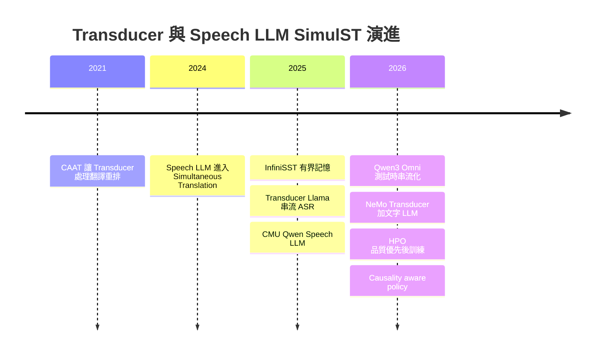
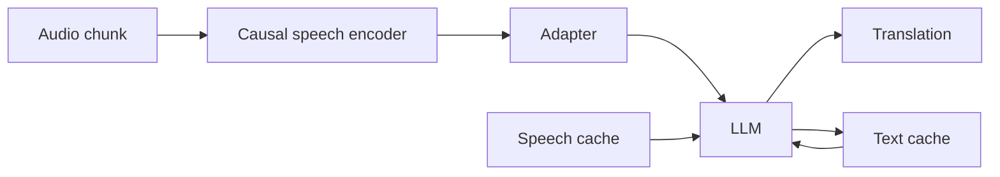
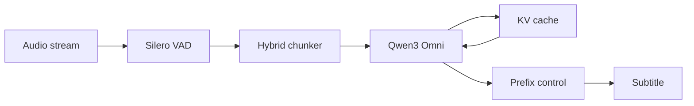
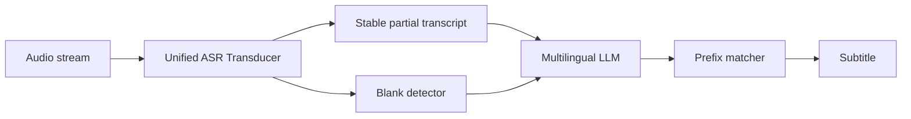
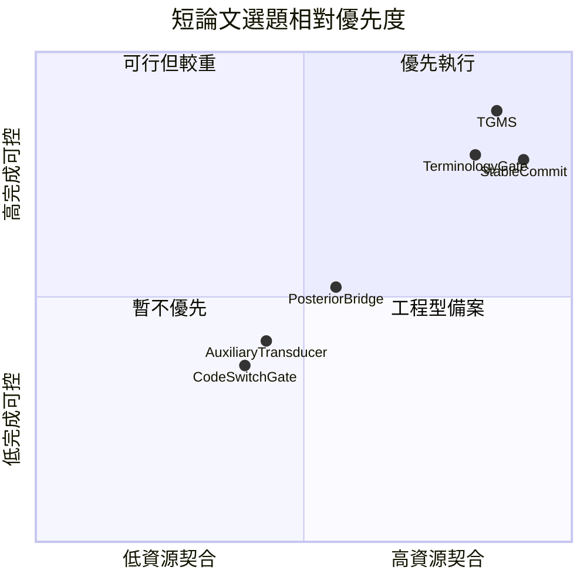

# Multimodal Speech LLM × SimulST／StreamST 第二輪深度研究報告：Zipformer2 Transducer 的結合路線、研究缺口與短論文選題

**研究基準日：2026-10-20，Asia/Taipei。**

本輪直接承接你在第一輪建立的 SimulST／StreamST 系統邊界、評測框架與路線分類，不重做第一輪的問題定義、入門 survey 與完整技術 taxonomy。本文所稱「第一輪」同時指你提供的附件版本與 GitHub 最新版本；附件版本基準日為 2026-10-10，GitHub 版本基準日為 2026-10-11。fileciteturn0file0 fileciteturn1file0

你的資源條件以下統一解讀為：**一位碩士生、約兩張 GPU、每張可用顯存按你提供的約 32 GB 規劃；不假定確切型號，也不自行把 H100／A100 的 GPU-hour 換成你的卡。**資料集仍待確認。目標會議、年份及截稿日目前仍是未填 placeholder；依你的明確要求，本文**不搜尋、不推測** deadline，因此投稿節只能做相對時程，不能假造絕對日期。

本文最重要的結論先寫在前面：

> **【推論】目前最值得你做成四頁短論文的題目，不是「把 Zipformer2 接到 LLM」本身，而是把 streaming Zipformer Transducer 當成一個便宜、可因果運作的 temporal controller／acoustic evidence side-channel，用它決定 multimodal Speech LLM 何時值得被喚醒、何時切 chunk、何時 commit 字幕；真正翻譯內容仍由 audio-native Speech LLM 生成。**
>
> 原因是「Transducer ASR → text LLM」在 NVIDIA NeMo IWSLT 2026 已經被直接做過；「Transducer + LLM」在 streaming ASR 也已有 Transducer-Llama；RNN-T 類模型甚至早已有 direct simultaneous translation 的 CAAT。新的問題應是：**Transducer 能不能當 Speech LLM 的低成本時間控制器，而不是再當一次 transcript generator？** citeturn15search3turn10search11turn10academia49


## 與第一輪報告的出入

對應你要求的 **§0**。

第一輪的整體方向沒有根本錯誤，但深挖後有幾個地方應該修正或細分。尤其附件版與一天後的 GitHub 版之間，本身就已有研究優先順序的更新：附件偏向 R1／R2／R5，GitHub 版已將「有界記憶 Speech LLM」與「context／terminology」提升為第二輪重點。fileciteturn0file0 fileciteturn1file0

| 第一輪判斷 | 第二輪修正 | 判斷 |
|---|---|---|
| Speech LLM SimulST 是「快速成長偏早期」 | 仍成立，但已不能只當成單一路線。至少應拆成 **speech encoder + text LLM、native multimodal LLM test-time streaming、learned WAIT policy、bounded-memory Speech LLM、RL post-training** 等子路線；2026 年已出現多個正式 IWSLT 系統。 | 【共識】citeturn15search1turn15search4turn9search8 |
| Cascade 與 Speech LLM 是相對分離的路線 | 現在最強實務系統之一已是 **streaming Transducer ASR + multilingual LLM**。NeMo IWSLT 2026 使用 dual-mode Unified ASR Transducer，並以連續 blank token 做 end-of-utterance 判斷，再接 Qwen 系列 LLM 與 prefix matching。 | 【單篇】citeturn15search3turn20view5 |
| Transducer 主要屬 streaming ASR／direct ST 的傳統機制 | 過度簡化。CAAT 已證明 RNN-T 類型架構可以直接用在 SimulST，且特別因應翻譯重排序而放鬆 ASR 式的強單調假設並加入 latency loss。 | 【單篇】citeturn10search11turn10search7 |
| 「Zipformer2 + Speech LLM」可能是一個本身就很新的整合 | **不應以「接起來」作 novelty。** Transducer-Llama 已在 streaming ASR 將 LLM 納入 Factorized Transducer；NeMo 又已把 Transducer ASR 接 LLM 做 SimulST。因此投稿主張必須落在**兩者如何互相控制或共享不確定性**。 | 【共識】citeturn10academia49turn15search3 |
| Speech LLM 要做 SimulST，通常需要專門 SimulST fine-tuning | 已過時。IWSLT 2026 的 Test-Time Adaptation 工作直接把 offline Qwen3-Omni 透過 VAD segmentation、multi-turn prompting、response prefilling 與 KV cache 轉成 SimulST，**不做 SimulST fine-tuning**。 | 【單篇】citeturn15search1turn22view3 |
| 長串流最大的 LLM 問題主要是 cache 爆掉 | 仍正確但不完整。現在更具體地是 **speech segmentation、KV cache、LLM invocation frequency、commit policy、prefix stability、跨語言重排序**共同決定 computation-aware latency；尤其 En→Zh 的重排序會明顯破壞 prefix stability。 | 【共識】citeturn14search0turn20view5turn22view0 |
| RL／policy optimization 是值得探索的自然下一步 | 科學上成立，但對你目前資源**不適合作第一題**。HPO 的一個正式報告 run 約使用三個節點、每節點八張 H100，其中一次約二十小時，也就是約四百八十 H100 GPU-hours。 | 【單篇】citeturn19view7 |
| 評測可以先看平均 latency | 第一輪已警告這件事，第二輪證據更強：近期工作直接指出平均 latency 會遮蔽 skew 與 tail events，且 computation-aware latency 的實作細節本身就會扭曲比較。 | 【共識】citeturn21view5turn21view19 |

**【推論】最重要的概念修正是下面這句：**

**Zipformer2／Transducer 和 multimodal Speech LLM 不需要競爭「誰負責翻譯」。最有研究價值的組合，可能是讓 Transducer 負責便宜且高頻率的聲學時間判斷，讓昂貴的 Speech LLM 負責低頻率但語意較強的翻譯。**

這其實非常符合你兩張中階到高階 GPU、一個碩士生、四頁短論文的限制：與其重訓完整 Speech LLM，不如固定 backbone，只改一個乾淨的 streaming control mechanism。


## 路線全景與失敗方向

對應你要求的 **§1 與 §4**。第一輪 §1–§3 已建立整體 SimulST taxonomy；這裡只畫「Transducer × Speech LLM」這條支線。

**時間線的節點**：CAAT、Speech LLM simultaneous systems、InfiniSST、Transducer-Llama、Qwen3 Omni test-time streaming、NeMo Transducer LLM、HPO、causality-aware policy。  
**邊**：時間先後，以及 Transducer、Speech LLM、test-time adaptation、policy optimization 逐步合流；不表示後者取代前者。



【共識】技術的演進不是「RNN-T → LLM，舊方法死亡」，而是原先分離的三個問題開始合流：**因果音訊編碼、何時輸出、如何利用強語言模型。**CAAT 處理 Transducer translation alignment；InfiniSST 處理 unbounded speech 與 cache；2026 年的 multimodal foundation model work 則顯示 offline audio LLM 可以只靠 inference policy 變成 simultaneous system。citeturn10search11turn14search0turn15search1

### 哪些方向已經有前例，因此不能當你的主要 novelty

| 想法 | 已有最接近證據 | 對你的影響 |
|---|---|---|
| Streaming Transducer ASR 後接 LLM 翻譯 | NeMo IWSLT 2026 已直接使用 Unified ASR Transducer + multilingual LLM。citeturn15search3 | 【共識】「Zipformer2 + LLM cascade」本身不夠新。 |
| 在 Transducer predictor 中塞強 LLM | Transducer-Llama 已研究 Factorized Transducer 與 LLM。citeturn10academia49turn10search1 | 【單篇】若做，必須明確超越 ASR predictor integration。 |
| Transducer 直接生成翻譯 | CAAT 已做 RNN-T-style SimulST。citeturn10search11 | 【單篇】不能把「Transducer for ST」當新點。 |
| Speech LLM + causal speech encoder + adapter | CMU、InfiniSST 已有。citeturn15search7turn14search0 | 【共識】單純換 encoder 為 Zipformer 需要更強理由。 |
| Offline multimodal model 不微調直接串流 | IWSLT 2026 Test-Time Adaptation 已做。citeturn15search1turn22view0 | 【單篇】單純 wrapper 也不夠新。 |
| Speech LLM 內部學 WAIT | CUHKSZ 使用 Qwen3-Omni 與 `<wait>` 類 decision。citeturn15search4turn20view3 | 【單篇】不能只新增 WAIT token。 |
| 用 RAG／glossary 幫專業術語 | RASST、MLLP IWSLT 2026 等已有。citeturn21view11 | 【共識】新點應是「何時允許 context 影響輸出」等更細機制。 |

### 被證據否定、弱化或逐步放棄的做法

這裡的「放棄」不是指全領域永久不用，而是已有論文直接指出限制、後續方法有意避免，或該設計不再適合當主方案。

| 方向 | 發生什麼問題 | 證據 | 結論 |
|---|---|---|---|
| 把 ASR 的嚴格單調 RNN-T 假設原樣搬到翻譯 | Target language 有重排序，來源時間與目標 token 不能強迫一對一單調前進；CAAT 因此加入 cross-attention 並放鬆限制。 | citeturn10search11 | 【單篇】直接照搬 ASR transducer 不合理。 |
| 直接把很強 LLM 換進 RNN-T predictor | Transducer-Llama 報告直接以 strong LLM predictor 做 RNN-T optimization 的增益有限，後改採 weak-to-strong LM swap 加 MWER。 | citeturn10academia49 | 【單篇】「模型變大就會好」被實驗否定。 |
| 每次新 chunk 都重算全部 speech 與 text history | 長 stream 會造成不斷增加的計算；InfiniSST 以 multi-turn representation 和 sliding KV cache 避免。 | citeturn14search0turn18view3 | 【共識】full recomputation 不適合長課堂。 |
| 單一 latency reward 強迫越早越好 | HPO 指出這種 reward 容易讓模型不顧 correctness 提前翻，因而採 hierarchical quality-before-latency reward。 | citeturn19view7 | 【單篇】延遲 reward 必須受 quality gate 約束。 |
| 只靠固定 chunk 或只靠停頓切音訊 | Test-Time Adaptation 使用 pause evidence 加 minimum／maximum duration 的 hybrid segmentation，因自然 pause 不一定在需要時出現。 | citeturn22view3 | 【單篇】純 VAD 或固定 chunk 都值得被 adaptive gate 取代。 |
| 只報 mean latency | 近期 latency work 指出平均值會隱藏 skew、極端停頓與 burst。 | citeturn21view5turn21view19 | 【共識】至少要補 tail 或 distribution。 |
| 對大型 multimodal model 全參數微調 | CUHKSZ 凍結 audio encoder、用 LoRA 調 LLM，而非全模型重訓；這是其工程選擇。 | citeturn20view0 | 【單篇】不是證明 full FT 一定錯，但對你的資源更無理由優先。 |

### 為什麼 Zipformer Transducer 特別值得放在「控制層」

icefall 的官方 streaming Zipformer recipe 本來就是 streaming transducer：Zipformer encoder、stateless decoder 與 joiner，搭配 pruned RNN-T loss；官方也提供 supervised fine-tuning 與 parameter-efficient adapter 路徑。citeturn0search0turn0search5turn8search3turn8search5

【推論】因此它天然可以低成本連續產生至少三類訊號：

| 可取得訊號 | 不必把它當最終 transcript 的用法 | 對 Speech LLM 的用途 |
|---|---|---|
| blank run duration | 是否仍在持續等待聲學資訊 | 判斷是否可能出現局部語意邊界 |
| nonblank emission event | 是否聽到新的可辨識資訊 | 只有資訊有進展時才呼叫 Speech LLM |
| partial hypothesis stability | 最近來源 prefix 是否劇烈改變 | 決定 translation prefix 是否適合 commit |
| token posterior 或 top-k uncertainty | 上游對某位置是否不確定 | 避免把單一錯誤 transcript 強制送給 LLM |
| encoder state change | 聲學表示是否真的有新資訊 | 作 adaptive chunk trigger 的候選訊號 |

NeMo 2026 已經直接用「連續 transducer blank」做 end-of-utterance 偵測，這使上述方向不是憑空猜測；真正尚未在本輪 primary-source 檢索中找到的是：**將 Transducer 只當 control channel，翻譯本身仍由 audio-native multimodal LLM 完成。**citeturn15search3turn20view5


## 近十八個月文獻盤點

對應你要求的 **§2**。

**核心日期窗口**：2025-04-20 至 2026-10-20。若論文先有較早 arXiv、但在此窗口正式出版，表中以正式出版月份為準並註明預印本可能更早。CAAT、Transducer-Llama、EASiST 等與題目高度相關但落在窗口外者，不計入下表的核心篇數，而放到 prior-work 分析使用。

**實際查詢式包括：**

```text
"simultaneous speech translation" "speech LLM"
"streaming speech translation" "multimodal LLM"
"simultaneous speech translation" Qwen
"unbounded speech translation" LLM
"test-time" "simultaneous speech translation" multimodal
"Zipformer transducer LLM speech translation simultaneous streaming"
"RNN-T transducer speech LLM simultaneous speech translation"
"transducer guided LLM streaming speech translation confidence timing"
"Zipformer LLM audio projector speech language model"
site:aclanthology.org/2025.iwslt "simultaneous speech translation"
site:aclanthology.org/2026.iwslt "simultaneous speech translation"
```

**篩選規則**：【推論】納入直接 SimulST／StreamST、Speech LLM architecture、latency policy／evaluation，或對 Zipformer–LLM bridge 有直接方法意義的 primary source；只列實際打開過的英文 ACL Anthology／arXiv／IEEE 原文。純搜尋摘要不進核心表。與 SimulST 相鄰但不是 speech-to-text simultaneous 的 paper，會明確標記其角色。第一輪已開啟原文清單亦作交叉核對。fileciteturn1file0

### 核心論文

| 論文與原文 URL | 月份 | 機制 | 資料集／條件 | 主要數字 | 相較 prior | 開源狀態 |
|---|---:|---|---|---|---|---|
| CUNI IWSLT 2025 — https://aclanthology.org/2025.iwslt-1.41/ citeturn21view0 | 2025-07 | Whisper offline model 串流化；AlignAtt；cascade + EuroLLM；context prompting | IWSLT long-form | 開發設定相較 organizer baseline，部分方向約 +2 BLEU，En→De／Zh／Ja 約 +13–22 BLEU | 【單篇】展示 offline speech/LLM 也能組成長串流 | paper；相關 SimulStreaming 開源 |
| MLLP-VRAIN IWSLT 2025 — https://aclanthology.org/2025.iwslt-1.35/ citeturn21view1 | 2025-07 | Whisper Large-v3-Turbo + NLLB；prefix training；wait-k／RALCP | ACL60/60 | BLEU 31.96；non-CA StreamLAAL 2.94 s；preliminary test BLEU 29.8 | 【單篇】強調 stable prefix 與 buffer | system code 未在本輪驗證 |
| NAIST IWSLT 2025 — https://aclanthology.org/2025.iwslt-1.39/ citeturn21view2 | 2025-07 | Whisper encoder + compressive projector + Qwen；Local Agreement；online SHAS | IWSLT 2025 | 本輪已開原文但未安全抽取單一可跨條件主數字，因此不補猜 | 【單篇】Speech encoder 與 LLM bridging | 未驗證官方 repo |
| CMU IWSLT 2025 — https://arxiv.org/abs/2506.13143 citeturn15search7 | 2025-06 | chunkwise-causal wav2vec + adapter + Qwen2.5-7B | ACL60/60 dev | En→Zh BLEU 44.3；CA-StreamLAAL 2.739 s；En→De BLEU 25.1；CA 2.306 s | 【單篇】把 Speech LLM 正式推到 unsegmented streaming | 未驗證獨立 repo |
| InfiniSST — https://arxiv.org/abs/2503.02969 citeturn14search0turn19view4 | 2025-07 formal | causal speech encoder + adapter + Llama 3.1 8B；multi-turn；sliding KV | MuST-C En→Es／De／Zh | 相近品質下 CA latency 約降低 0.5–1 s | 【單篇】明確處理 unbounded history | https://github.com/LeiLiLab/InfiniSST |
| StreamUni — https://arxiv.org/abs/2507.07803 fileciteturn1file0 | 2025-07 | unified large speech-language model；speech CoT；generation／truncation policy | multilingual ST | 本輪不以其非 streaming generation-off ablation 當 SimulST 主數字 | 【單篇】把 transcription／translation／policy 放同一模型 | repo 未驗證 |
| Going Beyond Your Expectations in Latency Metrics — https://aclanthology.org/2025.findings-acl.937/ citeturn21view5 | 2025-07 | latency distribution analysis | SimulST systems | 主結論是 mean latency 隱藏 skew 與 extreme delay；無單一翻譯主分數 | 【單篇】將 tail behavior 拉進評估 | evaluation work |
| CA*: Addressing Evaluation Pitfalls — https://aclanthology.org/2025.findings-naacl.393/ fileciteturn1file0 | 2025-05 | computation-aware timeline correction | SimulST evaluation | 無單一模型品質主數字 | 【單篇】修正 naive CA latency 累加問題 | evaluation work |
| Better Late Than Never — https://arxiv.org/abs/2509.17349 citeturn21view19 | 2025-09 | latency metric meta-evaluation；YAAL／LongYAAL | long-form SimulST | 無單一翻譯主分數 | 【單篇】顯示 metric 本身會影響系統排名解讀 | OmniSTEval 生態可用 |
| Simulstream — https://arxiv.org/abs/2512.17648 fileciteturn1file0 | 2025-12 | streaming system evaluation／demo framework；revision support | generic streaming ST | 工具論文；不以 BLEU 當核心主數字 | 【單篇】補 SimulEval 在 revision 等場景限制 | https://github.com/hlt-mt/simulstream |
| RASST — https://arxiv.org/abs/2601.22777v1 fileciteturn1file0 | 2026-01 | speech-to-text cross-modal retrieval；terminology prompting | terminology SimulST | 本輪採 v1，不混用後續摘要增益數字 | 【單篇】從 partial speech 直接找 context | repo 未驗證 |
| Hikari — https://arxiv.org/abs/2603.11578v2 fileciteturn1file0 | 2026-09 v2 | causal alignment；WAIT token；Decoder Time Dilation | IWSLT 2026 ACL Test En→De | BLEU 29.1；COMET 0.79；CU latency 1.4 s；CA 1.6 s | 【單篇】把 READ 與 WRITE 併入生成 vocabulary | repo 未驗證 |
| Hierarchical Policy Optimization — https://arxiv.org/abs/2604.21045 citeturn9search8turn19view7 | 2026-04 | GRPO；quality-before-latency hierarchical reward | YODAS subset；ACL60/60；RealSI | 約 1.5 s average latency 時，相較 strongest baseline 約 +7 COMET；+1.25 MetricX；+4 BLEURT | 【單篇】從 SFT 進一步 RL post-training | https://github.com/owaski/HPO |
| CUHKSZ IWSLT 2026 — https://aclanthology.org/2026.iwslt-1.13/ citeturn15search4turn20view3 | 2026-07 | Qwen3-Omni；LoRA；internal WAIT；bounded history | IWSLT 2026 dev | En→Zh low BLEU 40.5；XCOMET-XL 73.5；CA 1.95 s；high BLEU 42.1；CA 2.16 s | 【單篇】native multimodal LLM 直接學 simultaneous decision | system repo 未驗證 |
| NeMo IWSLT 2026 — https://aclanthology.org/2026.iwslt-1.23/ citeturn15search3turn20view5 | 2026-07 | Unified ASR Transducer + Qwen；blank-run endpoint；prefix matching | IWSLT 2026 dev | En→Zh low WER 6.63；BLEU 42.04；COMET 82.15；CU-LongYAAL 1879 ms | 【單篇】非常接近你的 Transducer + LLM 問題 | NVIDIA NeMo／公開 Parakeet model |
| MLLP-VRAIN IWSLT 2026 — https://aclanthology.org/2026.iwslt-1.24/ citeturn21view11 | 2026-07 | Parakeet + Qwen3.5；adaptive black-box policy；RAG；ASR word boosting | IWSLT 2026 | MCIF En→De 約 +5.82 XCOMET-XL 相較前一年；context 約 +1.03 | 【單篇】把 terminology/context 帶入強 cascade | repo 未驗證 |
| Test-Time Adaptation — https://aclanthology.org/2026.iwslt-1.27/ citeturn15search1turn22view0 | 2026-07 | Silero VAD + Qwen3-Omni；multi-turn；prefill；KV cache；無 SimulST training | MCIF；IWSLT Czech dev | En→De low COMET 0.8884；LongYAAL 1982 ms；baseline 0.7656／1809 ms | 【單篇】offline foundation model 純 test-time 轉 SimulST | baseline repo https://github.com/owaski/iwslt-2026-baselines |
| Pinch-AST — https://aclanthology.org/2026.iwslt-1.30/ citeturn21view12 | 2026-07 | off-the-shelf ASR + LoRA MT；ASR-noise augmentation；character LCP | IWSLT 四語向 | 全 pipeline 在單張 H100 80GB 達 real-time budget；摘要未提供單一通用 quality 主數字 | 【單篇】以 character LCP 改善 CJK stability | repo 未驗證 |
| IWSLT 2026 Findings — https://aclanthology.org/2026.iwslt-1.39/ fileciteturn1file0 | 2026-07 | official long-form benchmark | ACL Test 等 | En→Zh high：NEMO BLEU 47.64／CU 28.3 s；MLLP BLEU 50.03／CU 4.8 s／CA 5.2 s | 【單篇】說明「品質第一」與「延遲第一」可能不是同一系統 | official evaluation |
| AlignAtt4LLM — https://arxiv.org/abs/2606.03967 citeturn21view15 | 2026-06 | Qwen ASR forced alignment + decoder-only LLM；attention replay | IWSLT En→De／It／Zh | 低延遲約 2 s、高延遲低於 4 s 的設定優於其比較 baseline；本輪不補猜未抽出的 score | 【單篇】把 AlignAtt 概念帶入 decoder-only LLM | repo 未驗證 |
| MCIF — https://arxiv.org/abs/2507.19634v1 fileciteturn1file0 | 2025-07 | scientific-talk multimodal benchmark | scientific talks；paper context 等 | benchmark paper；沒有單一 SimulST 模型主分數 | 【單篇】提供 conference／EMI-like context research substrate | dataset benchmark |

上表核心集已超過你建議的二十篇。另有幾篇**窗口邊界但對你的題目極重要**：

| 邊界 prior | 日期關係 | 為何一定要讀 |
|---|---|---|
| Cross Attention Augmented Transducer Networks for Simultaneous Translation — https://aclanthology.org/2021.emnlp-main.555/ | 較舊 | 【單篇】直接證明 Transducer 可做 SimulST，且需處理 target reordering。citeturn10search11 |
| Transducer-Llama — ICASSP 2025 | 約在嚴格十八個月窗口前數日 | 【單篇】streamable Factorized Transducer 與 LLM integration；相較 strong FT 約 17% relative WER reduction，相較 RNN-T 約 32%。citeturn10academia49turn10search1 |
| Efficient and Adaptive Simultaneous Speech Translation with Fully Unidirectional Architecture — https://arxiv.org/abs/2504.11809 | 2025-04-16；比窗口起點早數日 | 【單篇】fully causal encoder + LLM + explicit read/write policy，是你若改做 joint architecture 時的近鄰。 |

**CSV 版：**

```csv
title,year,month,url,mechanism,dataset,main_metric,main_number,diff_from_prior,code_url,source_type
Simultaneous Translation with Offline Speech and LLM Models in CUNI Submission to IWSLT 2025,2025,07,https://aclanthology.org/2025.iwslt-1.41/,Whisper;AlignAtt;EuroLLM;context,IWSLT long-form,BLEU gain,+2 on Cs-En;+13 to +22 on several En target directions,offline speech and text LLM used for long-form simultaneous translation,https://github.com/ufal/SimulStreaming,primary
MLLP-VRAIN UPV System for the IWSLT 2025 Simultaneous Speech Translation Task,2025,07,https://aclanthology.org/2025.iwslt-1.35/,Whisper;NLLB;prefix training;RALCP,ACL60/60,BLEU;StreamLAAL,31.96;2.94s,stable-prefix cascade with prefix training,NA,primary
NAIST Simultaneous Speech Translation System for IWSLT 2025,2025,07,https://aclanthology.org/2025.iwslt-1.39/,Whisper encoder;compressive projector;Qwen;Local Agreement,IWSLT 2025,main result,not safely extracted,speech encoder to LLM bridge plus long-form segmentation,NA,primary
CMU IWSLT 2025 Simultaneous Speech Translation System,2025,06,https://arxiv.org/abs/2506.13143,chunkwise causal wav2vec;adapter;Qwen2.5-7B,ACL60/60 dev,BLEU;CA-StreamLAAL,44.3;2.739s for En-Zh,unsegmented Speech LLM with causal encoder,NA,primary
InfiniSST Simultaneous Translation of Unbounded Speech with Large Language Model,2025,07,https://arxiv.org/abs/2503.02969,causal speech encoder;adapter;Llama;sliding KV cache,MuST-C En-Es;En-De;En-Zh,CA latency reduction,0.5 to 1s at comparable quality,bounded-memory multi-turn Speech LLM,https://github.com/LeiLiLab/InfiniSST,primary
StreamUni Achieving Streaming Speech Translation with a Unified Large Speech-Language Model,2025,07,https://arxiv.org/abs/2507.07803,unified speech language model;speech CoT;generation;truncation,multilingual ST,main result,not safely extracted,unifies transcription translation and streaming control,NA,primary
Going Beyond Your Expectations in Latency Metrics for Simultaneous Speech Translation,2025,07,https://aclanthology.org/2025.findings-acl.937/,latency distribution analysis,SimulST systems,latency distribution,no single translation number,shows mean latency hides skew and extremes,NA,primary
CA Addressing Evaluation Pitfalls in Computation-Aware Latency for Simultaneous Speech Translation,2025,05,https://aclanthology.org/2025.findings-naacl.393/,computation-aware timing correction,SimulST systems,CA latency,no single translation number,corrects naive serial accumulation of overlapping compute and audio time,NA,primary
Better Late Than Never Meta-Evaluation of Latency Metrics for Simultaneous Speech-to-Text Translation,2025,09,https://arxiv.org/abs/2509.17349,latency meta-evaluation;YAAL;LongYAAL,long-form SimulST,latency metric,no single translation number,tests validity of long-form latency metrics,https://github.com/ufal/OmniSTEval,primary
Simulstream Open-Source Toolkit for Evaluation and Demonstration of Streaming Speech-to-Text Translation Systems,2025,12,https://arxiv.org/abs/2512.17648,streaming framework;revision-aware evaluation,generic StreamST,tool result,no single translation number,adds practical streaming and revision support,https://github.com/hlt-mt/simulstream,primary
RASST Fast Cross-modal Retrieval-Augmented Simultaneous Speech Translation,2026,01,https://arxiv.org/abs/2601.22777v1,cross-modal retrieval;terminology prompting,terminology SimulST,main result,v1 result not mixed with later versions,retrieves domain terminology from partial speech,NA,primary
Streaming Translation and Transcription Through Speech-to-Text Causal Alignment,2026,09,https://arxiv.org/abs/2603.11578v2,WAIT token;causal alignment;decoder time dilation,IWSLT 2026 ACL Test En-De,BLEU;COMET;CU latency;CA latency,29.1;0.79;1.4s;1.6s,learns content and waiting in one generation process,NA,primary
Hierarchical Policy Optimization for Simultaneous Translation of Unbounded Speech,2026,04,https://arxiv.org/abs/2604.21045,GRPO;hierarchical quality before latency reward,YODAS subset;ACL60/60;RealSI,COMET;MetricX;BLEURT,+7;+1.25;+4 at about 1.5s latency,post-trains imperfect SFT policy with quality-gated latency reward,https://github.com/owaski/HPO,primary
CUHKSZ Simultaneous Speech Translation System for IWSLT 2026,2026,07,https://aclanthology.org/2026.iwslt-1.13/,Qwen3-Omni;LoRA;WAIT;bounded history,IWSLT 2026 dev En-Zh,BLEU;XCOMET-XL;CA latency,40.5;73.5;1.95s in low regime,native multimodal LLM learns simultaneous decisions,NA,primary
NeMo IWSLT 2026 Cascaded System for Simultaneous Speech Translation,2026,07,https://aclanthology.org/2026.iwslt-1.23/,Unified ASR Transducer;Qwen;blank endpoint;prefix matching,IWSLT 2026 dev En-Zh,WER;BLEU;COMET;CU-LongYAAL,6.63;42.04;82.15;1879ms,combines dual-mode Transducer ASR with multilingual LLM,https://github.com/NVIDIA/NeMo,primary
MLLP-VRAIN UPV System for the IWSLT 2026 Simultaneous Speech Translation Task,2026,07,https://aclanthology.org/2026.iwslt-1.24/,Parakeet;Qwen3.5;adaptive policy;RAG;word boosting,MCIF En-De,XCOMET-XL gain,+5.82;context +1.03,strong cascade plus contextual terminology,NA,primary
Test-Time Adaptation of an Offline Multimodal Foundation Model for Simultaneous Speech Translation,2026,07,https://aclanthology.org/2026.iwslt-1.27/,Silero VAD;hybrid chunks;Qwen3-Omni;KV cache,MCIF En-De low,COMET;LongYAAL,0.8884;1982ms versus baseline 0.7656;1809ms,no SimulST training required,https://github.com/owaski/iwslt-2026-baselines,primary
Pinch-AST Robust Cascaded Speech Translation System for the IWSLT 2026 Simultaneous Speech Translation Task,2026,07,https://aclanthology.org/2026.iwslt-1.30/,ASR;LoRA MT;ASR noise augmentation;character LCP,IWSLT four directions,runtime,single H100 80GB within real-time budget,character-level stable prefix for robust multilingual streaming,NA,primary
Speech Translation and Metrics in 2026 Findings of the IWSLT Campaign,2026,07,https://aclanthology.org/2026.iwslt-1.39/,official long-form benchmark,ACL Test En-Zh,BLEU;CU-LongYAAL;CA-LongYAAL,NEMO 47.64;28.3s;MLLP 50.03;4.8s;5.2s,officially exposes quality latency divergence,NA,primary
AlignAtt4LLM,2026,06,https://arxiv.org/abs/2606.03967,Qwen ASR alignment;decoder-only LLM;attention replay,IWSLT En-De;En-It;En-Zh,latency,about 2s low;below 4s high,transfers AlignAtt control to decoder-only LLM,NA,primary
MCIF Multimodal Crosslingual Instruction-Following Benchmark from Scientific Talks,2025,07,https://arxiv.org/abs/2507.19634v1,multimodal scientific-talk benchmark,scientific talks;paper context,benchmark,no single SimulST model number,enables context-aware scientific speech evaluation,NA,primary
```


## 方法細節比較

對應你要求的 **§3**。這裡選四篇最影響你選題的工作：**InfiniSST、Test-Time Qwen3-Omni、CUHKSZ Qwen3-Omni、NeMo Transducer + LLM**。前三者代表 Speech LLM 的不同串流化哲學，第四者則是 Zipformer／Transducer 路線最直接的現代 prior。

### InfiniSST

**節點**：audio chunk、causal speech encoder、adapter、LLM、translation、speech cache、text cache。  
**邊**：新音訊經 encoder 與 adapter 送入 LLM；speech/text cache 回饋 LLM；LLM 持續輸出 translation。



【單篇】InfiniSST 不斷重算整段 history，而把 stream 轉成多輪 interaction；speech encoder 只處理新 chunk，LLM 利用 bounded KV cache 保存必要歷史。論文訓練使用單節點八張 L40S，但沒有提供足以換算 GPU-hour 的完整 wall-clock training time。citeturn14search0turn18view3turn19view4

### Test-Time Qwen3-Omni

**節點**：audio stream、Silero VAD、hybrid chunker、Qwen3 Omni、prefix control、subtitle、KV cache。  
**邊**：VAD 提供 pause evidence；hybrid chunker 同時受最小與最大時長控制；每個 chunk 進 Qwen3-Omni；KV cache 保留歷史；prefix control 決定可輸出文字。



【單篇】它最重要的特徵是**不做 SimulST training**。Silero VAD 每小段估 speech probability，再配合 minimum／maximum chunk duration；Qwen3-Omni 以 multi-turn context、assistant-prefix prefilling 與 KV caching 運作。MCIF 分析中，在一組設定下約 79.8% chunk boundary 位於 speech probability 低於 0.5 的 frame。citeturn22view3

這正好留下你的切入口：【推論】**剩下約五分之一邊界並不是自然 pause，而且 pause 本身也不知道翻譯語意是否穩定。Transducer emission／blank trajectory 可以成為 VAD 之外的另一種 causal signal。**

### NeMo Transducer + LLM

**節點**：audio stream、Unified ASR Transducer、stable partial transcript、multilingual LLM、prefix matcher、subtitle、blank detector。  
**邊**：Transducer 產生 partial transcript；blank detector 判斷語音階段；text prefix 送 LLM；translation 經 prefix matcher 後 commit。



【單篇】NeMo 的 dual-mode Unified ASR Transducer 是目前最直接回答你「Transducer + LLM 能不能做 SimulST」的證據：答案是**可以**。它利用連續 blank token 做 end detection，翻譯端則做 prefix matching／LCP。En→Zh 特別麻煩，因中文重排序讓 stable common prefix 不容易快速形成；系統因此需調小 chunk、right context 與 end-of-utterance threshold。citeturn15search3turn20view5

### 四種方法放在同一張表

| 方法 | Speech frontend | LLM／decoder | Streaming policy | 是否需要 SimulST training | 論文硬體資訊 | 主要計算瓶頸 | 主要失敗情境 |
|---|---|---|---|---|---|---|---|
| InfiniSST | causal speech encoder | Llama 3.1 8B | multi-turn + bounded KV | 是 | training：八張 L40S；未報總時間 | speech encoder + autoregressive decoder | 【推論】cache eviction 後跨很遠 context 遺失；synthetic trajectory 偏差。citeturn19view4 |
| Test-Time Adaptation | Qwen3-Omni native audio path；外加 Silero VAD | Qwen3-Omni 30B-A3B | VAD + min/max chunk + wait/generation control | **否** | 本輪原文未找到可安全引用的 inference GPU | large multimodal prefill／decode | pause 不等於 semantic boundary；context 持續長大；En→Zh trade-off 不一定全面改善。citeturn22view0turn22view3 |
| CUHKSZ | Qwen3-Omni audio encoder | Qwen3-Omni 30B-A3B | fixed chunk + learned WAIT + output guard | 是；LoRA | training：八張 A100；三 epochs；沒有 wall-clock | large MoE multimodal model | synthetic supervision bias；單字輸出／repetition 需額外 guard。citeturn20view0turn20view3 |
| NeMo | Unified ASR Transducer | Qwen3 或 Qwen3.5 text LLM | blank endpoint + prefix matching | ASR／LLM 使用既有 pretrained models；系統調參 | 本輪 paper 未提供足以推完整 training GPU-hour 的 wall-clock | ASR decoding + repeated LLM translation | transcript error propagation；En→Zh reorder 造成 LCP 卡住。citeturn15search3turn20view5 |

**【共識】這四種方法共同揭露一個核心事實：SimulST 的延遲並非只有「模型快不快」，而是 segmentation、model invocation、prefix stability 與 computation/cache 一起決定。** citeturn14search0turn15search1turn15search3

**【推論】因此 Zipformer2 最有價值的位置不是取代 Qwen3-Omni 的 audio encoder，而是加入一層「便宜且高頻的 streaming observation」，讓大型模型不必固定每個 chunk 都跑。**

這和直接 cascade 的差別如下：

| 架構 | LLM 最終看到什麼 | ASR 錯誤是否成為翻譯唯一來源 | 你的研究空間 |
|---|---|---|---|
| 標準 Transducer cascade | transcript | 是 | 已有 NeMo，novelty 低 |
| Multimodal LLM | raw／encoded audio | 否 | 已有多篇 |
| **Transducer-gated multimodal LLM** | **audio；Transducer 只提供 timing／confidence signal** | **否** | **本輪未找到直接相同 primary prior；最值得驗證** |
| Posterior bridge | audio 或 transducer posterior embedding | 否，但 model 會看到 ASR uncertainty | novelty 較高；實作風險也高 |


## 基線與可復現性

對應你要求的 **§5**。

### 可靠開源組件

| 元件 | 官方實作／模型 | 可復現程度 | 常見坑 |
|---|---|---|---|
| Zipformer／streaming Transducer | https://github.com/k2-fsa/icefall citeturn0search0turn0search5 | 高；有正式 streaming recipe | recipe、checkpoint、chunk context、decoding method 不同會改 WER；不要只說「Zipformer」。 |
| InfiniSST | https://github.com/LeiLiLab/InfiniSST fileciteturn4file0 | 中高；官方 repo 已確認 | paper 使用八張 L40S 訓練；不代表你適合重訓。 |
| NVIDIA NeMo | https://github.com/NVIDIA/NeMo | 高於一般 system paper | 2026 system 還包括 endpoint、LLM prefix matching 與不同 Qwen；不是下載 ASR checkpoint 就復現完整 SimulST。citeturn15search3 |
| IWSLT 2026 baseline | https://github.com/owaski/iwslt-2026-baselines | 高；Test-Time paper 明列 | baseline 是 Qwen3-ASR + Qwen3 text LLM，不是 multimodal Qwen3-Omni。citeturn22view2 |
| Simulstream | https://github.com/hlt-mt/simulstream | 中高 | evaluation version 必須固定，revision 模式與 append-only 模式不能混比。fileciteturn1file0 |
| OmniSTEval | https://github.com/ufal/OmniSTEval | 中高 | LongYAAL／resegmentation 的工具版本要一起報。fileciteturn1file0 |
| CAAT | https://github.com/danliu2/caat | 中；歷史 direct transducer baseline | architecture 年代較早；主要價值是 prior，不建議當第一個工程起點。citeturn10search3 |

icefall 官方目前可核對到的 Zipformer stateless-transducer benchmark包括正常規模模型約六千五百萬參數，在 LibriSpeech test-clean／test-other 的 WER 約為 2.21／4.79；小型模型約兩千三百萬參數時約為 2.42／5.73。這些是 ASR sanity benchmark，不是 SimulST 成績。citeturn0search0

| Zipformer sanity target | 論文／官方值 | 本報告建議的成功門檻 | 性質 |
|---|---:|---:|---|
| LibriSpeech test-clean WER | 2.21 | ≤ 2.41 | 【推論】若重跑 recipe，允許約 0.20 absolute 差異 |
| LibriSpeech test-other WER | 4.79 | ≤ 5.09 | 【推論】允許約 0.30 absolute 差異 |
| 若直接使用官方 checkpoint decode | 應近官方結果 | 【推論】若偏超過 0.10–0.15 absolute，優先檢查 feature／decode／checkpoint 而非模型理論 | sanity test |

【單篇，工程證據】icefall issue 中也有 Zipformer2 CTC 在特定資料上訓練困難、Transducer 卻成功的案例；這不能當學術定論，但提醒你不要為了「多一個 head」就假設 CTC 比 RNN-T 更容易穩定。citeturn0search2

### 我建議先復現哪一篇

**第一個 paper baseline：Test-Time Adaptation of an Offline Multimodal Foundation Model for Simultaneous Speech Translation。**

理由不是它最強，而是它和推薦題目的變數控制最乾淨：

> baseline = Silero VAD／hybrid segmentation + Qwen3-Omni  
> proposal = Zipformer Transducer gating + **同一個 Qwen3-Omni**

因此只改 segmentation／trigger mechanism，審稿人很容易看懂 contribution。論文也不要求你先做 SimulST fine-tuning。citeturn15search1turn22view3

第二個 component baseline 才是 icefall streaming Zipformer，確認 Transducer signal 正常；第三個才考慮 NeMo cascade 作「使用 transcript 的對照」。

### 復現成功判準

| Baseline | 對到原文的數字 | 建議復現門檻 | 為什麼 |
|---|---|---|---|
| Test-Time Adaptation En→De low | five-fold：COMET 0.8884；CU-LongYAAL 1982 ms。citeturn22view0 | COMET 差 ≤ 0.015；CU latency 差 ≤ 200 ms | 【推論】足以判斷 pipeline／scoring 沒有嚴重錯誤；CA latency 硬體不同不能硬對。 |
| Test-Time official cascade baseline | COMET 0.7656；CU 1809 ms。citeturn22view0 | 同上 | 可先確認 evaluation stack，再跑昂貴 Qwen3-Omni。 |
| NeMo En→Zh low | WER 6.63；BLEU 42.04；COMET 82.15；CU-LongYAAL 1879 ms。citeturn15search3 | BLEU ±0.5；若 COMET 用相同尺度則 ±1.0；CU latency ±150 ms | 【推論】主要作 cascade sanity；不能要求 CA latency 跨 GPU 重現。 |
| CUHKSZ En→Zh low | BLEU 40.5；XCOMET-XL 73.5；CA 1.95 s。citeturn20view3 | 不建議列為第一個 full reproduction；先只做 inference sanity | training 用八張 A100，與你的條件不匹配。 |

### GPU 時數目前能算什麼

你要求「論文沒報就不要估」，因此這裡**寧可留下無依據，也不拿 TFLOPS 粗暴換算**。

| 方法 | 論文自述硬體與時間 | 原始 GPU-hour | 換成你的 GPU | 結論 |
|---|---|---:|---|---|
| HPO | 三個節點；每節點八張 H100；單次約二十小時。citeturn19view7 | `3 × 8 × 20 = 480 H100 GPU-h` | `480 × H100有效吞吐 ÷ 你的GPU有效吞吐 × 平行效率修正`；實際比值未量測 | 【共識】**不能給可信單值**；而且遠超第一題合理風險。 |
| InfiniSST | 一節點八張 L40S；未報完整 wall-clock。citeturn19view4 | 無依據 | 無依據 | 不估 |
| CUHKSZ | 八張 A100；三 epochs；未報 wall-clock。citeturn20view0 | 無依據 | 無依據 | 不估 |
| Test-Time Adaptation | 方法本身無 SimulST training | training = 0 | training = 0 | inference GPU-hour 論文未提供足夠依據；不估 |
| NeMo system | 主要使用 pretrained ASR／LLM；本輪未抽到完整 end-to-end training time | 無依據 | 無依據 | 不估 |
| icefall Zipformer | 官方 repo 有訓練工程資訊，但不符合你指定「論文自述時間」的估算規則 | 不採作正式估算 | 不估 | 可供排程經驗，不寫成論文依據 |

**【推論】這反而進一步支持 test-time／control-policy 題目：你的主要成本會是 inference sweep，而不是重新訓練 speech foundation model。**


## 大廠動態與被做掉風險

對應你要求的 **§6**，嚴格聚焦研究基準日前約六個月。

| 公司／玩家 | 已開啟的近期動態 | 與本題距離 | 被做掉風險判斷 |
|---|---|---|---|
| OpenAI | 2026-05-07 推出 GPT-Realtime-Translate，官方描述可把七十多種輸入語言即時翻成十三種輸出語言，場景明列 customer support、education、events 等；官方 realtime 文件也把 live lectures、meetings、subtitle timing、names、numbers、code-switching、accent、overlap 列為 production concerns。citeturn12search3turn12search9 | **非常直接的產品競爭** | 【共識】「做一個 realtime translator app」已不是安全論文 novelty。 |
| Google | 2026-09-04 的官方 Google Translate 更新加入／擴大 near-real-time Live Translate audio，支援大量語言與 background use。citeturn11search0 | 直接產品層 | 【單篇】再次證明通用即時翻譯已商品化。 |
| Meta | 2026-07-06 官方宣布 AI glasses live translation 語言範圍從既有六種擴到約二十種。citeturn11search5 | wearable live translation | 【單篇】portable deployment 已進產品，不宜把「可移動翻譯字幕」當研究新意。 |
| NVIDIA | IWSLT 2026 NeMo 直接做 Unified ASR Transducer + LLM；另有 Interspeech 2026 MoVE 類 AudioLLM expressive S2ST 研究。citeturn15search3turn13search9 | **最直接威脅你的 Zipformer+LLM 敘事** | 【共識】一定要避開「Transducer ASR 接 LLM」這個已存在的主張。 |
| Apple | 本輪官方近六個月來源找到 ICASSP 2026 speech／ML research activity，但**沒有找到可直接對應本題、足以支持 Apple 已公開特定 SimulST 架構的 primary source**。citeturn12search15 | 證據不足 | 【推論】不能寫成 Apple 沒做；只能寫本輪官方公開檢索未找到直接項目。 |
| Alibaba Qwen ecosystem | Qwen3-Omni 已同時出現在 CUHKSZ 與 test-time IWSLT 系統，Qwen3／Qwen3.5 也大量出現在 cascade。citeturn15search4turn15search1turn15search3 | backbone 供應者 | 【共識】模型 backbone 本身很快會更新；不要把論文 novelty 綁死某一代 Qwen。 |

OpenAI 官方在該產品推出時亦公開了每分鐘價格；這使「API 直接解決通用 live translation」的工程門檻繼續下降。價格屬高度時效資訊，因此不應作你論文的長期核心論證。citeturn12search0turn12search3

**【共識】大廠已經把「generic real-time translation」做成產品，所以你的論文 moat 應該放在它們通常不公開、也不容易公平比較的部分：**

- **可重現的 computation-aware policy**
- **小硬體條件下的 inference efficiency**
- **什麼時候才值得叫 multimodal LLM**
- **字幕 commit／revision stability**
- **專業術語在「尚未講到」與「剛被聲學證據支持」之間的控制**
- **臺灣 EMI／En→zh-Hant 的透明 benchmark**

上述是【推論】，不是說商業系統一定做不到，而是它們目前的公開產品資料不足以形成可重現 academic baseline。citeturn12search9turn11search0


## 未解問題與具體題目

對應你要求的 **§7**。排序刻意偏向**四頁短論文：一個乾淨 contribution、一個主要資料集、一條清楚 causal story**，而不是一次做完整產品。

由於你尚未填 deadline，下面的「能否趕上」只能依**相對工程範圍**排序，不會假裝知道距截稿還有幾週。

### 題目排序

| 排名 | 題目 | 核心 novelty | 與兩張約 32GB GPU 契合 | 短論文完整性 | 最大風險 |
|---:|---|---|---|---|---|
| 1 | **Transducer-Gated Multimodal SimulST** | Zipformer Transducer 只當 temporal controller；翻譯仍 audio-native | 高 | **最高** | Qwen3-Omni 是否能在你的實際 VRAM/runtime 可靠跑 |
| 2 | **Evidence-Gated Terminology Context** | 只有出現聲學／Transducer evidence 時才把 glossary／RAG term 激活 | 高 | 高 | terminology benchmark／reference 建置 |
| 3 | **Transducer-Aware Stable Commit** | blank／stability signal + LLM prefix agreement 控制字幕 commit | 很高 | 高 | novelty 比第一題弱 |
| 4 | **Posterior Bridge from Zipformer to LLM** | 把 RNN-T posterior uncertainty 轉成 soft LLM conditioning，而非一最佳 transcript | 中 | 中 | vocab／time alignment engineering |
| 5 | **Auxiliary Transducer Alignment for Speech LLM** | Speech LLM training 同時保留 RNN-T head 作 monotonic acoustic clock | 中低 | 中低 | 需要 joint training |
| 6 | **EMI Code-Switch Aware SimulST Gate** | multilingual Transducer evidence 控制 code-switch prompting 與 term preservation | 資料不確定 | 中低 | 目前資料集待確認 |
| 7 | **HPO-style Quality-Latency Post-training** | 把 policy RL 壓到小模型 | 低 | 低 | 原版計算量過大 |

**quadrant 的節點**：上述前六個題目。  
**座標意義**：x 軸是與你硬體、人力、四頁範圍的契合；y 軸是「在相對截稿週期內形成完整短論文故事」的可控性。座標是本研究的**選題判斷值，不是實驗數據**。



### 推薦第一題：Transducer-Gated Multimodal SimulST

**研究問題**

【推論】現有 multimodal SimulST 常以固定 chunk、VAD 或 LLM 自身 WAIT policy 決定何時呼叫昂貴模型；但「聲音有沒有停」與「翻譯所需資訊是否已增加」不是同一件事。Streaming Transducer 的 blank／emission／stability trajectory 可能提供更有資訊量、又遠比大型 Speech LLM 便宜的 causal gating signal。Test-Time Qwen3-Omni、CUHKSZ 與 NeMo 分別支持 VAD、learned WAIT 與 Transducer blank 的可行性，但三者尚未形成這種 control-only hybrid。citeturn22view3turn20view3turn20view5

**假設**

> **H1【推論】**：在 translation backbone 固定時，以 streaming Zipformer Transducer 的 blank／emission stability 決定 Speech LLM invocation，可在翻譯品質幾乎不變的條件下降低 LLM 呼叫次數與 computation-aware latency。
>
> **H2【推論】**：由於最終 translation 仍讀 audio，而不是只讀一最佳 transcript，因此它不應承受完整 cascade 的 ASR error propagation。

**最小方法**

`audio → streaming Zipformer Transducer → gate score`

只有 gate 被觸發時，才把從上次 translation event 以來的新 audio chunk 送入 multimodal Speech LLM。Gate 可以先完全不學習，只用三個量：

| 訊號 | 最小實作 |
|---|---|
| blank run | 連續 blank 達門檻 |
| emission | 自上次 LLM call 後至少出現一定數量 nonblank events |
| maximum wait | 不論 gate 狀態，到上限必須呼叫一次，避免永久卡住 |

【推論】第一版**不要訓練 gate neural network**。只有 threshold sweep，就已足以形成一篇「Transducer signal 是否比 VAD／fixed chunk 更好的 triggering mechanism」的乾淨短論文。

**主實驗**

| 項目 | 設計 |
|---|---|
| 主資料集 | 【推論】優先 IWSLT 2026 MCIF／ACL-style En→Zh long-form；前提是你確認可取得。若取得條件不成立，再決定替代，本文不替你假定。 |
| Baseline A | Test-Time Adaptation 的 Silero-VAD hybrid segmentation + 同一 Speech LLM。citeturn22view3 |
| Baseline B | fixed-duration chunk + 同一 Speech LLM |
| Baseline C | 若資源容許，Zipformer transcript → 同系列 text LLM 的 cascade，測 ASR-error trade-off |
| Proposal | Zipformer Transducer gate + audio-native multimodal LLM |
| Quality | XCOMET-XL／COMET + SacreBLEU |
| Latency | LongYAAL／StreamLAAL；另報 computation-aware wall-clock |
| Compute | LLM calls per minute；RTF；GPU busy time；peak VRAM |
| Caption stability | committed tokens；revision characters；p95 inter-update gap |
| Error analysis | reordering；names；numbers；technical terms；false endpoint |

**最接近 prior work**

| Prior | 做了什麼 | 與本題差異 |
|---|---|---|
| Test-Time Adaptation of Offline Multimodal Foundation Model citeturn15search1turn22view3 | Silero VAD + hybrid chunk + Qwen3-Omni，不做 SimulST training | 沒有 Transducer acoustic-event controller |
| NeMo IWSLT 2026 citeturn15search3turn20view5 | Transducer ASR 的 partial transcript 直接成為 text LLM 的翻譯輸入；blank 用於 endpoint | 本題**不把 transcript 當 translation content**；只用 Transducer 控制 audio-native LLM |
| Transducer-Llama citeturn10academia49 | LLM 進入 streaming ASR Transducer predictor | 任務是 ASR，不是 multimodal SimulST control |
| CAAT citeturn10search11 | Transducer 本身直接生成 translation | 本題不讓 Transducer 負責 target translation |

本輪以 `Zipformer transducer LLM speech translation simultaneous streaming`、`RNN-T transducer speech LLM simultaneous speech translation`、`transducer guided LLM streaming speech translation confidence timing`、`Zipformer LLM audio projector speech language model` 等查詢式，**沒有找到 primary paper 完全等同「Transducer 只作 control signal、audio-native multimodal LLM 負責 translation」的架構**。【推論】這是本輪 negative search result，不等於數學意義上的全球不存在。

**兩週 pilot 與放棄判準**

| 時段 | 最小工作 | 成功條件 |
|---|---|---|
| Pilot 前半 | 跑通一個小 long-form dev subset；固定同一 Qwen3-Omni；重現 VAD baseline；streaming Zipformer 僅 inference | baseline 評測與 streaming timeline 可產生；若 Qwen3-Omni 無法在你的硬體穩定推論，第一題立即降級為 Stable Commit 或 cascade-control 題目 |
| Pilot 後半 | 比較 VAD trigger 與 blank/emission trigger；只 sweep 少量 threshold | 至少找到一個 proposal operating point 同時有明顯 compute／latency 優勢而品質近似 |

**具體成立門檻【推論】**

| 指標 | 假設成立 |
|---|---:|
| multimodal LLM invocation 數 | 至少降低 15% |
| computation-aware latency | 至少降低 10% |
| BLEU | 相對 baseline 下降不超過 0.5 |
| XCOMET-XL | 若採 0–100 scale，下降不超過 0.5；若工具採 0–1 scale，等價不超過 0.005 |
| p95 subtitle update delay | 不得惡化超過 10% |

**放棄／改題條件【推論】**：完整 threshold sweep 後，**沒有任何一個 Transducer-gated point 對 VAD／fixed chunk 形成 Pareto 改善**；或者最好 latency gain 低於約 5% 卻損失超過 1 BLEU；或者大型 multimodal backbone 本身無法在你的兩張 GPU 上形成可重現 runtime。此時不應再投入數週「調 threshold 調到贏」，應切到第三題 Stable Commit。

**GPU-hour**

| 部分 | 可否估 |
|---|---|
| Zipformer 重訓 | 【推論】pilot 不重訓，直接 pretrained，因此 training GPU-h = 0 |
| Multimodal LLM fine-tuning | 不做，training GPU-h = 0 |
| inference sweep | 論文沒有提供足以映射到你 GPU 的速度，因此**無依據，不估** |
| 完整實驗總 GPU-h | **無依據，不估** |

### 題目：Evidence-Gated Terminology Context

**假設【推論】**：EMI／conference RAG 最大的風險不是「找不到 term」，而是**太早把尚未說到的 context term 餵給模型，使 LLM 提前幻覺或誤用**。若先由 Zipformer partial emission／posterior 判斷該術語已有 acoustic evidence，再激活 glossary context，可提高 terminology accuracy 又不增加 premature insertion。

Closest prior 是 RASST 的 partial-speech cross-modal retrieval、MLLP 2026 的 ASR word boosting + RAG、CUNI 2025 的 terminology/context prompting。它們都證明 context 有效，但不是同一個 evidence-gated policy。citeturn21view0turn21view11

| 項目 | 設計 |
|---|---|
| baseline | unconditional glossary／RAG；no-context |
| proposal | acoustic-evidence-gated context |
| 主指標 | terminology accuracy；false term insertion；COMET；latency |
| pilot 成立 | term accuracy 至少 +5 percentage points；false-positive term insertion 不增加超過 1 point；CA latency 增加低於 5% |
| 放棄 | term accuracy gain <2 points，或 hallucinated term insertion 明顯增加 |
| GPU-hour | inference／small adapter 的 paper-based時間不足；**無依據，不估** |

**Prior：**RASST、MLLP 2026、CUNI 2025。citeturn21view11turn21view0

### 題目：Transducer-Aware Stable Commit

**假設【推論】**：translation prefix 的 LCP 穩定與 source acoustic stability 應同時滿足；單靠 translation LCP 會在 En→Zh reordering 卡住，單靠 ASR endpoint 又太晚。

最接近的是 NeMo LCP／blank endpoint、Pinch-AST character LCP，以及 Local Agreement 系列。NeMo 特別報告 En→Zh 重排序會降低 stable common prefix，直接提供動機。citeturn20view5turn21view12

| 項目 | 設計 |
|---|---|
| proposal | commit iff LLM prefix stable 且 Transducer source evidence stable |
| baseline | LCP only；blank endpoint only |
| 成立門檻 | revision characters 至少降低 30%；BLEU 損失 ≤0.5；p95 display delay 增加 <200 ms |
| 放棄 | revision gain <10% 或 latency 明顯惡化 |
| GPU-hour | inference-only；paper-based完整換算資料不足，**無依據，不估** |

【推論】這題 novelty 不如第一題漂亮，但成功率可能更高，尤其當 Qwen3-Omni 太重時，可以改成 text LLM cascade 做。

### 題目：Posterior Bridge from Zipformer Transducer to LLM

LegoSLM 的關鍵思想是用 speech model 對 LLM vocabulary 的 posterior 形成 soft pseudo-audio embedding，而不是只給一最佳字串；它在多個 ASR test sets 報告相對 USM-CTC 平均約 49% WER reduction，也支援 speech translation。citeturn21view9

**假設【推論】**：RNN-T joiner／predictor posterior 能保留「可能是 A，也可能是 B」的不確定性，因此相較 1-best transcript cascade，在專名、重音或 partial speech 時可減少 downstream LLM 被錯 transcript 綁死。

| 項目 | 設計 |
|---|---|
| proposal | top-k RNN-T posterior → learned projection → LLM conditioning |
| baseline | 1-best Zipformer transcript → same LLM |
| prior | LegoSLM；Transducer-Llama；CAAT |
| pilot 成立 | 相同 latency 下至少 +1 BLEU 或明顯 entity／term accuracy gain |
| 放棄 | projection training 不穩或 gain <0.3 BLEU 且 entity 無改善 |
| GPU-hour | 新方法沒有對應 paper training time；**無依據，不估** |

【推論】這題在方法 novelty 上可能比第一題還強，但四頁論文的工程風險大得多，因為你同時要處理 vocabulary mapping、temporal alignment、projection training 與 LLM interface。

### 題目：Auxiliary Transducer Alignment for Speech LLM

**假設【推論】**：speech encoder 同時保留 RNN-T auxiliary head，可以把 monotonic acoustic progress 當 training-time regularizer，使 Speech LLM 在 partial audio 上較少 hallucination、較容易決定何時等待。

Closest work 是 CMU causal speech encoder + Qwen、CAAT direct transducer、Transducer-Llama，但本輪沒有找到「RNN-T head 只當 auxiliary alignment clock、translation 由 multimodal LLM 負責」的完全相同 primary work。citeturn15search7turn10search11turn10academia49

| 項目 | 設計 |
|---|---|
| baseline | speech encoder + adapter + LLM |
| proposal | 同 encoder 額外 RNN-T loss；translation path 不經 transcript |
| pilot 成立 | prefix revision 降 ≥20%；BLEU loss ≤0.5 或品質提升 |
| 放棄 | auxiliary ASR loss 只改善 WER、不改善 ST stability／latency |
| GPU-hour | CMU／相關 paper 未提供足夠 wall-clock 可換算；**無依據，不估** |

### 題目：EMI Code-Switch Aware Gate

**假設【推論】**：英文 EMI 裡的英文技術名詞、中文插話、縮寫與 proper nouns 不應全部翻成單一語言；如果 Transducer／language-ID evidence 偵測 source code switch，再動態控制 Speech LLM prompt／copy policy，可改善 terminology preservation。

本輪沒有找到直接滿足「臺灣 EMI + natural code-switch + long-form SimulST + zh-Hant subtitle」的 benchmark，因此這題最大的風險不是模型，而是資料。第一輪亦已把這點列為在地盲區。fileciteturn0file0 fileciteturn1file0

| 項目 | 設計 |
|---|---|
| baseline | 一律翻譯；prompt 要求保留術語 |
| proposal | source evidence 控制 preserve／translate |
| pilot 成立 | term-preservation accuracy 至少 +10 absolute points；COMET／BLEU 不顯著下降 |
| 放棄 | 兩週內無法取得或建出可信 code-switch evaluation subset |
| GPU-hour | **無依據，不估** |

### 為什麼我不推薦先做 HPO

HPO 的結果學術上很吸引人，但一個 run 的自述成本已約為：

| 算式 | 結果 |
|---|---:|
| 節點數 × 每節點 H100 × 小時 | `3 × 8 × 20` |
| H100 GPU-hours | `480` |

citeturn19view7

【推論】而你要做短論文，不需要為了「方法看起來更 ML」就從最昂貴的 RL 開始。你的最佳切口反而是**固定所有大模型，只研究 streaming control**；這樣 reviewer 更容易相信 gain 不是靠增加模型／資料量取得。


## 投稿規劃、搜尋紀錄與研究提案

對應你要求的 **§8**，並包含結尾要求的搜尋紀錄與 one-pager。

### 目標會議目前是阻塞資訊

你明確提供的是：

| 欄位 | 目前內容 |
|---|---|
| 會議名稱 | `〔會議名稱〕`，未填 |
| 年份 | `〔年份〕`，未填 |
| 截稿日 | `〔截稿日〕`，未填 |
| 類型 | 四頁左右短論文，如 ICASSP／Interspeech |

因此我**沒有搜尋或推測 deadline，也沒有自行挑一個 conference 冒充你的 target**。

你要求的「近兩年該會議三篇同路線 accepted papers forensic analysis」因此無法誠實完成，原因不是缺文獻，而是**不知道應該解剖哪個 venue**。

| 論文 | 貢獻類型 | baseline 數 | 資料集數 | 消融實驗數 | 主表欄列 | 多 seed／顯著性 | 分析圖 |
|---|---|---|---|---|---|---|---|
| 阻塞：target venue 未指定 | 不推測 | — | — | — | — | — | — |
| 阻塞：target venue 未指定 | 不推測 | — | — | — | — | — | — |
| 阻塞：target venue 未指定 | 不推測 | — | — | — | — | — | — |

【推論】在 target venue 未填前，能做的合理投稿標準是「四頁 speech conference 風格」：**一個主 contribution、一個主要 long-form dataset、至少兩個直接 baseline、一組 gate／threshold ablation、一張 quality-latency Pareto 圖、一個 failure analysis。**這不是特定 ICASSP／Interspeech 的 acceptance rule，而是依你指定的短文規模給出的研究設計。

### 排名第一題距離可投稿還缺什麼

| 類別 | 最低需求 | 推薦完整版 |
|---|---|---|
| baseline | VAD/hybrid Qwen baseline；fixed-chunk baseline | 再加 Transducer transcript cascade |
| dataset | 一個 long-form En→Zh dataset | 若有餘力再做 En→De，只當 generalization |
| ablation | blank only；emission only；combined gate | 加 maximum-wait threshold sensitivity |
| quality | BLEU + 一個 semantic metric | XCOMET-XL + BLEU |
| latency | CU/CA LongYAAL 或 StreamLAAL | 再加 p50/p95 display update |
| compute | calls per minute；RTF | GPU busy time；VRAM peak |
| stability | 至少 revision／commit metric | 分 reordering／names／terms |
| seeds | threshold-based inference 不一定有 training seed | 若訓練小 gate，至少多 seed 或 bootstrap CI |
| qualitative | 兩到三個例子 | failure taxonomy |

**【推論】四頁短文最不該做的是同時 claim：新 encoder、新 LLM、新 RAG、新 policy、新字幕 UI。**第一題應把 claim 壓到一句：

> **A streaming Transducer can serve as a low-cost acoustic controller for an audio-native multimodal LLM, reducing unnecessary LLM invocations while preserving SimulST quality.**

### 搜尋紀錄與盲區

| 類別 | 本輪使用 |
|---|---|
| 論文資料庫 | ACL Anthology；arXiv；IEEE paper page |
| code | GitHub；icefall；InfiniSST；Simulstream；NVIDIA NeMo |
| benchmark | IWSLT 2025／2026 papers；MCIF；ACL60/60 related work |
| 公司 | OpenAI official；Google official；Meta official；Apple official ML／research；NVIDIA research／IWSLT |
| 第一輪資料 | 2026-10-10 附件；2026-10-11 GitHub 最新版 |

主要查詢式：

```text
"simultaneous speech translation" "speech LLM"
"streaming speech translation" multimodal LLM
"unbounded speech translation" LLM
"Qwen3-Omni" simultaneous speech translation
"test-time adaptation" simultaneous speech translation
"Zipformer transducer LLM speech translation simultaneous streaming"
"RNN-T transducer speech LLM simultaneous speech translation"
"transducer guided LLM streaming speech translation confidence timing"
"Zipformer LLM audio projector speech language model"
"hierarchical policy optimization" simultaneous translation unbounded speech
"latency metrics" simultaneous speech translation
"simultaneous speech translation" terminology retrieval
```

| 盲區 | 影響 |
|---|---|
| **可用資料集尚未確認** | 不能最終決定 En→Zh、EMI、自建資料或 MCIF 是否可做主表。 |
| **你的確切 GPU 型號仍未鎖定** | 不能把 H100／A100／L40S GPU-hour用理論 TFLOPS直接換算。 |
| **目標 conference／year／deadline 未填** | 無法完成該 venue 的三篇 accepted-paper forensic analysis、deadline 倒推與「下一個 venue」選擇。 |
| Qwen3-Omni 在你的實際環境能否以所需量化／runtime 穩定跑 | 是第一題最重要的 Day-zero feasibility gate。CUHKSZ 的正式 inference 環境比你的卡更寬裕，因此不能先假設一定 fit。citeturn20view3 |
| 部分 IWSLT system papers 沒有專用公開 repo | 能讀 paper 不等於可以一鍵復現；本文沒有補猜 repo URL。 |
| 對 control-only Transducer-gated multimodal LLM 未找到直接 prior | 是值得研究的 signal，但「沒搜到」不等於不存在；投稿前仍應再次做 title／citation-chain search。 |
| 商業系統不揭露完整 architecture | 不能說產品一定沒有類似 internal gating；academic novelty 應定義為**公開文獻中可驗證的方法差異**。 |

### 研究提案 one-pager

**暫定題目**

> **Transducer-Gated Multimodal Simultaneous Speech Translation: Efficient Audio-Native Streaming with Acoustic Event Control**

**Problem【推論】**

Multimodal Speech LLM 能直接由 speech 生成翻譯，但頻繁以固定 chunk 呼叫大型模型浪費 computation；VAD 只代表 speech pause，不代表新的 linguistic evidence 是否足以值得 translation update。另一方面，Transducer 能非常便宜地因果處理 streaming speech，並產生 blank、emission 和 prefix-stability signals。

**Method【推論】**

固定 pretrained streaming Zipformer Transducer 與 pretrained multimodal Speech LLM。Transducer **不提供最終 translation transcript**，而只產生 gate：

\[
g_t = f(\text{blank-run}_t,\ \text{emission-count}_t,\ \text{max-wait}_t)
\]

只有在 gate 開啟時才呼叫 multimodal Speech LLM；LLM 本身仍讀 audio。第一篇不學 `f`，只做 deterministic rule，避免把工作量擴成 policy learning。

**核心實驗**

| 問題 | 實驗 |
|---|---|
| gate 能不能減少 compute | calls/min；RTF；CA latency |
| 是不是只是少跑所以翻差 | BLEU；XCOMET-XL |
| Transducer 是否比 VAD 更合理 | matched-quality quality-latency frontier |
| gain 是 blank 還是 emission 造成 | blank-only／emission-only／combined ablation |
| 哪些句子有幫助 | pause-poor、fast speech、reordering、proper names |
| 為何不直接 cascade | 比較 audio-native gate 與 transcript→text-LLM baseline |

**兩週第一里程碑**

> 在一個小 long-form dev subset 上，固定同一 multimodal LLM，完成 fixed chunk、VAD gate、Transducer gate 三條 pipeline。

【推論】**第一 hard gate**：兩週結束時，若 Transducer gate 無法在 BLEU loss ≤0.5 的情況下把 LLM invocation 降至少 15%，或沒有任何 quality-latency Pareto 改善，立刻放棄第一題。

**相對截稿倒推**

因 deadline 尚未填，以下以 `D` 表示投稿日，沒有把任何實際會議日期塞進去。

| 相對里程碑 | 內容 | Hard gate |
|---|---|---|
| D−十二週以前 | environment；dataset；Qwen runtime fit；Zipformer streaming sanity | multimodal backbone 不能穩定跑就立即改做 Stable Commit／cascade |
| D−十週 | **pilot 完成** | **第一題沒有 Pareto signal 就換題，不再調參拖延** |
| D−八週 | Test-Time／VAD baseline 完整復現 | baseline 仍無法可信評測，應改投下一個你指定的場合 |
| D−五週 | 主實驗全部完成 | 此時仍只有 pilot 結果，不應硬投當期 |
| D−三週 | blank／emission／max-wait 消融與 failure analysis | 只補最必要實驗，不再增加新模型 |
| D−二週 | 完整初稿與主圖表 | contribution 必須已能用一句話說完 |
| D−一週 | reviewer-style sanity check；重跑關鍵表格；整理 reproducibility | 不新增大方向 |
| D | submission | — |

**哪個里程碑趕不上就改投下一個場合：**

【推論】**D−八週仍無法完成可信 baseline reproduction，就是最晚的撤退點。**因為四頁短文真正需要時間的不是寫字，而是主表、threshold sweep、CA latency、消融與 failure analysis。D−五週才發現 baseline 有問題，通常已沒有足夠餘裕做一篇乾淨 experimental paper。

由於你明確尚未填入「會議名稱、年份、截稿日」，本文不自行命名「下一個合適場合」，也不以現在的公開 conference calendar 替你做決定。

### 最終研究判斷

**【共識】Zipformer／Transducer 與 multimodal Speech LLM 在 SimulST 是可以結合的，而且其鄰近組合已經有人證明可行。**CAAT 證明 Transducer 能處理 simultaneous translation；Transducer-Llama 證明 streamable Transducer 與 LLM 可深度整合；NeMo 2026 又證明 Transducer ASR + LLM 在實際 long-form SimulST 競賽可達很強結果。citeturn10search11turn10academia49turn15search3

**【共識】因此，單純「Zipformer2 + Transducer + LLM」不再是足夠新穎的 paper idea。**

**【推論】真正適合你條件、也最可能形成四頁乾淨貢獻的研究問題是：**

> **能不能把 streaming Transducer 從「文字中介」改成「低成本時間控制器」，利用它的 blank、emission 與 stability evidence，決定昂貴 multimodal Speech LLM 何時才需要看新音訊與更新字幕？**

這個題目同時對應你原先三種場景：櫃檯需要低 tail latency、會議需要長串流與專名穩定、EMI 需要低成本持續運作與專業術語；但第一篇論文**不需要一次證明三個場景**。對四頁論文而言，一個 long-form 主資料集、一個 gating contribution、一條完整 quality–latency–compute story，反而最接近可以真正做完、說清楚、也讓 reviewer 一眼看懂的新意。
